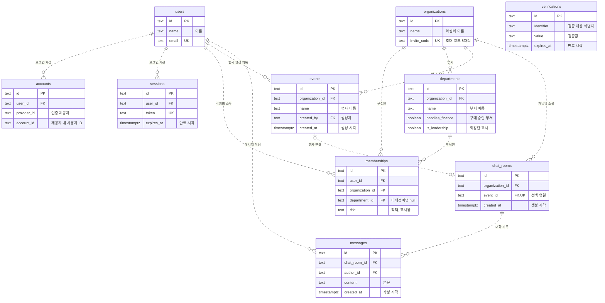
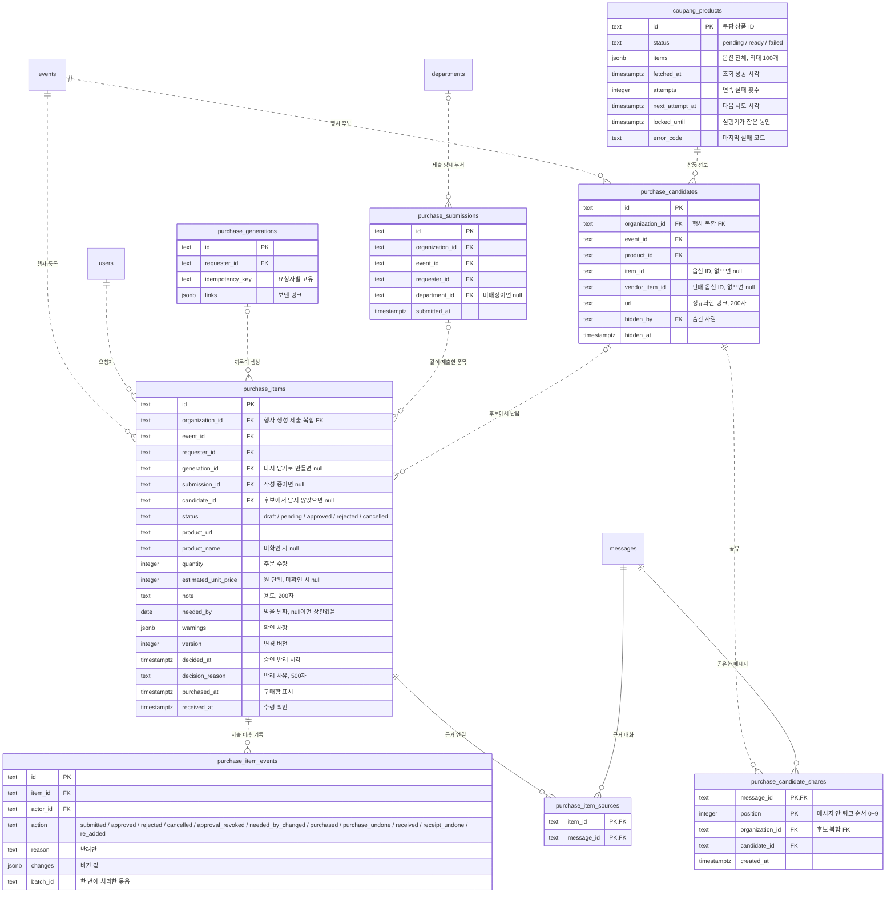
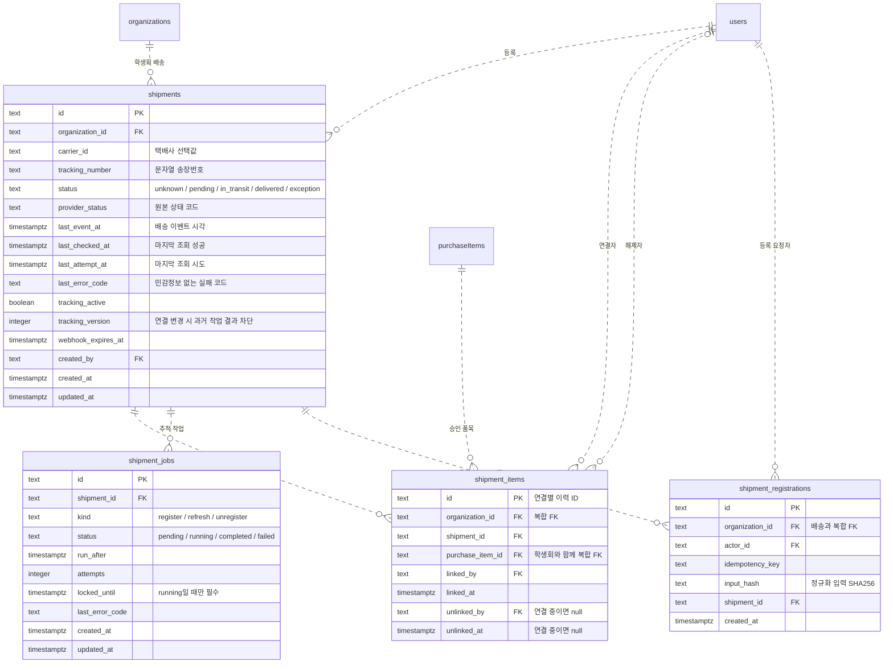

# ERD

원본: [schema.ts](../apps/api/src/db/schema.ts). 실제 DB 적용 여부와 별개로 코드의 주요 키와 관계를 표시한다. 스키마 변경 시 함께 수정한다.

## 인증·조직·대화

`PK`: 기본 키 · `FK`: 외래 키 · `UK`: 고유 키. 행사와 채팅방은 DB에서 서로 0~1개 연결을 허용하며, 행사 생성 API가 채팅방 하나를 함께 만든다. 나머지는 부모 1개당 자식 0개 이상이다. `verifications`는 외래 키가 없는 독립 테이블이다.

- `accounts`: `(provider_id, account_id)` 조합은 중복 불가.
- `organizations`: `invite_code`는 학생회마다 하나인 8자리 초대 코드다. 헷갈리는 0·1·I·O를 뺀 대문자·숫자로 이루어진다. DB 함수 `vada_invite_code()`가 기본값을 만들고, CHECK가 형식을 지킨다. 재발급 화면은 아직 없다. 코드가 새어 바꿔야 하면 승인을 받고 `UPDATE organizations SET invite_code = vada_invite_code() WHERE id = '<학생회 id>'`를 실행한다. 이 함수는 drizzle-kit이 모르는 직접 작성한 객체이므로, 마이그레이션을 합치거나 새로 만들 때 함께 옮긴다.
- `departments`: 학생회마다 회장단(`is_leadership`)이 정확히 하나다(부분 고유 색인 `departments_one_leadership`). 회장단은 구매 승인 표시(`handles_finance`)를 갖지 않는다(CHECK). 권한은 부서로 계산한다. 회장단은 조직 관리와 구매 승인, `handles_finance` 부서는 구매 승인을 한다(`access/membership.ts`). 회장단은 지울 수 없고 이름은 바꿀 수 있다. 구성원이나 구매요청 기록이 있는 부서는 지우지 않는다(서버). 학생회·부서 이름은 공백만이거나 상한(50·20자)을 넘을 수 없고, 같은 학생회 안에서 부서 이름이 겹치지 않는다(0011).
- `memberships`: `(organization_id, user_id)` 조합은 중복 불가. `(organization_id, department_id)`는 `departments`의 고유 조합 `(organization_id, id)`를 참조하여 다른 학생회 부서에 소속되는 것을 막는다. 부서는 비어 있을 수 있다(초대로 들어온 미배정 구성원). 비어 있으면 복합 외래 키를 검사하지 않는다. 직책(`title`)은 표시용 글이다. 공백만인 값과 20자 초과를 금지한다. 부서를 옮기면 서버가 지운다. 마지막 회장단은 다른 곳으로 옮길 수 없다(서버).
- `events`: 이름 중복은 허용하되 공백만으로 된 이름은 금지한다. 생성자의 소속 변경은 행사에 영향을 주지 않는다. 생성 당시 소속 검사는 서버 책임이다.
- `chat_rooms`: 행사 연결은 선택이며 행사당 최대 한 방이다. `(organization_id, event_id)` 복합 외래 키가 다른 학생회 행사 연결을 막는다. 행사·채팅방 생성은 하나의 트랜잭션이다. 행사 미연결 방의 생성·접근 API와 개인 대화 권한은 제공하지 않는다.
- `messages`: 행사 대신 채팅방을 참조한다. 공백만인 본문과 2,000자를 넘는 본문은 금지하며, 조회 인덱스는 `(chat_room_id, created_at, id)`다. 작성자 소속 변경으로 기존 메시지는 삭제되지 않는다. 쓰기 권한 검사는 서버 책임이다.
- 사용자 삭제 시 `accounts`·`sessions`는 함께 삭제된다. `memberships`·`departments`·`events`·`chat_rooms`·`messages`가 참조하는 부모의 삭제는 제한된다.

## 구매 품목

위 그림의 `events`·`departments`·`users`·`messages`를 참조한다. 속성은 주요 필드만 표시한다. 설계는 [구매 품목 단위 전환](superpowers/specs/2026-10-08-purchase-items-design.md)에 있다.

- `purchase_items`: 진행 단위다. 행사·생성 기록·제출 기록은 같은 학생회여야 한다.
  - 상태와 칸이 맞아야 한다. 작성 중이면 제출 기록이 없고, 승인·반려면 결정한 사람과 시각이 있고, 반려면 사유가 있다.
  - 구매함 표시는 승인 품목에만, 수령 확인은 구매함 표시된 품목에만 붙는다.
  - 모든 변경은 서버가 버전을 비교하고 올린다.
  - 상품명 500자·선택 옵션 200자·포장 단위 50자까지 넣고, 공백만은 넣지 않는다(계약과 같은 코드 포인트 기준).
- `purchase_submissions`: 상태가 없다. 화면은 품목 상태로 묶음을 보여 준다. 부서는 제출할 때의 요청자 부서이며 소속이 바뀌어도 그대로다.
- `purchase_generations`: 끼룩이 재시도를 막는다. `(requester_id, idempotency_key)`는 중복 불가다.
- `purchase_item_events`: 제출 이후의 변화만 기록하고 고치거나 지우지 않는다. 반려 기록만 사유가 있다.
- `purchase_item_sources`: 메시지가 같은 행사방인지는 서버가 검사한다. 작성 중 품목을 지울 때 서버가 근거 연결을 먼저 지운다.
- `coupang_products`: 학생회와 무관한 공개 상품 정보. 상품 ID 하나에 옵션 전체를 저장한다(최대 100개). `pending`은 조회 대기열이고, 웹 서버 안의 실행기가 `locked_until`로 잠가 가져가며 실패하면 1·5·30분 뒤 다시 시도하다 네 번째에 `failed`가 된다. `NOT_FOUND`는 바로 `failed`다.
- `purchase_candidates`: 같은 행사에서 (상품, `vendor_item_id`)마다 하나다(`NULLS NOT DISTINCT`, 옵션 미정은 상품마다 하나). 숨긴 사람·시각은 같이 있거나 같이 없고, 다시 공유되면 숨김을 푼다.
- `purchase_candidate_shares`: 메시지 안 링크 순서(0~9)마다 한 줄. 대화 저장과 같은 트랜잭션에서 기록한다.
- `purchase_items.candidate_id`: 후보에서 담은 품목. 다시 담기 복사본도 이어 받는다.
- 옛 요청서 표(`purchase_requests`·`purchase_request_history`·`purchase_request_sources`)와 요청서 연결 칸은 0012가 데이터를 옮긴 뒤 0013에서 지웠다.
- 권한·보는 범위·제출 필수값은 서버 책임이다. 작성 중 품목은 요청자만 보고, 제출된 품목은 학생회 누구나 본다.

## 배송 추적

배송 상태는 품목의 승인 상태와 독립적이다. 송장을 연결하면 구매함 표시가 붙는다. 스키마·마이그레이션, [등록·조회 API](delivery-api.md), [자동 갱신 실행기](delivery-worker.md)를 작성했다. Neon 반영, 실제 외부 연결 검증, 화면 연결·배포는 별도 단계다.

- `shipments`: `(organization_id, carrier_id, tracking_number)` 중복 불가. 송장번호의 앞자리 0을 보존한다. 택배사·송장번호 공백값을 금지한다. 초기 배송 상태는 `unknown`이다. 조회 실패는 배송 상태가 아니며 마지막 조회 상태를 초기화하지 않는 것은 서버 책임이다.
- `shipment_items`: `(organization_id, shipment_id)` → 배송, `(organization_id, purchase_item_id)` → 품목의 복합 FK로 다른 학생회 품목 연결을 막는다. 행사가 달라도 같은 학생회 품목이면 한 송장에 묶을 수 있다. `(organization_id, purchase_item_id)` 색인을 품목별 송장 조회와 FK 검사가 같이 쓴다.
- 연결 중인 `(shipment_id, purchase_item_id)` 조합만 중복을 금지한다. 해제자·해제 시각은 함께 기록하고 해제 시각은 연결 시각보다 빠를 수 없다. 재연결은 새 ID로 기록한다. 승인 여부·재정부 권한·해제 이력 수정 금지는 서버에서 검증한다.
- 합배송·분할배송을 표현하지만 배송별 수량 배분은 저장하지 않는다. 연결된 배송이 모두 완료돼도 품목 수량 전체의 도착으로 판정하지 않는다. 배송 정보 미등록은 활성 연결이 없는 상태다.
- `shipment_jobs`: 같은 배송·종류의 대기 작업과 실행 작업을 각각 최대 하나로 제한한다. 실행 중 새 알림은 다음 대기 작업 하나에 병합할 수 있다. `register` 작업은 신규 등록과 만료 갱신에 사용한다. 시도 횟수는 0 이상이며 실행 중에만 잠금 만료 시각을 갖는다.
- 실행기는 배송 행을 먼저 잠그고 배송당 한 작업을 선점한다. `attempts`와 잠금 기한으로 회수 전 작업자의 결과를 거부하며, `tracking_version`으로 연결 변경 전 조회 결과를 거부한다. 버전은 양수이고 재등록·마지막 연결 해제·배송 완료 시 증가한다. DB 제약만으로 자동 갱신이 실행되지는 않는다. 배송과 작업을 포함한 모든 신규 FK는 부모 삭제를 제한한다.
- `shipment_registrations`: `(organization_id, actor_id, idempotency_key)` 중복 불가. 등록 결과를 영속 보관하여 연결 해제 뒤 오래된 등록 요청이 재전송되어도 다시 연결하지 않는다. 같은 키에 다른 입력은 거부한다. 연결 해제 API는 품목 ID가 아니라 연결 ID를 받아 재연결 후 옛 해제 요청이 새 연결에 영향을 주지 않도록 한다.
- 배송 요약은 구매 품목 응답에 담긴다. 재정부 외 구성원의 송장번호는 마지막 네 자리만 표시한다.
