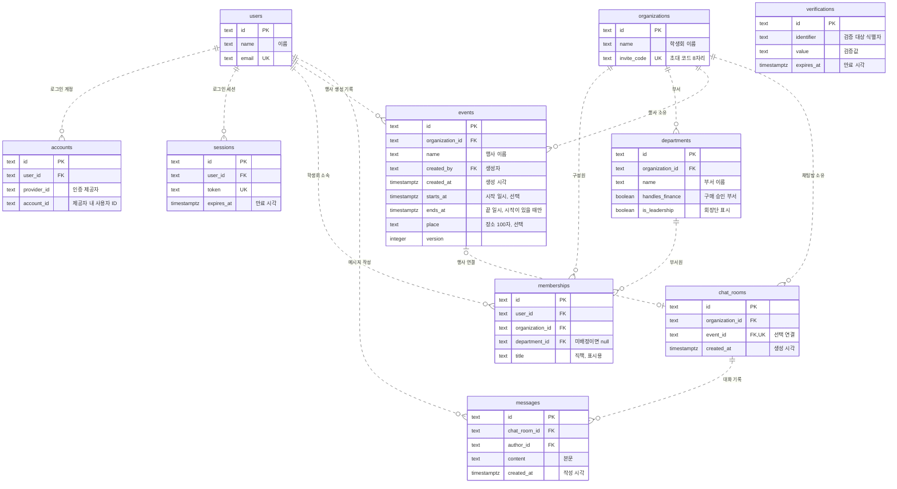
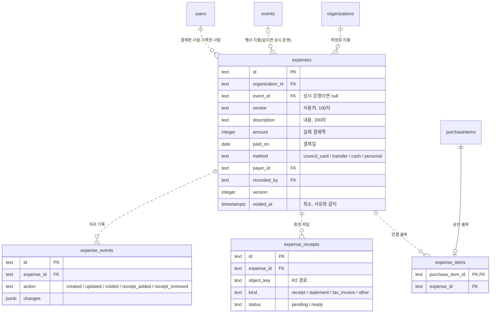
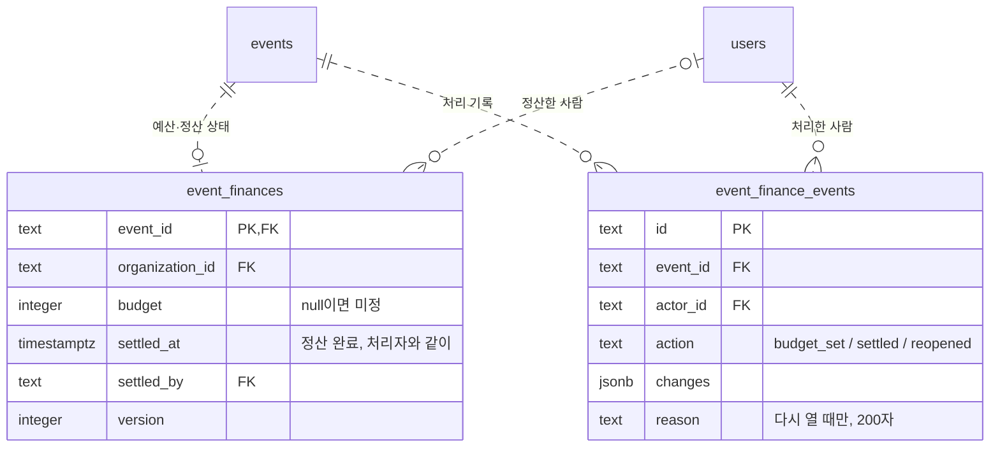
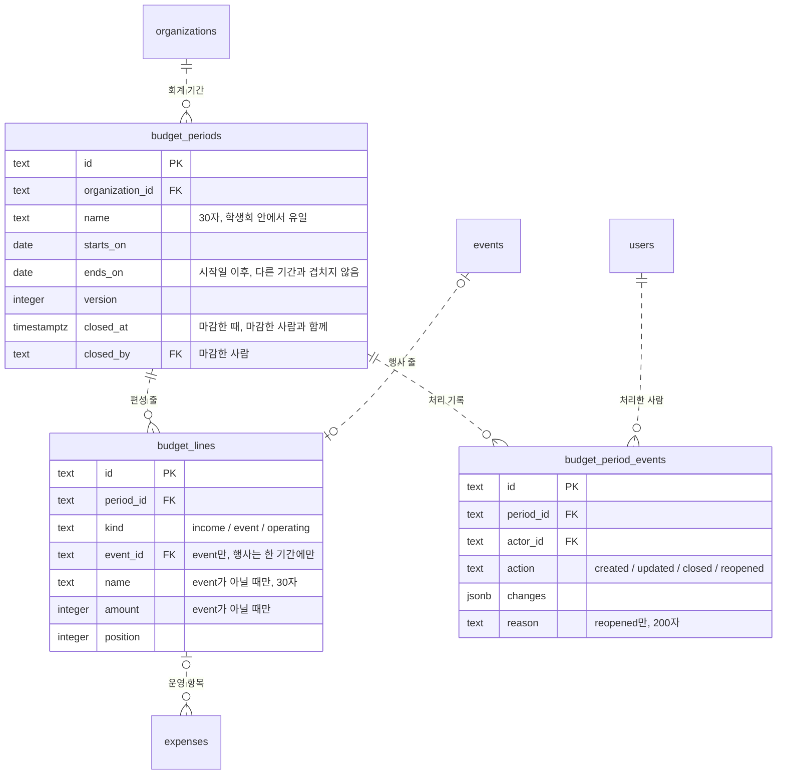
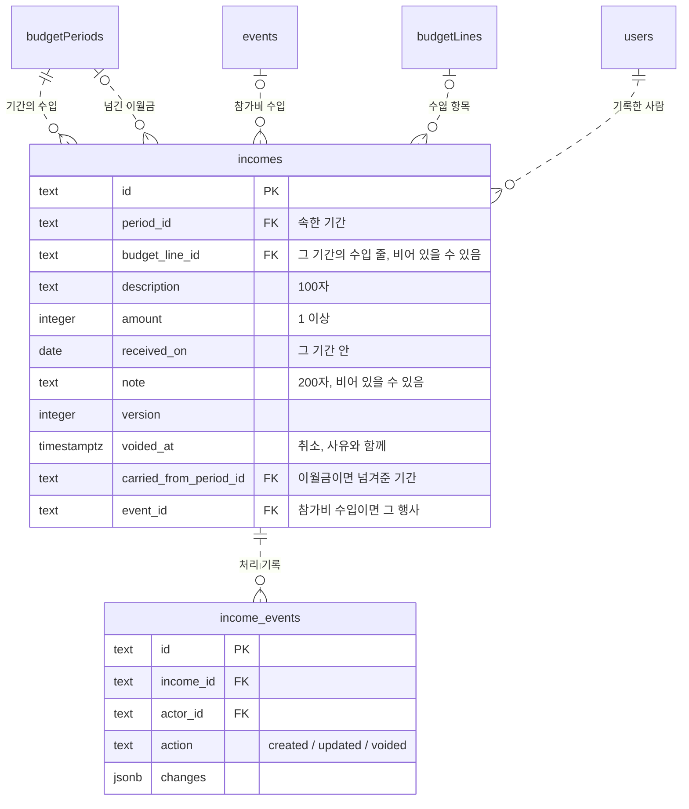
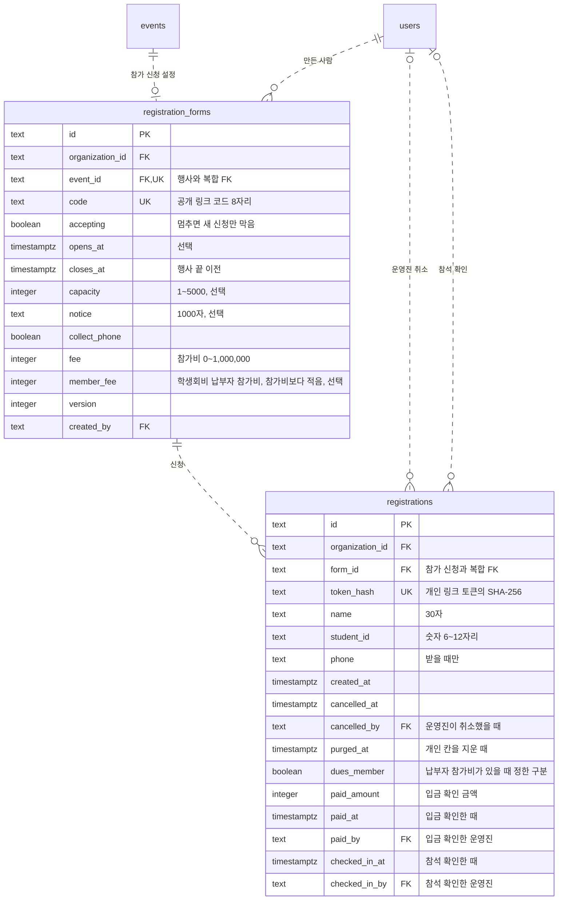
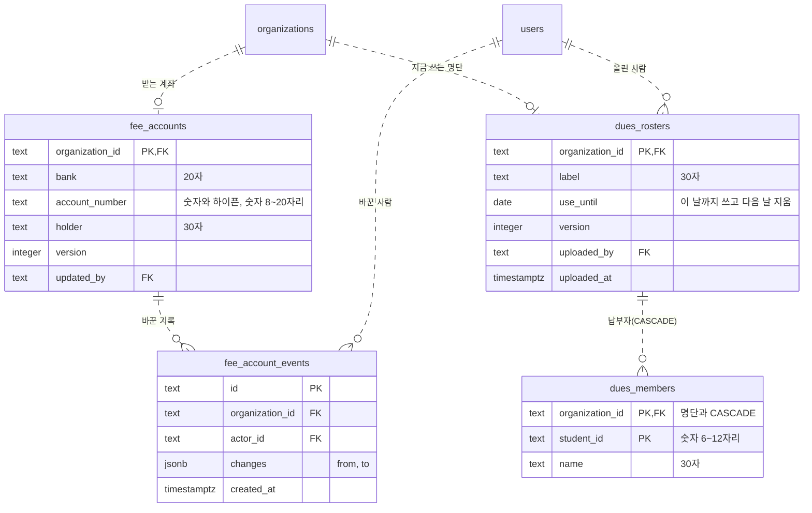
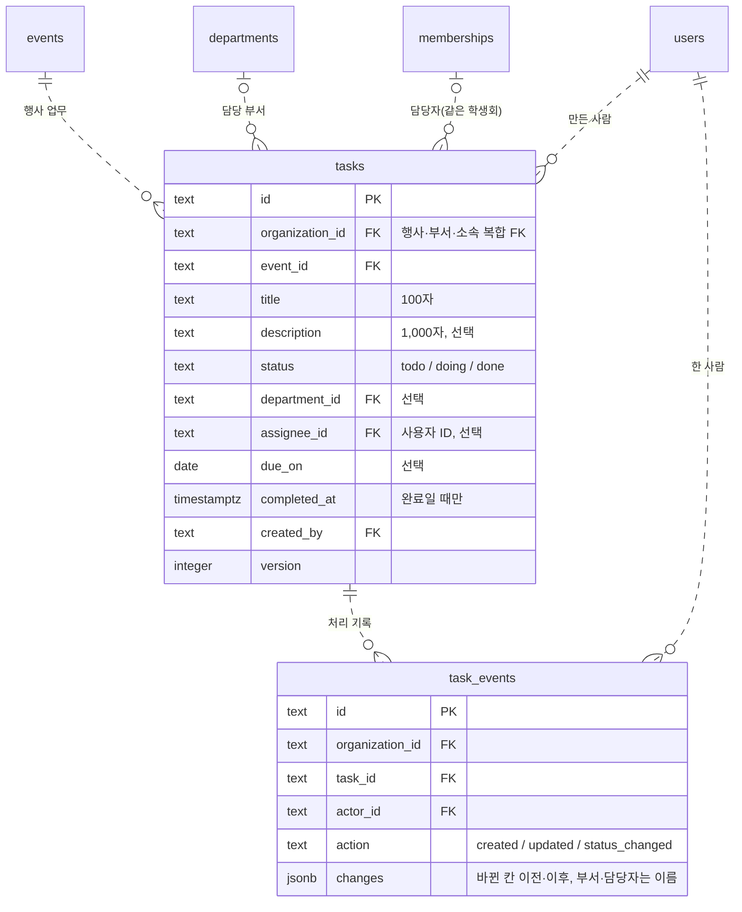
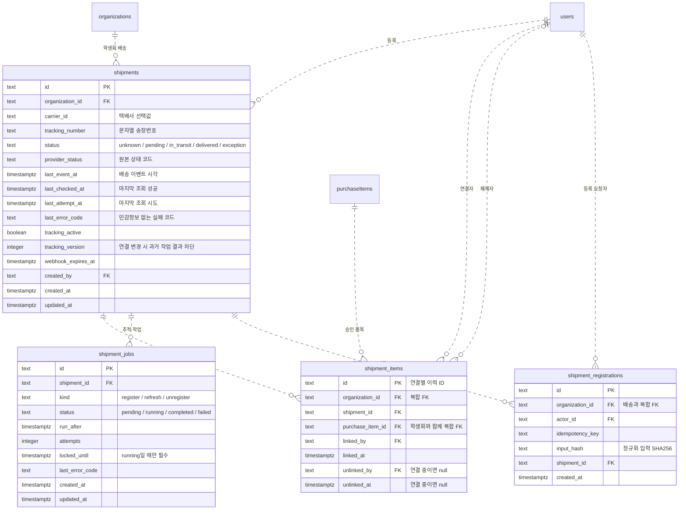

# ERD

원본: [schema.ts](../apps/api/src/db/schema.ts). 실제 DB 적용 여부와 별개로 코드의 주요 키와 관계를 표시한다. 스키마 변경 시 함께 수정한다.

## 인증·조직·대화

`PK`: 기본 키 · `FK`: 외래 키 · `UK`: 고유 키. 행사와 채팅방은 DB에서 서로 0~1개 연결을 허용하며, 행사 생성 API가 채팅방 하나를 함께 만든다. 나머지는 부모 1개당 자식 0개 이상이다. `verifications`는 외래 키가 없는 독립 테이블이다.

- `accounts`: `(provider_id, account_id)` 조합은 중복 불가.
- `organizations`: `invite_code`는 학생회마다 하나인 8자리 초대 코드다. 헷갈리는 0·1·I·O를 뺀 대문자·숫자로 이루어진다. DB 함수 `vada_invite_code()`가 기본값을 만들고, CHECK가 형식을 지킨다. 재발급 화면은 아직 없다. 코드가 새어 바꿔야 하면 승인을 받고 `UPDATE organizations SET invite_code = vada_invite_code() WHERE id = '<학생회 id>'`를 실행한다. 이 함수는 drizzle-kit이 모르는 직접 작성한 객체이므로, 마이그레이션을 합치거나 새로 만들 때 함께 옮긴다.
- `departments`: 학생회마다 회장단(`is_leadership`)이 정확히 하나다(부분 고유 색인 `departments_one_leadership`). 회장단은 구매 승인 표시(`handles_finance`)를 갖지 않는다(CHECK). 권한은 부서로 계산한다. 회장단은 조직 관리와 구매 승인, `handles_finance` 부서는 구매 승인을 한다(`access/membership.ts`). 회장단은 지울 수 없고 이름은 바꿀 수 있다. 구성원이나 구매요청 기록이 있는 부서는 지우지 않는다(서버). 학생회·부서 이름은 공백만이거나 상한(50·20자)을 넘을 수 없고, 같은 학생회 안에서 부서 이름이 겹치지 않는다(0011).
- `memberships`: `(organization_id, user_id)` 조합은 중복 불가. `(organization_id, department_id)`는 `departments`의 고유 조합 `(organization_id, id)`를 참조하여 다른 학생회 부서에 소속되는 것을 막는다. 부서는 비어 있을 수 있다(초대로 들어온 미배정 구성원). 비어 있으면 복합 외래 키를 검사하지 않는다. 직책(`title`)은 표시용 글이다. 공백만인 값과 20자 초과를 금지한다. 부서를 옮기면 서버가 지운다. 마지막 회장단은 다른 곳으로 옮길 수 없다(서버).
- `events`: 이름 중복은 허용하되 공백만으로 된 이름은 금지한다. 생성자의 소속 변경은 행사에 영향을 주지 않는다. 생성 당시 소속 검사는 서버 책임이다.
- `chat_rooms`: 행사 연결은 선택이며 행사당 최대 한 방이다. `(organization_id, event_id)` 복합 외래 키가 다른 학생회 행사 연결을 막는다. 행사·채팅방 생성은 하나의 트랜잭션이다. 행사 미연결 방의 생성·접근 API와 개인 대화 권한은 제공하지 않는다.
- `messages`: 행사 대신 채팅방을 참조한다. 공백만인 본문과 2,000자를 넘는 본문은 금지하며, 조회 인덱스는 `(chat_room_id, created_at, id)`다. 작성자 소속 변경으로 기존 메시지는 삭제되지 않는다. 쓰기 권한 검사는 서버 책임이다.
- 사용자 삭제 시 `accounts`·`sessions`는 함께 삭제된다. `memberships`·`departments`·`events`·`chat_rooms`·`messages`가 참조하는 부모의 삭제는 제한된다.

## 구매 품목

위 그림의 `events`·`departments`·`users`·`messages`를 참조한다. 속성은 주요 필드만 표시한다. 설계는 [구매 품목 단위 전환](superpowers/specs/2026-10-08-purchase-items-design.md)에 있다.

- `purchase_items`: 진행 단위다. 행사·생성 기록·제출 기록은 같은 학생회여야 한다.
  - 상태와 칸이 맞아야 한다. 작성 중이면 제출 기록이 없고, 승인·반려면 결정한 사람과 시각이 있고, 반려면 사유가 있다.
  - 구매함 표시는 승인 품목에만, 수령 확인은 구매함 표시된 품목에만 붙는다.
  - 모든 변경은 서버가 버전을 비교하고 올린다.
  - 상품명 500자·선택 옵션 200자·포장 단위 50자까지 넣고, 공백만은 넣지 않는다(계약과 같은 코드 포인트 기준).
- `purchase_submissions`: 상태가 없다. 화면은 품목 상태로 묶음을 보여 준다. 부서는 제출할 때의 요청자 부서이며 소속이 바뀌어도 그대로다.
- `purchase_generations`: 끼룩이 재시도를 막는다. `(requester_id, idempotency_key)`는 중복 불가다.
- `purchase_item_events`: 제출 이후의 변화만 기록하고 고치거나 지우지 않는다. 반려 기록만 사유가 있다.
- `purchase_item_sources`: 메시지가 같은 행사방인지는 서버가 검사한다. 작성 중 품목을 지울 때 서버가 근거 연결을 먼저 지운다.
- `coupang_products`: 학생회와 무관한 공개 상품 정보. 상품 ID 하나에 옵션 전체를 저장한다(최대 100개). `pending`은 조회 대기열이고, 웹 서버 안의 실행기가 `locked_until`로 잠가 가져가며 실패하면 1·5·30분 뒤 다시 시도하다 네 번째에 `failed`가 된다. `NOT_FOUND`는 바로 `failed`다.
- `purchase_candidates`: 같은 행사에서 (상품, `vendor_item_id`)마다 하나다(`NULLS NOT DISTINCT`, 옵션 미정은 상품마다 하나). 숨긴 사람·시각은 같이 있거나 같이 없고, 다시 공유되면 숨김을 푼다.
- `purchase_candidate_shares`: 메시지 안 링크 순서(0~9)마다 한 줄. 대화 저장과 같은 트랜잭션에서 기록한다.
- `purchase_items.candidate_id`: 후보에서 담은 품목. 다시 담기 복사본도 이어 받는다.
- 옛 요청서 표(`purchase_requests`·`purchase_request_history`·`purchase_request_sources`)와 요청서 연결 칸은 0012가 데이터를 옮긴 뒤 0013에서 지웠다.
- 권한·보는 범위·제출 필수값은 서버 책임이다. 작성 중 품목은 요청자만 보고, 제출된 품목은 학생회 누구나 본다.

## 지출·증빙

결제 한 번(영수증 한 장 단위)을 지출로 기록한다. 설계는 [M2-1 결제·증빙과 사용 내역](superpowers/specs/2026-10-09-expenses-design.md)에 있다.

- `expenses`: 지우지 않고 취소로 남긴다. 취소하면 합계에서 빠지고 연결 품목이 풀린다.
- `expense_items`: 품목 하나는 지출 하나에만 연결된다(PK). 같은 행사의 승인 품목만 연결하고, 연결하면 구매함으로 표시한다.
- `expense_receipts`: 파일은 비공개 R2 버킷에 있고 서명 주소로만 올리고 연다. 확인(HEAD)을 통과한 ready 파일만 증빙으로 센다.
- `expense_events`: 기록·수정(바뀐 칸)·취소·증빙 추가·삭제를 남기고 고치지 않는다.
- `expenses.budget_line_id`: 상시 운영 지출의 운영 항목(M2-3a). 아래 "예산 편성"을 본다.

## 행사 재정

행사마다 예산과 정산 상태를 둔다. 설계는 [M2-2 행사 예산·정산·결산 엑셀](superpowers/specs/2026-10-09-event-settlement-design.md)에 있다.

- `event_finances`: 예산을 정하거나 정산할 때 생긴다. 행이 없으면 예산 미정·정산 전이다.
- 정산 조건: 증빙 누락, 검토 대기 요청, 지출로 기록하지 않은 승인 품목이 모두 0이어야 한다.
- 정산된 행사에서 막는 것:
  - 지출 기록·수정·취소
  - 증빙 삭제
  - 예산 변경
  - 구매 요청 제출

  증빙 추가는 된다.
- `event_finance_events`: 아래를 남기고 고치지 않는다.
  - 예산 변경(이전·이후)
  - 정산(그때의 예산·실제 지출·지출 건수)
  - 다시 열기(사유)

## 예산 편성

회계 기간마다 수입·행사·운영 예산을 편성한다. 설계는 [M2-3a 학생회 예산 편성](superpowers/specs/2026-10-10-budget-plan-design.md)에 있다.

- 행사 줄의 금액은 `event_finances.budget`에 있다. 편성 수정과 행사 재정 탭이 같은 값을 고친다.
- `expenses.budget_line_id`: 상시 운영 지출만 운영 줄을 고른다. 결제일이 그 줄의 기간 안이어야 한다(서버 확인).
- 기간 날짜가 겹치지 않는 것과 이름·행사 중복은 학생회 단위 잠금 안에서 서버가 확인한다.
- 운영 줄은 취소하지 않은 지출이 고르고 있으면 지우지 않는다.

## 수입

회계 기간마다 실제로 들어온 돈을 적고, 결산서로 내려받는다. 설계는 [M2-3b 실제 수입 기록과 결산서](superpowers/specs/2026-10-10-semester-settlement-design.md)에 있다.

- 수입은 통장에 들어온 돈 한 건이고 기간 하나에 속한다. 받은 날이 그 기간 안인지, 수입 항목이 그 기간의 수입 줄인지는 서버가 확인한다.
- 지우지 않고 취소로 남긴다. 취소한 수입은 합계와 결산서에서 빠진다.
- 수입 줄은 취소하지 않은 수입이 고르고 있으면 지우지 않는다. 기간 날짜를 바꿀 때 이 기간의 수입이 밖으로 나가면 막는다.
- 남은 돈은 실제 수입 − 실제 지출이다. 결산서는 이 숫자와 수입·지출 내역(잔액 포함)을 시트로 낸다.

## 기간 마감

결산을 마친 기간을 잠그고 남은 돈을 다음 기간으로 넘긴다. 설계는 [M2-3c 회계 기간 마감과 이월](superpowers/specs/2026-10-10-period-close-design.md)에 있다.

- 마감은 `budget_periods.closed_at`·`closed_by`로 남는다. 조건은 서버가 본다.
  - 끝일이 지났다(한국 날짜).
  - 앞 기간이 모두 마감됐다.
  - 넣은 행사가 모두 정산됐다.
  - 결제일이 기간 안인 상시 운영 지출에 증빙 누락이 없다.
  - 남은 돈이 0원 이상이고, 0원보다 크면 다음 기간이 있다.
- 마감한 기간에서 막는 것:
  - 편성, 수입
  - 결제일이 그 기간인 상시 운영 지출의 기록·수정·취소·증빙 삭제(증빙 추가는 된다)
  - 그 기간 행사의 정산 다시 열기
- 이월금: 남은 돈은 다음 기간 시작일의 수입 한 건이다(`incomes.carried_from_period_id`). 손으로 고치거나 취소하지 않는다. 기간 하나가 넘긴 취소하지 않은 이월금은 한 건뿐이다(부분 unique 색인).
- 다시 열기: 사유를 `budget_period_events.reason`에 남기고, 다음 기간이 열려 있을 때만 된다. 넘긴 이월금은 취소한다.
- 마감한 기간과 이월금을 받은 기간보다 앞서는 기간은 만들거나 옮길 수 없다. 그래서 마감한 기간은 늘 시간순으로 맨 앞에 몰려 있다.
- 마감·다시 열기와 기간 만들기·편성 수정은 학생회 예산 잠금(advisory lock)을 혼자 잡는다. 지출 변경은 같은 잠금을 같이 잡는다.

## 참가 신청

행사마다 공개 링크로 로그인 없이 참가 신청을 받는다. 설계는 [M3a 행사 참가 신청](superpowers/specs/2026-10-10-event-registration-design.md)에 있다.

- 행사 하나에 참가 신청 하나다. 만들려면 행사 시작 일시가 있어야 하고, 마감은 행사 끝(끝 일시, 없으면 시작 일시) 이전이다. 참가 신청이 있는 행사는 시작 일시를 비우거나 마감보다 일찍 끝낼 수 없다.
- 지우지 않은 신청(`purged_at` 없음)은 토큰 해시·이름·학번이 있고, 휴대폰 번호는 받을 때만 있다. 지운 신청(`purged_at` 있음)은 네 칸이 모두 비어 있다. 취소하면 바로 지운다. 행은 신청 수로 남는다.
- 행사 끝에서 30일이 지나면 개인 칸을 지운다. 서버가 시작할 때와 1시간마다 지우고, 참가 신청 하나를 다루는 요청도 먼저 지운다.
- 같은 참가 신청에 지우지 않은 같은 학번은 하나다(부분 unique 색인). 정원은 참가 신청 행을 잠근 뒤 세고 넣는다.
- 신청자 정보는 부서가 있는 구성원(`manageEvents`)만 본다. 공개 화면에는 남은 자리 수만 나간다.
- 참가비(M3b): 신청에는 납부 구분(`dues_member`)만 남고, 낼 돈은 참가 신청의 금액으로 계산한다. 입금을 확인하면 그때 금액을 `paid_amount`에 남긴다. 세 입금 칸은 함께 있거나 함께 없다.
- 입금을 확인한 신청이 하나라도 있으면(취소·지운 행 포함) 참가비 금액을 바꿀 수 없다. 개인 칸을 지워도 납부 구분과 입금 칸은 남는다.
- 참석 확인(M3c, [설계](superpowers/specs/2026-10-11-event-attendance-design.md)): 두 참석 칸은 함께 있거나 함께 없고, 취소한 신청에는 없다(CHECK). 개인 칸을 지워도 남아 참석 수로 센다.
  - 참석 확인 QR은 개인 링크 토큰의 해시(`token_hash`)를 담는다. 운영진 스캐너가 그 값으로 이 행사의 신청을 찾는다.

## 참가비

참가비를 받는 학생회 계좌와 학생회비 납부 명단이다. 설계는 [M3b-1 행사 참가비와 입금 확인](superpowers/specs/2026-10-10-event-fees-design.md)에 있다.

- 계좌와 명단은 학생회마다 하나다. 재정 권한자(재정 부서·회장단)만 바꾸고, 학생회 참가비 잠금(advisory lock)으로 한 줄로 세운다.
- 계좌는 지우지 않는다. 바꿀 때마다 바꾸기 전과 뒤를 기록에 남긴다.
- 명단은 새로 올리면 통째로 바꾸고, 쓰는 기한(오늘부터 366일 안)이 지나면 지운다. 서버가 1시간마다, 그리고 명단을 다루는 요청이 먼저 지운다.
- `dues_members`의 FK만 CASCADE다. 명단을 지우는 것이 곧 납부자를 지우는 것이다.
- 신청할 때 학번과 이름(공백 빼고, 영문 대소문자 무시)이 둘 다 맞아야 납부자다.
- 참가비 수입(M3b-2, [설계](superpowers/specs/2026-10-11-event-fee-income-design.md)): 행사를 정산하면 받은 참가비(입금 확인 금액 합, 취소·지운 신청 포함)가 그 행사가 든 기간의 수입 한 건이 된다(`incomes.event_id`).
  - 손으로 고치거나 취소하지 않고, 정산을 다시 열면 취소한다. 행사 하나의 취소하지 않은 참가비 수입은 한 건뿐이다(부분 unique 색인).
  - 이월금이면서 참가비 수입일 수 없다(CHECK). 참가비 수입이 있는 행사는 편성에서 뺄 수 없다.
  - 받은 참가비가 있으면 행사가 기간에 들어 있어야 정산된다.

## 업무

행사(`events`)·부서(`departments`)·소속(`memberships`)·사용자(`users`)를 참조한다. 설계는 [행사 업무·일정](superpowers/specs/2026-10-11-event-tasks-design.md)에 있다.

- `tasks`: 담당자는 `(organization_id, assignee_id)` → `memberships (organization_id, user_id)`로 같은 학생회 소속만 받는다. 부서가 있는 구성원만 맡는 조건과 행사마다 300개 상한은 서버가 지킨다. 부서를 지우면 서버가 먼저 그 부서 업무의 담당 부서를 비우고 버전을 올린다. 완료 시각은 완료일 때만 있다(CHECK).
- `task_events`: 업무를 지울 때만 서버가 함께 지운다. 그 밖에는 고치거나 지우지 않는다. 부서·담당자는 그때의 이름으로 남겨 부서를 지우거나 이름이 바뀌어도 읽힌다.

## 배송 추적

배송 상태는 품목의 승인 상태와 독립적이다. 송장을 연결하면 구매함 표시가 붙는다. 스키마·마이그레이션, [등록·조회 API](delivery-api.md), [자동 갱신 실행기](delivery-worker.md)를 작성했다. Neon 반영, 실제 외부 연결 검증, 화면 연결·배포는 별도 단계다.

- `shipments`: `(organization_id, carrier_id, tracking_number)` 중복 불가. 송장번호의 앞자리 0을 보존한다. 택배사·송장번호 공백값을 금지한다. 초기 배송 상태는 `unknown`이다. 조회 실패는 배송 상태가 아니며 마지막 조회 상태를 초기화하지 않는 것은 서버 책임이다.
- `shipment_items`: `(organization_id, shipment_id)` → 배송, `(organization_id, purchase_item_id)` → 품목의 복합 FK로 다른 학생회 품목 연결을 막는다. 행사가 달라도 같은 학생회 품목이면 한 송장에 묶을 수 있다. `(organization_id, purchase_item_id)` 색인을 품목별 송장 조회와 FK 검사가 같이 쓴다.
- 연결 중인 `(shipment_id, purchase_item_id)` 조합만 중복을 금지한다. 해제자·해제 시각은 함께 기록하고 해제 시각은 연결 시각보다 빠를 수 없다. 재연결은 새 ID로 기록한다. 승인 여부·재정부 권한·해제 이력 수정 금지는 서버에서 검증한다.
- 합배송·분할배송을 표현하지만 배송별 수량 배분은 저장하지 않는다. 연결된 배송이 모두 완료돼도 품목 수량 전체의 도착으로 판정하지 않는다. 배송 정보 미등록은 활성 연결이 없는 상태다.
- `shipment_jobs`: 같은 배송·종류의 대기 작업과 실행 작업을 각각 최대 하나로 제한한다. 실행 중 새 알림은 다음 대기 작업 하나에 병합할 수 있다. `register` 작업은 신규 등록과 만료 갱신에 사용한다. 시도 횟수는 0 이상이며 실행 중에만 잠금 만료 시각을 갖는다.
- 실행기는 배송 행을 먼저 잠그고 배송당 한 작업을 선점한다. `attempts`와 잠금 기한으로 회수 전 작업자의 결과를 거부하며, `tracking_version`으로 연결 변경 전 조회 결과를 거부한다. 버전은 양수이고 재등록·마지막 연결 해제·배송 완료 시 증가한다. DB 제약만으로 자동 갱신이 실행되지는 않는다. 배송과 작업을 포함한 모든 신규 FK는 부모 삭제를 제한한다.
- `shipment_registrations`: `(organization_id, actor_id, idempotency_key)` 중복 불가. 등록 결과를 영속 보관하여 연결 해제 뒤 오래된 등록 요청이 재전송되어도 다시 연결하지 않는다. 같은 키에 다른 입력은 거부한다. 연결 해제 API는 품목 ID가 아니라 연결 ID를 받아 재연결 후 옛 해제 요청이 새 연결에 영향을 주지 않도록 한다.
- 배송 요약은 구매 품목 응답에 담긴다. 재정부 외 구성원의 송장번호는 마지막 네 자리만 표시한다.
