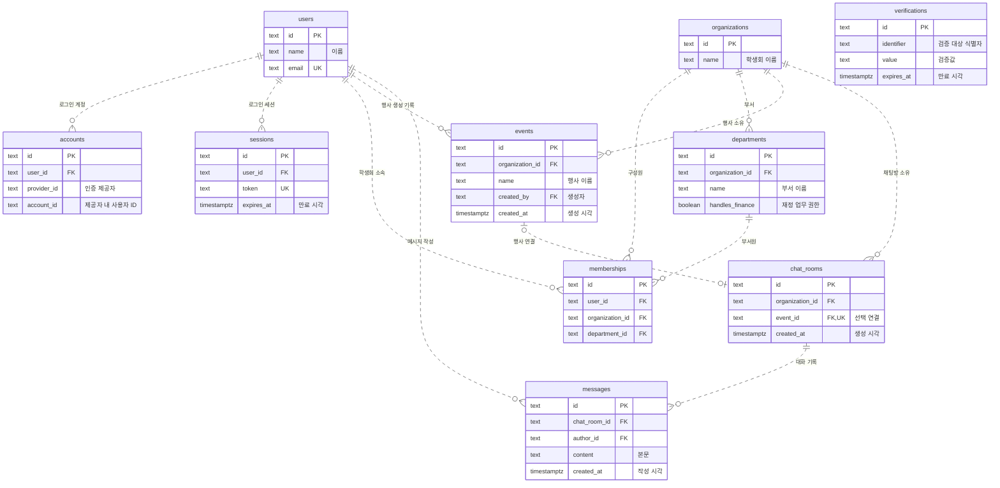
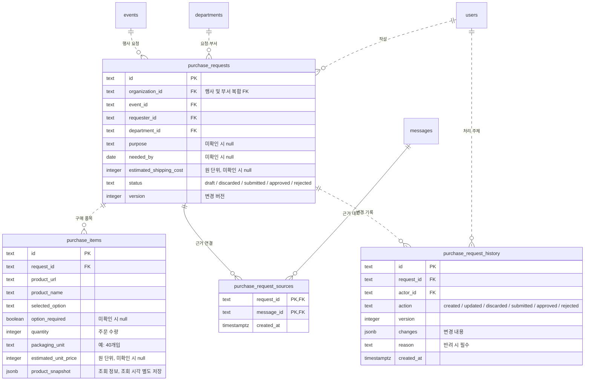
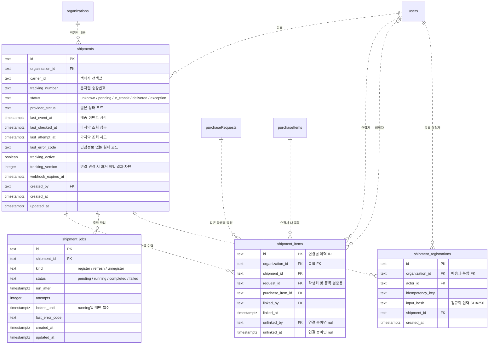

# ERD

원본: [schema.ts](../apps/api/src/db/schema.ts). 실제 DB 적용 여부와 별개로 코드의 주요 키와 관계를 표시한다. 스키마 변경 시 함께 수정한다.

## 인증·조직·대화

`PK`: 기본 키 · `FK`: 외래 키 · `UK`: 고유 키. 행사와 채팅방은 DB에서 서로 0~1개 연결을 허용하며, 행사 생성 API가 채팅방 하나를 함께 만든다. 나머지는 부모 1개당 자식 0개 이상이다. `verifications`는 외래 키가 없는 독립 테이블이다.

- `accounts`: `(provider_id, account_id)` 조합은 중복 불가.
- `memberships`: `(organization_id, user_id)` 조합은 중복 불가. `(organization_id, department_id)`는 `departments`의 고유 조합 `(organization_id, id)`를 참조하여 다른 학생회 부서에 소속되는 것을 막는다.
- `events`: 이름 중복은 허용하되 공백만으로 된 이름은 금지한다. 생성자의 소속 변경은 행사에 영향을 주지 않는다. 생성 당시 소속 검사는 서버 책임이다.
- `chat_rooms`: 행사 연결은 선택이며 행사당 최대 한 방이다. `(organization_id, event_id)` 복합 외래 키가 다른 학생회 행사 연결을 막는다. 행사·채팅방 생성은 하나의 트랜잭션이다. 행사 미연결 방의 생성·접근 API와 개인 대화 권한은 제공하지 않는다.
- `messages`: 행사 대신 채팅방을 참조한다. 공백만인 본문과 2,000자를 넘는 본문은 금지하며, 조회 인덱스는 `(chat_room_id, created_at, id)`다. 작성자 소속 변경으로 기존 메시지는 삭제되지 않는다. 쓰기 권한 검사는 서버 책임이다.
- 사용자 삭제 시 `accounts`·`sessions`는 함께 삭제된다. `memberships`·`departments`·`events`·`chat_rooms`·`messages`가 참조하는 부모의 삭제는 제한된다.

## 구매 요청

위 그림의 `events`·`departments`·`users`·`messages`를 참조한다. 속성은 주요 필드만 표시한다.

- `purchase_requests`: 행사·요청 부서는 같은 학생회여야 한다. 요청 부서는 기록된 ID를 유지하며 소속 변경에 따라 바뀌지 않는다. `(requester_id, idempotency_key)`는 중복 불가다.
- `purchase_items`: `(request_id, position)`은 중복 불가다. 주문 수량은 양의 정수, 단가·배송비는 0 이상의 원 단위 정수다. 미확인은 `null`이며 합계는 저장하지 않고 계산한다. 조회 정보와 조회 시각은 함께 저장하며 편집값과 분리한다.
- `purchase_request_sources`: 같은 요청·메시지 연결은 한 번만 저장한다. 메시지가 같은 행사방에 속하는지는 서버에서 검증해야 한다.
- `purchase_request_history`: `(request_id, version)`은 중복 불가이며 반려 이력에는 공백이 아닌 사유가 필요하다. 구매 관련 외래 키는 부모 삭제를 제한한다.
- 상태 대응: `draft` 검토 대기 · `discarded` 폐기 · `submitted` 접수 · `approved` 승인 · `rejected` 반려. 생성 중·실패는 요청서 상태가 아니다.
- DB는 품목·이력이 0개인 요청도 허용한다. 생성 원자성, 제출 필수값, 권한, 상태 전환, 버전 비교·증가, 조회 원본·이력의 수정 금지는 서버 책임이며 이 스키마만으로 보장하지 않는다.

## 배송 추적

배송 상태는 구매요청서의 승인 상태와 독립적이다. 스키마·마이그레이션, [등록·조회 API](delivery-api.md), [자동 갱신 실행기](delivery-worker.md)를 작성했다. Neon 반영, 실제 외부 연결 검증, 화면 연결·배포는 별도 단계다.

- `shipments`: `(organization_id, carrier_id, tracking_number)` 중복 불가. 송장번호의 앞자리 0을 보존한다. 택배사·송장번호 공백값을 금지한다. 초기 배송 상태는 `unknown`이다. 조회 실패는 배송 상태가 아니며 마지막 조회 상태를 초기화하지 않는 것은 서버 책임이다.
- `shipment_items`: `(organization_id, shipment_id)` → 배송, `(organization_id, request_id)` → 요청서, `(request_id, purchase_item_id)` → 품목의 복합 FK로 다른 학생회·요청서 품목 연결을 막는다. 기존 요청서·품목에는 참조용 복합 고유키만 추가하여 기존 컬럼·데이터는 유지한다.
- 연결 중인 `(shipment_id, purchase_item_id)` 조합만 중복을 금지한다. 해제자·해제 시각은 함께 기록하고 해제 시각은 연결 시각보다 빠를 수 없다. 재연결은 새 ID로 기록한다. 승인 여부·재정부 권한·해제 이력 수정 금지는 서버에서 검증한다.
- 합배송·분할배송을 표현하지만 배송별 수량 배분은 저장하지 않는다. 연결된 배송이 모두 완료돼도 요청 수량 전체의 도착이나 요청서 전체 완료로 판정하지 않는다. 배송 정보 미등록은 활성 연결이 없는 상태다.
- `shipment_jobs`: 같은 배송·종류의 대기 작업과 실행 작업을 각각 최대 하나로 제한한다. 실행 중 새 알림은 다음 대기 작업 하나에 병합할 수 있다. `register` 작업은 신규 등록과 만료 갱신에 사용한다. 시도 횟수는 0 이상이며 실행 중에만 잠금 만료 시각을 갖는다.
- 실행기는 배송 행을 먼저 잠그고 배송당 한 작업을 선점한다. `attempts`와 잠금 기한으로 회수 전 작업자의 결과를 거부하며, `tracking_version`으로 연결 변경 전 조회 결과를 거부한다. 버전은 양수이고 재등록·마지막 연결 해제·배송 완료 시 증가한다. DB 제약만으로 자동 갱신이 실행되지는 않는다. 배송과 작업을 포함한 모든 신규 FK는 부모 삭제를 제한한다.
- `shipment_registrations`: `(organization_id, actor_id, idempotency_key)` 중복 불가. 등록 결과를 영속 보관하여 연결 해제 뒤 오래된 등록 요청이 재전송되어도 다시 연결하지 않는다. 같은 키에 다른 입력은 거부한다. 연결 해제 API는 품목 ID가 아니라 연결 ID를 받아 재연결 후 옛 해제 요청이 새 연결에 영향을 주지 않도록 한다.
- 구성원에게 공유하는 응답은 배송 요약으로 한정하며 기존 요청서 근거 대화·이력의 조회 권한은 확장하지 않는다. 재정부 외 구성원의 송장번호는 마지막 네 자리만 표시한다.
