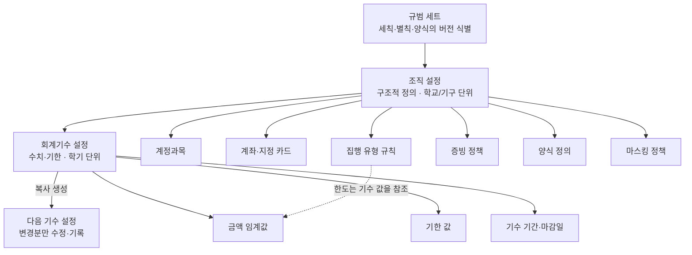

# VADA — 감사 규범 설정 스키마 초안

> 상태: 초안 · ERICA 규범 3종에서 도출 · 타 학교 검증 대기
>
> 최초 정리: 2026-08-14
>
> 도출 근거: `docs/VADA_AUDIT_RULES_GAP.md` 1~3장 (세칙 제1~30조, 별칙 제1~21조, 위원회 소정 양식 5종)
>
> 목적: 감사 규범 중 **학교·연도마다 달라지는 값**을 설정 데이터로 분리해, VADA가 특정 학교 구현체가 아니라 규칙 엔진이 되도록 한다.
>
> 적용 원칙: 이 문서는 초안이다. `VADA_FINANCE_SPEC.md`에 반영되기 전까지 확정 사항이 아니며 구현 근거로 사용하지 않는다.

## 1. 설계 원칙

| # | 원칙 | 이유 |
|---|---|---|
| 1 | **미설정은 기본값이 아니라 기능 차단이다.** 값이 없으면 관련 검증·계산·양식 출력을 비활성화하고 사용자에게 미설정을 알린다 | `VADA_FINANCE_SPEC.md` 9.3의 "VADA가 고정된 필수 자료 목록을 자체적으로 정하지 않는다"를 설정 계층으로 계승. 추정한 기본값은 규정 위반을 유발한다 |
| 2 | **모든 값은 근거 조항을 함께 저장한다** | 감사에서 "왜 3만원인가"에 답할 수 있어야 한다. 근거 없는 값은 임의 기준이 되고 세칙 제10조② 임의 장부 지적으로 이어진다 |
| 3 | **구조는 조직 단위, 수치·기한은 회계기수 단위로 나눈다** | 계정과목은 잘 바뀌지 않고 금액 한도는 매년 바뀐다. 식대 양식이 한도를 "2026년 기준"으로 명시한 것이 근거 |
| 4 | **기수 설정은 직전 기수 복사로 생성하고 변경분을 기록한다** | 매 학기 전체 재입력은 비현실적이고, 무엇이 바뀌었는지가 감사 대응에 필요하다 |
| 5 | **VADA는 판정하지 않고 입력을 강제한다** | 택시 사유 적정성처럼 사람이 판단할 항목을 시스템이 자동 판정하면 오판한다. 6장 참조 |
| 6 | **규범 문서 버전을 처리 건에 남긴다** | 개정 시 소급 적용 여부는 `VADA_FINANCE_SPEC.md` 15.1에서 미결이다. 정책이 정해질 때까지 최소한 어느 버전으로 처리했는지는 남긴다 |

## 2. 계층 구조



**분리 기준**: 규범 개정 없이 값만 바뀌면 기수 설정, 규범 구조가 바뀌어야 달라지면 조직 설정.

## 3. 규범 세트

처리 건에 어느 버전 규범을 적용했는지 남기기 위한 최소 식별자다.

| 필드 | 타입 | ERICA 값 | 비고 |
|---|---|---|---|
| `id` | string | — | 시스템 생성 |
| `sechik.title` | string | 한양대학교 ERICA 중앙감사 세칙 | |
| `sechik.revisedOn` | date | 2026-02-02 | 전부개정 |
| `byeolchik.title` | string \| null | 한양대학교 ERICA 중앙감사위원회 감사 시행 별칙 | 별칙이 없는 학교는 null |
| `byeolchik.revisedOn` | date \| null | 2026-02-02 | 신설 |
| `formSetVersion` | string \| null | 2026 | 양식 파일명의 연도 |
| `issuedBy` | string | 제7대 중앙감사위원회 | |

## 4. 조직 설정

### 4.1 계정과목

별칙 제1~2조. 코드는 시스템 내부용이고 명칭·정의는 규범 문구를 그대로 쓴다.

| 필드 | 타입 | 비고 |
|---|---|---|
| `incomeAccounts[]` | AccountCode | 수입 계정과목 |
| `expenseAccounts[]` | AccountCode | 지출 계정과목 |

`AccountCode`: `{ code, label, definition, source, isBusinessRevenue }`

`isBusinessRevenue`는 별칙 제14조의 수익 사업 별도 계정 관리 대상 여부다.

**ERICA 값**

| 구분 | 값 |
|---|---|
| 수입 (7) | 학생회비 / 이월금 / 지원금 / 사업 수익 / 행사 참가비 / 후원금 / 기타 수입 |
| 지출 (6) | 사업비 / 운영비 / 사무비 / 홍보비 / 기타 지출 / **복리후생비** |

**`복리후생비`는 별칙 제2조에 없고 결산안 양식에만 있다.** `source`를 조문이 아니라 양식으로 기록해야 하는 사례이며, 설계 원칙 2가 실제로 시험되는 지점이다. 세칙 제14조②1(수익 사업 순이익의 복리후생 집행)과 연결된 것으로 보이나 명시된 근거는 없다.

행사·상시 예산 항목은 이 계정과목 중 하나에 반드시 매핑한다. 자유 명칭은 하위 라벨로만 허용한다.

### 4.2 계좌·지정 카드

| 필드 | 타입 | 근거 | 비고 |
|---|---|---|---|
| `accounts[]` | BankAccount | 세칙 제11조, 별칙 제16조① | `purpose`: `primary` / `project` / `unmannedStore` |
| `cards[]` | DesignatedCard | 세칙 제13조① | 연결 계좌 필수 |
| `requiresSinglePrimaryAccount` | boolean | 세칙 제11조① | ERICA: true |
| `projectAccountMustSettleOnClose` | boolean | 세칙 제11조③ | ERICA: true. 사업 종료 시 잔액 대표 계좌 이입 |

### 4.3 결제 주체 정책

| 필드 | 타입 | 근거 | ERICA 값 |
|---|---|---|---|
| `allowedSources[]` | enum | 세칙 제13조①, 별칙 제5·6조, 양식 5종 | `designatedCard`, `bankTransfer`, `personalAdvance`, `personalCardException` |
| `cashAllowed` | boolean | 별칙 제5조② | **false** |
| `bankTransferConditions` | 조건 + 필수 첨부 | 별칙 제5조① | 조건: 카드 결제 구조적 불가 또는 예산 절감 명백 / 첨부: 거래명세서, 업체 명의 전자 이체 확인증 |
| `personalCardExceptionReasons[]` | string + 필수 첨부 | 별칙 제6조① | 사유: 대표 카드 분실·도난·훼손 / 첨부: 카드사 분실 신고 접수증 또는 재발급 신청 내역 |
| `personalAdvanceRequiredEvidence[]` | string | 양식 4종 | 명의 일치 송금 내역서 |

`personalAdvance`(사비 선지출)와 `personalCardException`(대표 카드 사고)은 **다른 경로다.** `VADA_AUDIT_RULES_GAP.md` 1.8 참조.

### 4.4 증빙 정책

| 필드 | 타입 | 근거 | ERICA 값 |
|---|---|---|---|
| `qualifiedEvidenceTypes[]` | string | 세칙 제13조① | 카드 매출전표, 현금영수증, 세금계산서 |
| `requiresItemUnitPriceQuantity` | boolean | 세칙 제13조① | true. 구매 품목·단가·수량 명시 |
| `physicalEvidenceDefault` | `required` \| `optional` | 별칙 제3조① | **required** |
| `physicalEvidenceExemption` | 조건 조합 | 별칙 제3조② | 금액 임계값(기수 참조) **AND** 대상 분류가 `officeSupplies` |
| `physicalEvidenceAlwaysRequired[]` | 분류 코드 | 별칙 제3조③ | `printPromotion`, `distributionGoods`, `foodBeverage` |
| `missingDetailRemedies[]` | oneOf 그룹 | 별칙 제4조① | 거래명세서 / 수기명세서(판매자 확인) / 구입 물품 나열 사진(가격표 식별) |
| `originalRetentionRequired` | boolean | 세칙 제13조⑤ | true. 원본 보관 책임자·위치 필드 필요 |
| `splitPaymentDetection` | boolean | 별칙 제3조④ | true. 단, 집행 유형별 예외 있음 (4.5) |

**면제 조건이 AND 결합인 점이 중요하다.** 금액만 낮아도 사무 소모품이 아니면 면제되지 않는다.

### 4.5 집행 유형 규칙 (스키마의 핵심)

`VADA_AUDIT_RULES_GAP.md` 2장 매트릭스 25행을 그대로 데이터화한다.

| 필드 | 타입 | 설명 |
|---|---|---|
| `code` | string | 내부 식별자 |
| `label` | string | 표시명 |
| `source` | RuleSource | 근거 조항 |
| `allowance` | enum | `allowed` / `conditional` / `prohibitedByDefault` |
| `conditionText` | string \| null | 집행 가능 조건. **자유 텍스트. 시스템이 판정하지 않는다** |
| `allowedPaymentSources[]` | enum | 허용 결제 주체. 비어 있지 않으면 다른 값 선택을 차단 |
| `limit` | LimitRule \| null | 금액 한도 |
| `requiredEvidence[]` | EvidenceRequirement | 필수 증빙 체크리스트 |
| `formId` | string \| null | 필요 소정 양식 |
| `autoCalculation` | AutoCalculation \| null | 자동 계산식 |
| `containsPersonalData` | boolean | 마스킹 대상 판정 |
| `bundlingRule` | BundlingRule \| null | 다건 묶음 규칙 |
| `exemptFromSplitPaymentCheck` | boolean | 분할 결제 탐지 제외 |

#### LimitRule

| 필드 | 값 | ERICA 예 (식대) |
|---|---|---|
| `basis` | `perPerson` / `perTransaction` / `perEvent` | `perPerson` |
| `amountKey` | 기수 임계값 참조 키 | `mealAllowancePerPerson` |
| `includes[]` | 한도에 포함되는 부대비용 | 배달비, 포장비 |
| `onExceed` | `block` / `splitWithinLimit` / `warn` | **`splitWithinLimit`** |

`splitWithinLimit`은 식대 양식의 "한도가 넘는 금액의 집행은 한도내에서 분할결제 하여야 합니다"를 표현한다. 이 값을 가진 유형은 `exemptFromSplitPaymentCheck`가 반드시 true여야 한다. **두 규칙이 모순되지 않도록 저장 시 검증한다.**

#### EvidenceRequirement

세칙 제27조가 **필수 증빙 누락 건수**로 징계 수위를 가르므로(5건 미만 주의 / 5건 이상 경고), 증빙은 묶음 단위 통과 여부가 아니라 **항목 단위 체크리스트**여야 한다.

| 필드 | 값 | 설명 |
|---|---|---|
| `key` | string | 항목 식별자 |
| `label` | string | 표시명 |
| `source` | RuleSource | 근거 |
| `requirement` | `always` / `conditional` / `oneOf` | |
| `conditionText` | string \| null | 조건부일 때의 조건 |
| `oneOfGroup` | string \| null | 택일 그룹 (별칙 제4조① 3택1) |
| `countsTowardMissingTally` | boolean | **누락 건수 집계 대상 여부** |

#### AutoCalculation

| 필드 | ERICA 값 (주유비) |
|---|---|
| `outputField` | `reimbursementAmount` |
| `expression` | `distanceKm / standardFuelEfficiencyKmPerLiter * unitPricePerLiter` |
| `inputs[]` | `distanceKm`(입력), `unitPricePerLiter`(입력), `standardFuelEfficiencyKmPerLiter`(기수 설정) |
| `roundingRule` | **null (미설정)** — 규범에 반올림 규정이 없다. 양식 예시 `50.4/10*1600 = 8,064`는 나누어떨어져 판단 불가 |

`roundingRule`이 미설정이면 계산 결과를 제안값으로만 표시하고 재정부가 확정하게 한다. 원칙 1의 적용 사례다.

#### BundlingRule

| 필드 | 값 | 근거 |
|---|---|---|
| `groupBy[]` | `sameAmount` / `roundTrip` / `sameVendor` | 대중교통 양식(동일 금액 다건), 택시 양식(왕복 1건) |
| `note` | string | 규범 문구 원문 |

이 규칙은 VADA 증빙 묶음의 그룹핑과 성격이 같지만 **기준 축이 다르다.** 증빙 묶음은 구매처·결제·영수증 기준, 양식 묶음은 금액·신청인·왕복 기준이다. 같은 저장 단위로 합칠지는 6장 열린 항목.

#### ERICA 집행 유형 값 요약

전체 25행은 `VADA_AUDIT_RULES_GAP.md` 2장에 있다. 스키마 특성이 드러나는 행만 옮긴다.

| code | allowance | allowedPaymentSources | limit | formId | 특이 |
|---|---|---|---|---|---|
| `mealAllowance` | `prohibitedByDefault` | designatedCard, personalAdvance | perPerson · splitWithinLimit | `mealReport` | `exemptFromSplitPaymentCheck: true` |
| `transitFare` | `conditional` | personalAdvance | 없음 | `transitReport` | `bundlingRule: sameAmount` |
| `taxiFare` | `conditional` | designatedCard, personalAdvance | 없음 | `taxiReport` | `bundlingRule: roundTrip` |
| `rentalCar` | `conditional` | **designatedCard만** | 없음 | `rentalCarReport` | 보험 가입 필수 조건 |
| `fuelReimbursement` | `conditional` | **personalAdvance만** | 없음 | `fuelReport` | `autoCalculation` 있음 |
| `prizeGoods` | `allowed` | designatedCard | 고가 기준 초과 시 추가 증빙 | null | `containsPersonalData: true` |
| `laborIndividual` | `conditional` | bankTransfer | 없음 | null | `containsPersonalData: true` |

`rentalCar`와 `fuelReimbursement`가 서로 정반대의 단일 결제 주체를 갖는 것이 이 필드가 필요한 이유다.

### 4.6 양식 정의

| 필드 | 타입 | 설명 |
|---|---|---|
| `id` | string | `mealReport` 등 |
| `title` | string | 양식 제목 |
| `source` | RuleSource | 근거 |
| `fields[]` | FormField | 입력 필드 |
| `signature` | SignatureBlock | 서명란 구성 |
| `notices[]` | string | 양식 하단 안내 문구 원문 |
| `outputFormat` | `pdf` | 양식 5종 공통 요구 |
| `attachesEvidence` | boolean | 증빙 동봉 여부. ERICA 5종 모두 true |

`FormField`: `{ key, label, type, required, valueSource }`
`valueSource`: `userInput` / `systemDerived` / `autoCalculated`

`SignatureBlock`: `{ dateLabel: '지급일' | '확인일', hasApplicant, applicantMultiple, hasOfficerTitle }`

**ERICA 양식 5종 서명란 차이**

| 양식 | dateLabel | hasApplicant | applicantMultiple |
|---|---|---|---|
| 식대 집행 보고서 | 지급일 | 조건부 (사비 결제 시) | false |
| 대중교통 실비 지급 보고서 | 지급일 | true | **true** |
| 택시 이용 보고서 | 지급일 | 조건부 (사비 결제 시) | false |
| **렌터카 이용 보고서** | **확인일** | **false** | false |
| 주유비 실비 지급 보고서 | 지급일 | true | false |

렌터카만 `확인일`인 이유는 공금 결제라 환급이 없기 때문이다. **`dateLabel`은 임의 표기가 아니라 결제 주체에서 파생되는 값**이므로, 저장 시 `allowedPaymentSources`와의 정합성을 검증한다.

`hasOfficerTitle`은 5종 모두 true다. 담당자 성명과 함께 직책(예: OO학생회 회계담당)을 요구하므로 **VADA에 직책 필드가 필요하다.**

### 4.7 마스킹 정책

| 필드 | 타입 | 근거 |
|---|---|---|
| `personalDataFields[]` | 분류 코드 | 별칙 제11·12·13·15조, 양식 신청인·담당자 |
| `maskingRule` | 필드별 마스킹 방식 | 세칙 제22조⑥ |
| `publicDisclosureDays` | number | 세칙 제22조③ |

**ERICA 개인정보 포함 자료**: 피보험자 명단(성명·학번·학과), 수령인 명단(성명·학번·학과·수령 상품), 수혜자 명단(이름·학번·시험명·지원 금액), 상금 수령인 명단, 소정 양식의 신청인·담당자 성명, 통장 사본, 카드 사진.

집행 유형의 `containsPersonalData`가 true면 해당 건의 증빙을 자동으로 마스킹 대상으로 분류한다.

## 5. 회계기수 설정

### 5.1 기수 기본

| 필드 | 타입 | 근거 | ERICA 비고 |
|---|---|---|---|
| `label` | string | — | 예: 2026학년도 1학기 |
| `startsOn` / `endsOn` | date | 세칙 제10조③ | 개강일~종강일 |
| `includesPrecedingVacation` | boolean | 세칙 제10조④ | true. 개강 전 방학 집행분 귀속 |
| `submissionDeadline` | date \| null | 세칙 제10조③ | **위원회 공고 사항.** 미공고 시 null |
| `carriedOverFrom` | termId \| null | 별칙 제1조② | 이월금 산출 원본 기수 |
| `derivedFrom` | termId \| null | 원칙 4 | 설정 복사 원본 |
| `changedKeys[]` | string | 원칙 4 | 직전 기수 대비 변경된 항목 |
| `lockedAt` | datetime \| null | — | 마감 잠금 시각 |

### 5.2 금액 임계값

| 키 | 근거 | ERICA 2026 값 |
|---|---|---|
| `physicalEvidenceExemptionAmount` | 별칙 제3조② | 30,000원 |
| `mealAllowancePerPerson` | 별칙 제7조③1, 식대 양식 | 10,000원 |
| `mealMinimumDurationHours` | 별칙 제7조② | 4시간 |
| `highValuePrizeAmount` | 별칙 제12조①3 | 50,000원 |
| `standardFuelEfficiencyKmPerLiter` | 주유비 양식 | 10 km/L |
| `lateNightWindow` | 별칙 제8조③1 | 23:00~06:00 |
| `unmannedStoreLossRatePercent` | 별칙 제16조③ | 10% |

`mealAllowancePerPerson`이 양식에 "2026년 기준"으로 표기된 것이 이 표 전체를 기수 단위로 둔 근거다.

### 5.3 기한

| 키 | 근거 | ERICA 값 |
|---|---|---|
| `participationFeeDisclosureDays` | 별칙 제10조① | 14일 |
| `unmannedStoreStocktakingCycle` | 별칙 제16조②2 | 월 1회 이상 |
| `objectionPeriodDays` | 세칙 제21조④2 | 3일 |
| `reviewPeriodDays` | 세칙 제21조⑤1 | 3일 |
| `clawbackDepositDays` | 세칙 제29조② | 14일 |
| `resultDisclosureDays` | 세칙 제22조③ | 7일 이상 |
| `apologyPostingWithinDays` / `apologyPostingDurationDays` | 세칙 제30조 | 3일 내 / 7일 이상 |
| `emergencyCommitteeNotifyDays` | 세칙 제17조① | 7일 |
| `emergencyCommitteeSettlementDays` | 세칙 제17조② | 3일 |
| `lateSubmissionWarningHours` | 세칙 제27조②2 | 24시간 |

기한 값은 **마감 알림 자동 등록**에 사용한다. `VADA_AUDIT_RULES_GAP.md` 6장 14순위 항목의 데이터 원천이다.

### 5.4 징계 임계값 (범위 미결)

VADA가 징계를 처분하지는 않지만 **제출 전 사전 경고**에 쓸 수 있다.

| 키 | 근거 | ERICA 값 | 용도 |
|---|---|---|---|
| `missingEvidenceWarningThreshold` | 세칙 제27조②1 / ③1 | 5건 | "현재 누락 3건. 5건 이상이면 경고 처분 기준입니다" |
| `cautionAccumulationThreshold` | 세칙 제27조③6 | 3회 | |
| `warningAccumulationThreshold` | 세칙 제27조④4 | 2회 | |

**범위 포함 여부는 열린 항목이다.** `VADA_AUDIT_RULES_GAP.md` 7장 결정 사항과 함께 판단한다.

## 6. 타입 정의 초안

프로젝트가 TypeScript이므로 그대로 옮길 수 있는 형태로 둔다. 식별자는 영문, 표시 문자열은 한국어라는 기존 `src/app/App.tsx` 관례를 따른다.

```ts
/** 미설정. 기본값을 추정하지 않고 관련 기능을 차단한다. */
type Unset = null;

type NormDocument = "sechik" | "byeolchik" | "form" | "notice";

interface RuleSource {
  document: NormDocument;
  clause: string; // "별칙 제3조②"
}

/** 모든 설정값은 근거를 동반한다. */
interface ConfiguredValue<T> {
  value: T | Unset;
  source: RuleSource | Unset;
  note?: string;
}

type PaymentSource =
  | "designatedCard"
  | "bankTransfer"
  | "personalAdvance"
  | "personalCardException";

interface LimitRule {
  basis: "perPerson" | "perTransaction" | "perEvent";
  amountKey: keyof ThresholdSet;
  includes: string[];
  onExceed: "block" | "splitWithinLimit" | "warn";
}

interface EvidenceRequirement {
  key: string;
  label: string;
  source: RuleSource;
  requirement: "always" | "conditional" | "oneOf";
  conditionText?: string;
  oneOfGroup?: string;
  countsTowardMissingTally: boolean;
}

interface AutoCalculation {
  outputField: string;
  expression: string;
  inputs: string[];
  roundingRule: "floor" | "ceil" | "round" | Unset;
}

interface BundlingRule {
  groupBy: Array<"sameAmount" | "roundTrip" | "sameVendor">;
  note: string;
}

interface ExecutionTypeRule {
  code: string;
  label: string;
  source: RuleSource;
  allowance: "allowed" | "conditional" | "prohibitedByDefault";
  conditionText: string | Unset;
  allowedPaymentSources: PaymentSource[];
  limit: LimitRule | Unset;
  requiredEvidence: EvidenceRequirement[];
  formId: string | Unset;
  autoCalculation: AutoCalculation | Unset;
  containsPersonalData: boolean;
  bundlingRule: BundlingRule | Unset;
  exemptFromSplitPaymentCheck: boolean;
}

interface FormField {
  key: string;
  label: string;
  type: "text" | "date" | "time" | "timeRange" | "number" | "money" | "count";
  required: boolean;
  valueSource: "userInput" | "systemDerived" | "autoCalculated";
}

interface SignatureBlock {
  dateLabel: "지급일" | "확인일";
  hasApplicant: boolean;
  applicantMultiple: boolean;
  hasOfficerTitle: boolean;
}

interface FormDefinition {
  id: string;
  title: string;
  source: RuleSource;
  fields: FormField[];
  signature: SignatureBlock;
  notices: string[];
  outputFormat: "pdf";
  attachesEvidence: boolean;
}

interface AccountCode {
  code: string;
  label: string;
  definition: string;
  source: RuleSource;
  isBusinessRevenue?: boolean;
}

interface OrganizationConfig {
  normSetId: string;
  incomeAccounts: AccountCode[];
  expenseAccounts: AccountCode[];
  accounts: BankAccount[];
  cards: DesignatedCard[];
  paymentPolicy: PaymentPolicy;
  evidencePolicy: EvidencePolicy;
  executionTypes: ExecutionTypeRule[];
  forms: FormDefinition[];
  maskingPolicy: MaskingPolicy;
}

interface ThresholdSet {
  physicalEvidenceExemptionAmount: ConfiguredValue<number>;
  mealAllowancePerPerson: ConfiguredValue<number>;
  mealMinimumDurationHours: ConfiguredValue<number>;
  highValuePrizeAmount: ConfiguredValue<number>;
  standardFuelEfficiencyKmPerLiter: ConfiguredValue<number>;
  lateNightWindow: ConfiguredValue<{ from: string; to: string }>;
  unmannedStoreLossRatePercent: ConfiguredValue<number>;
}

interface FiscalTermConfig {
  id: string;
  organizationId: string;
  label: string;
  startsOn: string;
  endsOn: string;
  includesPrecedingVacation: boolean;
  submissionDeadline: ConfiguredValue<string>;
  carriedOverFrom: string | Unset;
  derivedFrom: string | Unset;
  changedKeys: string[];
  lockedAt: string | Unset;
  thresholds: ThresholdSet;
  deadlines: DeadlineSet;
  sanctionThresholds?: SanctionThresholdSet;
}
```

`BankAccount`, `DesignatedCard`, `PaymentPolicy`, `EvidencePolicy`, `MaskingPolicy`, `DeadlineSet`, `SanctionThresholdSet`는 4·5장 표에서 그대로 파생한다. 초안 단계에서는 표를 단일 원본으로 두고 타입은 필요할 때 확장한다.

## 7. 저장 시 정합성 검증

설정값끼리 모순되면 규정 위반을 유발하므로 저장 시점에 막는다.

| # | 검증 | 이유 |
|---|---|---|
| 1 | `onExceed === "splitWithinLimit"` 이면 `exemptFromSplitPaymentCheck === true` | 식대는 한도 내 분할이 의무인데 분할 탐지에 걸리면 정상 업무를 오탐한다 |
| 2 | `allowedPaymentSources`가 `personalAdvance`만 포함하면 양식 `dateLabel`은 `지급일` | 환급이 발생하므로 확인일이 될 수 없다 |
| 3 | `allowedPaymentSources`에 `personalAdvance`가 없으면 `dateLabel`은 `확인일`, `hasApplicant`는 false | 렌터카 사례 |
| 4 | `cashAllowed === false` 인데 결제수단 목록에 현금이 있으면 거부 | 별칙 제5조② |
| 5 | `autoCalculation.inputs`의 기수 참조 키가 `ThresholdSet`에 존재해야 함 | 주유비 계산식이 표준 연비를 참조 |
| 6 | `limit.amountKey`가 `ThresholdSet`에 존재해야 함 | |
| 7 | `containsPersonalData === true` 인데 `maskingPolicy`가 미설정이면 경고 | 세칙 제22조⑥ 위반 위험 |
| 8 | 기수 `lockedAt`이 설정되면 해당 기수 값 변경 차단 | 감사 제출본과 시스템 값의 사후 불일치 방지 |

## 8. 이 스키마로 표현할 수 없는 것

솔직하게 남긴다. 설정으로 밀어 넣으면 오히려 위험한 항목이다.

| 항목 | 이유 | 처리 |
|---|---|---|
| 택시 이용 사유의 적정성 | 양식 예시의 22:39 출발은 심야 구간이 아닌데 "물품 공수" 사유로 인정됐다. 시각만으로 판정 불가 | `conditionText`를 표시하고 사유 입력만 강제. **자동 판정하지 않는다** |
| 별칙 제17조③ 내부 구성원 여부 | 판매자가 학생회 구성원인지 시스템이 알 수 없다 | 재정부 확인 체크로 처리 |
| 별칙 제3조② "단순 사무 행정 소모품" 해당 여부 | 품목 분류가 규범에 열거되지 않고 예시만 있다 | 분류 선택을 재정부가 하고 근거를 기록 |
| 별칙 제19조 공동 계정 사용 여부 | 외부 계정 상태를 알 수 없다 | 기수 마감 체크리스트 항목 |
| 규범 개정 시 진행 중 건의 소급 적용 | `VADA_FINANCE_SPEC.md` 15.1에서 범위 제외 중 | 규범 세트 버전만 기록하고 정책은 열어둔다 |
| 무인매점 재고, 단위 간 공동구매, 정기 결제 구독 | 범위 결정 미완 | 스키마에 넣지 않는다. `VADA_AUDIT_RULES_GAP.md` 7장 결정 후 |

## 9. 타 학교 검증 체크리스트

이 스키마의 실제 용도다. 다른 학교 규범을 만나면 아래 표에 O·X만 채운다. **전부 O면 모델 확정, X가 나오면 그 축만 추가 조사한다.**

| # | 가설 | 확인 방법 | A교 | B교 |
|---|---|---|---|---|
| 1 | 회계 단위가 학기다 | 세칙의 회계연도 조항 | | |
| 2 | 수입·지출 계정과목이 열거되어 있다 | 별칙 상당 문서 | | |
| 3 | 계정과목 개수가 ERICA(7/5)와 다르다 | 위와 동일 | | |
| 4 | 적격 증빙 3종 개념이 있다 | 증빙 조항 | | |
| 5 | 실체적 증빙 원칙과 소액 면제 기준이 있다 | 증빙 조항 | | |
| 6 | 소액 면제 금액이 30,000원이 아니다 | 위와 동일 | | |
| 7 | 집행 유형별 차등 증빙 체계가 있다 | 세부 지침 장 | | |
| 8 | 집행 유형 목록이 ERICA 15종과 다르다 | 위와 동일 | | |
| 9 | 사비 선지출·실비 환급 경로가 있다 | 여비교통비 조항 | | |
| 10 | 집행 유형별로 결제 주체가 강제된다 | 양식·조항 | | |
| 11 | 소정 양식 제출 의무가 있다 | 양식 배포 여부 | | |
| 12 | 양식이 PDF 변환·증빙 동봉을 요구한다 | 양식 안내 문구 | | |
| 13 | 증빙 누락 건수로 징계 수위가 갈린다 | 징계 조항 | | |
| 14 | 개인정보 명단이 필수 증빙에 포함된다 | 상품·보험·지원 조항 | | |
| 15 | 결과 공개 시 마스킹 의무가 있다 | 결과 보고 조항 | | |
| 16 | **스키마에 없는 새 축이 나왔다** | 전체 통독 | | |

16번이 이 검증의 핵심이다. 1~15번이 모두 O·X로 채워져도 **16번에 걸리는 게 있으면 스키마를 고쳐야 한다.**

## 10. 변경 이력

| 일자 | 내용 |
|---|---|
| 2026-08-14 | 최초 작성. ERICA 세칙·별칙·소정 양식 5종에서 도출한 초안. 조직/기수 2계층 구조, 집행 유형 규칙, 정합성 검증 8건, 타 학교 검증 체크리스트 16항 |
