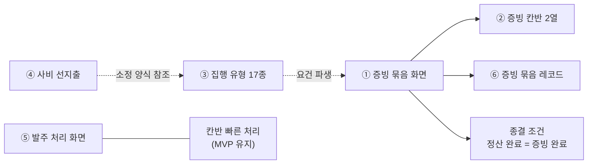

# VADA — 재정 보류 자산 인계

> 상태: 2026-08-19 확정 · **보류이지 폐기가 아니다**
>
> 대상: `VADA_MVP_SPEC.md` 6.1이 MVP 제품화에서 제외한 재정 기능
>
> 목적: 제외한 기능을 **언제든 다시 꺼내 쓸 수 있게** 위치·의존·재개 절차를 남긴다. 코드는 삭제하지 않고 와이어프레임에 그대로 둔다.

## 1. 이 문서를 쓰는 이유

제외 결정은 "필요 없다"가 아니라 **"첫 파일럿에서 검증할 것이 아니다"**다. 근거는 셋이다.

1. `VADA_MVP_SPEC.md` §5가 `증빙 완료의 전체 집행 프로세스`·`상세 증빙 관리`를 처음부터 제외 범위로 뒀다.
2. 재정부원 인터뷰(2026-08-15)에서 파일 정리 부담이 반증됐다. 표본 1명이라 확정 근거는 아니지만, **넣을 근거가 없다는 점**은 분명해졌다.
3. 집행 유형 17종과 사비 선지출은 세칙·별칙·소정 양식 대조에서 도출됐고 사용자가 제기한 고통이 아니다.

셋 다 **뒤집힐 수 있는 근거**다. 파일럿에서 증빙 요구가 관찰되거나, 감사에서 실제로 지적을 받거나, 재정부원 표본이 늘어 판단이 바뀌면 그때 꺼낸다. 그래서 지우지 않는다.

## 2. 보류 자산 목록

코드 위치는 **함수·상수 이름이 기준**이다. 줄 번호는 커밋 `6f2be57` 시점의 참고값이며 이후 밀린다.

| # | 자산 | 코드 위치 | 하는 일 | 보류 근거 |
|---|---|---|---|---|
| 1 | **증빙 묶음 화면** | `FINEVID01` (~16283) | 여러 요청의 실행분을 구매처·결제·영수증 기준으로 재구성해 증빙 묶음 완료 | §5 `상세 증빙 관리` · 인터뷰 반증 |
| 2 | **증빙 칸반 영역** | `financeAreas`의 `증빙` 항목 (~13073) | `증빙 필요`·`증빙 정리 중` 2열 | 1번에 종속 |
| 3 | **집행 유형 17종** | `EXECUTION_TYPES` (~1148, 121줄) · `FINREV01` 내 판정 UI (~14600) | 별칙 제7~21조 유형별 증빙 요건·결제 주체·한도 판정 | 규범발. 재정부에 17종 판정 부담 |
| 4 | **사비 선지출·환급** | `FINADV01` (~16075) · `AdvanceClaim` (~1278) · `ADVANCE_FORM_FIELDS` (~1298) · `AppContext.advanceClaims` (~1013) | 개인 선결제 → 재정부 확인 → 환급 실행 | 규범발. 소정 양식 4종에서 도출 |
| 5 | **구매·발주 처리 화면** | `FINPROC01` (~15773) | 실행분 테이블 + 발주·수령·취소·환불 상세 처리 | §6이 후속 범위로 지정. **칸반 빠른 처리로 대체 가능** |
| 6 | **증빙 묶음 레코드** | `EvidenceBundle` (~149) · `DEFAULT_EVIDENCE_BUNDLES` (~10866) | 완료된 증빙 묶음 보관·열람 | 1번에 종속 |

**보류하지 않는 것** — 아래는 MVP에 남는다. 혼동하지 않는다.

- 재정부 처리 단계 칸반 본체(`financeAreas` 나머지 영역, `EVTFIN01`)
- 실행분 모델(`PurchaseExecution` ~174)과 상태 계산(`getFinanceStageForExecution` ~358)
- 칸반 빠른 처리 헬퍼(`exec*` ~402~509) — 주문·수령·이행·취소·환불·재주문
- 품목 현황 칸반

## 3. 증빙을 빼면 상태 기계가 바뀐다

**가장 중요한 항목이다.** 증빙은 칸반의 7영역 중 하나가 아니라 **종결 조건이자 게이트**다. `getFinanceStageForExecution`에 세 곳으로 박혀 있다.

```
if (ex.evidenceStatus === "증빙 완료") return "정산 완료";          // ① 종결의 유일한 경로
if (ex.evidenceStatus === "증빙 필요" || ex.receiptStatus === "수령 완료"
    || ex.serviceStatus === "이행 완료") return "증빙 필요";        // ② 수령 즉시 증빙으로
const blocked = ... origin.evidenceStatus === "증빙 필요" ...       // ③ 재주문 보류 게이트
if (blocked) return "재주문 보류";
```

| 그냥 빼면 | 결과 |
|---|---|
| ① 제거 | **종결 불가.** `정산 완료`에 도달할 방법이 없어진다 |
| ② 제거 안 함 | **카드 증발.** 수령 완료 카드가 `증빙 필요`가 되는데 영역이 없어 어디에도 안 잡힌다 |
| ③ 제거 | `재주문 보류` 열이 영원히 빈다 |

### 확정된 대체 설계 (2026-08-19, `(나)`안)

증빙 2열을 빼고 **`완료` 영역 1열을 신설한다.** 순증 −1열이다.

| 변경 | 내용 |
|---|---|
| 종결 조건 | `수령 완료`·`이행 완료` = **`정산 완료`**(종결)로 재정의 |
| `완료` 영역 | 종결 카드를 **보드에서 지우지 않고 모아 둔다** |
| 재주문 보류 | 게이트를 **환불 미확정만**으로 다시 세운다 |

### 구현 방식 — 스위치 하나로 되돌린다 (2026-08-19 적용)

증빙 분기를 **삭제하지 않고** 상수 하나로 감쌌다. 다시 꺼낼 때 코드를 복원할 필요가 없다.

```ts
// src/app/App.tsx
export const EVIDENCE_STAGE_ENABLED = false;   // ← true로 바꾸면 증빙 단계가 그대로 살아난다
```

이 상수가 지배하는 곳은 네 군데다.

| 위치 | false일 때 | true일 때 |
|---|---|---|
| `getFinanceStageForExecution` 종결 | `수령 완료`·`이행 완료` → `정산 완료` | `증빙 필요` → `증빙 정리 중` → `증빙 완료` → `정산 완료` |
| 같은 함수, 주문 취소 분기 | 환불 확정 후 바로 `재주문 판단` | 환불 후 증빙 정리를 거쳐 `재주문 판단` |
| 같은 함수, 재주문 보류 게이트 | 환불 미확정만 판정 | 환불 + 증빙 미완료 판정 |
| `getFinancePurchaseProgress` (승인 전·마이그레이션 경로) | 위와 동일 규칙 | 위와 동일 규칙 |
| `financeAreas` 마지막 영역 | `완료`(`정산 완료`) | `증빙`(`증빙 필요`·`증빙 정리 중`) |

`FIN-EVID-01` 화면과 `evidenceStatus` 원본 필드는 **손대지 않았다.** 스위치는 처리 단계 계산과 보드 영역만 바꾼다. 증빙 화면은 지금도 열리고 동작하며, 그 결과가 처리 단계 보드에 반영되지 않을 뿐이다.

테스트도 함께 따라간다 — `finance-logic.test.tsx`의 증빙 제외 describe는 `describe.skipIf(EVIDENCE_STAGE_ENABLED)`로 묶여 있어 **스위치를 켜면 자동으로 건너뛴다.**

`완료` 영역을 두는 이유는 인터뷰에서 실재가 확인된 유일한 고통 때문이다.

> 내용을 몰라 물어봐야 한 거래가 있었나 → **있었다.**

증빙 없이도 "이번 학기에 뭘 사서 받았나"가 남으면 그 고통이 해결된다. 증빙을 다시 꺼낼 때는 이 `완료` 영역 뒤에 증빙 2열을 붙이면 되고, 종결 조건을 `증빙 완료`로 되돌린다.

## 4. 의존 관계 — 무엇을 꺼내면 무엇이 따라오는가



| 꺼내는 것 | 함께 필요한 것 |
|---|---|
| ① 증빙 묶음 | ②·⑥ 필수. 종결 조건을 `증빙 완료`로 되돌린다 |
| ③ 집행 유형 | 단독 가능. 다만 ①이 없으면 판정 결과를 쓸 곳이 없어 **가치가 반감**된다 |
| ④ 사비 선지출 | 단독 가능. ③이 있으면 소정 양식 필드가 유형에서 파생돼 완결된다 |
| ⑤ 발주 처리 | 단독 가능. **칸반 빠른 처리와 전환 규칙이 중복**되므로 둘 중 하나를 기준으로 삼는다 |

⑤는 코드에 이미 경고가 있다.

> `exec*` 헬퍼 주석: 전환 규칙은 `FIN-PROC-01`의 동명 핸들러와 동일하게 유지한다(수정 시 함께 반영).

**⑤를 다시 꺼내면 이 이중 관리가 부활한다.** 꺼낼 때 한쪽으로 통합하는 것을 먼저 검토한다.

## 5. 꺼내는 신호 — 언제 재개하는가

| 자산 | 재개 신호 |
|---|---|
| ① 증빙 묶음 | 파일럿에서 증빙 업로드 요구가 관찰되거나, 감사에서 증빙 누락 지적을 실제로 받음 |
| ③ 집행 유형 | 재정부가 유형별 증빙 요건을 직접 묻기 시작함. 또는 위원회 문의 2번(소액 면제 범위) 답변으로 판정 기준이 단순해짐 |
| ④ 사비 선지출 | 개인 선결제 건이 실제로 발생하고 카톡·수기로 정산되는 것이 확인됨 |
| ⑤ 발주 처리 | 칸반 빠른 처리로 부족하다는 요청. 특히 부분 수량 주문·물품 반환·수령 문제 표시 |
| — | 2단계 진입(`VADA_FINANCE_SCREENS.md` 4.1 세 지표 충족) 시 ①③은 함께 검토 |

## 6. `FIN-PROC-01`에만 있는 동작

⑤를 빼면 칸반 빠른 처리에 **없는** 동작 4개가 함께 빠진다. 재개 판단 시 이 목록을 기준으로 본다.

| 동작 | 핸들러 | 대체 가능성 |
|---|---|---|
| 부분 수량 주문 | `orderExecution` / `execOrderQty` | 헬퍼는 남아 있어 칸반에 버튼만 붙이면 된다 |
| 수령 문제(파손·오배송) | `flagReceiptIssue` | 칸반에 추가 가능 |
| 물품 반환 | `returnItem` | 환불 흐름과 연결돼 있어 재개 비용이 가장 크다 |
| 품절 반려 | `rejectItemOutOfStock` | `구매 불가 처리 필요` 열에서 대체 가능 |

## 7. 재개 시 회귀 확인

꺼낼 때 반드시 확인한다.

- `SCREENS` = `SPEC_DATA` = `SCREEN_COMPONENTS` 개수 일치
- `docs/VADA_SCREEN_QA.md` 해당 화면 QA 항목 — `FIN-EVID-01-03`은 **치명적 등급**이라 화면만 고치고 QA를 안 고치면 막힌다
- `src/app/finance.test.tsx` · `finance-logic.test.tsx` — 상태 계산이 바뀌면 여기서 잡힌다
- 예산 집계 음수 여부
- `env -u NODE_OPTIONS pnpm run build` + `pnpm run test`
- **빌드만으로 판단하지 않는다.** `vite build`는 타입 검사와 모듈 평가를 하지 않아 TDZ 오류·아이콘 미임포트를 통과시킨 전례가 있다(`VADA_FINANCE_SCREENS.md` 9장 3번)

## 8. 관련 문서

| 문서 | 역할 |
|---|---|
| `VADA_MVP_SPEC.md` 6.1 | **제품화 범위의 단일 기준.** 넣고 빼는 것을 여기서 정한다 |
| `VADA_FINANCE_SPEC.md` | 재정 도메인 규칙. 보류 자산의 상태·전이 정의는 여기에 그대로 살아 있다 |
| `VADA_FINANCE_SCREENS.md` | 화면 설계 범위와 1·2단계 구분 |
| `VADA_AUDIT_RULES_GAP.md` | 집행 유형·증빙 요건의 규범 근거 |
| `VADA_AUDIT_INQUIRY_SENT.md` | 위원회 문의 6건. 답변이 오면 ③④의 재개 판단이 달라질 수 있다 |

## 9. 변경 이력

| 일자 | 내용 |
|---|---|
| 2026-08-19 | 신설. 보류 자산 6종의 위치·의존·재개 신호·회귀 확인 정리. 증빙 제거에 따른 종결 조건 재정의(`(나)`안: `완료` 영역 신설)를 확정 기록 |
| 2026-08-19 | 구현 적용. 증빙 분기를 삭제하지 않고 `EVIDENCE_STAGE_ENABLED` 스위치로 감쌌다. 3장에 스위치 지배 범위와 되돌리는 법 추가 |
