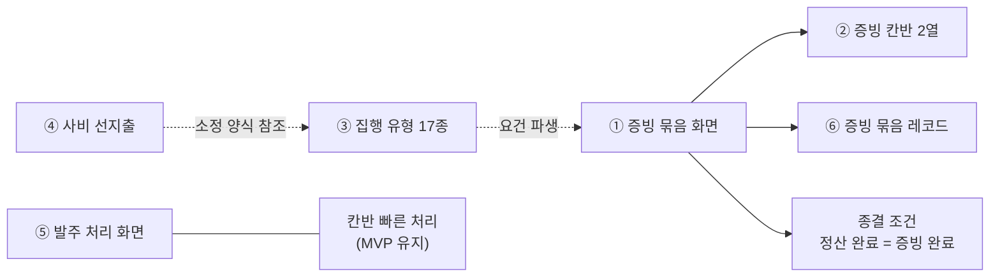

# VADA — 재정 보류 자산 인계

> 상태: 2026-08-19 확정 · **보류이지 폐기가 아니다**
>
> 대상: `VADA_MVP_SPEC.md` 6.1이 MVP 제품화에서 제외한 재정 기능
>
> 목적: 제외한 기능을 **언제든 다시 꺼내 쓸 수 있게** 위치·의존·재개 절차를 남긴다. 코드는 삭제하지 않고 와이어프레임에 그대로 둔다.

## 1. 이 문서를 쓰는 이유

제외 결정은 "필요 없다"가 아니라 **"첫 파일럿에서 검증할 것이 아니다"**다. 근거는 셋이다.

1. `VADA_MVP_SPEC.md` §5가 `증빙 완료의 전체 집행 프로세스`·`상세 증빙 관리`를 처음부터 제외 범위로 뒀다.
2. 재정부원 인터뷰(2026-08-15)에서 파일 정리 부담이 반증됐다. 표본 1명이라 확정 근거는 아니지만, **넣을 근거가 없다는 점**은 분명해졌다.
3. 집행 유형 17종과 사비 선지출은 세칙·별칙·소정 양식 대조에서 도출됐고 사용자가 제기한 고통이 아니다.

셋 다 **뒤집힐 수 있는 근거**다. 파일럿에서 증빙 요구가 관찰되거나, 감사에서 실제로 지적을 받거나, 재정부원 표본이 늘어 판단이 바뀌면 그때 꺼낸다. 그래서 지우지 않는다.

## 2. 보류 자산 목록

코드 위치는 **함수·상수 이름이 기준**이다. 줄 번호는 커밋 `6f2be57` 시점의 참고값이며 이후 밀린다.

| # | 자산 | 코드 위치 | 하는 일 | 보류 근거 |
|---|---|---|---|---|
| 1 | **증빙 묶음 화면** | `FINEVID01` (~16283) | 여러 요청의 실행분을 구매처·결제·영수증 기준으로 재구성해 증빙 묶음 완료 | §5 `상세 증빙 관리` · 인터뷰 반증 |
| 2 | **증빙 칸반 영역** | `financeAreas`의 `증빙` 항목 (~13073) | `증빙 필요`·`증빙 정리 중` 2열 | 1번에 종속 |
| 3 | **집행 유형 17종** | `EXECUTION_TYPES` (~1148, 121줄) · `FINREV01` 내 판정 UI (~14600) | 별칙 제7~21조 유형별 증빙 요건·결제 주체·한도 판정 | 규범발. 재정부에 17종 판정 부담 |
| 4 | **사비 선지출·환급** | `FINADV01` · `AdvanceClaim` · `ADVANCE_FORM_FIELDS` · `AppContext.advanceClaims` · 진입점 스위치 `ADVANCE_CLAIM_ENABLED` | 개인 선결제 → 재정부 확인 → 환급 실행 | 규범발. 소정 양식 4종에서 도출. **2026-09-02부터 진입점도 스위치로 닫혔다**(5장 센서 절 참조) |
| 6 | **증빙 묶음 레코드** | `EvidenceBundle` (~149) · `DEFAULT_EVIDENCE_BUNDLES` (~10866) | 완료된 증빙 묶음 보관·열람 | 1번에 종속 |

> **⑤ 구매·발주 처리 화면(`FIN-PROC-01`)은 보류 목록에서 뺐다 (2026-08-19 정정).** 칸반 카드의 상세보기가 승인 요청을 이 화면으로 보내고, `구매 불가 처리 필요` 열은 빠른 처리 액션이 없어 이 화면에서만 풀 수 있다. 빼면 칸반에 막다른 열이 생긴다. 근거는 `VADA_MVP_SPEC.md` 6.1 정정 절. 번호는 혼선을 막기 위해 ①②③④⑥을 그대로 둔다.

**보류하지 않는 것** — 아래는 MVP에 남는다. 혼동하지 않는다.

- 재정부 처리 단계 칸반 본체(`financeAreas` 나머지 영역, `EVTFIN01`)
- **구매·발주 처리 화면(`FINPROC01`)** — 칸반의 상세 뷰. 단 부분 수량 주문·수령 문제·물품 반환은 후속
- 실행분 모델(`PurchaseExecution` ~174)과 상태 계산(`getFinanceStageForExecution` ~358)
- 칸반 빠른 처리 헬퍼(`exec*` ~402~509) — 주문·수령·이행·취소·환불·재주문
- 품목 현황 칸반

## 3. 증빙을 빼면 상태 기계가 바뀐다

**가장 중요한 항목이다.** 증빙은 칸반의 7영역 중 하나가 아니라 **종결 조건이자 게이트**다. `getFinanceStageForExecution`에 세 곳으로 박혀 있다.

```
if (ex.evidenceStatus === "증빙 완료") return "정산 완료";          // ① 종결의 유일한 경로
if (ex.evidenceStatus === "증빙 필요" || ex.receiptStatus === "수령 완료"
    || ex.serviceStatus === "이행 완료") return "증빙 필요";        // ② 수령 즉시 증빙으로
const blocked = ... origin.evidenceStatus === "증빙 필요" ...       // ③ 재주문 보류 게이트
if (blocked) return "재주문 보류";
```

| 그냥 빼면 | 결과 |
|---|---|
| ① 제거 | **종결 불가.** `정산 완료`에 도달할 방법이 없어진다 |
| ② 제거 안 함 | **카드 증발.** 수령 완료 카드가 `증빙 필요`가 되는데 영역이 없어 어디에도 안 잡힌다 |
| ③ 제거 | `재주문 보류` 열이 영원히 빈다 |

### 확정된 대체 설계 (2026-08-19, `(나)`안 / 2026-09-01 종결 조건 정정)

증빙 2열을 빼고 **`완료` 영역을 신설한다.**

| 변경 | 내용 |
|---|---|
| 종결 조건 | `수령 완료`·`이행 완료` **다음에 실지출 금액 확정 하나를 남긴다.** 금액이 확정된 실행분만 `정산 완료` |
| `완료` 영역 | `금액 확인` → `정산 완료` 2열. 종결 카드를 **보드에서 지우지 않고 모아 둔다** |
| 재주문 보류 | 게이트를 **환불 미확정만**으로 다시 세운다 |
| 순증 | 증빙 2열 제거, 완료 2열 추가로 **±0열** |

#### 왜 금액 확정을 남겼나 (2026-09-01)

초안(2026-08-19)은 `수령 완료`를 곧바로 `정산 완료`로 보냈다. **처리 단계만 보고 예산 쪽을 확인하지 않은 판단이었다.**

예산의 실지출 전환은 `itemFullySettled`가 판정하는데, 그 조건이 `evidenceStatus === "증빙 완료"`로 남아 있었다. 증빙 화면은 MVP 제외로 격리돼 아무도 쓰지 않으므로 **이 조건은 영원히 참이 되지 않는다.** 결과는 이랬다.

| 화면 | 같은 품목(REQ-004 배너 거치대 80,000원)을 뭐라고 불렀나 |
|---|---|
| 처리 단계 칸반 | `정산 완료` — 끝난 구매 |
| 예산 요약 | `승인·집행 예정액` — 아직 안 쓴 돈 |

실제 지출액은 영원히 늘지 않고 집행 예정액은 영원히 줄지 않았다. **사용 가능액만 우연히 맞아서**(둘 다 배정액에서 빼므로) 눈에 띄지 않았다.

증빙 파일·영수증 번호·구매처 묶음은 빼도 되지만 **실지출 금액 한 칸은 뺄 수 없다.** 그게 없으면 예산 화면이 거짓말을 한다. 그래서 종결 판정 축을 증빙에서 **실지출 금액**으로 옮기고, 처리 단계와 예산이 같은 축을 보게 했다.

받는 것은 금액 하나뿐이다 — `승인액과 동일` 한 번 누르거나 실제 결제액을 직접 넣는다. 팝오버 안에서 끝나고 새 화면은 없다.

### 구현 방식 — 스위치 하나로 되돌린다 (2026-08-19 적용)

증빙 분기를 **삭제하지 않고** 상수 하나로 감쌌다. 다시 꺼낼 때 코드를 복원할 필요가 없다.

```ts
// src/app/App.tsx
export const EVIDENCE_STAGE_ENABLED = false;   // ← true로 바꾸면 증빙 단계가 그대로 살아난다
```

이 상수가 지배하는 곳은 네 군데다.

| 위치 | false일 때 | true일 때 |
|---|---|---|
| `getFinanceStageForExecution` 종결 | `수령 완료`·`이행 완료` → `정산 완료` | `증빙 필요` → `증빙 정리 중` → `증빙 완료` → `정산 완료` |
| 같은 함수, 주문 취소 분기 | 환불 확정 후 바로 `재주문 판단` | 환불 후 증빙 정리를 거쳐 `재주문 판단` |
| 같은 함수, 재주문 보류 게이트 | 환불 미확정만 판정 | 환불 + 증빙 미완료 판정 |
| `getFinancePurchaseProgress` (승인 전·마이그레이션 경로) | 위와 동일 규칙 | 위와 동일 규칙 |
| `financeAreas` 마지막 영역 | `완료`(`금액 확인`·`정산 완료`) | `증빙`(`증빙 필요`·`증빙 정리 중`) |
| `itemFullySettled` (예산 실지출 전환) | 모든 실행분에 `actualAmount`가 있으면 전환 | 모든 실행분이 `증빙 완료`면 전환 |
| `getGeneralProgressForExecution` | `actualAmount` 확정 시 요청자에게 `처리 완료` | `증빙 완료` 시 `처리 완료` |
| 팝오버 `금액 확인` 액션 | `SettleAmountPanel`(결제 수단 3종 → 승인액과 동일 / 직접 입력) | 해당 단계에 도달하지 않음 |
| `기록 > 증빙 묶음` 탭 · 상단 `증빙 정리` 버튼 · 팝오버 `증빙 처리하기` | **노출하지 않는다** | 노출 |
| `FIN-PROC-01` 실행분 표 마지막 열 | `실지출`(확정 금액 / `미확정`) | `증빙`(evidenceStatus) |
| `FIN-PROC-01` 처리 열 · 주 액션 | 금액 확정 액션 · `행사 재정으로` | `증빙 필요` 배지 · `증빙 정리로 이동` |
| `EVT-FIN-01` 품목 현황 열 | 수령·이행 완료와 정산 중을 **한 열로 합친다** | `수령·이행 완료` / `정산 중` 2열 |
| `FIN-00` 증빙 현황 카드 · 증빙 상태 열 | 감추고 지출 내역이 폭을 모두 쓴다 | 3열 그리드에 카드 노출 |
| `FIN-LEDGER-01` 증빙 열 · 필터 · `증빙 누락` 요약 | 감춘다. 확정 판정도 실지출 금액을 따르고 `금액 미확정` 건수를 보여준다 | 증빙 기준 |
| `execAdvanceFulfillment` · `FIN-PROC-01` 수령·이행 진행 | 완료 시 `evidenceStatus`를 **심지 않는다** | 완료 시 `증빙 필요`를 심는다 |
| `openPurchaseRequest` 라우팅 | `증빙 필요` 요청도 `FIN-EVID-01`로 보내지 않는다 | `증빙 필요` → `FIN-EVID-01` |

### 3.1 두 번째 스위치 — `ADVANCE_CLAIM_ENABLED` (2026-09-02)

사비 선지출은 증빙과 **독립된 자산**이라(4장 의존 그래프에서 ④는 ①에 종속되지 않는다) 상수를 따로 둔다. 증빙 스위치를 재사용하면 두 자산이 한 손잡이에 묶여 따로 재개할 수 없게 된다.

```
export const ADVANCE_CLAIM_ENABLED = false;
```

| 위치 | false일 때 | true일 때 |
|---|---|---|
| `EVT-FIN-01` 액션 바 `사비 선지출` 버튼 | **노출하지 않는다** | `FIN-ADV-01`(권한 보유 시 `01B`)로 이동 |

지배 범위가 한 곳뿐인 이유는, 선지출이 상태 기계에 박혀 있지 않고 **독립 화면 + 독립 모델**(`AdvanceClaim`)이기 때문이다. 증빙과 달리 계산에 손댈 것이 없다. `FINADV01` 화면과 `AdvanceClaim` 모델은 그대로 살아 있고, 좌측 화면 목록의 `운영 — 행사 · 재정(MVP 제외·보류)` 그룹에서 여전히 열린다.

**되살리는 법**: 상수를 `true`로 바꾸면 진입점이 돌아온다. 그 전에 4.1을 먼저 읽는다 — 별도 화면이 아니라 결제 수단 확장으로 충분할 수 있다.

`FIN-EVID-01` 화면과 `evidenceStatus` 원본 필드는 **손대지 않았다.** 스위치는 처리 단계 계산과 보드 영역만 바꾼다. 증빙 화면은 지금도 열리고 동작하며, 그 결과가 처리 단계 보드에 반영되지 않을 뿐이다.

테스트도 함께 따라간다 — `finance-logic.test.tsx`의 증빙 제외 describe는 `describe.skipIf(EVIDENCE_STAGE_ENABLED)`로 묶여 있어 **스위치를 켜면 자동으로 건너뛴다.**

`완료` 영역을 두는 이유는 인터뷰에서 실재가 확인된 유일한 고통 때문이다.

> 내용을 몰라 물어봐야 한 거래가 있었나 → **있었다.**

증빙 없이도 "이번 학기에 뭘 사서 받았나"가 남으면 그 고통이 해결된다. 증빙을 다시 꺼낼 때는 이 `완료` 영역 뒤에 증빙 2열을 붙이면 되고, 종결 조건을 `증빙 완료`로 되돌린다.

### 재개할 때 이 묶음의 이름과 1차 목적을 바꾼다 (2026-09-01 기록)

**증빙 묶음을 묶는 축은 영수증이 아니라 거래다.** 같은 구매처에서 한 번에 결제한 실행분이 한 묶음이 되고, 영수증은 그 거래에 붙는 증거물이다. 요청·승인 묶음과 무관하게 실제 거래가 같으면 함께 묶이는 현재 규칙이 이미 그렇게 되어 있다.

그래서 재개 시점에는 이 자산을 **`구매 묶음`(거래 단위)으로 재정의**하는 것을 먼저 검토한다. 그러면

- 영수증이 없는 결제(현금·계좌이체)도 묶음이 성립한다. 지금 이름으로는 증빙이 없으면 묶을 근거가 사라진다
- 이번에 도입한 실행분별 `actualAmount`가 그대로 묶음 합계로 올라간다. **금액 확인 단계는 구매 묶음과 호환된다** — 실행분에 이미 금액이 붙어 있으므로 묶음은 합계만 계산하면 된다
- 영수증 번호·파일은 묶음의 **속성**이 되고, 묶음 성립의 **전제**가 아니게 된다

**지금 이름을 바꾸지 않는 이유**는 세 가지다.

1. MVP에서 이 탭을 노출하지 않으므로 화면에서 바꿀 대상이 없다. 라벨만 바꾸고 숨기면 아무도 보지 못한다
2. 코드 타입은 `EvidenceBundle`, 필드는 `receiptNo`·`evidenceStatus`다. UI 라벨만 바꾸면 코드·문서·UI가 세 갈래로 갈려 스위치를 켤 때 회귀 확인이 어려워진다
3. 이름을 바꿔도 **묶는 노동은 그대로 남는다.** 재정부가 "이 실행분들은 한 번의 결제였다"고 골라 묶는 작업이 증빙 정리의 본체이고, MVP에서 그 작업을 시킬 수 없다는 판단은 바뀌지 않았다

**이름 후보 주의** — `기록` 그룹에 `승인 묶음`이 이미 있어 `구매 묶음`을 나란히 두면 "구매"와 "묶음"이 각각 두 번씩 나온다. 재개 시 두 탭의 이름을 함께 정한다.

## 4. 의존 관계 — 무엇을 꺼내면 무엇이 따라오는가



| 꺼내는 것 | 함께 필요한 것 |
|---|---|
| ① 증빙 묶음 | ②·⑥ 필수. 종결 조건을 `증빙 완료`로 되돌린다 |
| ③ 집행 유형 | 단독 가능. 다만 ①이 없으면 판정 결과를 쓸 곳이 없어 **가치가 반감**된다 |
| ④ 사비 선지출 | 단독 가능. ③이 있으면 소정 양식 필드가 유형에서 파생돼 완결된다. **다만 별도 화면으로 되살리기 전에 4.1을 먼저 읽는다** |
| ~~⑤ 발주 처리~~ | **MVP로 재편입(2026-08-19).** 칸반 빠른 처리와 전환 규칙이 중복되므로, 손댈 때 `exec*` 헬퍼와 `FIN-PROC-01` 동명 핸들러를 함께 고친다 |

⑤는 코드에 이미 경고가 있다.

> `exec*` 헬퍼 주석: 전환 규칙은 `FIN-PROC-01`의 동명 핸들러와 동일하게 유지한다(수정 시 함께 반영).

**⑤가 MVP에 남으므로 이 이중 관리는 현재진행형이다.** 전환 규칙을 고칠 때 두 곳을 함께 봐야 하며, 통합은 별도 과제로 남는다.

### 4.1 ④ 사비 선지출은 별도 화면이 아니어도 될 수 있다

**다시 꺼낼 때 `FIN-ADV-01`을 그대로 되살리지 않는다.** 먼저 증빙의 결제수단 확장으로 충분한지 검토한다.

근거는 셋이다.

1. **이미 표현이 있다.** `FIN-EVID-01`의 결제수단은 `지정 카드 / 계좌 이체 / **사비 선지출** / 개인 카드(대표 카드 사고)` 4종이다. 사비 선지출은 이미 증빙의 한 선택지다.
2. **데이터가 전부 증빙 모양이다.** `AdvanceClaim`은 선지출자·선지출액·소정 양식 입력값·환급액·환급 계좌·환급 실행일·명의 일치 송금 내역서를 담는다. 요청·검토 흐름의 데이터가 없고 상태도 `청구 제출 → 확인 중 → 환급 완료 → 반려` 4개뿐이다.
3. **자기 규칙과 충돌한다.** `VADA_FINANCE_SPEC.md` §1 11번은 "기존 원본 상태·계산 표시로 해결할 수 없는지 먼저 검토하고 필요성이 입증되지 않으면 추가하지 않는다"고 정한다. 결제수단 옵션으로 표현되는 것을 도메인 단위로 승격시킨 셈이다.

**남는 진짜 문제 하나** — 주유비는 별칙 제8조⑤에 따라 **공금 결제가 불가**하다. 그 지출은 요청·승인 경로를 아예 탈 수 없어 행사 예산 집계에서 빠진다. 증빙이 아니라 집계 구멍이다.

다만 **빈도 데이터가 없다.** 결산안 실물 34행 대조는 지출 27건을 세면서 실비 항목을 따로 분류하지 않았다. 학생회가 렌터카·주유비를 쓰는 빈도가 확인되지 않은 상태다.

| 관찰 결과 | 재개 형태 |
|---|---|
| 사비 선지출 결제수단 선택이 드묾 | 재개하지 않는다 |
| 선택은 잦으나 식대 한도 초과분 위주 | **증빙 결제수단 확장으로 충분.** 선지출자·환급액·송금 내역서 필드만 추가 |
| 주유비·렌터카 등 공금 불가 지출이 실재하고 예산 집계가 어긋남 | 그때 별도 청구 단위(`AdvanceClaim`)를 검토한다 |

## 5. 꺼내는 신호 — 언제 재개하는가

> **센서가 어디 있는지 먼저 확인한다 (2026-09-02).** ④의 재개 신호는 결제수단 선택 빈도인데, 그 선택지가 `FIN-EVID-01` 안에 있어서 **증빙을 빼면서 센서까지 같이 사라져 있었다.** 신호를 기다리는데 신호를 만들 장치가 없는 상태였다. 실지출 확정(`금액 확인`)에 `paymentSource` 3종을 붙여 더 싼 자리에 센서를 복구했다. 파일럿 동안 종결되는 모든 실행분이 이 값을 남기므로, M5 판정에 쓸 빈도 데이터가 자동으로 쌓인다. 4.1의 세 갈래 재개 형태는 이 데이터로 고른다.

| 자산 | 재개 신호 |
|---|---|
| ① 증빙 묶음 | 파일럿에서 증빙 업로드 요구가 관찰되거나, 감사에서 증빙 누락 지적을 실제로 받음 |
| ③ 집행 유형 | 재정부가 유형별 증빙 요건을 직접 묻기 시작함. 또는 위원회 문의 2번(소액 면제 범위) 답변으로 판정 기준이 단순해짐 |
| ④ 사비 선지출 | **`금액 확인`의 결제 수단에서 `사비 선지출` 선택이 반복 관찰됨.** 개인 선결제가 카톡·수기로 정산되는 것이 확인되면 보강 신호. 4.1도 함께 본다 |
| ⑤ 발주 처리의 **후속 동작** | 부분 수량 주문·물품 반환·수령 문제 표시가 실제로 필요하다는 요청. 화면 자체는 MVP에 있다 |
| — | 2단계 진입(`VADA_FINANCE_SCREENS.md` 4.1 세 지표 충족) 시 ①③은 함께 검토 |

## 6. `FIN-PROC-01`에만 있는 동작 — 후속 범위

화면은 MVP에 있지만, 칸반 빠른 처리에 **없고 이 화면에만 있는** 동작 4개는 후속이다. `품절 반려`는 `구매 불가 처리 필요` 열을 푸는 유일한 경로라 **MVP에 포함**한다.

| 동작 | 핸들러 | 대체 가능성 |
|---|---|---|
| 부분 수량 주문 | `orderExecution` / `execOrderQty` | 헬퍼는 남아 있어 칸반에 버튼만 붙이면 된다 |
| 수령 문제(파손·오배송) | `flagReceiptIssue` | 칸반에 추가 가능 |
| 물품 반환 | `returnItem` | 환불 흐름과 연결돼 있어 재개 비용이 가장 크다 |
| **품절 반려** | `rejectItemOutOfStock` | **MVP 포함.** `구매 불가 처리 필요` 열을 푸는 유일한 경로이며 칸반에 대응 액션이 없다 |

## 7. 재개 시 회귀 확인

꺼낼 때 반드시 확인한다.

- `SCREENS` = `SPEC_DATA` = `SCREEN_COMPONENTS` 개수 일치
- `docs/VADA_SCREEN_QA.md` 해당 화면 QA 항목 — `FIN-EVID-01-03`은 **치명적 등급**이라 화면만 고치고 QA를 안 고치면 막힌다
- `src/app/finance.test.tsx` · `finance-logic.test.tsx` — 상태 계산이 바뀌면 여기서 잡힌다
- 예산 집계 음수 여부
- **처리 단계의 종결과 예산의 실지출 전환이 같은 축을 보는가** — 스위치를 켜면 `itemFullySettled`가 `증빙 완료`로 돌아가야 한다. 한쪽만 바꾸면 칸반은 종결이라 하고 예산은 집행 예정으로 잡는 모순이 다시 생긴다(2026-09-01에 고친 버그)
- `금액 확인` 열이 사라지고 `증빙 필요`·`증빙 정리 중` 2열이 돌아오는가. 이때 `actualAmount`는 증빙 완료 시 입력받는 값으로 돌아간다
- `finance.test.tsx`의 `MVP 재정 화면에 증빙 문구가 남지 않는다`가 자동으로 건너뛰어지는가. 이 describe가 MVP 재정 화면 12개를 렌더해 `증빙` 문자열이 없는지 확인한다(`FIN-REV-01`은 집행 유형 판정 UI 때문에 제외)
- `env -u NODE_OPTIONS pnpm run build` + `pnpm run test`
- **빌드만으로 판단하지 않는다.** `vite build`는 타입 검사와 모듈 평가를 하지 않아 TDZ 오류·아이콘 미임포트를 통과시킨 전례가 있다(`VADA_FINANCE_SCREENS.md` 9장 3번)

## 8. 관련 문서

| 문서 | 역할 |
|---|---|
| `VADA_MVP_SPEC.md` 6.1 | **제품화 범위의 단일 기준.** 넣고 빼는 것을 여기서 정한다 |
| `VADA_FINANCE_SPEC.md` | 재정 도메인 규칙. 보류 자산의 상태·전이 정의는 여기에 그대로 살아 있다 |
| `VADA_FINANCE_SCREENS.md` | 화면 설계 범위와 1·2단계 구분 |
| `VADA_AUDIT_RULES_GAP.md` | 집행 유형·증빙 요건의 규범 근거 |
| `VADA_AUDIT_INQUIRY_SENT.md` | 위원회 문의 6건. 답변이 오면 ③④의 재개 판단이 달라질 수 있다 |

## 9. 변경 이력

| 일자 | 내용 |
|---|---|
| 2026-08-19 | 신설. 보류 자산 6종의 위치·의존·재개 신호·회귀 확인 정리. 증빙 제거에 따른 종결 조건 재정의(`(나)`안: `완료` 영역 신설)를 확정 기록 |
| 2026-08-19 | 구현 적용. 증빙 분기를 삭제하지 않고 `EVIDENCE_STAGE_ENABLED` 스위치로 감쌌다. 3장에 스위치 지배 범위와 되돌리는 법 추가 |
| 2026-08-19 | ⑤ 구매·발주 처리를 보류 목록에서 제외하고 MVP로 재편입. 칸반 상세보기 경로와 `구매 불가 처리 필요` 막다른 열을 확인한 결과다. 6장을 후속 동작 목록으로 재정의하고 품절 반려를 MVP로 옮김 |
| 2026-08-19 | 4.1 신설 — 사비 선지출은 이미 증빙 결제수단 4종에 들어 있어 중복 모델링이다. 재개 신호를 관찰 가능한 지표(결제수단 선택 빈도)로 바꾸고, 재개 형태를 세 갈래로 나눴다. 공금 결제 불가인 주유비의 예산 집계 구멍은 빈도 미확인으로 기록 |
| 2026-09-01 | **진입점 정리.** 스위치를 껐는데도 `FIN-PROC-01`의 주 액션이 `증빙 정리로 이동`이었고, `FIN-00` 증빙 현황 카드·`FIN-LEDGER-01` 증빙 열·품목 현황 `정산 중` 빈 열·수령 완료 시 `evidenceStatus` 심기가 남아 있었다. 전부 스위치로 감싸고 `FIN-PROC-01`에 금액 확정 액션을 넣어 상세 뷰에서도 종결되게 했다. 회귀 방어로 MVP 재정 화면 12개의 `증빙` 문자열 부재를 테스트로 고정 |
| 2026-09-02 | **④ 진입점 차단과 센서 복구.** `EVT-FIN-01` 액션 바의 `사비 선지출` 버튼이 스위치 없이 MVP 화면에서 보류 화면으로 보내고 있었다(09-01에 증빙만 정리하고 이 축은 빠졌다). `ADVANCE_CLAIM_ENABLED` 상수를 신설해 감쌌다. 화면을 되살리는 대신 `금액 확인`에 결제 수단 3종을 붙여, 사비 결제 사실은 기록하고 청구·환급 흐름은 계속 보류한다. 5장에 센서 절 추가 |
| 2026-09-01 | **종결 조건 정정.** 예산의 실지출 전환이 여전히 `증빙 완료`에 묶여 있어 처리 단계는 `정산 완료`, 예산은 `집행 예정`으로 갈리던 모순을 고쳤다. `완료` 영역을 `금액 확인` → `정산 완료` 2열로 나누고 종결 판정 축을 실지출 금액으로 옮겼다. 3장에 재개 시 `구매 묶음`(거래 단위) 재정의 검토를 기록 |
