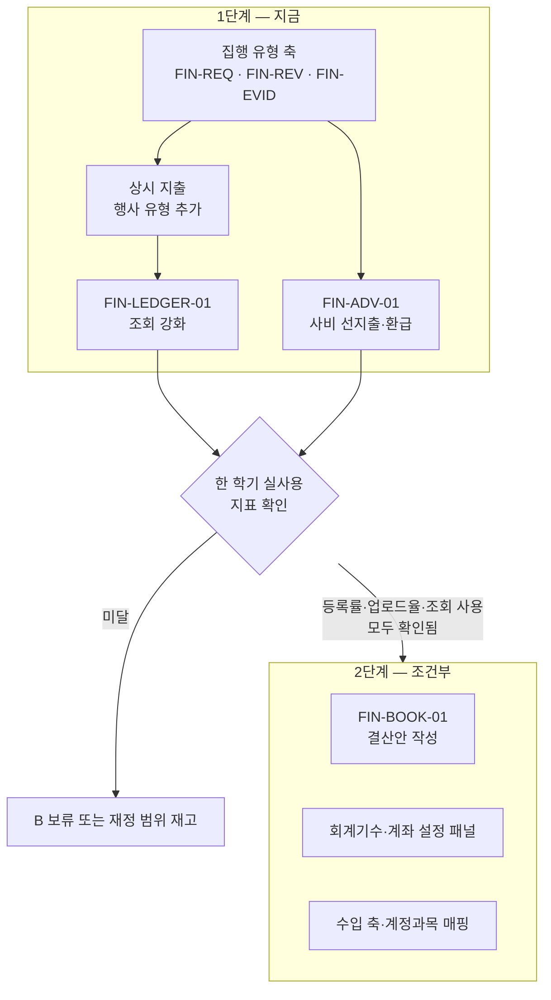

# VADA — 재정 화면 범위

> 상태: 2차 개정 · `VADA_FINANCE_SPEC.md` §17 4번 충족 산출물
>
> 최초 정리: 2026-08-14 · 최종 갱신: 2026-08-15
>
> 근거: `VADA_FINANCE_SPEC.md` 2~15장, `docs/VADA_AUDIT_RULES_GAP.md`, `docs/VADA_AUDIT_CONFIG_SCHEMA.md`, 결산안 실물 34행 대조, 재정부원 인터뷰
>
> 적용 원칙: 이 문서는 **무엇을 만들지**를 정하고 상세 동작은 `VADA_FINANCE_SPEC.md`에서 파생한다. 충돌하면 기준 문서를 우선한다.

## 1. 이 문서가 정하는 것

`VADA_FINANCE_SPEC.md` §17이 요구한 네 번째 조건이다.

**정하지 않는 것**: 어느 화면을 첫 파일럿 제품에 넣을지는 이 문서가 아니라 `docs/VADA_MVP_SPEC.md` 6.1이 정한다(2026-08-19 분리). 이 문서는 재정 도메인이 요구하는 화면의 **설계 범위**를 다룬다.

> 4. 필요한 화면 목록과 기존 화면의 수정·대체 범위를 별도로 확정한다.

§12.3의 "화면 목록과 화면 ID의 최종 구성은 도메인 미결정 사항을 모두 확정한 뒤 결정한다"에 대한 답이기도 하다.

## 2. 2단계로 나눈 이유

초안은 신설 5개를 한 번에 만드는 계획이었다. 결산안 실물 대조와 재정부원 인터뷰에서 **전제 두 개가 흔들려** 단계를 나눴다.

### 2.1 결산안은 VADA가 생성할 수 없다

실물 34행을 한 줄씩 대조한 결과다(8장).

| 구분 | 행 |
|---|---|
| 지출 — VADA 구매 경로로 채울 수 있음 | 27 |
| 환불 입금 — VADA 환불 경로로 채울 수 있음 | 2 |
| 수입 — VADA에 입력 경로가 없음 | 3 |
| **예금 이자 — VADA가 원천적으로 모름** | **2** |

결정적인 것은 `거래 후 잔액`이다. 잔액은 거래 순서에 의존하는데, 첫 예금 이자가 20행에 끼어 있어 **그 이후 24행의 잔액을 VADA만으로 계산할 수 없다.**

즉 **VADA 단독으로 완전히 생성 가능한 행은 0개다.** 은행 내역이 원본이고 VADA는 거기에 정보를 붙이는 구조여야 한다. 제출 가이드도 "은행에서 발급받은 공식 Excel 내용을 그대로 붙여넣는 것을 추천"한다고 안내한다.

### 2.2 현재 워크플로가 이미 단일 입력이다

재정부원 인터뷰(2026-08-15) 요지다.

| 질문 | 답 |
|---|---|
| 결산안을 뭘 보고 쓰나 | 거래가 생길 때마다 **결산안에 직접 기록해서 끝냈다.** 은행 내역을 한 번에 복붙하는 사람도 있다 |
| 증빙 파일 이름 바꾸기는 얼마나 걸리나 | 사진 찍은 날 바로 저장해서 **별로 오래 걸리지 않았다** |
| 내용을 몰라 물어봐야 한 거래가 있었나 | **있었다.** 개수는 기억나지 않는다 |

세 가지를 알 수 있다.

1. **이중 입력이 지금은 없다.** 결산안 하나에만 쓴다. VADA를 넣으면 오히려 입력처가 둘이 된다
2. **파일 정리는 아프지 않다.** 초안에서 "가장 확실한 가치"로 꼽았던 근거가 반증됐다
3. **내용을 기억 못 하는 고통은 실재한다.** 이건 조회만으로 해결된다

표본이 1명이고 실시간 기록형이라 일반화할 수 없다. 다만 **초안이 근거 없이 단정했다는 점은 분명해졌다.**

### 2.3 그래서 값싼 것부터 확인한다

| 안 | VADA가 하는 일 | 비용 | 얻는 것 |
|---|---|---|---|
| **A** | 검색되는 구매 기록 | 낮음 | 내용·금액·요청자·증빙 조회 |
| **B** | 은행 임포트 + 매칭 + 파일 번호 | 높음 | A + 양방향 누락 탐지 + 증빙 번호 + 내보내기 |

**A를 먼저 만들고, 한 학기 실사용 결과로 B를 판단한다.** B는 VADA에 구매 기록이 쌓여 있어야 의미가 있어서, 지금 만들어도 가치를 잴 수 없다.

## 3. 1단계 — 구현 완료 (2026-08-15)

신설은 하나뿐이고 나머지는 기존 화면 수정이다. **네 항목 모두 구현·검증을 마쳤다.**

> **범위 주의 (2026-08-19 추가).** 이 장은 **와이어프레임 구현**이 끝났다는 뜻이지 제품에 들어간다는 뜻이 아니다. 네 항목 중 집행 유형 축과 사비 선지출은 `VADA_MVP_SPEC.md` 6.1에서 **MVP 제품화 제외**로 확정됐다. 규범 대조에서 도출됐고 사용자가 제기한 고통이 아니라는 것이 근거다. 상시 지출은 결산안 실물 11% 근거가 있으나 결산안 작성 목적에서 나왔으므로 함께 보류하고, `FIN-LEDGER-01` 조회 강화만 승격 후보 1순위로 남는다. 와이어프레임 코드는 삭제하지 않고 `docs/VADA_FINANCE_DEFERRED.md`에 인계한다. 재정부 처리 단계 칸반은 **MVP에 남으며**, 증빙 2열만 빼고 `완료` 1열을 넣는다.

| 항목 | 결과 |
|---|---|
| 집행 유형 축 | `EXECUTION_TYPES` 17종 신설. `FIN-REV-01`에서 재정부가 판정하고 `FIN-EVID-01`이 소비한다 |
| 상시 지출 | `EventRecord.kind`로 처리. 새 화면·메뉴 0개 |
| `FIN-LEDGER-01` 조회 강화 | 정적 목업을 실제 데이터 파생으로 교체 |
| `FIN-ADV-01` 사비 선지출·환급 | 신설. 재정부 변형 `FIN-ADV-01B` 포함 |

구현 중 확인한 것은 9장에 기록했다.

### 3.1 집행 유형 축 도입 (수정)

**VADA를 쓸 이유를 만드는 변경이다.** 조회만으로는 도구를 열 유인이 약하다.

| 화면 | 수정 |
|---|---|
| `FIN-REQ-01B` / `01C` 구매 요청 작성·수정 | 요청자는 **집행 유형을 고르지 않는다.** 무엇을 왜 사는지만 쓴다 |
| `FIN-REV-01` / `01B` 검토·재검토 | **재정부가 검토 단계에서 집행 유형을 판정한다.** 유형별 집행 조건과 한도를 근거로 보여주되 자동 판정하지 않는다 |
| `FIN-EVID-01` 결제·증빙 정리 | 집행 유형별 **필수 증빙 체크리스트(항목 단위)**, 결제 주체에서 `현금` 제거와 예외 사유 필수, 거래 일시 입력, 개인정보 자료 분류 |

**판정 주체를 재정부로 옮긴 이유**: 요청자(부서장)가 15종 중 "여비교통비-택시"를 고르려면 별칙을 읽은 사람이어야 한다. 초안은 "요청자가 고르고 재정부가 정정"이었는데, 현실은 재정부가 거의 다 고치게 되므로 요청 단계에 두는 의미가 없다.

**체크리스트를 항목 단위로 두는 이유**: 세칙 제27조가 **필수 증빙 누락 건수**로 징계 수위를 가른다(5건 미만 주의, 5건 이상 경고). 묶음 단위 통과·미통과로는 건수를 셀 수 없다.

계좌·지정 카드 마스터는 2단계로 미룬다. 1단계에서는 마스터 없이 결제 주체 선택지 제한과 예외 사유 입력만 한다.

### 3.2 상시 지출 = 행사 유형 (수정)

실물 결산안에서 사업명이 빈 지출이 **총지출의 약 11%**였다. 어도비 구독, 사물함 번호표, 보궐선거 투표용지 등이다.

초안은 회계기수 화면에 `상시` 영역을 붙였는데 **잘못된 결합이었다.** 부서장이 구독 결제를 요청하려고 "회계기수" 메뉴에 들어가는 건 말이 안 된다.

→ **`EventRecord`에 유형을 두고 `2026-1 상시` 같은 레코드를 만든다.** `budget`·`organization`·`surveySettings`가 모두 optional이라 구조상 가능하다. 행사 재정 화면과 요청·검토·증빙 흐름을 100% 재사용하고, 상시에 불필요한 탭(업무·문서·회의·일정·인원)은 유형으로 숨긴다.

**새 화면도 새 메뉴도 늘지 않는다.**

### 3.3 `FIN-LEDGER-01` 사용 내역 — 조회 강화 (수정)

A안의 본체다. 결산안을 쓰는 사람이 옆에 띄워놓고 쓰는 화면이다.

| 항목 | 내용 |
|---|---|
| 검색 | 날짜, 금액, 품목명, 요청자, 행사 |
| 상세 | 구매 요청 → 품목 → 실행분 → 증빙 자료까지 한 화면에서 추적 |
| 결산안 지원 | 사업명·계정과목 후보·내용 초안을 **복사 가능한 형태**로 제공 |
| 역할 | 전 구성원 열람. 처리 버튼 없음 |

**이름은 `사용 내역`을 유지한다.** 수입 축이 2단계에 생기므로 `재정 내역` 개명도 2단계로 미룬다.

### 3.4 `FIN-ADV-01` 사비 선지출·환급 (신설)

1단계 유일한 신설이다.

| 항목 | 내용 |
|---|---|
| 위치 | 행사 재정 (상시 유형 포함) |
| 목적 | 개인이 먼저 지출한 실비를 청구하고 재정부가 환급한다 |
| 담는 것 | 선지출자·선지출액·집행 유형·소정 양식 입력값, 재정부 확인, 환급액 확정, 환급 계좌·실행일, 명의 일치 송금 내역서 |
| 역할 | 청구는 전 구성원, 확인·환급은 재정부 |
| 근거 | 소정 양식 4종, 별칙 제8조·제15조 |

예산 반영은 **환급 실행 시점**에 환급액 기준이다. 식대처럼 한도 초과분을 환급하지 않으면 미환급분은 조직 예산에 잡지 않는다.

### 3.5 경미 수정

| 화면 | 수정 |
|---|---|
| `FIN-PROC-01` 구매·발주 처리 | 집행 유형에 따라 허용되지 않는 결제 주체 차단 |
| `EVT-FIN-01` / `01B` 행사 재정 | 집행 유형 표시, 상시 유형 대응 |
| `MY-REQ-01` 내 구매 요청 | 사비 선지출 청구 내역 포함 |

### 3.6 영향 없음

회의(`OPS-MEET-*`), 업무(`OPS-TASK-*`, `EVT-TASK-*`), 행사 개요·일정·인원, 조직 관리, 기록(`REC-*`), 메시지, 외부 참여.

## 4. 2단계 — 조건부

**아래는 1단계를 한 학기 쓴 뒤 지표를 보고 판단한다. 지금 만들지 않는다.**

### 4.1 진입 판정 지표

| 지표 | 확인할 것 | 미달 시 |
|---|---|---|
| 구매 요청 등록률 | 실제 지출 중 몇 %가 VADA를 거쳤나 | 매칭할 대상이 없어 B가 성립하지 않는다 |
| 증빙 업로드율 | 증빙이 VADA에 올라왔나 | **파일 번호 부여가 원천적으로 불가능하다** |
| 조회 사용 여부 | 결산안 쓸 때 VADA를 실제로 열었나 | A조차 안 쓴다면 B는 더 안 쓴다 |

### 4.2 `FIN-BOOK-01` 결산안 작성 (2단계 후보)

`FIN-RECON-01`과 `FIN-EXPORT-01`을 통합한 것이다. **대사가 곧 결산안 작성이므로 별개 화면이 아니다.**

성격은 **누적 원장**이다. 은행 내역을 여러 번 받아 쌓고, VADA 기록을 붙이고, 학기말에 확정한다. 월 1회 또는 학기말 사용을 전제한다.

#### 흐름과 설계 결정

| 단계 | 결정 | 근거 |
|---|---|---|
| 1. 은행 내역 들여오기 | **파일 업로드가 아니라 붙여넣기 우선** | 은행마다 형식이 달라 파싱이 취약하다. 결산안 자체도 변환 보조 열을 둘 만큼 자동화를 전제하지 않는다 |
| | 열 매핑 확인 단계 필수 | 출금·입금이 한 열인 은행, 최신 거래가 위인 은행이 있다 |
| | **행 단위 미리보기와 오류 행 표시** | 날짜 형식·금액 표기가 제각각이라 파싱 실패율이 낮지 않다 |
| | 중복 판정은 `거래 일시 + 금액 + 잔액` | 같은 날 같은 금액이어도 잔액은 다르다 |
| | 계좌별 원장 분리 | 제출 가이드가 계좌별 금전출납부 분리를 허용한다 |
| 2. VADA 기록 연결 | **증빙 묶음이 아니라 구매 실행분에 연결** | 결산안 행은 결제 즉시 생기고 증빙 묶음 완료는 한참 뒤다. 시점이 맞지 않는다 |
| | 은행 거래 1 : 실행분 N | 한 번 결제로 여러 품목을 산다. 연결 결과가 곧 증빙 묶음 후보가 된다 |
| | **자동 제안, 사람 확정** | 같은 날 같은 금액 3건이 실재했다. 세칙 제19조① 일치성은 사람이 책임진다. 후보가 유일한 건만 일괄 확정 허용 |
| 3. 미연결 처리 | **양방향으로 표시** | 은행 O·VADA X(이자·이월금 또는 누락 지출)와 VADA O·은행 X(미결제 또는 기록 오류)를 모두 봐야 한다 |
| 4. 증빙 파일 번호 | **내보내기 시점에 한 번에 확정** | 중간에 거래를 끼워 넣으면 뒤 번호가 밀려 이미 바꾼 파일명이 어긋난다. 가이드가 "거래 행 또는 증빙번호"라 해 여지를 준다 |
| 5. 내보내기 | **셀 범위 복사 기본**, xlsx는 보조 | 위원회가 드라이브에 넣어둔 파일에 붙여넣는 방식이다. 우리가 만든 xlsx로 갈아치우면 양식이 어긋날 위험이 있다 |

#### 실제 자동화 범위

초안은 "8열 중 4열"이라고 썼으나 과장이었다.

| 열 | 실제 |
|---|---|
| 거래 일시 · 출금액 · 입금액 · 거래 후 잔액 | 은행이 준다 |
| 사업명 | **완전 자동** |
| 계정과목 | **불가.** 예산 항목이 자유 입력이라 계정과목 6종과 매핑이 없다. 선행 작업 필요 |
| 내용 | **초안 수준.** 실물은 "연합 체전 펀치 기계 남자 공동 1등 상품(배달의민족 상품권)" 같은 문장이라 품목명 조합으로 안 나온다 |
| 증빙 연결 | 증빙이 VADA에 올라와 있을 때만 |

정직하게는 **완전 자동 1열 + 초안 2열 + 조건부 연결 1열**이다.

### 4.3 함께 미루는 것

| 항목 | 이유 |
|---|---|
| 회계기수 축 (기간·파라미터·마감·이월금) | 값 9개짜리 전용 화면은 과하다. B 진입 시 **설정 패널**로 만든다 |
| 계좌·지정 카드 마스터 | 계좌 3개·카드 1~2개다. 마찬가지로 설정 패널 |
| 수입 축과 계정과목 매핑 | 수입 입력 경로가 `FIN-BOOK-01`의 은행 임포트다. 그 화면 없이는 들어올 곳이 없다 |
| `사용 내역` → `재정 내역` 개명 | 수입이 생긴 뒤 |
| 최상위 재정의 재정부 전용 메뉴 3개 | 위 화면들이 2단계이므로 메뉴도 2단계 |

## 5. 메뉴 원칙

`VADA_MENU_STRUCTURE.md` v8과 `VADA_FINANCE_SPEC.md` §12.1에 재정부 전용 메뉴 3개를 추가했으나, **1단계에서는 적용하지 않는다.** 해당 화면이 2단계 조건부이기 때문이다.

| # | 개정 내용 | 적용 시점 |
|---|---|---|
| 1 | 최상위 재정에 재정부 전용 작업 공간 허용 | **2단계** |
| 2 | 상시 지출 요청 경로 | **1단계.** 단 회계기수가 아니라 **행사 유형**으로 구현하므로 메뉴 변경이 필요 없다 |
| 3 | 열람과 처리를 역할로 구분 | 2단계 |

**1단계에서 메뉴 변경은 없다.**

## 6. 구현 순서

| 순서 | 내용 | 이유 |
|---|---|---|
| 1 | 집행 유형 축 | VADA를 쓸 이유를 만든다. 증빙 요건이 명확해진다 |
| 2 | 상시 지출 행사 유형 | 총지출 11%가 여기 있다. 빠지면 조회도 반쪽이다 |
| 3 | `FIN-LEDGER-01` 조회 강화 | 결산안 작성 시 실제로 열어보는 화면 |
| 4 | `FIN-ADV-01` | 실비 정산은 실재하는 별도 흐름이다 |
| — | 2단계 | 4.1 지표 확인 후 |

## 7. 추적 관계

§17 5번(기준 문서와 화면 요구사항의 추적 관계) 대응이다.

| 화면 | 기준 문서 절 |
|---|---|
| `FIN-REQ-01B` / `01C` | §5, §15.2 |
| `FIN-REV-01` / `01B` | §5.3, §6, §15.2 확인된 값 |
| `FIN-EVID-01` | §9 전체, §13, §15.2 |
| `FIN-LEDGER-01` | §10, §12.1 |
| `FIN-ADV-01` | §10, §15.2 반영 대기 |
| `FIN-BOOK-01` (2단계) | §1 7번, §9.4, §13, §15.2 제출 가이드 확인 결과 |

## 8. 결산안 실물 34행 대조

2.1의 근거다. 단과대학 1학기 결산안 사본을 행 단위로 분류했다.

| 분류 | 행 수 | 내역 |
|---|---|---|
| 지출 | 27 | VADA 구매 경로로 채울 수 있음. 단 사업 미귀속 9행 포함 |
| 환불 입금 | 2 | 오결제 취소. VADA 환불 확인 업무로 대응 |
| 수입 | 3 | 이월금 310,414 · 지원금 1,690,200 · 학회 해체 잔여금 151,502 |
| **예금 이자** | **2** | 60원 · 288원. **은행이 자동으로 넣는 거래라 VADA가 알 수 없다** |

**첫 예금 이자가 20행에 있어 그 이후 24행(전체의 71%)의 `거래 후 잔액`이 VADA만으로는 계산되지 않는다.** 이자 60원 하나가 결산안 3분의 2를 무너뜨린다.

사업 미귀속 상시 지출 9행은 145,450원으로 총지출의 약 11%였다. 어도비 정기 결제가 4건으로 매월 별도 행에 기록돼 있어, 구독을 결제 주기마다 실행분으로 만드는 방식이 장부 구조와 일치함을 확인했다.

## 9. 1단계 구현에서 확인한 것

문서만으로는 몰랐던 것들이다.

| # | 확인 | 대응 |
|---|---|---|
| 1 | `FIN-LEDGER-01`이 **정적 목업**이었다. `LEDGER_ROWS` 하드코딩, 필터가 동작하지 않는 `div`, 요약 숫자가 문자열 상수 | 조회 기능을 붙이려면 실제 데이터 파생 외에 방법이 없어 교체했다. `FIN-00`·`EVT-FIN-01`은 이미 실제 데이터를 쓰고 있어 이 화면만 예외였다 |
| 2 | 행사 탭이 `EVENT_TABS` 상수로 20여 곳에서 쓰인다 | `DesktopShell` 한 곳에서 걸러 호출부를 건드리지 않았다 |
| 3 | `vite build`는 타입 검사와 모듈 평가를 하지 않는다 | 컨텍스트 기본값의 TDZ 오류와 아이콘 미임포트를 **빌드가 통과시켰고 테스트가 잡았다.** 빌드만으로 완료를 판단하면 안 된다 |
| 4 | 결제수단 값을 바꾸면 저장된 초안·아카이브 레코드가 낡는다 | `evidenceDrafts` 기본값이 빈 배열이라 실제 영향은 없었으나, 아카이브 샘플의 `method`도 함께 갱신했다 |
| 5 | `VADA_SCREEN_QA.md`(2026-10-14 삭제)의 `FIN-EVID-01-03`은 **치명적 등급**이었다 | 화면을 고치고 QA 항목을 안 고치면 QA에서 막힌다. 변경마다 함께 갱신했다 |

## 10. 미해결

| # | 항목 | 처리 |
|---|---|---|
| 1 | 예외 집행 사유서·수익금 정산서 양식 미확보 | 2단계 내보내기 목록에서 제외. **위원회 문의 4번으로 존재 여부 확인 중(2026-08-19 발송, 답변 대기)** |
| 2 | 공동구매 분담금의 수입 계정과목 | **위원회 문의 5번 발송 완료(2026-08-19), 답변 대기.** 2단계 수입 축 범위라 1단계를 막지 않는다 |
| 3 | 분할 결제 의심 판정 조건 | 정당한 분할이 실재한다(수령인이 다른 상품 3건). 금액·시점만으로 판정하면 오탐한다. `FIN-EVID-01` 구현 시 확정 |
| 4 | **VADA에 구매 요청을 올릴 유인** | 재정 기능 전체의 전제다. 승인 흐름이 카톡으로 충분하다면 A도 B도 성립하지 않는다. 1단계 실사용으로 확인한다 |
| 5 | 표본이 재정부원 1명이고 실시간 기록형이다 | 사후 일괄 기록형에게 같은 질문을 하면 판단이 달라질 수 있다 |
| 6 | `notion-import/VADA 재정 기준 문서/`는 2026-07-31 사본이라 현행과 다르다 | 참조하지 않는다. 단일 기준은 `docs/VADA_FINANCE_SPEC.md`다 |

## 11. 변경 이력

| 일자 | 내용 |
|---|---|
| 2026-08-14 | 최초 작성. 신설 5개·대폭 수정 2개·경미 수정 6개. 메뉴 원칙 개정 필요 3건 식별 |
| 2026-08-14 | 메뉴 원칙 개정 3건 완료. 신설 화면 메뉴 배치 확정 |
| 2026-08-15 | **1단계 구현 완료.** 집행 유형 축 17종(`FIN-REV-01` 판정 · `FIN-EVID-01` 소비), 상시 지출(`EventRecord.kind`), `FIN-LEDGER-01` 실제 데이터 파생 교체, `FIN-ADV-01`·`FIN-ADV-01B` 신설. 화면 91 → 93개. `SPEC_DATA`·`VADA_SCREEN_QA.md`·`VADA_MENU_STRUCTURE.md`·`VADA_HANDOFF.md` 동반 갱신. 9장에 구현 중 확인한 사항 5건 기록 |
| 2026-08-15 | **2단계 구조로 전면 개정.** 결산안 34행 대조로 VADA 단독 생성 불가를 확인(잔액 의존성)하고, 재정부원 인터뷰로 이중 입력 부재와 파일 정리 부담 없음을 확인. `FIN-RECON-01`·`FIN-EXPORT-01`을 `FIN-BOOK-01`로 통합해 2단계 조건부로 격하. 회계기수·계좌 마스터를 설정 패널로 축소해 2단계로 이동. 상시 지출을 행사 유형으로 변경. 집행 유형 판정 주체를 재정부로 이동. 1단계 신설을 `FIN-ADV-01` 하나로 축소. 자동화 범위를 4열에서 1열+초안 2열로 정정 |
| 2026-08-19 | 위원회 문의 6건 발송 완료(답변 대기). 10장 미해결 1·2번에 발송 상태 반영. 상세는 `VADA_AUDIT_RULES_GAP.md` 0장 |
| 2026-08-19 | MVP 제품화 범위 분리를 반영. 3장에 범위 주의 추가(와이어프레임 구현 완료 ≠ 제품 포함), 1장에 제품화 범위의 주체가 `VADA_MVP_SPEC.md` 6.1임을 명시 |
| 2026-08-19 | 처리 단계 칸반을 MVP 유지로 정정(증빙 2열 제외·`완료` 1열 신설). 보류 자산 인계 문서 `VADA_FINANCE_DEFERRED.md` 연결 |
| 2026-08-19 | `FIN-PROC-01`을 MVP로 재편입. 제외 화면 3종을 와이어프레임 좌측 목록의 `운영 — 행사 · 재정(MVP 제외·보류)` 그룹으로 분리 |
