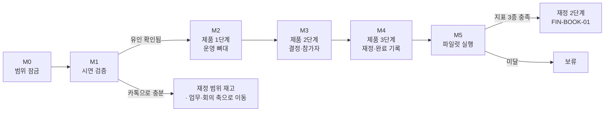

# VADA 로드맵

기준일: 2026-09-02
상태: M0 완료, M1 대기

이 문서는 **무엇을 언제 하는가**만 정한다. 무엇을 만드는가는 `VADA_MVP_SPEC.md`, 재정 도메인 규칙은 `VADA_FINANCE_SPEC.md`, 보류 자산은 `VADA_FINANCE_DEFERRED.md`가 정한다.

## 1. 지금까지 온 길

| 시기 | 단계 | 내용 |
|---|---|---|
| ~2026-08-03 | 와이어프레임 확장 | Figma Make 산출물을 React 단일 파일(`src/app/App.tsx`)로 옮기고 80 → 93화면. 백엔드 없음, 전부 로컬 상태 |
| 2026-08-13 ~ 08-15 | 재정 도메인 조사·1단계 구현 | 중앙감사 세칙·별칙·소정 양식 5종·제출 가이드·결산안 실물 34행 대조. 집행 유형 17종, 상시 지출 컨테이너, 실행분 모델, 사비 선지출 |
| 2026-08-19 | **범위 재확정** | 재정 구현이 MVP 제외 범위를 넘어간 것을 진단하고 되돌렸다. `MVP_SPEC` 6.1 신설, `FINANCE_DEFERRED` 인계 문서 신설, `EVIDENCE_STAGE_ENABLED` 스위치 도입 |
| 2026-08-19 | 위원회 문의 발송 | 6건 발송, 답변 대기. **어느 것도 현재 작업을 막지 않는다**(`VADA_AUDIT_INQUIRY_SENT.md` 4장) |
| 2026-08-31 | 요청자 가시성 보강 | `MY-REQ-01`·`FIN-REQ-02` 구매 목적 노출, 진행 단계 실행분 기반 재계산, 반려 표본 추가 |
| 2026-09-01 | 시연 허브 스위치 정합 | `EVT-FIN-DEMO`가 `EVIDENCE_STAGE_ENABLED`를 따르지 않던 곳을 정리하고 `VADA_PILOT_DEMO_SCRIPT.md`를 맞췄다 |
| 2026-09-01 | **종결 조건 정정** | 예산의 실지출 전환이 `증빙 완료`에 묶여 있어 칸반은 `정산 완료`, 예산은 `집행 예정`으로 갈리던 모순을 고쳤다. `완료` 영역을 `금액 확인` → `정산 완료` 2열로 나누고 종결 축을 실지출 금액으로 옮겼다. 테스트 57 → 85 |
| 2026-09-02 | 화면 총수 정정 | `MENU_STRUCTURE` §10이 91개에 머물러 코드·다른 문서의 93개와 갈리던 것을 맞췄다 |
| 2026-09-02 | **결제 수단 기록·선지출 진입점 차단** | 사비 선지출 화면은 MVP 제외를 유지하되 `금액 확인`에 결제 수단 3종을 붙여 사비 결제 **사실만** 기록한다. `EVT-FIN-01`의 선지출 진입점을 `ADVANCE_CLAIM_ENABLED`로 닫고, 시연 스크립트에 결제 주체 문항을 넣었다. 테스트 85 → 91 |
| 2026-09-29 ~ 10-05 | 역할별 홈·끼룩이 표현 | 회장단·부서장·부원·재정부 홈 시안(`HOME-01C`·`01D`·`01M`·`01F`) 채택, `HOME-01K` 브리핑 미채택. 끼룩이를 AI 비서가 아닌 자동화 표시로 한정. 쿠팡 링크로 구매 요청 카드 자동 채우기. 93 → 97화면 |
| 2026-10-12 ~ 10-14 | **메뉴 v6.2·메시지·구매 후보** | `운영`·`메시지` 메뉴 삭제, 공간 목록(우리 학생회·활성 행사), 공지방·부서방, 전 화면 사이드챗, 부서방 쇼핑 링크 → 구매 후보 → 그 자리에서 구매 요청. 예산 항목은 재정부가 검토 시 지정, 구매 요청 권한에 회장단 추가. 97 → 100화면. 근거는 `docs/planning/` |

## 2. 마일스톤

### M0 — 범위 잠금 (완료, 2026-09-02)

와이어프레임 작업을 정리하고 MVP 제품화 목록을 코드와 문서에서 한 번에 확정한다.

| 항목 | 완료 기준 | 상태 |
|---|---|---|
| 브랜치 정리 | `finance-demo-mode` → `main` 병합 | 완료. `finance-demo-mode`·`finance-settle-amount` 모두 `main`에 포함(`git branch --no-merged main` 결과 없음) |
| MVP 화면 목록 확정 | 93화면 중 제품화 대상 42화면을 id로 명시(아래 3장) | 완료. 42개 id 전부가 `SCREENS`에 실재함을 대조 |
| 문서 모순 제거 | `MVP_SPEC` §6과 6.1이 `FIN-PROC-01`에 대해 서로 다른 말을 하던 것을 정리 | 완료. 화면 총수 91 대 93 불일치도 2026-09-02에 함께 정리 |

**완료 기준**: "이 화면이 MVP인가"를 문서 한 곳만 보고 답할 수 있다.

**판정 근거(2026-09-02)**: 빌드 통과 · 테스트 85개 통과 · MVP 42화면 id가 코드에 전부 존재 · 미병합 브랜치 없음 · 화면 총수를 `MENU_STRUCTURE` §10 한 곳에서 답할 수 있음.

> 병합이 끝난 로컬 브랜치 `finance-demo-mode`·`finance-settle-amount`는 아직 남겨 두었다. 삭제는 별도 판단 사항이다.

### M1 — 유인 가설 검증 (시연)

제품을 만들기 전에 **가장 비싼 가정을 가장 싸게 친다.**

`VADA_FINANCE_SCREENS.md` 10장 미해결 4번이 이렇게 적혀 있다.

> **VADA에 구매 요청을 올릴 유인.** 재정 기능 전체의 전제다. 승인 흐름이 카톡으로 충분하다면 A도 B도 성립하지 않는다. 1단계 실사용으로 확인한다.

그런데 실사용을 하려면 제품이 있어야 하고, 제품은 M2~M4로 가장 비싼 단계다. **순환 의존이다.** `EVT-FIN-DEMO` 시연 허브가 이미 있으므로 백엔드를 쓰기 전에 시연만으로 이 질문을 먼저 친다.

| 항목 | 내용 |
|---|---|
| 대상 | 파일럿 후보 학생회 2~3곳 (재정부원 + 구매 요청자 양쪽) |
| 물어볼 것 | ① 카톡 대신 VADA에 구매 요청을 올릴 의향 ② 처리 단계 칸반이 실제로 확인 비용을 줄이는가 ③ 재정부원 표본을 실시간 기록형 1명에서 넓힌다(미해결 5번) |
| 쓰는 것 | 현재 와이어프레임 + `EVT-FIN-DEMO` 시연 흐름 |
| 기간 | 2~3주 |
| 진행 방법 | **[`VADA_PILOT_DEMO_SCRIPT.md`](./VADA_PILOT_DEMO_SCRIPT.md)** — 문항·순서·사전 등록 판정 기준 |

**완료 기준**: 가설 3(구매 요청 상태 가시성이 확인 비용을 줄인다)에 대해 학생회 2곳 이상의 답을 얻는다.

**분기**: "카톡으로 충분하다"가 나오면 M2~M4의 재정 축 설계를 바꾸고, 업무·회의 축(가설 1·2)을 먼저 세운다.

### M2 — 제품 1단계 · 운영 뼈대

`VADA_MVP_SPEC.md` §11 1단계와 같다.

- 인증 · 학생회 생성 · 초대 · 기본 역할
- 행사 생성 · 운영진 지정 · 행사 상태
- 행사 업무 · 내 업무 · 통합 캘린더

**완료 기준**: 내부 운영진만으로 행사 업무를 만들고 배정·완료할 수 있다.

> 여기서 처음으로 **서버가 생긴다.** 현재 `worker/index.ts`는 404 스텁이고 모든 상태가 브라우저 메모리에 있다. §12 체크리스트의 "역할별로 허용되지 않은 행동이 **서버에서** 차단된다"는 이 단계 전에는 검증 자체가 불가능하다.

### M3 — 제품 2단계 · 결정과 참가자

- 회의 · 안건 · 후속 업무 생성
- 공개 참여 설문 · 신청자 명단
- QR 출석

**완료 기준**: 회의에서 만든 후속 업무와 공개 신청·출석이 하나의 행사 ID로 연결된다.

### M4 — 제품 3단계 · 재정과 완료 기록

- 구매 요청 · 검토 · 보완 흐름 (제품화 범위는 `MVP_SPEC` 6.1)
- 행사 결과 집계 · 회고 · 완료 기록
- 파일럿 QA와 권한 · 중복 처리 검증

**완료 기준**: `MVP_SPEC` §3 성공 기준 6항목을 실제 행사 1건에서 완주한다.

### M5 — 파일럿 실행과 판정

**완료 기준**: 한 학기 실사용 후 아래 지표를 수집하고 재정 2단계 진입 여부를 판정한다.

| 지표 | 미달 시 |
|---|---|
| 구매 요청 등록률 | 매칭할 대상이 없어 결산안 대사가 성립하지 않는다 |
| 증빙 업로드율 | 증빙 파일 번호 부여가 원천적으로 불가능하다 |
| 조회 사용 여부 | 조회조차 안 쓴다면 결산안 작성은 더 안 쓴다 |

충족하면 `FIN-BOOK-01` 결산안 작성으로 간다(`VADA_FINANCE_SCREENS.md` 4장). 이때 `FINANCE_DEFERRED.md`의 보류 자산 ①증빙 묶음 ③집행 유형도 함께 검토한다.

**`FIN-LEDGER-01`은 승격 1순위다.** 인터뷰가 유일하게 지지한 항목이고 구현 비용이 낮다. 파일럿 중 조회 요구가 관찰되면 M5를 기다리지 않고 올린다.

## 3. MVP 제품화 화면 42개

2026-09-02 확정 목록이다(당시 93개 와이어프레임 기준). **화면이 그려져 있다는 사실은 MVP에 넣을 근거가 되지 않는다**(`MVP_SPEC` §6).

> 2026-10-14 기준 와이어프레임은 100개다. 이후 추가된 역할별 홈(`HOME-01C`·`01D`·`01M`·`01F`)·공간 메시지(`US-MSG-01`·`EVT-MSG-01`)·사이드챗(`MSG-04`)을 이 목록에 넣을지와, 채팅·구매 후보를 MVP로 올리는 기준서 문구는 아직 정하지 않았다(`docs/planning/chat-purchase/design.md` §6-8). 메뉴 위치는 v6.2(`VADA_MENU_STRUCTURE.md` v9 절)를 따른다.

| 영역 | 화면 id | 개수 |
|---|---|---|
| 온보딩·조직 | `ONB-01` `ONB-02` `ORG-01` `ORG-02` `INV-00` `INV-01` `ORG-03A` `ORG-03C` `ORG-04B` | 9 |
| 홈·내 업무 | `HOME-01` `MY-01` | 2 |
| 행사 | `EVT-00A2` `EVT-00B` `EVT-01` `EVT-02` `EVT-03A` `EVT-TASK-01` `EVT-TASK-02` `EVT-SCHED-01` | 8 |
| 회의 | `OPS-MEET-01C` `OPS-MEET-02` `OPS-MEET-05B` `OPS-MEET-06B` `OPS-MEET-07` | 5 |
| 참가자 | `EVT-04` `EVT-05` `EXT-01A` `EXT-01B` `EXT-02A` `EXT-02B` `EXT-02C` | 7 |
| 재정 | `FIN-00` `EVT-FIN-01` `MY-REQ-01` `FIN-REQ-01B` `FIN-REQ-01C` `FIN-REQ-02` `FIN-REV-01` `FIN-SUP-01B` `FIN-PROC-01` | 9 |
| 캘린더·기록 | `OPS-CAL-01` `REC-01` | 2 |

나머지(2026-10-14 기준 58개)는 와이어프레임 자산으로 남긴다. 그중 재정 3개(`FIN-EVID-01` `FIN-ADV-01` `FIN-ADV-01B`)는 좌측 목록에서 `운영 — 행사 · 재정(MVP 제외·보류)` 그룹으로 분리해 두었고, 재개 절차는 `VADA_FINANCE_DEFERRED.md`에 있다.

**화면 안에서도 범위가 갈리는 세 곳**

| 화면 | MVP | 후속 |
|---|---|---|
| `EVT-FIN-01` 처리 단계 칸반 | 6개 영역 + `완료`(`금액 확인`·`정산 완료` 2열) | `증빙` 영역 2열 |
| `FIN-PROC-01` | 발주 · 수령/이행 기록 · 실지출 금액·결제 수단 확정 · 품절 반려 | 부분 수량 주문 · 수령 문제 · 물품 반환 |
| `FIN-REV-01` | 품목별 승인 · 반려 · 보완 | 집행 유형 17종 판정 |

## 4. 막지 않는 대기 항목

작업을 시작하기 전에 답이 필요하다고 오해하기 쉬운 것들이다. **어느 것도 M0~M2를 막지 않는다.**

| 항목 | 상태 | 막히는 지점 |
|---|---|---|
| 중앙감사위원회 문의 6건 | 2026-08-19 발송, 답변 대기 | 없음. 6건 모두 안전한 기본 동작으로 우회(`VADA_AUDIT_INQUIRY_SENT.md` 4장) |
| 칸반 23열 해상도 | 병합 검토 대상 | M5 파일럿 데이터를 보고 판단 |
| 재정부원 표본 1명 | 미해결 5번 | M1 시연에서 넓힌다 |

## 5. 변경 이력

| 일자 | 내용 |
|---|---|
| 2026-08-31 | 신설. M0~M5 마일스톤, MVP 42화면 목록 확정, M1 시연 검증 단계를 순환 의존 해소용으로 도입 |
| 2026-09-02 | 사비 선지출 범위 재확인. 화면은 MVP 제외 유지, 결제 수단 기록만 `금액 확인`에 추가. 판정을 뒤집을 근거(사비 선결제 빈도)를 M1 시연 문항으로 넘겼다 |
| 2026-10-14 | 1장에 역할별 홈·메뉴 v6.2·구매 후보 작업 추가, 화면 수 100개 반영. MVP 42화면 목록 자체는 바꾸지 않고 새 화면의 편입 여부를 미결정으로 표시 |
| 2026-09-02 | **M0 완료 판정.** 1장에 2026-09-01 작업 2건 추가, 3장 범위 분기 화면을 두 곳 → 세 곳으로 정정하고 `완료` 영역 2열·`FIN-PROC-01` 금액 확정을 반영 |
