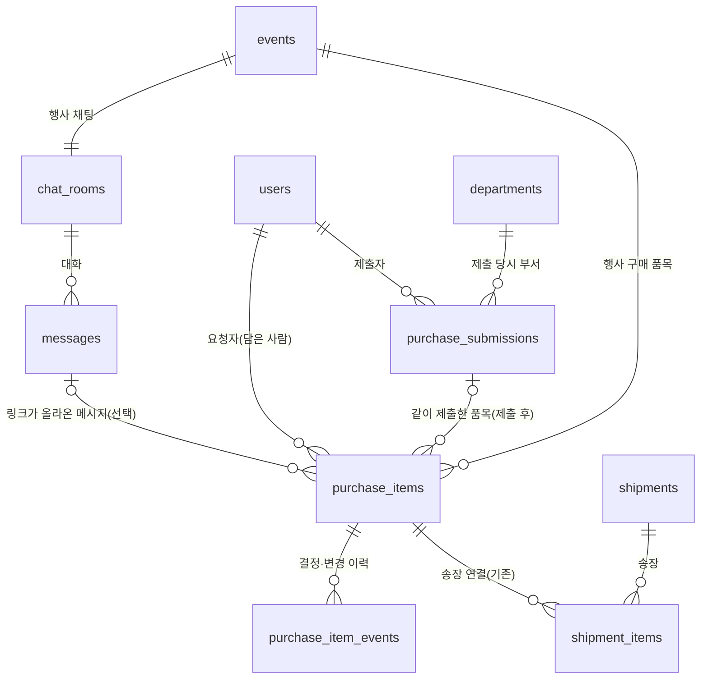

# 구매 도메인 관계 설계 (M1, 제안)

2026-10-04 결정. 아직 스키마에 반영하지 않았다. 반영 시 [ERD](ERD.md)를 함께 고친다.

## 결론

**품목이 진행 단위다. 사용자는 품목만 다룬다. 제출 기록은 내부 단위로만 둔다.**

- 품목마다 상태와 받을 날짜를 가진다. 채팅에서 담은 품목은 "작성 중"으로 쌓이고, 사용자가 골라 제출한다.
- "구매요청 만들기"나 요청 이름은 없다. 묶음별로 달라지는 값이 없기 때문이다. 요청자·부서는 언제나 같고, 유일하게 달라지던 받을 날짜는 품목마다 수시로 바뀐다.
- 제출할 때마다 **제출 기록**이 하나 생긴다. 화면에서는 "같이 제출한 품목"으로만 보인다. 이 기록은 동시 처리 잠금, 제출 당시 부서, 재정부 검토함의 묶음, 채팅 알림 카드 한 장의 단위로 쓴다.

## 근거

- 구매 시스템은 진행 상태(승인·주문·수령)를 품목 줄 단위로 추적하고, 묶음 상태는 줄 상태의 집계로 본다(ERPNext Material Request, Coupa requisition line).
- 품목 줄 단위로 승인·거부하며 거부 사유는 필수다(PeopleSoft). 후속 단계가 생기면 승인 취소가 불가하다(SAP).
- 주문은 요청과 별개이고, 여러 요청의 승인 품목을 묶는다(Oracle AutoCreate, Procurify). 요청자가 묶음을 미리 정할 이유가 없다.
- 일관성 경계는 실제 불변식 단위로 정한다(Vernon, Effective Aggregate Design). "같이 제출한 품목 전체 승인"과 "한 품목 요청 취소"가 겹칠 때 제출 기록 하나를 잠그면 된다.
- 채팅에서 만든 작업은 원문 메시지를 참조한다(Linear Slack 연동).

검토한 대안:

| 안 | 버린 이유 |
|---|---|
| 요청서가 상태를 가짐 (현재) | 승인은 요청서 단위인데 배송은 품목 단위라 어긋난다 |
| 요청서 + 품목별 결정, 작성 중 요청서는 사람×행사당 1개 | 요청서마다 달라지는 값이 받을 날짜뿐이다. 날짜가 바뀔 때마다 묶음을 쪼개야 해서 사용자 부담이 크다 |

## 구조

### purchase_items (구매 품목)

- 소속: organization_id, event_id, requester_id(담은 사람). 같은 학생회 검증은 복합 FK.
- 상품: product_url, vendorItemId, 상품명·옵션·이미지·가격 스냅샷과 조회 시각. 링크로 정해진 값이다.
- 입력·추정: quantity, note(어디에 쓰나요), needed_by(날짜 또는 없음). 수량·용도만 출처를 남긴다(source_message_id, 인용문 스냅샷).
- 상태: `draft`(작성 중) / `pending`(대기) / `approved`(승인) / `rejected`(반려) / `cancelled`(요청 취소)
- 제출: submission_id(작성 중이면 null)
- 결정: decided_by, decided_at, reason, approved_unit_price, approved_quantity
- 구매·수령: purchased_at/by(재정부가 결제 직후 표시), received_at/by(학생회 누구나 확인하고 누른 사람을 남긴다. 분할 배송이 있어 송장 상태로 완료를 판정하지 않는다)

### purchase_submissions (제출 기록, 화면에는 이름 없음)

- organization_id, event_id, requester_id, department_id(제출 당시), submitted_at, version
- 상태가 없다. 화면 상태는 품목 상태를 모아 계산한다.

### purchase_item_events (이력)

- 제출 이후만 기록한다. action(제출·승인·반려·취소·기한 변경·승인 취소·구매함·수령), actor, reason, 이전·이후 값, batch_id(일괄 처리 묶음)

## 규칙

| 규칙 | 위치 |
|---|---|
| 작성 중 품목은 요청자만 수정·삭제 | 서버 |
| 제출: 같은 행사의 내 작성 중 품목을 골라 제출 기록 하나로 묶고 `pending`으로 바꿈. 필수값은 옵션 확정과 수량 | 서버 |
| `draft`이면 submission_id 없음, 그 외에는 있음 | DB CHECK |
| 제출 후 상품·옵션·수량 수정 금지 | 서버 |
| 받을 날짜는 구매함 표시 전까지 요청자가 바꿀 수 있음. 이력에 남기고 재정부 화면에 "기한 변경" 표시 | 서버 |
| 요청 취소는 `pending`만, 요청자만 | 서버 |
| 결정은 `pending`만, 재정부만. 반려 사유 필수. 같은 제출 기록 안의 처리는 제출 기록을 잠그고 version 비교 | DB CHECK + 서버 |
| 승인 취소는 송장 연결 전까지, 재정부만(`pending`으로 되돌림) | 서버 |
| 구매함 표시는 `approved`만 | 서버 |
| 송장 연결은 `approved`만(기존) | 서버 |
| 근거 메시지는 같은 행사방만. 메시지 삭제 시 참조를 비우고 인용문 스냅샷은 남김 | DB FK SET NULL + 서버 |
| 같은 상품을 다시 담으면 합치지 않고 경고 | 서버·화면 |
| 다시 담기(반려·취소 후)는 같은 내용으로 새 작성 중 품목을 만듦 | 서버 |

## 화면

- 요청자: 행사의 **"내 구매 품목"** 하나에서 작성 중 → 진행 중 → 끝남 순으로 본다. 작성 중 품목을 골라 제출한다. 받을 날짜는 품목마다 버튼으로 고르고(기본 "행사 전"), 여러 개를 골라 한 번에 바꿀 수 있다. 버튼 값은 저장할 때 날짜로 바뀐다.
- 재정부: 검토함은 제출 기록 단위로 묶어 보여 주고, 품목마다 승인·반려한다. "구매할 품목"은 승인된 품목을 받을 날짜가 이른 순으로 보여 준다.
- 채팅: 제출 기록마다 알림 카드 하나. 결정이 나면 새 메시지 없이 카드만 바뀐다.
- 용어: "구매 품목", "작성 중", "같이 제출한 품목". "구매요청서", "장바구니"는 쓰지 않는다. 장바구니는 쿠팡 장바구니와 헷갈린다. 비목(예산 항목)은 재정부가 정하고 요청자에게 보이지 않는다.
- 품목 상태: 작성 중 · 대기 · 승인 · 반려 · 요청 취소 · 구매함 · 배송 중 · 배송 완료 · 수령 완료

## 채팅 링크와 상품 정보 (2026-10-04 결정)

- 채팅에 링크를 올렸다고 구매 품목이 되지 않는다. 제안일 수 있기 때문이다. 확정된 링크만 사용자가 구매 품목으로 옮긴다.
- 링크를 누르면 오른쪽 사이드바에 상품 정보를 보여 준다(Slack 스레드처럼 대화를 유지한 채).
- 상품 정보는 링크가 채팅에 올라오는 시점에 미리 조회한다. 조건:
  - 쿠팡 상품 링크만 조회
  - 상품 단위(상품 ID)로 한 번 조회해 옵션 전체를 저장하고 재사용한다. 같은 상품의 다른 옵션 링크는 다시 조회하지 않는다(2026-10-07 결정)
  - 메시지 전송은 기다리지 않고, 조회는 뒤에서 한다. 조회가 끝나기 전에는 불러오는 중으로 보여 준다
  - 가격은 제출할 때만 다시 확인한다. 최근에 조회한 품목은 건너뛰고, 여러 품목은 동시에 조회한다. 기준 시간은 구현할 때 정한다(2026-10-07 결정)
- 근거: Slack은 링크가 게시될 때 미리보기를 가져온다. NN/g 응답 시간 기준으로 1초를 넘으면 흐름이 끊긴다.
- 현재 코드(`apps/api/src/purchases/products.ts`)는 옵션 단위(itemId)로 조회한다. 구매 흐름을 다시 만들 때 상품 단위로 바꾼다.

### 상품 조회 실측 (ReefAPI, 2026-10-07)

| 항목 | 결과 |
|---|---|
| 상품 조회 응답 시간 | 2.7~5.1초. 순차 10회 중간값 3.1~4.0초. 15초 초과 없음 |
| 같은 상품 재조회 | 매번 실시간 조회(`cache_hit=false`). 빨라지지 않고 매번 과금된다. 우리 쪽 저장이 필수다 |
| 링크 5개 동시 조회 | 5.1초에 모두 완료. 한도(429) 없음 |
| 상품 ID로 조회 | 그 상품의 옵션 전체(2~51개)를 준다. itemId로 조회하면 그 옵션 1개만 준다. 비용은 같다 |
| 함께 오는 정보 | 가격, 정가·할인율, 재고, 도착 예정, 평점·리뷰 수, 이미지 |
| 검색 | 1회 5.2초. 다른 1회는 30초를 넘겨 끊었다. M1에는 쓰지 않는다 |
| 비용 | 상품 조회 2크레딧, 검색 3크레딧. 실패(시간 초과·차단·형식 오류)는 무료 |
| 요금제 | 무료 1,000크레딧(상품 조회 약 500회). Pro는 연간 결제 시 월 $15, 월 10,000크레딧(약 5,000회). 크레딧은 이월된다 |
| 한도 | 키당 초당 약 5회, IP당 초당 약 10회(3초 이동 창). 넘으면 429 `RATE_LIMITED`, 몇 초 뒤 재시도 |

- 실측: 검색 결과의 실제 상품 5개로 순차 2회, 동시 1회, 변형 2회 조회. 사용 크레딧 35~38.
- 출처: [ReefAPI 쿠팡 문서](https://reefapi.com/docs/coupang), [공통 문서](https://reefapi.com/docs), [요금](https://reefapi.com/pricing). 계정 잔액은 API로 볼 수 없어 대시보드에서 확인한다.
- 구현 시 반영: 조회는 큐로 동시 실행 수를 제한하고, 시간 초과·429는 무료이므로 뒤에서 재시도한다.

## 후보 목록 (2026-10-04 결정)

채팅에 올라온 쿠팡 링크를 행사의 두 번째 탭에 모두 모은다. 쿠팡 장바구니처럼 골라서 "총 N개 품목 요청하기"로 보낸다. 이 목록은 행사 참여자 모두가 함께 본다.

| 질문 | 결정 | 근거 |
|---|---|---|
| 같은 상품이 여러 번 올라오면 | 후보에 한 번만 보여 준다. 쿠팡 vendorItemId(판매자 + 옵션)가 같으면 같은 상품이고, 옵션이 다르면 다른 후보다. 옵션 정보가 없는 링크는 "옵션 미정"인 별도 후보로 둔다 | 쿠팡 장바구니도 옵션이 다르면 줄을 나눈다. 옵션이 다르면 실제로 사는 물건이 다르다 |
| 공유한 사람 표시 | 후보마다 "박해랑 · 10/4 오후 2:12에 공유"(여러 번이면 "외 N번 공유")를 보여 주고, 누르면 채팅 사이드바가 해당 메시지로 이동해 강조한다. 여러 번 공유됐으면 공유 목록을 펼쳐 고른다 | Slack "파일 및 링크"는 공유한 사람·시각을 보여 주고 원래 메시지로 이동한다(제 지식 기준, 문서 미확인) |
| 목록에서 빼기 | 누구나 "숨기기". 누가·언제 숨겼는지 남기고, 실행 취소와 "숨긴 항목"에서 복원을 제공한다. 완전 삭제는 M1에 없다 | Apple 미리알림·Trello·Slack 리스트는 멤버 누구나 빼되 되돌릴 수 있다. NN/g는 확인 창보다 되돌리기를 권한다 |
| 중복 요청 | 요청된 후보에는 "요청됨 · 요청자 · 수량"을 모두에게 보여 준다. 반려·취소되면 표시를 푼다. 다른 사람이 같은 후보를 요청하면 경고한 뒤 허용한다 | MyRegistry는 구매를 모두에게 실시간 표시한다. Zola는 수동 표시를 잊어 중복 구매가 났으므로 요청 시 시스템이 자동 표시한다. 부서가 달라 같은 상품이 따로 필요할 수 있어 막지 않는다 |
| 체크와 수량 | 사람마다 따로. 체크는 이번에 요청할 선택, 수량은 요청할 때 입력. 공유되는 것은 후보의 존재, 숨김, 요청됨 표시 | Amazon Business 공유 장바구니는 선택이 요청자 개인 것이다. 배달 앱 함께주문은 수량이 사람별이다. 선택을 공유하면 남의 선택을 덮어쓴다 |

## 플랫폼·알림 (2026-10-04 결정)

- 네이티브 앱은 만들지 않는다. 웹을 모바일 우선으로 설계하고 설치 가능한 웹앱(PWA)으로 둔다. 화면과 서버 API를 분리해 두어 나중에 앱을 만들 수 있게 한다.
- 알림은 우선순위를 낮춘다. M1에서는 재정부가 화면의 검토 목록을 직접 확인한다.
- 알림에서 바로 승인하는 방식은 쓰지 않는다. 한 번에 제출된 품목을 품목마다 판단해야 하기 때문이다.
- 반려와 별개인 "수정 요청" 상태는 두지 않는다. 반려 사유를 보고 요청자가 "다시 담기"로 고쳐 다시 보낸다.
- 구매 시점의 가격 변동은 M1에서 고려하지 않는다.

## M1에서 하지 않는 것

- 주문·결제·증빙(정산) 테이블. 구매함 표시만 둔다.
- 수량 일부 승인. 반려 후 다시 요청한다.
- 예산 한도 검사.

## 정책 결정 (2026-10-07)

1. **가입·초대:** 학생회마다 초대 링크가 하나 있다. 링크를 받은 사람은 로그인한 뒤 자기 부서를 골라 바로 가입한다. 링크는 학생회 사람 누구나 공유할 수 있어서, 관리자 역할을 따로 두지 않는다.
   - 판단 기준: 사용자에게 가장 직관적이거나 구현이 가장 간단한 쪽.
   - 학생회 역할은 이미 분명하므로 부서를 잘못 고르거나 악용할 여지는 고려하지 않는다.
2. **요청자가 학생회를 나가면:** 품목을 다른 사람에게 넘기는 기능은 두지 않는다.
   - 요청자가 필요한 때는 제출할 때와 반려를 받을 때뿐이다. 제출 이후의 흐름은 요청자와 상관없이 진행한다. 그래서 수령 확인도 학생회 누구나 한다.
   - 요청자만 하는 동작(작성 중 품목 수정, 대기 중 요청 취소, 받을 날짜 변경)은 요청자가 나가면 할 수 없게 될 뿐 흐름을 막지 않는다.
3. **정산 단위:** 행사 × 비목.
4. **채팅 메시지 삭제:** M1에서는 지원하지 않는다.
   - 판단 기준: 나중에 넓힐 수 있게 두되, 구현이 가장 쉬운 쪽.
   - 나중에 본인 메시지 삭제를 붙일 수 있도록, 근거 메시지를 지우면 참조만 비우고 인용문 사본은 남기는 규칙(위 규칙 표)은 유지한다.
5. **앱 아이콘:** 디자인이 나오기 전까지 'VADA' 글자로 만든 임시 아이콘을 쓴다.
