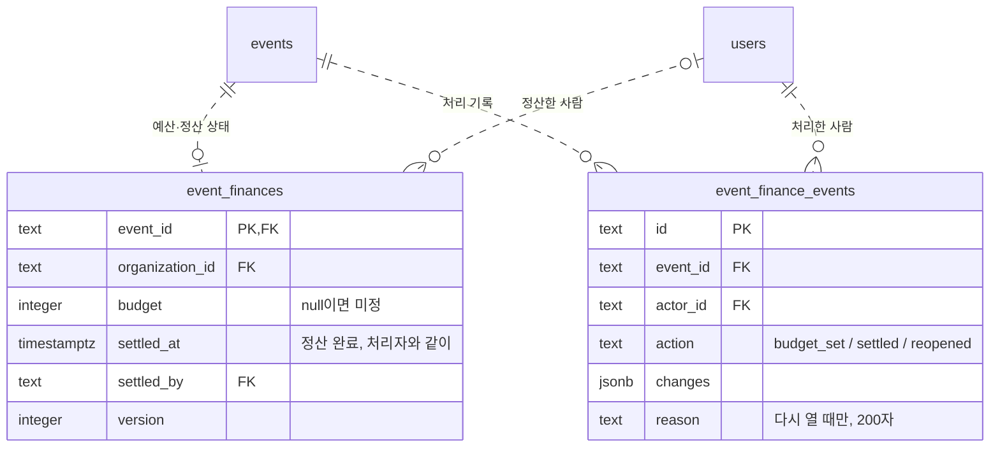

# M2-2 행사 예산·정산·결산 엑셀 Implementation Plan

> **For agentic workers:** REQUIRED SUB-SKILL: Use superpowers:subagent-driven-development (recommended) or superpowers:executing-plans to implement this plan task-by-task. Steps use checkbox (`- [ ]`) syntax for tracking.

**Goal:** 재정 권한자가 행사마다 예산을 정하고, 증빙이 다 모이면 정산을 닫는다. 학생회 구성원은 누구나 행사별 예산·실제 지출·지출 예정·남은 예산을 보고 정산서 엑셀을 내려받는다.

**Architecture:**
- 마이그레이션 0016으로 새 표 2개(`event_finances`, `event_finance_events`)를 더한다.
- `apps/api/src/settlement/`에 다음을 둔다.
  - `lock.ts`: 정산된 행사 잠금(`requireOpenEvents`)
  - `service.ts`: 숫자·예산·정산·다시 열기·엑셀 자료
  - `workbook.ts`: 엑셀 그리기
  - `routes.ts`: 라우트
- 지출 기록·수정·취소, 증빙 삭제, 구매 제출은 `requireOpenEvents`로 정산된 행사를 막는다.
- 엑셀은 서버가 `write-excel-file`로 만든다. 화면은 fetch로 받아 파일로 저장한다.
- 화면은 행사 화면의 새 "재정" 탭이고 코드는 `apps/web/src/settlement/`에 둔다. 사용 내역 요약과 재정 숫자는 공용 `StatGrid`로 그린다.

**Tech Stack:**
- 서버: Hono 4.13.9, drizzle-orm 0.45.3 / drizzle-kit 0.31.11, PGlite 테스트(`npx tsx --test`), zod 4.6.5
- 새 의존성: write-excel-file 4.1.1, fflate 0.8.3(API 테스트 전용)
- 화면: React 19.3, Vite 8, vitest 5 + jsdom

**Spec:** `docs/superpowers/specs/2026-10-09-event-settlement-design.md`

## Global Constraints

- **요청 본문:** contracts의 `z.strictObject`만 쓴다.
  - 문자열은 `text(max)`/`token(max)`만 쓴다.
  - 문자열·배열·숫자에는 모두 상한을 둔다.
- **라우트:**
  - `json(Schema)`를 인증·소속 미들웨어보다 앞에 두고, `c.req.valid('json')`만 쓴다.
  - 변경 라우트는 `/api/organizations/` 아래에 둔다.
  - 실패는 `ApiError(code, status)`로 던지고, 라우트별 `onError`를 만들지 않는다.
- **값의 범위:**
  - 예산은 0 ~ 2,147,483,647 정수이거나 null(미정)이다.
  - 버전은 0 ~ 2,147,483,647이고, 0은 "아직 행 없음"이다.
  - 다시 열기 사유는 200자다. DB CHECK도 200이다.
- **정산 조건:** 증빙 누락, 검토 대기 요청, 지출로 기록하지 않은 승인 품목이 모두 0이다. 아니면 `NOT_READY_TO_SETTLE`(409)다.
- **정산된 행사에서 막는 것:** 모두 `EVENT_SETTLED`(409)다. 증빙 추가·확인은 막지 않는다.
  - 이 행사로 지출 기록
  - 이 행사 지출의 수정·옮기기·취소
  - 다른 행사 지출을 이 행사로 옮기기
  - 증빙 삭제
  - 예산 변경
  - 구매 요청 제출
- **잠금:**
  - 예산·정산·다시 열기는 행사 행을 `FOR NO KEY UPDATE`로 잠근다.
  - 지출 변경, 증빙 삭제, 구매 제출은 같은 행을 `FOR SHARE`로 잠근다.
- **엑셀 내용:**
  - 시트는 `요약`·`지출 내역`·`증빙`·`품목`이다. 취소한 지출은 넣지 않는다.
  - 금액은 `#,##0`, 결제일은 `yyyy-mm-dd` 날짜 칸이다. 합계는 값으로 쓴다.
  - 사용자 글은 문자 칸이다.
  - 링크는 `HYPERLINK("<주소>","열기")` 수식으로 쓴다. 수식 앞에 `=`를 붙이지 않는다. 주소가 255자를 넘으면 "—"를 쓴다.
  - 지출이 1,000건을 넘으면 `EXPORT_TOO_LARGE`(409)다.
- **엑셀 응답:**
  - 머리글:
    - `Content-Type: application/vnd.openxmlformats-officedocument.spreadsheetml.sheet`
    - `Content-Disposition: attachment; filename="settlement.xlsx"; filename*=UTF-8''<RFC 5987>`
    - `Cache-Control: no-store`
  - 파일 이름은 `{행사 이름} 정산 {한국 날짜}.xlsx`다. `\/:*?"<>|`와 제어 문자는 `_`로 바꾼다.
- 로그와 응답에 행사 이름·금액·파일 이름·오류 원문을 넣지 않는다.
- **화면 규칙:**
  - `apps/web/src/components/ui` 부품과 Tailwind 스케일만 쓴다.
  - 긴 글에는 `wrap-anywhere`를 준다.
  - 버튼은 같은 스키마의 `safeParse`로 켠다.
- **화면 문구** (그대로 쓴다):
  - 탭 "재정"
  - 숫자 "예산", "실제 지출", "지출 예정", "남은 예산", "미정", "{금액} 초과", "금액을 모르는 품목 N개 제외"
  - 체크리스트 "정산하려면", "증빙 누락 N건", "검토 대기 요청 N건", "지출로 기록하지 않은 승인 품목 N개"
  - 해결 방법
    - "지출 상세에서 증빙을 올려 주세요."
    - "구매 검토에서 승인하거나 반려해 주세요."
    - "산 품목은 지출에 연결하고, 사지 않을 품목은 승인을 취소해 주세요."
  - 버튼 "예산 정하기", "정산 완료", "정산 다시 열기", "엑셀 내려받기", "지출 기록"
  - 정산 확인 "정산을 마치면 이 행사의 지출·예산·증빙 삭제가 잠겨요."
  - 다시 열기 "다시 열면 지출과 예산을 바꿀 수 있어요."
  - 빈 상태 "이 행사에 기록된 지출이 없어요"
  - 지출 상세 "정산이 끝난 행사의 지출이라 수정·취소·증빙 삭제를 할 수 없어요."
  - 구매 제출 막힘 "정산이 끝난 행사예요. 재정부에 정산을 다시 열어 달라고 해 주세요."
- **마이그레이션 0016:** 새 표만 더한다. dev와 배포 DB에 먼저 적용하고 배포한다. 지출 목록이 새 표를 조인하므로 순서가 바뀌면 사용 내역이 실패한다. DB 적용 전에 사용자 승인을 받는다.

## Review Focus

1. **정산과 동시에 들어온 구매 제출·지출 변경:**
   - 모든 경로가 같은 행사 행을 잠가야 한다. 정산·다시 열기·예산은 `FOR NO KEY UPDATE`, 지출 기록·수정·취소, 증빙 삭제, 구매 제출은 `FOR SHARE`다.
   - 그래야 정산 확인 뒤에 대기 품목이나 지출이 끼어들지 않는다.
   - 테스트는 순서대로만 확인한다. 동시성은 리뷰에서 잠금 순서로 본다. → Task 3·4
2. **행사 이름에 `/`·`"`·`'`·`(`·`)`가 들어간 경우:**
   - `Content-Disposition`이 RFC 5987로 유효해야 한다.
   - 화면도 같은 이름으로 저장해야 한다.
   - → Task 5 라우트·파일 이름 테스트, Task 7 `downloadName` 테스트
3. **예산이 0원인 경우:**
   - 집행률이 없어야 한다(0으로 나누지 않음).
   - 남은 예산은 음수 "초과"로 보여야 한다.
   - → Task 5 workbook 테스트, Task 7 view 테스트
4. **지출이 0건인 경우:**
   - 시트는 머리글만 두고, 합계는 0이어야 한다.
   - → Task 5 workbook 테스트
5. **수식을 계산하지 않는 미리 보기:**
   - 합계·금액·날짜는 값이라 보여야 한다.
   - 사용자 글 `=1+1`은 수식이 아니라 문자로 남아야 한다.
   - → Task 5 workbook 테스트

## 파일 구조

| 파일 | 책임 |
|---|---|
| `packages/contracts/src/settlement.ts` (새) | 예산·정산·다시 열기 스키마, 응답 타입 |
| `packages/contracts/src/expenses.ts` | 결제 수단·증빙 종류 이름(화면·엑셀 공용), `ExpenseSummary.settled` |
| `apps/api/src/db/schema.ts`, `migrations/0016_event_settlement.sql` (생성) | 새 표 2개 |
| `apps/api/src/settlement/lock.ts` (새) | 정산된 행사 잠금(`requireOpenEvents`) |
| `apps/api/src/settlement/service.ts` (새) | 숫자·예산·정산·다시 열기·엑셀 자료 |
| `apps/api/src/settlement/workbook.ts` (새) | 엑셀 시트 그리기, 파일 이름, 내려받기 머리글 |
| `apps/api/src/settlement/routes.ts` (새) | Hono 라우트 |
| `apps/api/src/expenses/{service,receipts,summaries}.ts`, `purchases/service.ts` | 잠금 연결, `settled` 조인 |
| `apps/api/src/app.ts`, `serve.ts`, `http/boundary.test.ts`, `purchases/test-setup.ts` | 연결 |
| `apps/web/src/components/StatGrid.tsx` (새) | 숫자 묶음 카드(공용 표시 부품) |
| `apps/web/src/settlement/*` (새) | 문구 도우미, 데이터 훅, 재정 탭, 예산 대화상자 |
| `apps/web/src/workspace/{EventWorkspace,Workspace}.tsx` | 재정 탭 연결 |
| `apps/web/src/expenses/{ExpenseDetailDialog,ExpenseFormDialog,expense-view}.tsx/ts` | 정산 잠금 표시, 행사 미리 고르기, 오류 문구 |

---

### Task 1: 행사 재정 계약과 결제 수단·증빙 종류 이름

**Files:**
- Create: `packages/contracts/src/settlement.ts`, `packages/contracts/src/settlement.test.ts`
- Modify: `packages/contracts/src/expenses.ts`, `packages/contracts/src/index.ts`, `packages/contracts/package.json`, `apps/web/src/expenses/expense-view.ts`

**Interfaces:**
- Consumes: `text`(input.ts), `PURCHASE_INTEGER_MAX`(purchases.ts), `ExpensePerson`·`ExpenseSummary`·`EXPENSE_METHODS`·`RECEIPT_KINDS`(expenses.ts)
- Produces:
  - 상수: `SETTLEMENT_REASON_MAX`(200), `EVENT_FINANCE_HISTORY_MAX`(100), `EXPENSE_METHOD_LABELS`, `RECEIPT_KIND_LABELS`
  - 스키마: `SetEventBudgetSchema`(`{ version, budget }`), `SettleEventSchema`(`{ version }`), `ReopenSettlementSchema`(`{ version, reason }`)
  - 타입: `EventFinanceAction`, `SetEventBudgetRequest`, `SettleEventRequest`, `ReopenSettlementRequest`, `EventFinanceHistoryEntry`, `EventFinance`, `EventFinanceResponse`

- [ ] **Step 1: 실패하는 계약 테스트 작성**

`packages/contracts/src/settlement.test.ts`:

```ts
import assert from 'node:assert/strict'
import { test } from 'node:test'
import { EXPENSE_METHOD_LABELS, EXPENSE_METHODS, RECEIPT_KIND_LABELS, RECEIPT_KINDS } from './expenses.js'
import { isStrictObject } from './input.js'
import { ReopenSettlementSchema, SETTLEMENT_REASON_MAX, SetEventBudgetSchema, SettleEventSchema } from './settlement.js'

// 테스트 파일에 제어 문자를 그대로 쓰지 않는다.
const nul = String.fromCharCode(0)
const lone = String.fromCharCode(0xd800)
const emoji = '😀'

test('예산: 버전 0(아직 행 없음)과 미정(null)을 받고, 음수·소수·상한+1·문자열·모르는 키는 거절한다', () => {
  assert.deepEqual(SetEventBudgetSchema.parse({ version: 0, budget: 3000000 }), { version: 0, budget: 3000000 })
  for (const body of [{ version: 4, budget: null }, { version: 1, budget: 0 }, { version: 2147483647, budget: 2147483647 }]) {
    assert.equal(SetEventBudgetSchema.safeParse(body).success, true, JSON.stringify(body))
  }
  for (const body of [{ budget: 1 }, { version: 1 }, { version: -1, budget: 1 }, { version: 1.5, budget: 1 }, { version: 2147483648, budget: 1 },
    { version: 1, budget: -1 }, { version: 1, budget: 1.5 }, { version: 1, budget: 2147483648 }, { version: 1, budget: '1000' },
    { version: '1', budget: 1 }, { version: 1, budget: 1, extra: 1 }]) {
    assert.equal(SetEventBudgetSchema.safeParse(body).success, false, JSON.stringify(body))
  }
})

test('정산·다시 열기: 버전이 필요하고, 다시 열기 사유는 비울 수 없다', () => {
  assert.equal(SettleEventSchema.safeParse({ version: 0 }).success, true)
  for (const body of [{}, { version: -1 }, { version: '1' }, { version: 1, extra: 1 }]) {
    assert.equal(SettleEventSchema.safeParse(body).success, false, JSON.stringify(body))
  }
  assert.deepEqual(ReopenSettlementSchema.parse({ version: 3, reason: ' 영수증 빠짐 ' }), { version: 3, reason: '영수증 빠짐' })
  assert.equal(ReopenSettlementSchema.safeParse({ version: 3, reason: emoji.repeat(SETTLEMENT_REASON_MAX) }).success, true)
  for (const body of [{ version: 3 }, { version: 3, reason: '' }, { version: 3, reason: '  ' }, { version: 3, reason: emoji.repeat(SETTLEMENT_REASON_MAX + 1) },
    { version: 3, reason: `a${nul}` }, { version: 3, reason: `a${lone}` }, { reason: '빠짐' }, { version: 3, reason: '빠짐', extra: 1 }]) {
    assert.equal(ReopenSettlementSchema.safeParse(body).success, false, JSON.stringify(body))
  }
})

test('요청 스키마는 모르는 키를 조용히 버리지 않는다', () => {
  for (const schema of [SetEventBudgetSchema, SettleEventSchema, ReopenSettlementSchema]) assert.equal(isStrictObject(schema), true)
})

test('결제 수단·증빙 종류마다 화면과 엑셀이 같이 쓰는 이름이 있다', () => {
  assert.deepEqual(Object.keys(EXPENSE_METHOD_LABELS), [...EXPENSE_METHODS])
  assert.deepEqual(Object.keys(RECEIPT_KIND_LABELS), [...RECEIPT_KINDS])
  assert.deepEqual([EXPENSE_METHOD_LABELS.council_card, EXPENSE_METHOD_LABELS.personal, RECEIPT_KIND_LABELS.tax_invoice],
    ['학생회 카드', '개인 결제(환급 필요)', '세금계산서'])
})
```

`packages/contracts/package.json`의 `test` 스크립트 끝에 ` src/settlement.test.ts`를 더한다:

```json
"scripts": { "typecheck": "tsc --noEmit", "test": "tsx --test src/input.test.ts src/coupang.test.ts src/expenses.test.ts src/settlement.test.ts" },
```

- [ ] **Step 2: 실패 확인**

Run: `npm test --workspace @vada/contracts`
Expected: FAIL — `./settlement.js`가 없다

- [ ] **Step 3: 계약 구현**

`packages/contracts/src/expenses.ts`의 `export type ExpenseAction = …` 줄 바로 아래에 더한다:

```ts
// 화면과 엑셀이 같은 이름을 쓴다.
export const EXPENSE_METHOD_LABELS: Record<ExpenseMethod, string> = { council_card: '학생회 카드', transfer: '계좌이체', cash: '현금',
  personal: '개인 결제(환급 필요)' }
export const RECEIPT_KIND_LABELS: Record<ReceiptKind, string> = { receipt: '영수증', statement: '거래명세서', tax_invoice: '세금계산서', other: '기타' }
```

`packages/contracts/src/settlement.ts`:

```ts
import { z } from 'zod'
import type { ExpensePerson, ExpenseSummary } from './expenses.js'
import { text } from './input.js'
import { PURCHASE_INTEGER_MAX } from './purchases.js'

export const SETTLEMENT_REASON_MAX = 200
export const EVENT_FINANCE_HISTORY_MAX = 100
export type EventFinanceAction = 'budget_set' | 'settled' | 'reopened'

// 행사 재정 행이 없으면 버전 0이다. 첫 변경이 버전 1로 행을 만든다.
const version = z.number().int().min(0).max(PURCHASE_INTEGER_MAX)
// null이면 예산 미정이다.
export const SetEventBudgetSchema = z.strictObject({ version, budget: z.number().int().min(0).max(PURCHASE_INTEGER_MAX).nullable() })
export const SettleEventSchema = z.strictObject({ version })
export const ReopenSettlementSchema = z.strictObject({ version, reason: text(SETTLEMENT_REASON_MAX) })
export type SetEventBudgetRequest = z.infer<typeof SetEventBudgetSchema>
export type SettleEventRequest = z.infer<typeof SettleEventSchema>
export type ReopenSettlementRequest = z.infer<typeof ReopenSettlementSchema>

export interface EventFinanceHistoryEntry {
  id: string
  action: EventFinanceAction
  actor: ExpensePerson
  // budget_set: { from, to }, settled: { budget, spent, expenseCount }
  changes: Record<string, unknown>
  // 다시 열 때만 있다.
  reason: string | null
  createdAt: string
}
export interface EventFinance {
  eventId: string
  // null이면 미정이다.
  budget: number | null
  // 취소하지 않은 지출 합.
  spent: number
  // 지출에 연결되지 않은 승인 품목의 수량 × 예상 단가 합. 금액을 모르는 품목은 빼고 plannedUnknown에 센다.
  planned: number
  plannedUnknown: number
  // 예산 − 실제 지출 − 지출 예정. 예산이 미정이면 null이다.
  remaining: number | null
  // 취소하지 않은 지출 수.
  expenseCount: number
  // 정산 조건 셋. 모두 0이어야 정산할 수 있다.
  missingEvidence: number
  pendingRequests: number
  unrecordedItems: number
  settled: { by: ExpensePerson; at: string } | null
  version: number
  // 최근 100개, 오래된 순.
  history: EventFinanceHistoryEntry[]
}
export interface EventFinanceResponse {
  finance: EventFinance
  // 이 행사의 지출. 결제일 최근 순으로 300개까지, 취소한 것도 "취소됨"으로 준다.
  expenses: ExpenseSummary[]
  truncated: boolean
}
```

`packages/contracts/src/index.ts`의 지출 내보내기 줄에 `EXPENSE_METHOD_LABELS, RECEIPT_KIND_LABELS`를 더하고, 파일 끝에 더한다:

```ts
export { EXPENSE_VENDOR_MAX, EXPENSE_DESCRIPTION_MAX, EXPENSE_NOTE_MAX, EXPENSE_VOID_REASON_MAX, EXPENSE_ITEMS_MAX, RECEIPTS_PER_EXPENSE_MAX,
  RECEIPT_FILE_NAME_MAX, RECEIPT_SIZE_MAX, EXPENSE_METHODS, RECEIPT_KINDS, RECEIPT_CONTENT_TYPES, EXPENSE_METHOD_LABELS, RECEIPT_KIND_LABELS,
  CreateExpenseSchema, UpdateExpenseSchema, VoidExpenseSchema, CreateReceiptUploadSchema, ReceiptActionSchema } from './expenses.js'
```

```ts
export { SETTLEMENT_REASON_MAX, EVENT_FINANCE_HISTORY_MAX, SetEventBudgetSchema, SettleEventSchema, ReopenSettlementSchema } from './settlement.js'
export type { EventFinanceAction, SetEventBudgetRequest, SettleEventRequest, ReopenSettlementRequest, EventFinanceHistoryEntry, EventFinance,
  EventFinanceResponse } from './settlement.js'
```

`apps/web/src/expenses/expense-view.ts`의 `methodLabels`·`kindLabels` 정의를 contracts 값으로 바꾼다. import에 `EXPENSE_METHOD_LABELS, RECEIPT_KIND_LABELS`를 더한다:

```ts
import { codePoints, EXPENSE_METHOD_LABELS, RECEIPT_KIND_LABELS, RECEIPTS_PER_EXPENSE_MAX, type ExpenseAction, type ExpenseHistoryEntry,
  type ExpenseMethod, type ExpenseSummary, type ReceiptKind } from '@vada/contracts'
import { won } from '../purchases/purchase-view'

// 엑셀과 같은 이름을 쓴다.
export const methodLabels = EXPENSE_METHOD_LABELS
export const kindLabels = RECEIPT_KIND_LABELS
```

- [ ] **Step 4: 통과 확인**

Run: `npm test --workspace @vada/contracts && npm run typecheck --workspace @vada/contracts && cd apps/web && npx vitest run --no-file-parallelism src/expenses && npx tsc --noEmit -p .`
Expected: PASS

- [ ] **Step 5: 커밋**

```bash
git add packages/contracts apps/web/src/expenses/expense-view.ts
git commit -m "행사 재정 계약 추가"
```

---

### Task 2: 행사 재정 표와 마이그레이션 0016

**Files:**
- Modify: `apps/api/src/db/schema.ts`, `apps/api/src/db/migrations.test.ts`
- Create(생성기): `apps/api/migrations/0016_event_settlement.sql`, `apps/api/migrations/meta/0016_snapshot.json`, `meta/_journal.json` 갱신

**Interfaces:**
- Produces: drizzle 표 `eventFinances`(`eventId`, `organizationId`, `budget`, `settledAt`, `settledBy`, `version`, `createdAt`, `updatedAt`), `eventFinanceEvents`(`id`, `organizationId`, `eventId`, `actorId`, `action`, `changes`, `reason`, `createdAt`). 제약 이름은 아래 테스트가 쓰는 이름이다.

- [ ] **Step 1: 실패하는 마이그레이션 테스트 작성**

`apps/api/src/db/migrations.test.ts` 끝에 더한다(위쪽 import에 `migrationsBefore`, `migrationsFolder`, `PGlite`, `drizzle`, `migrate`, `assert`, `test`가 이미 있다):

```ts
test('0016 adds event finances without touching expenses', async (t) => {
  const pg = new PGlite()
  const previous = migrationsBefore('0016_event_settlement')
  try {
    const db = drizzle(pg)
    await migrate(db, { migrationsFolder: previous.folder })
    await pg.exec(`
      INSERT INTO users (id,name,email) VALUES ('u','재정','u@example.test');
      INSERT INTO organizations (id,name) VALUES ('o','Council'),('o2','Other');
      INSERT INTO events (id,organization_id,name,created_by) VALUES ('e','o','체육대회','u'),('e2','o2','남의 행사','u');
      INSERT INTO expenses (id,organization_id,event_id,vendor,description,amount,paid_on,method,payer_id,recorded_by)
        VALUES ('x','o','e','쿠팡','물품',1000,'2026-10-09','council_card','u','u');
    `)
    const before = (await pg.query<Record<string, unknown>>('SELECT * FROM expenses')).rows
    await migrate(db, { migrationsFolder })
    const finance = (change: Record<string, string> = {}) => {
      const values: Record<string, string> = { event_id: "'e'", organization_id: "'o'", budget: 'NULL', settled_at: 'NULL', settled_by: 'NULL', ...change }
      return pg.exec(`INSERT INTO event_finances (${Object.keys(values).join(',')}) VALUES (${Object.values(values).join(',')})`)
    }

    await t.test('existing expenses keep their values', async () => {
      assert.deepEqual((await pg.query<Record<string, unknown>>('SELECT * FROM expenses')).rows, before)
    })
    await t.test('a budget is zero or more, who and when settle together, and the event is in the same council', async () => {
      await finance({ budget: '0', settled_at: 'now()', settled_by: "'u'" })
      await assert.rejects(finance(), { constraint: 'event_finances_pkey' })
      await pg.exec('DELETE FROM event_finances')
      await finance()
      await pg.exec('DELETE FROM event_finances')
      const cases: [Record<string, string>, string][] = [
        [{ budget: '-1' }, 'event_finances_budget_nonnegative'],
        [{ settled_at: 'now()' }, 'event_finances_settled_pair'],
        [{ settled_by: "'u'" }, 'event_finances_settled_pair'],
        [{ version: '0' }, 'event_finances_version_positive'],
        [{ event_id: "'e2'" }, 'event_finances_event_same_organization'],
      ]
      for (const [change, constraint] of cases) await assert.rejects(finance(change), { constraint }, constraint)
    })
    await t.test('history actions are known, changes are objects, and only reopening has a short reason', async () => {
      const entry = (id: string, action: string, reason = 'NULL', changes = "'{}'", event = 'e') => pg.exec(
        `INSERT INTO event_finance_events (id,organization_id,event_id,actor_id,action,changes,reason) VALUES ('${id}','o','${event}','u','${action}',${changes},${reason})`)
      await entry('h1', 'budget_set', 'NULL', `'{"from":null,"to":1000}'`)
      await entry('h2', 'settled')
      await entry('h3', 'reopened', "'영수증 빠짐'")
      const cases: [string, string, string, string][] = [
        ['h4', 'closed', 'NULL', 'event_finance_events_action_valid'],
        ['h5', 'reopened', 'NULL', 'event_finance_events_reason_when_reopened'],
        ['h6', 'settled', "'사유'", 'event_finance_events_reason_when_reopened'],
        ['h7', 'reopened', "'  '", 'event_finance_events_reason_not_blank'],
        ['h8', 'reopened', `'${'가'.repeat(201)}'`, 'event_finance_events_reason_length'],
      ]
      for (const [id, action, reason, constraint] of cases) await assert.rejects(entry(id, action, reason), { constraint }, constraint)
      await assert.rejects(entry('h9', 'settled', 'NULL', "'[]'"), { constraint: 'event_finance_events_changes_object' })
      await assert.rejects(entry('h10', 'settled', 'NULL', "'{}'", 'e2'), { constraint: 'event_finance_events_event_same_organization' })
    })
  } finally {
    previous.remove()
    await pg.close()
  }
})
```

- [ ] **Step 2: 실패 확인**

Run: `cd apps/api && npx tsx --test src/db/migrations.test.ts`
Expected: FAIL — `Migration not found: 0016_event_settlement`

- [ ] **Step 3: 표 정의**

`apps/api/src/db/schema.ts` 끝(`expenseEvents` 다음)에 더한다:

```ts
// 행사의 예산과 정산 상태. 예산을 정하거나 정산할 때 생긴다. 행이 없으면 예산 미정·정산 전이다.
export const eventFinances = pgTable('event_finances', {
  eventId: text('event_id').primaryKey(),
  organizationId: text('organization_id').notNull(),
  // 비어 있으면 예산 미정이다.
  budget: integer('budget'),
  settledAt: timestamp('settled_at', { withTimezone: true }),
  settledBy: text('settled_by').references(() => users.id, { onDelete: 'restrict' }),
  version: integer('version').notNull().default(1),
  createdAt: timestamp('created_at', { withTimezone: true }).notNull().defaultNow(),
  updatedAt: timestamp('updated_at', { withTimezone: true }).notNull().defaultNow().$onUpdate(() => new Date()),
}, (table) => [
  foreignKey({
    name: 'event_finances_event_same_organization',
    columns: [table.organizationId, table.eventId],
    foreignColumns: [events.organizationId, events.id],
  }).onDelete('restrict'),
  check('event_finances_budget_nonnegative', sql`${table.budget} >= 0`),
  check('event_finances_settled_pair', sql`(${table.settledAt} IS NULL) = (${table.settledBy} IS NULL)`),
  check('event_finances_version_positive', sql`${table.version} >= 1`),
])

// 예산·정산 처리 기록. 고치거나 지우지 않는다.
export const eventFinanceEvents = pgTable('event_finance_events', {
  id: text('id').primaryKey(),
  organizationId: text('organization_id').notNull(),
  eventId: text('event_id').notNull(),
  actorId: text('actor_id').notNull().references(() => users.id, { onDelete: 'restrict' }),
  action: text('action', { enum: ['budget_set', 'settled', 'reopened'] }).notNull(),
  changes: jsonb('changes').$type<Record<string, unknown>>().notNull().default({}),
  // 다시 열 때만 사유가 있다.
  reason: text('reason'),
  createdAt: timestamp('created_at', { withTimezone: true }).notNull().defaultNow(),
}, (table) => [
  foreignKey({
    name: 'event_finance_events_event_same_organization',
    columns: [table.organizationId, table.eventId],
    foreignColumns: [events.organizationId, events.id],
  }).onDelete('restrict'),
  check('event_finance_events_action_valid', sql`${table.action} IN ('budget_set','settled','reopened')`),
  check('event_finance_events_changes_object', sql`jsonb_typeof(${table.changes}) = 'object'`),
  check('event_finance_events_reason_when_reopened', sql`(${table.action} = 'reopened') = (${table.reason} IS NOT NULL)`),
  check('event_finance_events_reason_not_blank', sql`${table.reason} ~ '[^[:space:]]'`),
  check('event_finance_events_reason_length', sql`char_length(${table.reason}) <= 200`),
  index('event_finance_events_event_idx').on(table.eventId, table.createdAt),
])
```

- [ ] **Step 4: 마이그레이션 생성**

Run: `cd apps/api && npx drizzle-kit generate --name event_settlement`
Expected: `migrations/0016_event_settlement.sql`, `migrations/meta/0016_snapshot.json`이 생기고 `_journal.json`에 `0016_event_settlement`가 붙는다.

- [ ] **Step 5: 새 표만 만드는지 확인**

Run: `cd apps/api && grep -o '\(CREATE TABLE\|ALTER TABLE\|CREATE INDEX\) "[a-z_]*"' migrations/0016_event_settlement.sql | sort -u`
Expected: 대상이 `event_finances`, `event_finance_events`뿐이다(`CREATE INDEX "event_finance_events_event_idx"` 포함). 다른 표의 `ALTER TABLE`이 없다.

- [ ] **Step 6: 통과 확인**

Run: `cd apps/api && npx tsx --test src/db/migrations.test.ts src/db/schema.test.ts`
Expected: PASS

- [ ] **Step 7: 커밋**

```bash
git add apps/api/src/db/schema.ts apps/api/src/db/migrations.test.ts apps/api/migrations
git commit -m "행사 재정 표와 마이그레이션 0016"
```

---

### Task 3: 정산된 행사 잠금(지출·증빙 삭제·구매 제출)과 지출의 정산 표시

**Files:**
- Create: `apps/api/src/settlement/lock.ts`, `apps/api/src/settlement/lock.test.ts`
- Modify:
  - `apps/api/src/expenses/service.ts`(create·update·void), `apps/api/src/expenses/receipts.ts`(remove)
  - `apps/api/src/expenses/summaries.ts`, `apps/api/src/purchases/service.ts`(submit)
  - `packages/contracts/src/expenses.ts`(`ExpenseSummary.settled`), `apps/web/src/expenses/expense-fixtures.ts`
  - `apps/api/package.json`(test 목록)

**Interfaces:**
- Consumes: `eventFinances`(Task 2)
- Produces:
  - `requireOpenEvents(tx: Reader, organizationId: string, eventIds: (string | null)[]): Promise<void>`
    - null은 건너뛴다.
    - 다른 학생회·없는 행사는 `NOT_FOUND`(404), 정산된 행사는 `EVENT_SETTLED`(409)다.
  - `ExpenseSummary.settled: boolean`

- [ ] **Step 1: 실패하는 잠금 테스트 작성**

`apps/api/src/settlement/lock.test.ts`:

```ts
import assert from 'node:assert/strict'
import { test } from 'node:test'
import type { ExpenseResponse, ExpensesResponse, ReceiptUploadResponse } from '@vada/contracts'
import { link, refs, setupPurchases } from '../purchases/test-setup.js'

type Env = Awaited<ReturnType<typeof setupPurchases>>
const body = (overrides: Record<string, unknown> = {}) => ({ eventId: 'e', vendor: '쿠팡', description: '체육대회 물품', amount: 46000,
  paidOn: '2026-10-09', method: 'council_card', payerMembershipId: 'mf', note: null, itemIds: [] as string[], ...overrides })
const create = async (env: Env, overrides: Record<string, unknown> = {}) =>
  (await env.ok<ExpenseResponse>(env.request('POST', '/expenses', body(overrides)), 201)).expense
// 정산 API 없이 정산된 상태를 만든다.
const settle = (env: Env, event = 'e') => env.pg.query(`INSERT INTO event_finances (event_id,organization_id,settled_at,settled_by)
  VALUES ($1,'a',now(),'f') ON CONFLICT (event_id) DO UPDATE SET settled_at = now(), settled_by = 'f'`, [event])
async function rejected(pending: Promise<Response>, label: string) {
  const response = await pending
  assert.equal(response.status, 409, label)
  assert.deepEqual(await response.json(), { error: 'EVENT_SETTLED' }, label)
}

test('정산된 행사: 지출 기록·수정·옮기기·취소와 증빙 삭제를 막고, 증빙 추가는 받는다. 다른 행사와 상시 운영은 그대로다', async () => {
  const env = await setupPurchases()
  const { pg, request, ok, as, storage } = env
  try {
    as('f')
    const inside = await create(env)
    const elsewhere = await create(env, { eventId: 'e2' })
    await pg.exec(`INSERT INTO expense_receipts (id,organization_id,expense_id,object_key,file_name,content_type,size_bytes,kind,status,uploaded_by,confirmed_at)
      VALUES ('r1','a','${inside.id}','receipts/a/${inside.id}/r1','영수증.jpg','image/jpeg',1234,'receipt','ready','f',now())`)
    await settle(env)
    await rejected(request('POST', '/expenses', body()), '기록')
    await rejected(request('PATCH', `/expenses/${inside.id}`, { ...body({ amount: 1 }), version: inside.version }), '수정')
    await rejected(request('PATCH', `/expenses/${inside.id}`, { ...body({ eventId: 'e2' }), version: inside.version }), '밖으로 옮기기')
    await rejected(request('PATCH', `/expenses/${elsewhere.id}`, { ...body({ eventId: 'e' }), version: elsewhere.version }), '안으로 옮기기')
    await rejected(request('POST', `/expenses/${inside.id}/void`, { version: inside.version, reason: '중복' }), '취소')
    await rejected(request('POST', `/expenses/${inside.id}/receipts/r1/delete`, {}), '증빙 삭제')
    // 정산 뒤에 받은 거래명세서는 더 붙일 수 있다.
    const started = await ok<ReceiptUploadResponse>(request('POST', `/expenses/${inside.id}/receipts`,
      { fileName: '명세서.pdf', contentType: 'application/pdf', size: 10, kind: 'statement' }), 201)
    storage!.put(`receipts/a/${inside.id}/${started.receiptId}`, 10, 'application/pdf')
    const added = (await ok<ExpenseResponse>(request('POST', `/expenses/${inside.id}/receipts/${started.receiptId}/confirm`, {}))).expense
    assert.deepEqual([added.receiptCount, added.settled], [2, true])
    await ok(request('PATCH', `/expenses/${elsewhere.id}`, { ...body({ eventId: 'e2', amount: 1 }), version: elsewhere.version }))
    await create(env, { eventId: null })
    const list = await ok<ExpensesResponse>(request('GET', '/expenses'))
    assert.deepEqual(list.expenses.map(expense => `${expense.event?.id ?? '상시'}:${expense.settled}`).sort(), ['e2:false', 'e:true', '상시:false'])
    assert.deepEqual((await pg.query(`SELECT amount, version FROM expenses WHERE id = '${inside.id}'`)).rows, [{ amount: 46000, version: 1 }])
  } finally { await pg.close() }
})

test('정산된 행사에는 구매 요청을 낼 수 없고, 작성 중 품목은 그대로 남는다', async () => {
  const env = await setupPurchases()
  const { pg, request, drafts } = env
  try {
    const created = await drafts([link(1)])
    await settle(env)
    await rejected(request('POST', '/events/e/purchase-items/submit', { items: refs(created) }), '제출')
    assert.deepEqual((await pg.query(`SELECT status FROM purchase_items WHERE id = '${created[0]!.id}'`)).rows, [{ status: 'draft' }])
  } finally { await pg.close() }
})
```

`apps/api/package.json`의 `test` 스크립트에서 `src/expenses/receipts.test.ts` 다음에 ` src/settlement/lock.test.ts`를 더한다.

- [ ] **Step 2: 실패 확인**

Run: `cd apps/api && npx tsx --test src/settlement/lock.test.ts`
Expected: FAIL — 정산된 행사에도 지출 기록이 201이 된다(`expected 409`)

- [ ] **Step 3: 잠금 구현**

`apps/api/src/settlement/lock.ts`:

```ts
import { and, eq } from 'drizzle-orm'
import type { PgDatabase, PgQueryResultHKT } from 'drizzle-orm/pg-core'
import { eventFinances, events } from '../db/schema.js'
import { ApiError } from '../http/errors.js'

type Reader = Pick<PgDatabase<PgQueryResultHKT>, 'select'>

// 정산된 행사의 지출·증빙 삭제·구매 제출을 막는다. 상시 운영(null)은 정산이 없어 건너뛴다.
// 행사 행을 FOR SHARE로 잠근다. 정산·다시 열기·예산은 같은 행을 FOR NO KEY UPDATE로 잠그므로 정산 확인과 겹치지 않는다.
// 여러 행사는 ID 순서로 잠근다. 다른 학생회의 행사는 없는 것으로 본다.
export async function requireOpenEvents(tx: Reader, organizationId: string, eventIds: (string | null)[]) {
  const ids = [...new Set(eventIds.filter((id): id is string => id !== null))].sort()
  for (const id of ids) {
    const [event] = await tx.select({ id: events.id }).from(events)
      .where(and(eq(events.organizationId, organizationId), eq(events.id, id))).for('share')
    if (!event) throw new ApiError('NOT_FOUND', 404)
    const [finance] = await tx.select({ settledAt: eventFinances.settledAt }).from(eventFinances)
      .where(and(eq(eventFinances.organizationId, organizationId), eq(eventFinances.eventId, id)))
    if (finance?.settledAt) throw new ApiError('EVENT_SETTLED', 409)
  }
}
```

- [ ] **Step 4: 지출·증빙·구매 제출에 잠금 연결**

`apps/api/src/expenses/service.ts` import에 `import { requireOpenEvents } from '../settlement/lock.js'`를 더하고 세 곳을 바꾼다.

`create`:

```ts
      return db.transaction(async tx => {
        await requireFinance(tx, scope, true)
        await requireOpenEvents(tx, scope.organizationId, [input.eventId])
        await eventName(tx, scope, input.eventId)
```

`update`(`if (row.voidedAt) …` 다음 줄):

```ts
        if (row.voidedAt) throw new ApiError('INVALID_STATE', 409)
        // 정산된 행사에서 빼거나 정산된 행사로 옮기는 것도 막는다.
        await requireOpenEvents(tx, scope.organizationId, [row.eventId, input.eventId])
```

`void`(`if (row.voidedAt) …` 다음 줄):

```ts
        if (row.voidedAt) throw new ApiError('INVALID_STATE', 409)
        await requireOpenEvents(tx, scope.organizationId, [row.eventId])
```

`apps/api/src/expenses/receipts.ts` import에 `import { requireOpenEvents } from '../settlement/lock.js'`를 더하고 `remove`를 바꾼다:

```ts
        const expense = await lockExpense(tx, scope, expenseId)
        if (expense.voidedAt) throw new ApiError('INVALID_STATE', 409)
        // 정산 뒤에는 증빙을 지우지 않는다. 더 붙이는 것은 된다.
        await requireOpenEvents(tx, scope.organizationId, [expense.eventId])
```

`apps/api/src/purchases/service.ts` import에 `import { requireOpenEvents } from '../settlement/lock.js'`를 더하고 `submit`의 트랜잭션을 바꾼다:

```ts
      return db.transaction(async tx => {
        const membership = await member(tx, scope, true)
        await eventOf(tx, scope)
        await requireOpenEvents(tx, scope.organizationId, [scope.eventId])
```

- [ ] **Step 5: 지출 응답에 정산 표시 더하기**

`packages/contracts/src/expenses.ts`의 `ExpenseSummary`에서 `voided` 다음에 더한다:

```ts
  // 행사 정산이 끝났으면 true다. 수정·취소·증빙 삭제를 막는다(증빙 추가는 된다).
  settled: boolean
```

`apps/api/src/expenses/summaries.ts`:
- import에 `eventFinances`를 더한다.
- `expenseSummaries`의 select·조인·매핑을 바꾼다.

```ts
  const rows = await db.select({
    expense: expenses, eventName: events.name, settledAt: eventFinances.settledAt, payerName: payers.name, payerMembershipId: payerMemberships.id,
    recorderName: recorders.name, voiderName: voiders.name,
    receiptCount: sql<number>`(select count(*)::int from ${expenseReceipts} where ${expenseReceipts.expenseId} = ${expenses.id} and ${expenseReceipts.status} = 'ready')`,
  }).from(expenses)
    .leftJoin(events, and(eq(events.id, expenses.eventId), eq(events.organizationId, expenses.organizationId)))
    // 정산된 행사의 지출이면 화면이 수정·취소·증빙 삭제를 감춘다.
    .leftJoin(eventFinances, and(eq(eventFinances.eventId, expenses.eventId), eq(eventFinances.organizationId, expenses.organizationId)))
```

매핑의 `voided: …,` 다음 줄:

```ts
      settled: row.settledAt !== null,
```

`apps/web/src/expenses/expense-fixtures.ts`의 `expense()` 기본값에서 `voided: null,` 다음에 `settled: false,`를 더한다.

- [ ] **Step 6: 통과 확인**

Run: `cd apps/api && npx tsx --test src/settlement/lock.test.ts src/expenses/expenses.test.ts src/expenses/receipts.test.ts src/purchases/purchases.test.ts && cd ../.. && npm run typecheck`
Expected: PASS

- [ ] **Step 7: 커밋**

```bash
git add apps/api packages/contracts apps/web/src/expenses/expense-fixtures.ts
git commit -m "정산된 행사의 지출·증빙 삭제·구매 제출 막기"
```

---

### Task 4: 행사 재정 API(숫자·예산·정산·다시 열기)와 연결

**Files:**
- Create: `apps/api/src/settlement/service.ts`, `apps/api/src/settlement/routes.ts`, `apps/api/src/settlement/settlement.test.ts`
- Modify: `apps/api/src/app.ts`, `apps/api/src/serve.ts`, `apps/api/src/http/boundary.test.ts`, `apps/api/src/purchases/test-setup.ts`, `apps/api/package.json`

**Interfaces:**
- Consumes: `requireFinance`(purchases/review.ts), `expenseSummaries`(expenses/summaries.ts), `eventFinances`·`eventFinanceEvents`(Task 2), 계약(Task 1)
- Produces:
  - `createSettlementService(db: SettlementDatabase)`
    - `get(scope, eventId)`: `Promise<EventFinanceResponse>`
    - `setBudget(scope, eventId, input)`, `settle(scope, eventId, input)`, `reopen(scope, eventId, input)`: 같은 응답
  - `financeNumbers(db, scope, eventId)`: `{ spent, expenseCount, missingEvidence, pendingRequests, unrecordedItems, planned, plannedUnknown }`
  - `financeRow(db, scope, eventId)`: `{ finance, settlerName } | null`
  - `createSettlementRoutes(db, session)`
  - `AppOptions.settlement`
  - test-setup의 `approved(links?, event?)`: `Promise<string[]>`
    - 기획(p)이 제출하고 재정(f)이 승인한 품목 ID를 준다. 끝나면 사용자는 f다.

- [ ] **Step 1: 테스트 준비(test-setup)**

`apps/api/src/purchases/test-setup.ts`:
- import에 `import { createSettlementRoutes } from '../settlement/routes.js'`를 더한다.
- `createApp` 호출과 반환값을 바꾼다.

```ts
  const app = createApp({ auth: { handler: async () => new Response() }, trustedOrigin: origin, purchases: routes,
    expenses: createExpenseRoutes(db, session, storage?.storage), settlement: createSettlementRoutes(db, session) })
```

`submitted` 함수 다음에 더한다:

```ts
  // 기획(p)이 담아 제출하고 재정(f)이 승인한 품목 ID. 끝나면 재정(f)으로 남는다. 다른 행사방에는 e의 메시지가 없으므로 근거 없이 만든다.
  async function approved(links = [link(1)], event = 'e') {
    state.generate = async input => ({ items: input.links.map(url => generated(url, { sourceMessageIds: [] })) })
    state.userId = 'p'
    const created = await submitted(links, event)
    state.userId = 'f'
    await ok(request('POST', '/purchase-review/decisions', { decisions: created.map(item => ({ id: item.id, version: item.version, decision: 'approved' })) }))
    return created.map(item => item.id)
  }
```

`return { pg, db, state, storage, request, ok, drafts, submitted, approved, share, ready, candidateOf, as: … }`처럼 반환값에 `approved`를 더한다.

- [ ] **Step 2: 실패하는 API 테스트 작성**

`apps/api/src/settlement/settlement.test.ts`:

```ts
import assert from 'node:assert/strict'
import { test } from 'node:test'
import type { EventFinanceResponse, ExpenseResponse } from '@vada/contracts'
import { link, setupPurchases } from '../purchases/test-setup.js'

type Env = Awaited<ReturnType<typeof setupPurchases>>
const body = (overrides: Record<string, unknown> = {}) => ({ eventId: 'e', vendor: '쿠팡', description: '체육대회 물품', amount: 46000,
  paidOn: '2026-10-09', method: 'council_card', payerMembershipId: 'mf', note: null, itemIds: [] as string[], ...overrides })
const create = async (env: Env, overrides: Record<string, unknown> = {}) =>
  (await env.ok<ExpenseResponse>(env.request('POST', '/expenses', body(overrides)), 201)).expense
const readyReceipt = (expenseId: string, id = 'r1') => `INSERT INTO expense_receipts
  (id,organization_id,expense_id,object_key,file_name,content_type,size_bytes,kind,status,uploaded_by,confirmed_at)
  VALUES ('${id}','a','${expenseId}','receipts/a/${expenseId}/${id}','영수증.jpg','image/jpeg',1234,'receipt','ready','f',now())`
const financeOf = (env: Env, event = 'e') => env.ok<EventFinanceResponse>(env.request('GET', `/events/${event}/finance`))
async function refused(pending: Promise<Response>, status: number, error: string, label = error) {
  const response = await pending
  assert.equal(response.status, status, label)
  assert.deepEqual(await response.json(), { error }, label)
}

test('숫자: 실제 지출은 취소를 빼고, 지출 예정은 지출에 연결 안 된 승인 품목이며, 금액을 모르는 품목과 정산 조건 셋을 센다', async () => {
  const env = await setupPurchases()
  const { pg, request, ok, as, submitted } = env
  try {
    const [linked, , unknown] = await env.approved([link(1), link(2), link(3)])
    await pg.query('UPDATE purchase_items SET estimated_unit_price = NULL WHERE id = $1', [unknown])
    await create(env, { amount: 50000, itemIds: [linked] })
    const voided = await create(env, { amount: 9000 })
    await ok(request('POST', `/expenses/${voided.id}/void`, { version: 1, reason: '중복' }))
    await create(env, { eventId: 'e2', amount: 7000 })
    as('p')
    await submitted([link(4)])
    as('n')
    const { finance, expenses, truncated } = await financeOf(env)
    // 가짜 생성기의 품목은 수량 2, 예상 단가 11,590원이다.
    assert.deepEqual([finance.budget, finance.spent, finance.planned, finance.plannedUnknown, finance.remaining], [null, 50000, 23180, 1, null])
    assert.deepEqual([finance.expenseCount, finance.missingEvidence, finance.pendingRequests, finance.unrecordedItems], [1, 1, 1, 2])
    assert.deepEqual([finance.settled, finance.version, finance.history], [null, 0, []])
    // 목록은 이 행사의 지출만 주고, 취소한 것도 "취소됨"으로 준다.
    assert.deepEqual(expenses.map(expense => `${expense.amount}:${expense.voided !== null}`).sort(), ['50000:false', '9000:true'])
    assert.equal(truncated, false)
    as('x')
    assert.equal((await request('GET', '/events/e/finance')).status, 403)
    as(null)
    assert.equal((await request('GET', '/events/e/finance')).status, 401)
    as('f')
    for (const id of ['ex', 'missing', 'x'.repeat(65)]) assert.equal((await request('GET', `/events/${id}/finance`)).status, 404, id)
  } finally { await pg.close() }
})

test('예산: 재정 권한자만 정하고, 미정으로 되돌릴 수 있으며, 버전이 맞아야 한다. 바뀐 값만 기록하고 남은 예산은 음수가 될 수 있다', async () => {
  const env = await setupPurchases()
  const { pg, request, ok, as } = env
  try {
    as('f')
    await create(env, { amount: 50000 })
    const path = '/events/e/finance/budget'
    for (const user of ['p', 'n', 'x']) {
      as(user)
      assert.equal((await request('POST', path, { version: 0, budget: 1 })).status, 403, user)
    }
    as(null)
    assert.equal((await request('POST', path, { version: 0, budget: 1 })).status, 401)
    as('l')
    const first = (await ok<EventFinanceResponse>(request('POST', path, { version: 0, budget: 30000 }))).finance
    assert.deepEqual([first.budget, first.remaining, first.version], [30000, -20000, 1])
    await refused(request('POST', path, { version: 0, budget: 1 }), 409, 'VERSION_CONFLICT')
    const cleared = (await ok<EventFinanceResponse>(request('POST', path, { version: 1, budget: null }))).finance
    assert.deepEqual([cleared.budget, cleared.remaining, cleared.version], [null, null, 2])
    // 같은 값이면 버전과 기록을 그대로 둔다.
    const same = (await ok<EventFinanceResponse>(request('POST', path, { version: 2, budget: null }))).finance
    assert.equal(same.version, 2)
    assert.deepEqual(same.history.map(entry => [entry.action, entry.actor.name, entry.changes, entry.reason]),
      [['budget_set', '회장', { from: null, to: 30000 }, null], ['budget_set', '회장', { from: 30000, to: null }, null]])
    for (const id of ['ex', 'missing', 'x'.repeat(65)]) {
      assert.equal((await request('POST', `/events/${id}/finance/budget`, { version: 0, budget: 1 })).status, 404, id)
    }
    // 행이 없는 행사에 미정을 보내면 아무것도 만들지 않는다.
    const untouched = (await ok<EventFinanceResponse>(request('POST', '/events/e2/finance/budget', { version: 0, budget: null }))).finance
    assert.deepEqual([untouched.version, untouched.history], [0, []])
  } finally { await pg.close() }
})

test('정산: 증빙 누락·검토 대기 요청·지출로 기록하지 않은 승인 품목이 남으면 거절하고, 다 채우면 닫아 그때 숫자를 남긴다', async () => {
  const env = await setupPurchases()
  const { pg, request, ok, as, submitted } = env
  try {
    const [bought] = await env.approved([link(1)])
    as('p')
    const [waiting] = await submitted([link(2)])
    as('f')
    const expense = await create(env, { amount: 50000 })
    const settle = (version = 0) => request('POST', '/events/e/finance/settle', { version })
    await refused(settle(), 409, 'NOT_READY_TO_SETTLE', '셋 다 남음')
    await pg.exec(readyReceipt(expense.id))
    await refused(settle(), 409, 'NOT_READY_TO_SETTLE', '대기·미기록 남음')
    await ok(request('POST', '/purchase-review/decisions',
      { decisions: [{ id: waiting!.id, version: waiting!.version, decision: 'rejected', reason: '필요 없음' }] }))
    await refused(settle(), 409, 'NOT_READY_TO_SETTLE', '미기록 남음')
    await ok(request('PATCH', `/expenses/${expense.id}`, { ...body({ amount: 50000, itemIds: [bought] }), version: expense.version }))
    as('p')
    assert.equal((await settle()).status, 403)
    as('f')
    const settled = (await ok<EventFinanceResponse>(settle())).finance
    assert.deepEqual([settled.settled?.by.name, settled.version, settled.missingEvidence, settled.pendingRequests, settled.unrecordedItems],
      ['재정', 1, 0, 0, 0])
    assert.deepEqual(settled.history.map(entry => [entry.action, entry.changes]), [['settled', { budget: null, spent: 50000, expenseCount: 1 }]])
    await refused(settle(1), 409, 'INVALID_STATE')
    await refused(request('POST', '/events/e/finance/budget', { version: 1, budget: 1000 }), 409, 'EVENT_SETTLED')
  } finally { await pg.close() }
})

test('다시 열기: 재정 권한자가 사유를 적어야 하고, 정산 전이면 거절한다. 열면 잠금이 풀리고 기록이 남는다', async () => {
  const env = await setupPurchases()
  const { pg, request, ok, as } = env
  try {
    as('f')
    // 지출·품목이 없으면 바로 정산된다.
    await ok(request('POST', '/events/e/finance/settle', { version: 0 }))
    const reopen = (payload: unknown) => request('POST', '/events/e/finance/reopen', payload)
    assert.equal((await reopen({ version: 1 })).status, 400)
    assert.equal((await reopen({ version: 1, reason: ' ' })).status, 400)
    as('n')
    assert.equal((await reopen({ version: 1, reason: '영수증 빠짐' })).status, 403)
    as('f')
    const opened = (await ok<EventFinanceResponse>(reopen({ version: 1, reason: ' 영수증 빠짐 ' }))).finance
    assert.deepEqual([opened.settled, opened.version], [null, 2])
    assert.deepEqual(opened.history.map(entry => [entry.action, entry.reason]), [['settled', null], ['reopened', '영수증 빠짐']])
    await refused(reopen({ version: 2, reason: '다시' }), 409, 'INVALID_STATE')
    await create(env)
  } finally { await pg.close() }
})

test('재정 탭의 지출은 이 행사 것만 결제일 최근 순으로 300개까지 주고, 숫자는 전체로 센다', async () => {
  const env = await setupPurchases()
  const { pg, as } = env
  try {
    await pg.exec(`INSERT INTO expenses (id,organization_id,event_id,vendor,description,amount,paid_on,method,payer_id,recorded_by)
      SELECT 'bulk-' || n, 'a', 'e', '가게', '다과', 1000, DATE '2026-01-01' + n, 'cash', 'f', 'f' FROM generate_series(1, 301) AS n;
      INSERT INTO expenses (id,organization_id,event_id,vendor,description,amount,paid_on,method,payer_id,recorded_by)
      VALUES ('other','a','e2','가게','축제',5,'2026-12-31','cash','f','f');`)
    as('n')
    const { finance, expenses, truncated } = await financeOf(env)
    assert.deepEqual([expenses.length, truncated, expenses[0]!.id, finance.spent, finance.expenseCount], [300, true, 'bulk-301', 301000, 301])
  } finally { await pg.close() }
})
```

`apps/api/package.json`의 `test` 스크립트에서 `src/settlement/lock.test.ts` 다음에 ` src/settlement/settlement.test.ts`를 더한다.

- [ ] **Step 3: 실패 확인**

Run: `cd apps/api && npx tsx --test src/settlement/settlement.test.ts`
Expected: FAIL — `../settlement/routes.js`가 없다

- [ ] **Step 4: 서비스 구현**

`apps/api/src/settlement/service.ts`:

```ts
import { randomUUID } from 'node:crypto'
import { and, desc, eq, isNull, notExists, sql, type SQL } from 'drizzle-orm'
import { alias, type PgDatabase, type PgQueryResultHKT } from 'drizzle-orm/pg-core'
import { EVENT_FINANCE_HISTORY_MAX, type EventFinance, type EventFinanceAction, type EventFinanceResponse, type ReopenSettlementRequest,
  type SetEventBudgetRequest, type SettleEventRequest } from '@vada/contracts'
import { eventFinanceEvents, eventFinances, events, expenseItems, expenseReceipts, expenses, purchaseItems as items, users } from '../db/schema.js'
import { expenseSummaries } from '../expenses/summaries.js'
import { ApiError } from '../http/errors.js'
import { requireFinance } from '../purchases/review.js'

type Db = PgDatabase<PgQueryResultHKT>
export type SettlementDatabase = Pick<Db, 'select' | 'insert' | 'update' | 'transaction'>
type Reader = Pick<Db, 'select'>
type Transaction = Parameters<Parameters<SettlementDatabase['transaction']>[0]>[0]
export interface SettlementScope { organizationId: string; userId: string }
const LIST_LIMIT = 300
const settlers = alias(users, 'event_settlers')
const actors = alias(users, 'event_finance_actors')

// 이 학생회의 행사다. 바꿀 때는 행사 행을 FOR NO KEY UPDATE로 잠근다.
// 지출 변경·증빙 삭제·구매 제출은 같은 행을 FOR SHARE로 잠그므로 정산 확인과 겹치지 않는다. 행사를 참조하는 행 추가(FK 검사)는 막지 않는다.
export async function eventOf(db: Reader, scope: SettlementScope, eventId: string, lock = false) {
  const query = db.select({ name: events.name }).from(events).where(and(eq(events.organizationId, scope.organizationId), eq(events.id, eventId)))
  const [event] = await (lock ? query.for('no key update') : query)
  if (!event) throw new ApiError('NOT_FOUND', 404)
  return event
}

// 숫자와 정산 조건을 센다. 지출 예정은 지출에 연결되지 않은 승인 품목이고, 수량·단가를 모르는 품목은 합에서 빼고 따로 센다.
export async function financeNumbers(db: Reader, scope: SettlementScope, eventId: string) {
  const [spending] = await db.select({
    spent: sql<string>`coalesce(sum(${expenses.amount}), 0)`,
    expenseCount: sql<number>`count(*)::int`,
    // 표 하나만 고르는 select는 sql 안의 열에서 표 이름을 떼므로, 바깥 지출을 가리키는 하위 질의는 질의 빌더로 만든다.
    missingEvidence: sql<number>`(count(*) filter (where ${notExists(db.select({ one: sql`1` }).from(expenseReceipts)
      .where(and(eq(expenseReceipts.expenseId, expenses.id), eq(expenseReceipts.status, 'ready'))))}))::int`,
  }).from(expenses).where(and(eq(expenses.organizationId, scope.organizationId), eq(expenses.eventId, eventId), isNull(expenses.voidedAt)))
  const unrecorded = sql`${items.status} = 'approved' and ${expenseItems.purchaseItemId} is null`
  const [requests] = await db.select({
    pendingRequests: sql<number>`(count(*) filter (where ${items.status} = 'pending'))::int`,
    unrecordedItems: sql<number>`(count(*) filter (where ${unrecorded}))::int`,
    planned: sql<string>`coalesce(sum(${items.quantity}::bigint * ${items.estimatedUnitPrice}) filter (where ${unrecorded}), 0)`,
    plannedUnknown: sql<number>`(count(*) filter (where ${unrecorded} and (${items.quantity} is null or ${items.estimatedUnitPrice} is null)))::int`,
  }).from(items)
    .leftJoin(expenseItems, and(eq(expenseItems.purchaseItemId, items.id), eq(expenseItems.organizationId, items.organizationId)))
    .where(and(eq(items.organizationId, scope.organizationId), eq(items.eventId, eventId)))
  return { spent: Number(spending!.spent), expenseCount: spending!.expenseCount, missingEvidence: spending!.missingEvidence,
    pendingRequests: requests!.pendingRequests, unrecordedItems: requests!.unrecordedItems, planned: Number(requests!.planned),
    plannedUnknown: requests!.plannedUnknown }
}

// 예산·정산 상태와 정산한 사람 이름. 행이 없으면 null(예산 미정·정산 전)이다.
export async function financeRow(db: Reader, scope: SettlementScope, eventId: string) {
  const [row] = await db.select({ finance: eventFinances, settlerName: settlers.name }).from(eventFinances)
    .leftJoin(settlers, eq(settlers.id, eventFinances.settledBy))
    .where(and(eq(eventFinances.organizationId, scope.organizationId), eq(eventFinances.eventId, eventId)))
  return row ?? null
}

// 응답 하나로 숫자·정산 상태·처리 기록·이 행사의 지출을 준다. 바꾸는 요청도 같은 모양으로 돌려준다.
async function responseOf(db: Reader, scope: SettlementScope, eventId: string): Promise<EventFinanceResponse> {
  const numbers = await financeNumbers(db, scope, eventId)
  const row = await financeRow(db, scope, eventId)
  const history = await db.select({ entry: eventFinanceEvents, actorName: actors.name }).from(eventFinanceEvents)
    .innerJoin(actors, eq(actors.id, eventFinanceEvents.actorId))
    .where(and(eq(eventFinanceEvents.organizationId, scope.organizationId), eq(eventFinanceEvents.eventId, eventId)))
    .orderBy(desc(eventFinanceEvents.createdAt), desc(eventFinanceEvents.id)).limit(EVENT_FINANCE_HISTORY_MAX)
  const budget = row?.finance.budget ?? null
  const settledAt = row?.finance.settledAt ?? null
  const settledBy = row?.finance.settledBy ?? null
  const finance: EventFinance = {
    eventId, budget, ...numbers,
    remaining: budget === null ? null : budget - numbers.spent - numbers.planned,
    settled: settledAt && settledBy ? { by: { id: settledBy, name: row?.settlerName ?? '' }, at: settledAt.toISOString() } : null,
    version: row?.finance.version ?? 0,
    // 최근 것부터 잘라 온 뒤 오래된 순으로 돌린다.
    history: history.reverse().map(({ entry, actorName }) => ({ id: entry.id, action: entry.action, actor: { id: entry.actorId, name: actorName },
      changes: entry.changes, reason: entry.reason, createdAt: entry.createdAt.toISOString() })),
  }
  const list = await expenseSummaries(db, scope.organizationId, eq(expenses.eventId, eventId), LIST_LIMIT + 1)
  return { finance, expenses: list.slice(0, LIST_LIMIT), truncated: list.length > LIST_LIMIT }
}

export function createSettlementService(db: SettlementDatabase) {
  // 바꾸기 전에: 재정 권한(부서 변경과 겹치지 않게 잠금), 행사 행 잠금, 버전. 행이 없으면 버전 0이다.
  async function begin(tx: Transaction, scope: SettlementScope, eventId: string, version: number) {
    await requireFinance(tx, scope, true)
    await eventOf(tx, scope, eventId, true)
    const [row] = await tx.select().from(eventFinances)
      .where(and(eq(eventFinances.organizationId, scope.organizationId), eq(eventFinances.eventId, eventId)))
    if ((row?.version ?? 0) !== version) throw new ApiError('VERSION_CONFLICT', 409)
    return row ?? null
  }
  // 행이 없으면 버전 1로 만들고, 있으면 버전을 올려 바꾼다.
  async function save(tx: Transaction, scope: SettlementScope, eventId: string, exists: boolean,
    values: { budget?: number | null; settledAt?: SQL | null; settledBy?: string | null }) {
    if (exists) await tx.update(eventFinances).set({ ...values, version: sql`${eventFinances.version} + 1` }).where(eq(eventFinances.eventId, eventId))
    else await tx.insert(eventFinances).values({ eventId, organizationId: scope.organizationId, ...values })
  }
  async function record(tx: Transaction, scope: SettlementScope, eventId: string, action: EventFinanceAction,
    changes: Record<string, unknown>, reason: string | null = null) {
    await tx.insert(eventFinanceEvents).values({ id: randomUUID(), organizationId: scope.organizationId, eventId, actorId: scope.userId,
      action, changes, reason })
  }
  return {
    async get(scope: SettlementScope, eventId: string) {
      await eventOf(db, scope, eventId)
      return responseOf(db, scope, eventId)
    },
    // 정산 뒤에는 바꾸지 않는다. 같은 값이면 버전과 기록을 그대로 둔다.
    async setBudget(scope: SettlementScope, eventId: string, input: SetEventBudgetRequest) {
      return db.transaction(async tx => {
        const row = await begin(tx, scope, eventId, input.version)
        if (row?.settledAt) throw new ApiError('EVENT_SETTLED', 409)
        const from = row?.budget ?? null
        if (from !== input.budget) {
          await save(tx, scope, eventId, row !== null, { budget: input.budget })
          await record(tx, scope, eventId, 'budget_set', { from, to: input.budget })
        }
        return responseOf(tx, scope, eventId)
      })
    },
    // 증빙 누락·검토 대기 요청·지출로 기록하지 않은 승인 품목이 모두 0일 때만 닫는다. 그때의 예산·실제 지출·지출 건수를 남긴다.
    async settle(scope: SettlementScope, eventId: string, input: SettleEventRequest) {
      return db.transaction(async tx => {
        const row = await begin(tx, scope, eventId, input.version)
        if (row?.settledAt) throw new ApiError('INVALID_STATE', 409)
        const numbers = await financeNumbers(tx, scope, eventId)
        if (numbers.missingEvidence || numbers.pendingRequests || numbers.unrecordedItems) throw new ApiError('NOT_READY_TO_SETTLE', 409)
        await save(tx, scope, eventId, row !== null, { settledAt: sql`now()`, settledBy: scope.userId })
        await record(tx, scope, eventId, 'settled', { budget: row?.budget ?? null, spent: numbers.spent, expenseCount: numbers.expenseCount })
        return responseOf(tx, scope, eventId)
      })
    },
    // 사유를 남기고 잠금을 푼다.
    async reopen(scope: SettlementScope, eventId: string, input: ReopenSettlementRequest) {
      return db.transaction(async tx => {
        const row = await begin(tx, scope, eventId, input.version)
        if (!row?.settledAt) throw new ApiError('INVALID_STATE', 409)
        await save(tx, scope, eventId, true, { settledAt: null, settledBy: null })
        await record(tx, scope, eventId, 'reopened', {}, input.reason)
        return responseOf(tx, scope, eventId)
      })
    },
  }
}
```

- [ ] **Step 5: 라우트 구현**

`apps/api/src/settlement/routes.ts`:

```ts
import { Hono, type Context } from 'hono'
import { ReopenSettlementSchema, SetEventBudgetSchema, SettleEventSchema, token, type EventFinanceResponse } from '@vada/contracts'
import { requireMembership, type MembershipEnv } from '../access/membership.js'
import { requireSession, type SessionReader } from '../auth/require-session.js'
import { ApiError } from '../http/errors.js'
import { json } from '../http/validate.js'
import { createSettlementService, type SettlementDatabase, type SettlementScope } from './service.js'

// 경로의 ID도 본문과 같은 규칙으로 검사한다. 제어 문자나 너무 긴 값은 없는 ID로 본다.
const pathId = token(64)
function idOf(value: string | undefined) {
  const parsed = pathId.safeParse(value)
  if (!parsed.success) throw new ApiError('NOT_FOUND', 404)
  return parsed.data
}

// 행사 재정. 숫자·지출·처리 기록은 구성원 누구나 보고, 예산·정산·다시 열기는 재정 권한자만 한다.
export function createSettlementRoutes(db: SettlementDatabase, session: SessionReader) {
  const routes = new Hono<MembershipEnv>()
  const service = createSettlementService(db)
  const auth = requireSession(session)
  const member = requireMembership(db)
  const base = '/organizations/:organizationId/events/:eventId/finance'
  const scope = (c: Context<MembershipEnv>): SettlementScope => ({ organizationId: c.get('membership').organization.id, userId: c.get('userId') })
  const eventId = (c: Context<MembershipEnv>) => idOf(c.req.param('eventId'))
  routes.get(base, auth, member, async c => c.json(await service.get(scope(c), eventId(c)) satisfies EventFinanceResponse))
  routes.post(`${base}/budget`, json(SetEventBudgetSchema), auth, member, async c =>
    c.json(await service.setBudget(scope(c), eventId(c), c.req.valid('json')) satisfies EventFinanceResponse))
  routes.post(`${base}/settle`, json(SettleEventSchema), auth, member, async c =>
    c.json(await service.settle(scope(c), eventId(c), c.req.valid('json')) satisfies EventFinanceResponse))
  routes.post(`${base}/reopen`, json(ReopenSettlementSchema), auth, member, async c =>
    c.json(await service.reopen(scope(c), eventId(c), c.req.valid('json')) satisfies EventFinanceResponse))
  return routes
}
```

- [ ] **Step 6: 앱·서버·경계 테스트 연결**

`apps/api/src/app.ts`:

```ts
import type { createSettlementRoutes } from './settlement/routes.js'
```

`AppOptions`에 `expenses?` 다음 줄로 더한다:

```ts
  settlement?: ReturnType<typeof createSettlementRoutes>
```

`createApp`의 구조 분해에 `settlement`를 더하고(`expenses, settlement, organization, webhook`), `if (expenses) …` 다음 줄에 더한다:

```ts
  if (settlement) app.route('/api', settlement)
```

`apps/api/src/serve.ts`:
- import에 `import { createSettlementRoutes } from './settlement/routes.js'`를 더한다.
- `const expenses = …` 다음에 아래를 더한다.
- `createApp` 호출에 `settlement`를 넘긴다.

```ts
  const settlement = createSettlementRoutes(db, (headers) => auth.api.getSession({ headers }))
```

```ts
  const app = createApp({ auth, trustedOrigin: env.BETTER_AUTH_URL!, access, events, chat, purchases, deliveries, expenses, settlement, organization, webhook })
```

`apps/api/src/http/boundary.test.ts`:
- import에 `import { createSettlementRoutes } from '../settlement/routes.js'`를 더한다.
- `modules`에서 `expenses: …,` 다음에 더한다.

```ts
      settlement: createSettlementRoutes(db, session),
```

- [ ] **Step 7: 통과 확인**

Run: `cd apps/api && npx tsx --test src/settlement/settlement.test.ts src/settlement/lock.test.ts src/expenses/expenses.test.ts src/http/boundary.test.ts && cd ../.. && npm run typecheck`
Expected: PASS. 경계 테스트가 `POST …/events/:eventId/finance/{budget,settle,reopen}`을 새로 검사한다.

- [ ] **Step 8: 커밋**

```bash
git add apps/api
git commit -m "행사 재정 API: 숫자·예산·정산·다시 열기"
```

---

### Task 5: 정산서 엑셀

**Files:**
- Create: `apps/api/src/settlement/workbook.ts`, `apps/api/src/settlement/workbook.test.ts`
- Modify:
  - `apps/api/src/settlement/service.ts`(`exportData`), `apps/api/src/settlement/routes.ts`(내려받기, `publicOrigin`)
  - `apps/api/src/settlement/settlement.test.ts`
  - `apps/api/src/serve.ts`, `apps/api/src/http/boundary.test.ts`, `apps/api/src/purchases/test-setup.ts`(세 번째 인자)
  - `apps/api/package.json`(의존성·test 목록), `package-lock.json`

**Interfaces:**
- Consumes: `eventOf`, `financeNumbers`, `financeRow`(Task 4), `expenseItemRows`(expenses/summaries.ts), `EXPENSE_METHOD_LABELS`·`RECEIPT_KIND_LABELS`(Task 1)
- Produces:
  - `SettlementSheetData`, `SheetExpense` 타입
  - `settlementWorkbook(data): Promise<Buffer>`
  - `settlementFileName(eventName, exportedAt): string`, `contentDisposition(fileName): string`
  - `EXPENSE_HEADER`, `RECEIPT_HEADER`, `ITEM_HEADER`
  - 서비스 `exportData(scope, eventId, publicOrigin): Promise<SettlementSheetData>`
  - `createSettlementRoutes(db, session, publicOrigin)`

- [ ] **Step 1: 의존성 설치**

Run: `npm install write-excel-file@4.1.1 --save-exact --workspace @vada/api && npm install fflate@0.8.3 --save-exact --save-dev --workspace @vada/api`
Expected: `apps/api/package.json`의 `dependencies`에 `"write-excel-file": "4.1.1"`, `devDependencies`에 `"fflate": "0.8.3"`

- [ ] **Step 2: 실패하는 엑셀 테스트 작성**

`apps/api/src/settlement/workbook.test.ts`:

```ts
import assert from 'node:assert/strict'
import { test } from 'node:test'
import { strFromU8, unzipSync } from 'fflate'
import { contentDisposition, EXPENSE_HEADER, ITEM_HEADER, RECEIPT_HEADER, settlementFileName, settlementWorkbook,
  type SettlementSheetData } from './workbook.js'

// 테스트용 xlsx 읽기. 시트를 [행][열] 글자 표로 돌려준다.
// 문자 칸은 글, 숫자·날짜 칸은 저장된 값, 수식 칸은 "formula:수식", 빈 칸은 ''다.
function readBook(file: Buffer) {
  const files = unzipSync(new Uint8Array(file))
  const xml = (path: string) => strFromU8(files[path]!)
  const unescape = (value: string) => value.replace(/&lt;/g, '<').replace(/&gt;/g, '>').replace(/&quot;/g, '"').replace(/&apos;/g, "'").replace(/&amp;/g, '&')
  const attribute = (element: string, name: string) => element.match(new RegExp(`\\s${name}="([^"]*)"`))?.[1]
  const strings = [...xml('xl/sharedStrings.xml').matchAll(/<si><t[^>]*>([\s\S]*?)<\/t><\/si>/g)].map(match => unescape(match[1]!))
  const targets = new Map([...xml('xl/_rels/workbook.xml.rels').matchAll(/<Relationship\b[^>]*>/g)]
    .map(([element]) => [attribute(element, 'Id')!, attribute(element, 'Target')!]))
  const sheets = [...xml('xl/workbook.xml').matchAll(/<sheet\b[^>]*>/g)].map(([element]) => {
    const target = targets.get(attribute(element, 'r:id')!)!
    return { name: unescape(attribute(element, 'name')!), path: target.startsWith('/') ? target.slice(1) : `xl/${target}` }
  })
  function rows(index: number) {
    const table: string[][] = []
    for (const [, column, row, attributes, inner = ''] of xml(sheets[index]!.path).matchAll(/<c r="([A-Z]+)(\d+)"([^>]*?)(?:\/>|>([\s\S]*?)<\/c>)/g)) {
      const formula = inner.match(/<f>([\s\S]*?)<\/f>/)?.[1]
      const value = inner.match(/<v>([\s\S]*?)<\/v>/)?.[1]
      const cell = formula !== undefined ? `formula:${unescape(formula)}` : value === undefined ? '' : /\st="s"/.test(attributes!) ? strings[Number(value)]! : value
      ;(table[Number(row) - 1] ??= [])[column!.charCodeAt(0) - 65] = cell
    }
    return Array.from(table, cells => Array.from(cells ?? [], cell => cell ?? ''))
  }
  return { names: sheets.map(sheet => sheet.name), rows }
}
const valuesOf = (rows: string[][]) => (label: string) => rows.find(cells => cells[0] === label)?.slice(1)

const uploadedAt = new Date('2026-10-09T09:40:00Z')
const receiptUrl = 'https://vada.test/api/organizations/a/expenses/x1/receipts/r1/file'
const data: SettlementSheetData = {
  organizationName: '검증 학생회', eventName: '체육대회', settled: { by: '재정', at: uploadedAt }, exportedAt: new Date('2026-10-10T01:05:00Z'),
  budget: 100000, planned: 0, plannedUnknown: 0, voidedCount: 1,
  expenses: [
    { paidOn: '2026-10-01', vendor: '=1+1', description: '물품', amount: 46000, method: 'council_card', payer: '재정', note: null, recordedBy: '재정',
      receipts: [{ kind: 'receipt', fileName: '영수증 (1).jpg', uploadedBy: '재정', uploadedAt, url: receiptUrl },
        { kind: 'statement', fileName: '명세서.pdf', uploadedBy: '회장', uploadedAt, url: `https://vada.test/${'a'.repeat(300)}` }],
      items: [{ name: '테이블', quantity: 2, estimatedUnitPrice: 11590, requester: '기획' },
        { name: '상품명 확인 필요', quantity: null, estimatedUnitPrice: null, requester: '기획' }] },
    { paidOn: '2026-10-03', vendor: '인쇄소', description: '현수막 & <배너>', amount: 60000, method: 'personal', payer: '기획', note: '환급 완료',
      recordedBy: '회장', receipts: [], items: [] },
  ],
}

test('정산서 요약: 숫자·정산 상태·결제 수단별 합계를 값으로 적는다', async () => {
  const book = readBook(await settlementWorkbook(data))
  assert.deepEqual(book.names, ['요약', '지출 내역', '증빙', '품목'])
  const summary = book.rows(0)
  const row = valuesOf(summary)
  assert.deepEqual(summary[0], ['행사 정산서'])
  assert.deepEqual([row('학생회'), row('행사')], [['검증 학생회'], ['체육대회']])
  assert.deepEqual(row('정산 상태'), ['정산 완료 · 2026-10-09 18:40 · 재정'])
  assert.deepEqual(row('내려받은 때'), ['2026-10-10 10:05'])
  assert.deepEqual([row('예산'), row('실제 지출'), row('지출 예정'), row('남은 예산'), row('집행률')], [['100000'], ['106000'], ['0'], ['-6000'], ['1.06']])
  assert.deepEqual([row('지출 건수'), row('증빙 누락')], [['2'], ['1']])
  assert.deepEqual([row('학생회 카드'), row('계좌이체'), row('현금'), row('개인 결제(환급 필요)')], [['46000'], ['0'], ['0'], ['60000']])
  assert.ok(summary.some(cells => cells[0] === '취소한 지출 1건은 넣지 않았어요.'))
})

test('정산서 시트: 지출은 번호·날짜 칸·문자 칸으로 쓰고 합계를 값으로 둔다. 증빙과 품목은 지출 번호로 잇는다', async () => {
  const book = readBook(await settlementWorkbook(data))
  // 결제일은 엑셀 날짜 일련번호다(1970-01-01 = 25569).
  const serial = (iso: string) => String(Date.parse(`${iso}T00:00:00Z`) / 86400000 + 25569)
  assert.deepEqual(book.rows(1), [
    EXPENSE_HEADER,
    ['1', serial('2026-10-01'), '=1+1', '물품', '46000', '학생회 카드', '재정', '2', '', '재정'],
    ['2', serial('2026-10-03'), '인쇄소', '현수막 & <배너>', '60000', '개인 결제(환급 필요)', '기획', '0', '환급 완료', '회장'],
    ['합계', '', '', '', '106000'],
  ])
  assert.deepEqual(book.rows(2), [
    RECEIPT_HEADER,
    ['1', '영수증', '영수증 (1).jpg', '재정', '2026-10-09', `formula:HYPERLINK("${receiptUrl}","열기")`],
    // 255자가 넘는 주소는 링크를 빼고 표시만 남긴다.
    ['1', '거래명세서', '명세서.pdf', '회장', '2026-10-09', '—'],
  ])
  assert.deepEqual(book.rows(3), [
    ITEM_HEADER,
    ['1', '테이블', '2', '11590', '23180', '기획'],
    ['1', '상품명 확인 필요', '확인 필요', '확인 필요', '—', '기획'],
  ])
})

test('지출이 없고 예산이 0원이면 머리글만 두고 집행률은 비운다. 예산이 미정이면 남은 예산도 비운다', async () => {
  const book = readBook(await settlementWorkbook({ ...data, settled: null, budget: 0, planned: 23180, plannedUnknown: 2, voidedCount: 0, expenses: [] }))
  const summary = book.rows(0)
  const row = valuesOf(summary)
  assert.deepEqual(row('정산 상태'), ['정산 전 (숫자가 바뀔 수 있어요)'])
  assert.deepEqual(row('지출 예정'), ['23180', '금액을 모르는 품목 2개 제외'])
  assert.deepEqual([row('남은 예산'), row('집행률')], [['-23180'], ['—']])
  assert.equal(summary.some(cells => cells[0]?.startsWith('취소한 지출')), false)
  assert.deepEqual(book.rows(1), [EXPENSE_HEADER, ['합계', '', '', '', '0']])
  assert.deepEqual(book.rows(2), [RECEIPT_HEADER])
  assert.deepEqual(book.rows(3), [ITEM_HEADER])
  const undecided = valuesOf(readBook(await settlementWorkbook({ ...data, budget: null })).rows(0))
  assert.deepEqual([undecided('예산'), undecided('남은 예산'), undecided('집행률')], [['미정'], ['—'], ['—']])
})

test('파일 이름은 윈도 금지 글자를 바꾸고 한국 날짜를 붙이며, 내려받기 머리글은 RFC 5987로 싣는다', () => {
  assert.equal(settlementFileName('체육대회 (1)/"최종"?', new Date('2026-10-09T15:30:00Z')), '체육대회 (1)__최종__ 정산 2026-10-10.xlsx')
  assert.equal(contentDisposition("a'(b)*.xlsx"), `attachment; filename="settlement.xlsx"; filename*=UTF-8''a%27%28b%29%2A.xlsx`)
})
```

`apps/api/package.json`의 `test` 스크립트에서 `src/settlement/settlement.test.ts` 다음에 ` src/settlement/workbook.test.ts`를 더한다.

- [ ] **Step 3: 실패 확인**

Run: `cd apps/api && npx tsx --test src/settlement/workbook.test.ts`
Expected: FAIL — `./workbook.js`가 없다

- [ ] **Step 4: 엑셀 그리기 구현**

`apps/api/src/settlement/workbook.ts`:

```ts
import writeExcelFile, { type Cell, type Row } from 'write-excel-file/node'
import { EXPENSE_METHOD_LABELS, EXPENSE_METHODS, RECEIPT_KIND_LABELS, type ExpenseMethod, type ReceiptKind } from '@vada/contracts'

export interface SheetExpense {
  paidOn: string
  vendor: string
  description: string
  amount: number
  method: ExpenseMethod
  payer: string
  note: string | null
  recordedBy: string
  // 확인된 증빙만 담는다. url은 로그인한 구성원만 여는 앱 주소다.
  receipts: { kind: ReceiptKind; fileName: string; uploadedBy: string; uploadedAt: Date; url: string }[]
  items: { name: string; quantity: number | null; estimatedUnitPrice: number | null; requester: string }[]
}
// 정산서 한 장에 들어가는 자료. 서비스가 모으고 이 파일은 시트만 그린다.
export interface SettlementSheetData {
  organizationName: string
  eventName: string
  settled: { by: string; at: Date } | null
  exportedAt: Date
  budget: number | null
  planned: number
  plannedUnknown: number
  voidedCount: number
  // 취소하지 않은 지출, 결제일·기록 순. 이 순서로 1부터 번호(증빙 번호)를 매긴다.
  expenses: SheetExpense[]
}

export const EXPENSE_HEADER = ['번호', '결제일', '사용처', '내용', '금액', '결제 수단', '결제한 사람', '증빙 수', '메모', '기록한 사람']
export const RECEIPT_HEADER = ['지출 번호', '종류', '파일 이름', '올린 사람', '올린 날', '열기']
export const ITEM_HEADER = ['지출 번호', '품목', '수량', '예상 단가', '예상 금액', '요청한 사람']

// 사용자가 쓴 글은 모두 문자 칸이다. "="로 시작해도 수식으로 읽히지 않는다.
const text = (value: string): Cell => ({ value, type: String })
const bold = (value: string): Cell => ({ value, type: String, fontWeight: 'bold' })
const money = (value: number, strong = false): Cell => ({ value, type: Number, format: '#,##0', ...(strong ? { fontWeight: 'bold' as const } : {}) })
const count = (value: number): Cell => ({ value, type: Number })
// 결제일은 날짜 칸이다. 날짜를 UTC 자정으로 두어 일련번호가 정수가 되게 한다.
const day = (value: string): Cell => ({ value: new Date(`${value}T00:00:00.000Z`), type: Date, format: 'yyyy-mm-dd' })
// 수식 안 문자열은 255자까지다. 넘으면 링크를 빼고 표시만 남긴다. 주소는 서버가 만든 것만 넣는다.
const link = (url: string): Cell => url.length <= 255 && !url.includes('"') ? { value: `HYPERLINK("${url}","열기")`, type: 'Formula' } : text('—')
const header = (labels: string[]): Row => labels.map(bold)
// 2026-10-09 18:40 (한국 시간)
export const koreanTime = (value: Date) => value.toLocaleString('sv-SE', { timeZone: 'Asia/Seoul', hour12: false }).slice(0, 16)

function summarySheet(data: SettlementSheetData): Row[] {
  const spent = data.expenses.reduce((sum, expense) => sum + expense.amount, 0)
  const missing = data.expenses.filter(expense => expense.receipts.length === 0).length
  const byMethod = (method: ExpenseMethod) => data.expenses.filter(expense => expense.method === method).reduce((sum, expense) => sum + expense.amount, 0)
  return [
    [bold('행사 정산서')],
    [],
    [text('학생회'), text(data.organizationName)],
    [text('행사'), text(data.eventName)],
    [text('정산 상태'), text(data.settled ? `정산 완료 · ${koreanTime(data.settled.at)} · ${data.settled.by}` : '정산 전 (숫자가 바뀔 수 있어요)')],
    [text('내려받은 때'), text(koreanTime(data.exportedAt))],
    [],
    [text('예산'), data.budget === null ? text('미정') : money(data.budget)],
    [text('실제 지출'), money(spent)],
    [text('지출 예정'), money(data.planned), ...(data.plannedUnknown ? [text(`금액을 모르는 품목 ${data.plannedUnknown}개 제외`)] : [])],
    [text('남은 예산'), data.budget === null ? text('—') : money(data.budget - spent - data.planned)],
    // 예산이 미정이거나 0원이면 나누지 않는다.
    [text('집행률'), data.budget ? { value: spent / data.budget, type: Number, format: '0.0%' } : text('—')],
    [text('지출 건수'), count(data.expenses.length)],
    [text('증빙 누락'), count(missing)],
    [],
    [bold('결제 수단별 합계')],
    ...EXPENSE_METHODS.map((method): Row => [text(EXPENSE_METHOD_LABELS[method]), money(byMethod(method))]),
    ...(data.voidedCount ? [[], [text(`취소한 지출 ${data.voidedCount}건은 넣지 않았어요.`)]] : []),
  ]
}
function expenseSheet(data: SettlementSheetData): Row[] {
  const total = data.expenses.reduce((sum, expense) => sum + expense.amount, 0)
  return [
    header(EXPENSE_HEADER),
    ...data.expenses.map((expense, index): Row => [count(index + 1), day(expense.paidOn), text(expense.vendor), text(expense.description),
      money(expense.amount), text(EXPENSE_METHOD_LABELS[expense.method]), text(expense.payer), count(expense.receipts.length),
      expense.note === null ? null : text(expense.note), text(expense.recordedBy)]),
    [bold('합계'), null, null, null, money(total, true)],
  ]
}
function receiptSheet(data: SettlementSheetData): Row[] {
  return [header(RECEIPT_HEADER), ...data.expenses.flatMap((expense, index) => expense.receipts.map((receipt): Row => [count(index + 1),
    text(RECEIPT_KIND_LABELS[receipt.kind]), text(receipt.fileName), text(receipt.uploadedBy), text(koreanTime(receipt.uploadedAt).slice(0, 10)),
    link(receipt.url)]))]
}
function itemSheet(data: SettlementSheetData): Row[] {
  return [header(ITEM_HEADER), ...data.expenses.flatMap((expense, index) => expense.items.map((item): Row => [count(index + 1), text(item.name),
    item.quantity === null ? text('확인 필요') : count(item.quantity),
    item.estimatedUnitPrice === null ? text('확인 필요') : money(item.estimatedUnitPrice),
    item.quantity === null || item.estimatedUnitPrice === null ? text('—') : money(item.quantity * item.estimatedUnitPrice),
    text(item.requester)]))]
}

// 행사 정산서(.xlsx). 합계는 계산한 값을 적어 수식을 계산하지 않는 미리 보기에서도 보이게 한다.
export async function settlementWorkbook(data: SettlementSheetData): Promise<Buffer> {
  return writeExcelFile([
    { data: summarySheet(data), sheet: '요약', columns: [{ width: 18 }, { width: 36 }, { width: 28 }] },
    { data: expenseSheet(data), sheet: '지출 내역', stickyRowsCount: 1, columns: [{ width: 6 }, { width: 12 }, { width: 20 }, { width: 32 },
      { width: 12 }, { width: 18 }, { width: 12 }, { width: 8 }, { width: 28 }, { width: 12 }] },
    { data: receiptSheet(data), sheet: '증빙', stickyRowsCount: 1, columns: [{ width: 8 }, { width: 12 }, { width: 36 }, { width: 12 },
      { width: 12 }, { width: 8 }] },
    { data: itemSheet(data), sheet: '품목', stickyRowsCount: 1, columns: [{ width: 8 }, { width: 36 }, { width: 8 }, { width: 12 },
      { width: 12 }, { width: 12 }] },
  ]).toBuffer()
}

// 파일 이름. 윈도에서 쓸 수 없는 글자는 _로 바꾸고 한국 날짜를 붙인다.
export function settlementFileName(eventName: string, exportedAt: Date) {
  const name = eventName.replace(/[\\/:*?"<>|\u0000-\u001f]/g, '_').trim() || '행사'
  return `${name} 정산 ${exportedAt.toLocaleDateString('sv-SE', { timeZone: 'Asia/Seoul' })}.xlsx`
}
// 내려받기 머리글. 한글 이름은 RFC 5987로 싣고, encodeURIComponent가 남기는 ' ( ) * 도 바꾼다.
export function contentDisposition(fileName: string) {
  const encoded = encodeURIComponent(fileName).replace(/['()*]/g, char => `%${char.charCodeAt(0).toString(16).toUpperCase()}`)
  return `attachment; filename="settlement.xlsx"; filename*=UTF-8''${encoded}`
}
```

- [ ] **Step 5: 엑셀 그리기 통과 확인**

Run: `cd apps/api && npx tsx --test src/settlement/workbook.test.ts`
Expected: PASS

- [ ] **Step 6: 실패하는 엑셀 자료·내려받기 테스트 작성**

`apps/api/src/settlement/settlement.test.ts` import에 `import { createSettlementService } from './service.js'`를 더하고 끝에 더한다:

```ts
test('엑셀 자료: 취소한 지출은 빼고 결제일·기록 순으로 모으며, 확인된 증빙과 앱 링크, 연결 품목을 담는다', async () => {
  const env = await setupPurchases()
  const { pg, db, request, ok } = env
  try {
    const [itemId] = await env.approved([link(1)])
    const late = await create(env, { paidOn: '2026-10-05', vendor: '쿠팡', itemIds: [itemId] })
    await create(env, { paidOn: '2026-10-01', vendor: '다이소', amount: 3000, method: 'cash', note: '다과' })
    const voided = await create(env, { paidOn: '2026-10-02', vendor: '중복' })
    await ok(request('POST', `/expenses/${voided.id}/void`, { version: 1, reason: '중복' }))
    await pg.exec(readyReceipt(late.id))
    await pg.exec(`INSERT INTO expense_receipts (id,organization_id,expense_id,object_key,file_name,content_type,size_bytes,kind,status,uploaded_by)
      VALUES ('r2','a','${late.id}','receipts/a/${late.id}/r2','올리는 중.jpg','image/jpeg',1234,'receipt','pending','f')`)
    await ok(request('POST', '/events/e/finance/budget', { version: 0, budget: 100000 }))
    const data = await createSettlementService(db).exportData({ organizationId: 'a', userId: 'n' }, 'e', 'https://vada.test')
    assert.deepEqual([data.organizationName, data.eventName, data.settled, data.budget, data.planned, data.voidedCount],
      ['A', '체육대회', null, 100000, 0, 1])
    assert.deepEqual(data.expenses.map(expense => expense.vendor), ['다이소', '쿠팡'])
    assert.deepEqual({ ...data.expenses[0]! }, { paidOn: '2026-10-01', vendor: '다이소', description: '체육대회 물품', amount: 3000, method: 'cash',
      payer: '재정', note: '다과', recordedBy: '재정', receipts: [], items: [] })
    assert.deepEqual(data.expenses[1]!.receipts.map(receipt => [receipt.kind, receipt.fileName, receipt.uploadedBy, receipt.url]),
      [['receipt', '영수증.jpg', '재정', `https://vada.test/api/organizations/a/expenses/${late.id}/receipts/r1/file`]])
    assert.deepEqual(data.expenses[1]!.items, [{ name: '테이블', quantity: 2, estimatedUnitPrice: 11590, requester: '기획' }])
  } finally { await pg.close() }
})

test('엑셀 내려받기: 구성원 누구나 받고, 파일 이름은 행사 이름과 한국 날짜다. 다른 학생회 행사와 1,000건 넘는 행사는 거절한다', async () => {
  const env = await setupPurchases()
  const { pg, request, as } = env
  try {
    await pg.query("UPDATE events SET name = $1 WHERE id = 'e'", ["체육대회 (1)/'최종'"])
    as('n')
    const response = await request('GET', '/events/e/finance/export')
    assert.equal(response.status, 200)
    const today = new Date().toLocaleDateString('sv-SE', { timeZone: 'Asia/Seoul' })
    const encoded = encodeURIComponent(`체육대회 (1)_'최종' 정산 ${today}.xlsx`).replace(/\(/g, '%28').replace(/\)/g, '%29').replace(/'/g, '%27')
    assert.deepEqual([response.headers.get('Content-Type'), response.headers.get('Content-Disposition'), response.headers.get('Cache-Control')],
      ['application/vnd.openxmlformats-officedocument.spreadsheetml.sheet', `attachment; filename="settlement.xlsx"; filename*=UTF-8''${encoded}`, 'no-store'])
    // xlsx는 zip이다.
    assert.deepEqual([...new Uint8Array(await response.arrayBuffer()).slice(0, 2)], [0x50, 0x4b])
    as('x')
    assert.equal((await request('GET', '/events/e/finance/export')).status, 403)
    as(null)
    assert.equal((await request('GET', '/events/e/finance/export')).status, 401)
    as('n')
    assert.equal((await request('GET', '/events/ex/finance/export')).status, 404)
    await pg.exec(`INSERT INTO expenses (id,organization_id,event_id,vendor,description,amount,paid_on,method,payer_id,recorded_by)
      SELECT 'bulk-' || n, 'a', 'e', '가게', '다과', 1000, DATE '2026-01-01', 'cash', 'f', 'f' FROM generate_series(1, 1001) AS n`)
    await refused(request('GET', '/events/e/finance/export'), 409, 'EXPORT_TOO_LARGE')
  } finally { await pg.close() }
})
```

- [ ] **Step 7: 실패 확인**

Run: `cd apps/api && npx tsx --test src/settlement/settlement.test.ts`
Expected: FAIL — `exportData`가 없고(`is not a function`), 내려받기 경로가 404다

- [ ] **Step 8: 엑셀 자료·내려받기 구현**

`apps/api/src/settlement/service.ts`:
- import를 바꾼다.
  - drizzle-orm에 `asc, inArray, isNotNull`을 더한다.
  - contracts에 `EXPENSE_ITEMS_MAX`를 더한다.
  - schema에 `organizations`를 더한다.
  - summaries에 `expenseItemRows`를 더한다.
  - `import type { SettlementSheetData, SheetExpense } from './workbook.js'`를 더한다.
- 상수를 더한다.

```ts
const EXPORT_LIMIT = 1000
const payers = alias(users, 'export_payers')
const recorders = alias(users, 'export_recorders')
const uploaders = alias(users, 'export_uploaders')
// 지출별로 묶는다. 순서는 받은 순서 그대로다.
function groupBy<T>(list: T[], key: (entry: T) => string | null) {
  const groups = new Map<string, T[]>()
  for (const entry of list) {
    const id = key(entry)
    if (id === null) continue
    const group = groups.get(id)
    if (group) group.push(entry)
    else groups.set(id, [entry])
  }
  return groups
}
```

`createSettlementService`의 반환 객체에서 `reopen` 다음에 더한다:

```ts
    // 정산서 자료. 취소하지 않은 지출을 결제일·기록 순으로 모으고, 확인된 증빙과 연결 품목을 붙인다.
    async exportData(scope: SettlementScope, eventId: string, publicOrigin: string): Promise<SettlementSheetData> {
      const event = await eventOf(db, scope, eventId)
      const rows = await db.select({ expense: expenses, payerName: payers.name, recorderName: recorders.name }).from(expenses)
        .innerJoin(payers, eq(payers.id, expenses.payerId))
        .innerJoin(recorders, eq(recorders.id, expenses.recordedBy))
        .where(and(eq(expenses.organizationId, scope.organizationId), eq(expenses.eventId, eventId), isNull(expenses.voidedAt)))
        .orderBy(asc(expenses.paidOn), asc(expenses.createdAt), asc(expenses.id)).limit(EXPORT_LIMIT + 1)
      if (rows.length > EXPORT_LIMIT) throw new ApiError('EXPORT_TOO_LARGE', 409)
      const ids = rows.map(row => row.expense.id)
      const receipts = ids.length ? await db.select({ receipt: expenseReceipts, uploaderName: uploaders.name }).from(expenseReceipts)
        .innerJoin(uploaders, eq(uploaders.id, expenseReceipts.uploadedBy))
        .where(and(eq(expenseReceipts.organizationId, scope.organizationId), inArray(expenseReceipts.expenseId, ids), eq(expenseReceipts.status, 'ready')))
        .orderBy(asc(expenseReceipts.createdAt), asc(expenseReceipts.id)) : []
      const linked = ids.length ? await expenseItemRows(db, scope.organizationId, inArray(expenseItems.expenseId, ids), EXPORT_LIMIT * EXPENSE_ITEMS_MAX) : []
      const receiptsOf = groupBy(receipts, entry => entry.receipt.expenseId)
      const itemsOf = groupBy(linked, entry => entry.expenseId)
      const [organization] = await db.select({ name: organizations.name }).from(organizations).where(eq(organizations.id, scope.organizationId))
      const [voided] = await db.select({ count: sql<number>`count(*)::int` }).from(expenses)
        .where(and(eq(expenses.organizationId, scope.organizationId), eq(expenses.eventId, eventId), isNotNull(expenses.voidedAt)))
      const numbers = await financeNumbers(db, scope, eventId)
      const row = await financeRow(db, scope, eventId)
      const settledAt = row?.finance.settledAt ?? null
      // 영수증 보기 주소. 로그인한 구성원이면 짧게 사는 서명 주소로 이동해 파일이 열린다.
      const fileUrl = (expenseId: string, receiptId: string) => new URL(`/api/organizations/${encodeURIComponent(scope.organizationId)}/expenses/${
        encodeURIComponent(expenseId)}/receipts/${encodeURIComponent(receiptId)}/file`, publicOrigin).href
      return {
        organizationName: organization?.name ?? '', eventName: event.name, exportedAt: new Date(),
        settled: settledAt ? { by: row?.settlerName ?? '', at: settledAt } : null,
        budget: row?.finance.budget ?? null, planned: numbers.planned, plannedUnknown: numbers.plannedUnknown, voidedCount: voided!.count,
        expenses: rows.map(({ expense, payerName, recorderName }): SheetExpense => ({
          paidOn: expense.paidOn, vendor: expense.vendor, description: expense.description, amount: expense.amount, method: expense.method,
          payer: payerName, note: expense.note, recordedBy: recorderName,
          receipts: (receiptsOf.get(expense.id) ?? []).map(({ receipt, uploaderName }) => ({ kind: receipt.kind, fileName: receipt.fileName,
            uploadedBy: uploaderName, uploadedAt: receipt.confirmedAt ?? receipt.createdAt, url: fileUrl(expense.id, receipt.id) })),
          items: (itemsOf.get(expense.id) ?? []).map(({ item }) => ({ name: item.productName ?? '상품명 확인 필요', quantity: item.quantity,
            estimatedUnitPrice: item.estimatedUnitPrice, requester: item.requester.name })),
        })),
      }
    },
```

`apps/api/src/settlement/routes.ts`:
- import에 `import { contentDisposition, settlementFileName, settlementWorkbook } from './workbook.js'`를 더한다.
- 서명을 `createSettlementRoutes(db: SettlementDatabase, session: SessionReader, publicOrigin: string)`로 바꾼다.
- `reopen` 라우트 다음에 더한다.

```ts
  // 정산서 엑셀. 구성원 누구나 내려받는다. 영수증 링크는 앱 주소(publicOrigin)로 만든다.
  routes.get(`${base}/export`, auth, member, async c => {
    const data = await service.exportData(scope(c), eventId(c), publicOrigin)
    const file = await settlementWorkbook(data)
    c.header('Content-Type', 'application/vnd.openxmlformats-officedocument.spreadsheetml.sheet')
    c.header('Content-Disposition', contentDisposition(settlementFileName(data.eventName, data.exportedAt)))
    c.header('Cache-Control', 'no-store')
    return c.body(new Uint8Array(file))
  })
```

세 번째 인자를 넘기도록 호출하는 곳 세 군데를 바꾼다:
- `apps/api/src/serve.ts`: `createSettlementRoutes(db, (headers) => auth.api.getSession({ headers }), env.BETTER_AUTH_URL!)`
- `apps/api/src/http/boundary.test.ts`: `settlement: createSettlementRoutes(db, session, 'https://vada.test'),`
- `apps/api/src/purchases/test-setup.ts`: `settlement: createSettlementRoutes(db, session, origin)`

- [ ] **Step 9: 통과 확인**

Run: `cd apps/api && npx tsx --test src/settlement/workbook.test.ts src/settlement/settlement.test.ts src/settlement/lock.test.ts src/http/boundary.test.ts && cd ../.. && npm run typecheck`
Expected: PASS

- [ ] **Step 10: 커밋**

```bash
git add apps/api package-lock.json
git commit -m "행사 정산서 엑셀 내려받기"
```

---

### Task 6: 공용 숫자 묶음 StatGrid

**Files:**
- Create: `apps/web/src/components/StatGrid.tsx`
- Modify: `apps/web/src/expenses/Expenses.tsx`, `apps/web/src/ui-gallery/Gallery.tsx`, `apps/web/src/ui-gallery/Gallery.test.tsx`

**Interfaces:**
- Produces:
  - `StatGrid({ label, stats, className })`: 이름 붙은 `section`(region) 카드다.
  - `Stat = { label: string; value: ReactNode; tone?: 'danger'; note?: ReactNode; action?: ReactNode }`
  - 기본 클래스는 `grid gap-2 p-4`이고, 열 수는 `className`으로 정한다.

- [ ] **Step 1: 실패하는 테스트 작성**

`apps/web/src/ui-gallery/Gallery.test.tsx`의 첫 테스트 이름 목록에 `'숫자 묶음'`을 더한다(`'칩'` 다음):

```tsx
  for (const name of ['버튼', '입력', '칩', '숫자 묶음', '카드·배너', '메뉴·탭', '빈 화면·아바타·로고', '대화상자·옆 메뉴', '상태 문구', '인증 카드', '긴 글', '숨김']) {
```

끝에 더한다:

```tsx
test('숫자 묶음은 이름 붙은 영역에 숫자·설명·버튼을 두고, 위험 숫자는 빨갛게 보인다', () => {
  render(<Gallery />)
  const stats = screen.getByRole('region', { name: '예시 숫자' })
  expect(within(stats).getByText('금액을 모르는 품목 2개 제외')).toBeTruthy()
  expect(within(stats).getByText('120,000원 초과').className).toContain('text-destructive')
  expect(within(stats).getByRole('button', { name: '예산 정하기' })).toBeTruthy()
})
```

- [ ] **Step 2: 실패 확인**

Run: `cd apps/web && npx vitest run --no-file-parallelism src/ui-gallery`
Expected: FAIL — "숫자 묶음" 제목이 없다

- [ ] **Step 3: 부품 구현과 사용**

`apps/web/src/components/StatGrid.tsx`:

```tsx
import type { ReactNode } from 'react'
import { cardClass } from '@/components/ui/card'
import { cn } from '@/lib/utils'

export type Stat = { label: string; value: ReactNode; tone?: 'danger'; note?: ReactNode; action?: ReactNode }

// 숫자 묶음 카드. 표시만 한다. 숫자 계산과 문구는 쓰는 기능이 정하고, 열 수는 className으로 준다.
export function StatGrid({ label, stats, className }: { label: string; stats: Stat[]; className?: string }) {
  return <section aria-label={label} className={cn(cardClass, 'grid gap-2 p-4', className)}>
    {stats.map(stat => <div key={stat.label} className="flex min-w-0 flex-col gap-0.5">
      <span className="text-xs text-gray-500">{stat.label}</span>
      <span className={cn('text-sm font-semibold wrap-anywhere text-gray-900', stat.tone === 'danger' && 'text-destructive')}>{stat.value}</span>
      {stat.note && <span className="text-xs wrap-anywhere text-gray-500">{stat.note}</span>}
      {stat.action}
    </div>)}
  </section>
}
```

`apps/web/src/ui-gallery/Gallery.tsx`:
- import에 `import { StatGrid } from '@/components/StatGrid'`를 더한다.
- `<Section title="칩">…</Section>` 다음에 아래를 더한다.

```tsx
    <Section title="숫자 묶음">
      <StatGrid label="예시 숫자" className="w-96 grid-cols-2 gap-3" stats={[
        { label: '예산', value: '3,000,000원', action: <Button variant="outline" size="sm" className="mt-1 self-start">예산 정하기</Button> },
        { label: '실제 지출', value: '950,000원' },
        { label: '지출 예정', value: '1,100,000원', note: '금액을 모르는 품목 2개 제외' },
        { label: '남은 예산', value: '120,000원 초과', tone: 'danger' },
      ]} />
    </Section>
```

`apps/web/src/expenses/Expenses.tsx`:
- `const stats …` 줄과 `<section aria-label="지출 요약" …>…</section>`를 아래로 바꾼다.
- 쓰지 않게 된 `cardClass`, `cn` import를 지운다. `Card`는 그대로 둔다.
- `import { StatGrid } from '@/components/StatGrid'`를 더한다.

```tsx
      <StatGrid label="지출 요약" className="grid-cols-3" stats={[{ label: '이번 달', value: won(totals.thisMonth) },
        { label: '전체', value: won(totals.total) }, { label: '증빙 누락', value: `${totals.missingEvidence}건` }]} />
```

- [ ] **Step 4: 통과 확인**

Run: `cd apps/web && npx vitest run --no-file-parallelism src/ui-gallery src/expenses && npx tsc --noEmit -p .`
Expected: PASS

- [ ] **Step 5: 커밋**

```bash
git add apps/web/src/components/StatGrid.tsx apps/web/src/expenses/Expenses.tsx apps/web/src/ui-gallery
git commit -m "숫자 묶음 공용 부품"
```

---

### Task 7: 재정 화면 문구 도우미와 오류 문구

**Files:**
- Create: `apps/web/src/settlement/settlement-view.ts`, `apps/web/src/settlement/settlement-view.test.ts`, `apps/web/src/settlement/settlement-fixtures.ts`
- Modify:
  - `apps/web/src/expenses/expense-view.ts`, `apps/web/src/expenses/expense-view.test.ts`
  - `apps/web/src/purchases/purchase-view.ts`, `apps/web/src/purchases/purchase-view.test.ts`

**Interfaces:**
- Consumes: `EventFinance`, `EventFinanceHistoryEntry`(Task 1), `won`(purchase-view)
- Produces:
  - 표시 문구: `budgetText(budget)`, `remainingText(remaining)`, `requirements(finance)`(`{ key, label, hint, done }[]`), `readyToSettle(finance)`, `financeHistoryText(entry)`, `settledDay(at)`
  - 오류·내려받기: `settlementMessage(code)`, `settlementFailure`, `downloadName(disposition)`
  - 테스트 데이터: `eventFinance(overrides)`, `financeResponse(overrides, rest)`

- [ ] **Step 1: 실패하는 테스트 작성**

`apps/web/src/settlement/settlement-fixtures.ts`:

```ts
import type { EventFinance, EventFinanceResponse } from '@vada/contracts'

// 화면 테스트용 행사 재정. 기본은 예산 미정이고, 지출·품목이 없어 바로 정산할 수 있는 상태다.
export const eventFinance = (overrides: Partial<EventFinance> = {}): EventFinance => ({ eventId: 'e', budget: null, spent: 0, planned: 0,
  plannedUnknown: 0, remaining: null, expenseCount: 0, missingEvidence: 0, pendingRequests: 0, unrecordedItems: 0, settled: null, version: 0,
  history: [], ...overrides })
export const financeResponse = (overrides: Partial<EventFinance> = {}, rest: Partial<Omit<EventFinanceResponse, 'finance'>> = {}): EventFinanceResponse =>
  ({ finance: eventFinance(overrides), expenses: [], truncated: false, ...rest })
```

`apps/web/src/settlement/settlement-view.test.ts`:

```ts
import { expect, test } from 'vitest'
import type { EventFinanceAction, EventFinanceHistoryEntry } from '@vada/contracts'
import { budgetText, downloadName, financeHistoryText, readyToSettle, remainingText, requirements, settledDay, settlementMessage } from './settlement-view'
import { eventFinance } from './settlement-fixtures'

test('예산·남은 예산: 미정은 미정과 —이고, 0보다 작으면 초과로 적는다', () => {
  expect([budgetText(null), budgetText(0), budgetText(3000000)]).toEqual(['미정', '0원', '3,000,000원'])
  expect([remainingText(null), remainingText(0), remainingText(-120000)]).toEqual(['—', '0원', '120,000원 초과'])
})

test('정산 조건 셋이 모두 0이어야 정산할 수 있고, 각 줄에 개수와 해결 방법이 있다', () => {
  const pending = eventFinance({ missingEvidence: 2, pendingRequests: 0, unrecordedItems: 1 })
  expect(requirements(pending).map(item => [item.label, item.done])).toEqual([['증빙 누락 2건', false], ['검토 대기 요청 0건', true],
    ['지출로 기록하지 않은 승인 품목 1개', false]])
  expect(requirements(pending).map(item => item.hint)).toEqual(['지출 상세에서 증빙을 올려 주세요.', '구매 검토에서 승인하거나 반려해 주세요.',
    '산 품목은 지출에 연결하고, 사지 않을 품목은 승인을 취소해 주세요.'])
  expect([readyToSettle(pending), readyToSettle(eventFinance())]).toEqual([false, true])
})

test('처리 기록 문구와 정산한 날', () => {
  const entry = (action: EventFinanceAction, changes: Record<string, unknown> = {}, reason: string | null = null): EventFinanceHistoryEntry =>
    ({ id: 'h', action, actor: { id: 'f', name: '재정' }, changes, reason, createdAt: '2026-10-09T09:00:00.000Z' })
  expect(financeHistoryText(entry('budget_set', { from: null, to: 3000000 }))).toBe('예산 미정 → 3,000,000원')
  expect(financeHistoryText(entry('settled', { budget: 3000000, spent: 950000, expenseCount: 4 }))).toBe('정산 완료 · 실제 지출 950,000원')
  expect(financeHistoryText(entry('reopened', {}, '영수증 빠짐'))).toBe('정산 다시 엶: 영수증 빠짐')
  // 한국 시간으로 날짜를 센다.
  expect(settledDay('2026-10-09T15:30:00.000Z')).toBe('10월 10일')
})

test('내려받은 파일 이름은 filename*에서 꺼내고, 없거나 깨졌으면 기본 이름이다. 오류는 화면 문구로 바꾼다', () => {
  expect(downloadName(`attachment; filename="settlement.xlsx"; filename*=UTF-8''${encodeURIComponent('체육대회 정산 2026-10-09.xlsx')}`))
    .toBe('체육대회 정산 2026-10-09.xlsx')
  expect(downloadName("attachment; filename*=UTF-8''%28%27%29.xlsx")).toBe("(')" + '.xlsx')
  expect(downloadName(null)).toBe('정산.xlsx')
  expect(downloadName("attachment; filename*=UTF-8''%E0%A4%A.xlsx")).toBe('정산.xlsx')
  expect(settlementMessage('NOT_READY_TO_SETTLE')).toBe('아직 정산할 수 없어요. 남은 항목을 확인해 주세요.')
  expect(settlementMessage('EXPORT_TOO_LARGE')).toBe('지출이 너무 많아 엑셀로 만들 수 없어요.')
  expect(settlementMessage('???')).toBe('처리하지 못했어요. 다시 시도해 주세요.')
})
```

`apps/web/src/expenses/expense-view.test.ts`:
- import에 `expenseMessage`를 더한다(`import { comparisonText, dayText, expenseMessage, fitFileName, groupByMonth, historyText } from './expense-view'`).
- 끝에 아래 테스트를 더한다.

```ts
test('정산된 행사의 지출을 바꾸려 하면 다시 열라고 안내한다', () => {
  expect(expenseMessage('EVENT_SETTLED')).toBe('정산이 끝난 행사라 바꿀 수 없어요. 행사 재정 탭에서 정산을 다시 연 뒤 해 주세요.')
})
```

`apps/web/src/purchases/purchase-view.test.ts`:
- import 목록에 `messageOf`를 더한다.
- 끝에 아래 테스트를 더한다.

```ts
test('정산된 행사에 구매 요청을 내면 재정부에 다시 열어 달라고 안내한다', () => {
  expect(messageOf('EVENT_SETTLED')).toBe('정산이 끝난 행사예요. 재정부에 정산을 다시 열어 달라고 해 주세요.')
})
```

- [ ] **Step 2: 실패 확인**

Run: `cd apps/web && npx vitest run --no-file-parallelism src/settlement src/expenses/expense-view.test.ts src/purchases/purchase-view.test.ts`
Expected: FAIL — `./settlement-view`가 없고, `EVENT_SETTLED` 문구가 기본 실패 문구다

- [ ] **Step 3: 구현**

`apps/web/src/settlement/settlement-view.ts`:

```ts
import type { EventFinance, EventFinanceHistoryEntry } from '@vada/contracts'
import { won } from '../purchases/purchase-view'

export const budgetText = (budget: number | null) => budget === null ? '미정' : won(budget)
// 남은 예산. 예산이 미정이면 —, 0보다 작으면 초과로 적는다.
export const remainingText = (remaining: number | null) => remaining === null ? '—' : remaining < 0 ? `${won(-remaining)} 초과` : won(remaining)

export type Requirement = { key: 'missingEvidence' | 'pendingRequests' | 'unrecordedItems'; label: string; hint: string; done: boolean }
// 정산하려면 셋 다 0이어야 한다. 해결 방법은 재정 권한자에게만 보인다.
export function requirements(finance: EventFinance): Requirement[] {
  return [
    { key: 'missingEvidence', label: `증빙 누락 ${finance.missingEvidence}건`, hint: '지출 상세에서 증빙을 올려 주세요.', done: finance.missingEvidence === 0 },
    { key: 'pendingRequests', label: `검토 대기 요청 ${finance.pendingRequests}건`, hint: '구매 검토에서 승인하거나 반려해 주세요.',
      done: finance.pendingRequests === 0 },
    { key: 'unrecordedItems', label: `지출로 기록하지 않은 승인 품목 ${finance.unrecordedItems}개`,
      hint: '산 품목은 지출에 연결하고, 사지 않을 품목은 승인을 취소해 주세요.', done: finance.unrecordedItems === 0 },
  ]
}
export const readyToSettle = (finance: EventFinance) => requirements(finance).every(item => item.done)

// 처리 기록 한 줄.
export function financeHistoryText(entry: EventFinanceHistoryEntry) {
  if (entry.action === 'budget_set') {
    const { from, to } = entry.changes as { from: number | null; to: number | null }
    return `예산 ${budgetText(from)} → ${budgetText(to)}`
  }
  if (entry.action === 'settled') return `정산 완료 · 실제 지출 ${won(Number(entry.changes.spent ?? 0))}`
  return `정산 다시 엶: ${entry.reason ?? ''}`
}
// 정산한 날(한국 시간). 예: 10월 9일
export const settledDay = (at: string) => new Date(at).toLocaleDateString('ko-KR', { timeZone: 'Asia/Seoul', month: 'long', day: 'numeric' })

export const settlementErrors: Record<string, string> = {
  FORBIDDEN: '권한이 없어요. 재정 부서나 회장단만 할 수 있어요.',
  NOT_FOUND: '행사를 찾을 수 없어요. 새로 불러와 주세요.',
  VERSION_CONFLICT: '다른 곳에서 먼저 바뀌었어요. 새로 불러왔어요.',
  INVALID_STATE: '지금 상태에서는 할 수 없어요. 새로 불러왔어요.',
  NOT_READY_TO_SETTLE: '아직 정산할 수 없어요. 남은 항목을 확인해 주세요.',
  EVENT_SETTLED: '정산이 끝난 행사라 바꿀 수 없어요.',
  EXPORT_TOO_LARGE: '지출이 너무 많아 엑셀로 만들 수 없어요.',
  INVALID_INPUT: '입력값을 확인해 주세요.',
}
export const settlementFailure = '처리하지 못했어요. 다시 시도해 주세요.'
export const settlementMessage = (code: unknown) => typeof code === 'string' ? settlementErrors[code] ?? settlementFailure : settlementFailure
// 내려받기 머리글의 filename*에서 파일 이름을 꺼낸다. 없거나 깨졌으면 기본 이름이다.
export function downloadName(disposition: string | null) {
  const encoded = disposition?.match(/filename\*=UTF-8''([^;]+)/i)?.[1]
  if (!encoded) return '정산.xlsx'
  try {
    return decodeURIComponent(encoded)
  } catch {
    return '정산.xlsx'
  }
}
```

`apps/web/src/expenses/expense-view.ts`의 `expenseErrors`에서 `INVALID_INPUT` 앞에 더한다:

```ts
  EVENT_SETTLED: '정산이 끝난 행사라 바꿀 수 없어요. 행사 재정 탭에서 정산을 다시 연 뒤 해 주세요.',
```

`apps/web/src/purchases/purchase-view.ts`의 `purchaseErrors`에서 `FORBIDDEN` 앞에 더한다:

```ts
  EVENT_SETTLED: '정산이 끝난 행사예요. 재정부에 정산을 다시 열어 달라고 해 주세요.',
```

- [ ] **Step 4: 통과 확인**

Run: `cd apps/web && npx vitest run --no-file-parallelism src/settlement src/expenses/expense-view.test.ts src/purchases/purchase-view.test.ts && npx tsc --noEmit -p .`
Expected: PASS

- [ ] **Step 5: 커밋**

```bash
git add apps/web/src/settlement apps/web/src/expenses/expense-view.ts apps/web/src/expenses/expense-view.test.ts apps/web/src/purchases/purchase-view.ts apps/web/src/purchases/purchase-view.test.ts
git commit -m "재정 화면 문구와 정산 오류 안내"
```

---

### Task 8: 재정 탭 화면

**Files:**
- Create: `apps/web/src/settlement/useEventFinance.ts`, `apps/web/src/settlement/EventFinance.tsx`, `apps/web/src/settlement/BudgetDialog.tsx`, `apps/web/src/settlement/EventFinance.test.tsx`
- Modify: `apps/web/src/expenses/ExpenseFormDialog.tsx`, `apps/web/src/expenses/ExpenseFormDialog.test.tsx`

**Interfaces:**
- Consumes:
  - Task 7 도우미, `StatGrid`(Task 6)
  - `ExpenseCard`, `ExpenseDetailDialog`, `ExpenseFormDialog`, `expensesBase`·`sendExpense`(expenses/useExpenses.ts)
- Produces:
  - `useEventFinance(organizationId, eventId, enabled)`: `{ data, loadError, refresh, download, setBudget, settle, reopen }`
    - `download`, `setBudget`, `settle`, `reopen`은 `Promise<FinanceResult>`를 돌려준다.
    - `FinanceResult = { ok: true } | { ok: false; message: string }`
  - `EventFinanceState`, `financeBase(organizationId, eventId)`
  - `EventFinance({ organizationId, eventId, finance, viewerMembershipId, events, state })`
  - `BudgetDialog({ open, budget, version, onClose, onSubmit })`
  - `ExpenseFormDialog`에 선택 prop `initialEventId?: string`

- [ ] **Step 1: 실패하는 화면 테스트 작성**

`apps/web/src/settlement/EventFinance.test.tsx`:

```tsx
// @vitest-environment jsdom
import { afterEach, expect, test, vi } from 'vitest'
import { cleanup, fireEvent, render, screen, waitFor, within } from '@testing-library/react'
import { json, mockApi } from '../test-support/mock-api'
import { event, membership } from '../test-support/workflow-fixtures'
import { expense } from '../expenses/expense-fixtures'
import EventFinance from './EventFinance'
import { financeResponse } from './settlement-fixtures'
import { useEventFinance } from './useEventFinance'

afterEach(() => { cleanup(); vi.unstubAllGlobals(); vi.restoreAllMocks() })
const base = '/api/organizations/o/events/e/finance'
function Harness({ finance }: { finance: boolean }) {
  const state = useEventFinance('o', 'e', true)
  return <EventFinance organizationId="o" eventId="e" finance={finance} viewerMembershipId="mf" events={[event(), event('e2')]} state={state} />
}
function setup(body = financeResponse(), finance = true) {
  const api = mockApi()
  api.on('GET', base, () => json(body))
  render(<Harness finance={finance} />)
  return api
}
const numbers = () => screen.findByRole('region', { name: '행사 재정' })

test('숫자 넷과 정산 조건: 예산이 미정이면 남은 예산이 없고, 금액을 모르는 품목은 지출 예정에서 빼고 알린다', async () => {
  setup(financeResponse({ spent: 50000, planned: 23180, plannedUnknown: 1, missingEvidence: 1, pendingRequests: 1, unrecordedItems: 2 }))
  const region = await numbers()
  for (const text of ['미정', '50,000원', '23,180원', '—', '금액을 모르는 품목 1개 제외']) expect(within(region).getByText(text)).toBeTruthy()
  const checklist = screen.getByRole('region', { name: '정산하려면' })
  for (const text of ['증빙 누락 1건', '검토 대기 요청 1건', '지출로 기록하지 않은 승인 품목 2개', '지출 상세에서 증빙을 올려 주세요.',
    '구매 검토에서 승인하거나 반려해 주세요.', '산 품목은 지출에 연결하고, 사지 않을 품목은 승인을 취소해 주세요.']) {
    expect(within(checklist).getByText(text)).toBeTruthy()
  }
  expect(within(checklist).getByRole('button', { name: '정산 완료' }).hasAttribute('disabled')).toBe(true)
})

test('남은 예산이 0보다 작으면 초과로 빨갛게 보인다', async () => {
  setup(financeResponse({ budget: 30000, spent: 50000, remaining: -20000, version: 1 }))
  expect(within(await numbers()).getByText('20,000원 초과').className).toContain('text-destructive')
})

test('예산을 정하면 받은 숫자로 바꾸고, 비우면 미정으로 보낸다. 저장 버튼은 같은 스키마로 켠다', async () => {
  const api = setup(financeResponse({ spent: 50000 }))
  api.on('POST', `${base}/budget`, call => {
    const { budget, version } = call.body as { budget: number | null; version: number }
    return json(financeResponse({ budget, spent: 50000, remaining: budget === null ? null : budget - 50000, version: version + 1 }))
  })
  const open = async () => {
    fireEvent.click(within(await numbers()).getByRole('button', { name: '예산 정하기' }))
    return screen.findByRole('dialog', { name: '예산 정하기' })
  }
  let dialog = await open()
  const save = () => within(dialog).getByRole('button', { name: '저장' })
  fireEvent.change(within(dialog).getByLabelText('예산(원)'), { target: { value: '-1' } })
  expect(save().hasAttribute('disabled')).toBe(true)
  fireEvent.change(within(dialog).getByLabelText('예산(원)'), { target: { value: '3000000' } })
  fireEvent.click(save())
  expect(await within(await numbers()).findByText('3,000,000원')).toBeTruthy()
  await waitFor(() => expect(screen.queryByRole('dialog')).toBeNull())
  dialog = await open()
  fireEvent.change(within(dialog).getByLabelText('예산(원)'), { target: { value: '' } })
  fireEvent.click(save())
  expect(await within(await numbers()).findByText('미정')).toBeTruthy()
  expect(api.calls.filter(call => call.method === 'POST').map(call => call.body)).toEqual([{ version: 0, budget: 3000000 }, { version: 1, budget: null }])
})

test('조건이 맞으면 한 번 더 물은 뒤 정산하고, 정산 완료 표시와 다시 열기를 보여 준다', async () => {
  const settled = { by: { id: 'f', name: '재정 테스터' }, at: '2026-10-09T09:40:00.000Z' }
  const api = setup(financeResponse({ version: 1, budget: 100000, remaining: 100000 }))
  api.on('POST', `${base}/settle`, () => json(financeResponse({ version: 2, budget: 100000, remaining: 100000, settled,
    history: [{ id: 'h1', action: 'settled', actor: settled.by, changes: { budget: 100000, spent: 0, expenseCount: 0 }, reason: null, createdAt: settled.at }] })))
  api.on('POST', `${base}/reopen`, () => json(financeResponse({ version: 3, budget: 100000, remaining: 100000 })))
  const checklist = await screen.findByRole('region', { name: '정산하려면' })
  fireEvent.click(within(checklist).getByRole('button', { name: '정산 완료' }))
  expect(within(checklist).getByText('정산을 마치면 이 행사의 지출·예산·증빙 삭제가 잠겨요.')).toBeTruthy()
  fireEvent.click(within(checklist).getByRole('button', { name: '정산 완료' }))
  const status = await screen.findByRole('region', { name: '정산 상태' })
  expect(within(status).getByText('10월 9일 · 재정 테스터')).toBeTruthy()
  expect(screen.queryByRole('region', { name: '정산하려면' })).toBeNull()
  for (const name of ['예산 정하기', '지출 기록']) expect(screen.queryByRole('button', { name })).toBeNull()
  expect(screen.getByText(/정산 완료 · 실제 지출 0원$/)).toBeTruthy()
  fireEvent.click(within(status).getByRole('button', { name: '정산 다시 열기' }))
  expect(within(status).getByText('다시 열면 지출과 예산을 바꿀 수 있어요.')).toBeTruthy()
  const reopen = within(status).getByRole('button', { name: '다시 열기' })
  expect(reopen.hasAttribute('disabled')).toBe(true)
  fireEvent.change(within(status).getByLabelText('다시 여는 사유'), { target: { value: '영수증 빠짐' } })
  fireEvent.click(reopen)
  expect(await screen.findByRole('region', { name: '정산하려면' })).toBeTruthy()
  expect(api.calls.filter(call => call.method === 'POST').map(call => [call.path, call.body])).toEqual([
    [`${base}/settle`, { version: 1 }], [`${base}/reopen`, { version: 2, reason: '영수증 빠짐' }]])
})

test('서버가 정산을 거절하면 알리고 새로 불러온다', async () => {
  const api = setup()
  api.on('POST', `${base}/settle`, () => json({ error: 'NOT_READY_TO_SETTLE' }, 409))
  const checklist = await screen.findByRole('region', { name: '정산하려면' })
  fireEvent.click(within(checklist).getByRole('button', { name: '정산 완료' }))
  fireEvent.click(within(checklist).getByRole('button', { name: '정산 완료' }))
  expect(await screen.findByText('아직 정산할 수 없어요. 남은 항목을 확인해 주세요.')).toBeTruthy()
  await waitFor(() => expect(api.calls.filter(call => call.method === 'GET' && call.path === base)).toHaveLength(2))
})

test('재정 권한이 없으면 숫자·조건·지출만 보고, 엑셀은 내려받는다', async () => {
  setup(financeResponse({ missingEvidence: 1 }), false)
  const checklist = await screen.findByRole('region', { name: '정산하려면' })
  expect(within(checklist).getByText('증빙 누락 1건')).toBeTruthy()
  expect(within(checklist).queryByText('지출 상세에서 증빙을 올려 주세요.')).toBeNull()
  for (const name of ['예산 정하기', '정산 완료', '지출 기록']) expect(screen.queryByRole('button', { name })).toBeNull()
  expect(screen.getByRole('button', { name: '엑셀 내려받기' })).toBeTruthy()
})

test('엑셀을 받으면 서버가 준 파일 이름으로 내려받고, 실패하면 알린다', async () => {
  const api = setup()
  const name = '체육대회 정산 2026-10-09.xlsx'
  api.on('GET', `${base}/export`, () => new Response(new Blob(['xlsx']), { headers: {
    'Content-Type': 'application/vnd.openxmlformats-officedocument.spreadsheetml.sheet',
    'Content-Disposition': `attachment; filename="settlement.xlsx"; filename*=UTF-8''${encodeURIComponent(name)}` } }))
  // jsdom에는 파일 주소 만들기가 없다.
  Object.defineProperty(URL, 'createObjectURL', { configurable: true, writable: true, value: vi.fn(() => 'blob:settlement') })
  Object.defineProperty(URL, 'revokeObjectURL', { configurable: true, writable: true, value: vi.fn() })
  const clicks: { download: string; href: string }[] = []
  vi.spyOn(HTMLAnchorElement.prototype, 'click').mockImplementation(function (this: HTMLAnchorElement) {
    clicks.push({ download: this.download, href: this.getAttribute('href') ?? '' })
  })
  fireEvent.click(await screen.findByRole('button', { name: '엑셀 내려받기' }))
  await waitFor(() => expect(clicks).toEqual([{ download: name, href: 'blob:settlement' }]))
  api.on('GET', `${base}/export`, () => json({ error: 'EXPORT_TOO_LARGE' }, 409))
  fireEvent.click(screen.getByRole('button', { name: '엑셀 내려받기' }))
  expect(await screen.findByText('지출이 너무 많아 엑셀로 만들 수 없어요.')).toBeTruthy()
})

test('이 행사의 지출 카드를 누르면 상세를 연다', async () => {
  const api = setup(financeResponse({ spent: 10000, expenseCount: 1, missingEvidence: 1 }, { expenses: [expense()] }))
  api.on('GET', '/api/organizations/o/expenses/x1', () => json({ expense: expense() }))
  const list = await screen.findByRole('region', { name: '이 행사의 지출' })
  fireEvent.click(within(list).getByRole('button', { name: '쿠팡' }))
  expect(await screen.findByRole('dialog', { name: '쿠팡 · 10,000원' })).toBeTruthy()
})

test('지출 기록은 이 행사를 미리 고른 채 연다', async () => {
  const api = setup()
  api.on('GET', '/api/organizations/o/members', () => json({ viewer: membership(true), departments: [],
    members: [{ id: 'mf', name: '재정 테스터', title: null, departmentId: 'df' }] }))
  api.on('GET', '/api/organizations/o/purchase-review/linkable-items', () => json({ items: [], truncated: false }))
  fireEvent.click(await screen.findByRole('button', { name: '지출 기록' }))
  const form = await screen.findByRole('dialog', { name: '지출 기록' })
  expect((within(form).getByLabelText('행사') as HTMLSelectElement).value).toBe('e')
})

test('지출이 없으면 안내하고, 불러오지 못하면 다시 시도한다. 긴 사유는 줄을 바꾼다', async () => {
  const api = mockApi()
  api.on('GET', base, () => json({ error: 'X' }, 500))
  render(<Harness finance />)
  expect(await screen.findByText('재정을 불러오지 못했어요.')).toBeTruthy()
  const reason = '가'.repeat(200)
  api.on('GET', base, () => json(financeResponse({ history: [{ id: 'h1', action: 'reopened', actor: { id: 'f', name: '재정 테스터' }, changes: {},
    reason, createdAt: '2026-10-09T09:40:00.000Z' }] })))
  fireEvent.click(screen.getByRole('button', { name: '다시 시도' }))
  expect(await screen.findByText('이 행사에 기록된 지출이 없어요')).toBeTruthy()
  expect(screen.getByText(new RegExp(`정산 다시 엶: ${reason}$`)).className).toContain('wrap-anywhere')
})
```

`apps/web/src/expenses/ExpenseFormDialog.test.tsx` 끝에 더한다:

```tsx
test('행사를 미리 고르면 그 행사의 품목만 보여 준다', async () => {
  const api = mockApi()
  api.on('GET', '/api/organizations/o/members', () => json(members))
  api.on('GET', '/api/organizations/o/purchase-review/linkable-items', () => json({ items: [
    expenseItem({ id: 'i2', productName: '생수' }), expenseItem({ id: 'i3', productName: '현수막', event: { id: 'e2', name: '축제' } })], truncated: false }))
  render(<ExpenseFormDialog organizationId="o" viewerMembershipId="mf" events={[event(), event('e2')]} initialEventId="e2" open expense={null}
    onClose={() => {}} onSubmit={vi.fn()} onSaved={vi.fn()} />)
  const dialog = await screen.findByRole('dialog', { name: '지출 기록' })
  expect((within(dialog).getByLabelText('행사') as HTMLSelectElement).value).toBe('e2')
  expect(await within(dialog).findByText(/^현수막 · /)).toBeTruthy()
  expect(within(dialog).queryByText(/^생수 · /)).toBeNull()
})
```

- [ ] **Step 2: 실패 확인**

Run: `cd apps/web && npx vitest run --no-file-parallelism src/settlement src/expenses/ExpenseFormDialog.test.tsx`
Expected: FAIL — `./EventFinance`·`./useEventFinance`가 없고, `initialEventId`를 무시해 행사 값이 ''다

- [ ] **Step 3: 데이터 훅 구현**

`apps/web/src/settlement/useEventFinance.ts`:

```ts
import { useCallback, useEffect, useState } from 'react'
import type { EventFinanceResponse, ReopenSettlementRequest, SetEventBudgetRequest } from '@vada/contracts'
import { downloadName, settlementFailure, settlementMessage } from './settlement-view'

export type FinanceResult = { ok: true } | { ok: false; message: string }
const isFinance = (body: unknown): body is EventFinanceResponse => typeof body === 'object' && body !== null
  && typeof (body as EventFinanceResponse).finance === 'object' && Array.isArray((body as EventFinanceResponse).expenses)
export const financeBase = (organizationId: string, eventId: string) =>
  `/api/organizations/${encodeURIComponent(organizationId)}/events/${encodeURIComponent(eventId)}/finance`

// 재정 탭을 열 때 불러온다. 바꾸는 요청은 받은 응답으로 화면을 바꾸고, 실패하면 새로 불러온다.
export function useEventFinance(organizationId: string, eventId: string, enabled: boolean) {
  const base = financeBase(organizationId, eventId)
  const [data, setData] = useState<EventFinanceResponse | null>(null)
  const [loadError, setLoadError] = useState(false)
  const [attempt, setAttempt] = useState(0)
  useEffect(() => {
    if (!enabled) return
    const controller = new AbortController()
    setLoadError(false)
    void (async () => {
      try {
        const response = await fetch(base, { credentials: 'same-origin', cache: 'no-store', signal: controller.signal })
        const body: unknown = await response.json()
        if (!response.ok || !isFinance(body)) throw new Error('Event finance lookup failed')
        if (!controller.signal.aborted) setData(body)
      } catch {
        if (!controller.signal.aborted) setLoadError(true)
      }
    })()
    return () => controller.abort()
  }, [base, enabled, attempt])
  const refresh = useCallback(() => setAttempt(value => value + 1), [])
  async function send(path: string, body: unknown): Promise<FinanceResult> {
    try {
      const response = await fetch(`${base}${path}`, { method: 'POST', credentials: 'same-origin', headers: { 'Content-Type': 'application/json' },
        body: JSON.stringify(body) })
      const result: unknown = await response.json().catch(() => null)
      if (response.ok && isFinance(result)) {
        setData(result)
        return { ok: true }
      }
      refresh()
      return { ok: false, message: settlementMessage((result as { error?: unknown } | null)?.error) }
    } catch {
      return { ok: false, message: settlementFailure }
    }
  }
  // 파일을 받아 브라우저 내려받기로 넘긴다. 이름은 서버 머리글의 filename*을 쓴다.
  async function download(): Promise<FinanceResult> {
    try {
      const response = await fetch(`${base}/export`, { credentials: 'same-origin', cache: 'no-store' })
      if (!response.ok) {
        const result = await response.json().catch(() => null) as { error?: unknown } | null
        return { ok: false, message: settlementMessage(result?.error) }
      }
      const url = URL.createObjectURL(await response.blob())
      const anchor = document.createElement('a')
      anchor.href = url
      anchor.download = downloadName(response.headers.get('Content-Disposition'))
      document.body.append(anchor)
      anchor.click()
      anchor.remove()
      // 내려받기가 시작된 뒤에 주소를 푼다.
      setTimeout(() => URL.revokeObjectURL(url), 1000)
      return { ok: true }
    } catch {
      return { ok: false, message: settlementFailure }
    }
  }
  return {
    data, loadError, refresh, download,
    setBudget: (input: SetEventBudgetRequest) => send('/budget', input),
    settle: (version: number) => send('/settle', { version }),
    reopen: (input: ReopenSettlementRequest) => send('/reopen', input),
  }
}
export type EventFinanceState = ReturnType<typeof useEventFinance>
```

- [ ] **Step 4: 예산 대화상자 구현**

`apps/web/src/settlement/BudgetDialog.tsx`:

```tsx
import { useState } from 'react'
import { SetEventBudgetSchema, type SetEventBudgetRequest } from '@vada/contracts'
import StateMessage from '@/components/StateMessage'
import { Button } from '@/components/ui/button'
import { Dialog, DialogContent, DialogDescription, DialogFooter, DialogHeader, DialogTitle } from '@/components/ui/dialog'
import { Input } from '@/components/ui/input'
import { Label } from '@/components/ui/label'
import type { FinanceResult } from './useEventFinance'

type Props = { open: boolean; budget: number | null; version: number; onClose: () => void; onSubmit: (input: SetEventBudgetRequest) => Promise<FinanceResult> }

// 예산 정하기. 비우면 미정이다.
export default function BudgetDialog({ open, onClose, ...props }: Props) {
  return <Dialog open={open} onOpenChange={next => { if (!next) onClose() }}>
    {open && <DialogContent><Form onClose={onClose} {...props} /></DialogContent>}
  </Dialog>
}

function Form({ budget, version, onClose, onSubmit }: Omit<Props, 'open'>) {
  const [amount, setAmount] = useState(budget === null ? '' : String(budget))
  const [message, setMessage] = useState('')
  const [busy, setBusy] = useState(false)
  const input = { version, budget: amount.trim() === '' ? null : Number(amount) }
  // 버튼은 서버와 같은 스키마로 켠다.
  const valid = SetEventBudgetSchema.safeParse(input).success
  async function save() {
    setBusy(true)
    setMessage('')
    const result = await onSubmit(input)
    setBusy(false)
    if (result.ok) onClose()
    else setMessage(result.message)
  }
  return <>
    <DialogHeader><DialogTitle>예산 정하기</DialogTitle><DialogDescription>비우면 미정이에요.</DialogDescription></DialogHeader>
    <Label className="flex flex-col gap-1.5">예산(원)
      <Input type="number" inputMode="numeric" min={0} step={1} value={amount} onChange={event => setAmount(event.target.value)} /></Label>
    {message && <StateMessage kind="error">{message}</StateMessage>}
    <DialogFooter>
      <Button variant="outline" disabled={busy} onClick={onClose}>닫기</Button>
      <Button disabled={busy || !valid} onClick={() => void save()}>저장</Button>
    </DialogFooter>
  </>
}
```

- [ ] **Step 5: 재정 탭 구현**

`apps/web/src/settlement/EventFinance.tsx`:

```tsx
import { useState } from 'react'
import { Check, Download, Plus, Receipt } from 'lucide-react'
import { ReopenSettlementSchema, type EventSummary, type ExpenseDetail } from '@vada/contracts'
import { EmptyState } from '@/components/EmptyState'
import { StatGrid, type Stat } from '@/components/StatGrid'
import StateMessage from '@/components/StateMessage'
import { Badge } from '@/components/ui/badge'
import { Button } from '@/components/ui/button'
import { Card, cardClass } from '@/components/ui/card'
import { Label } from '@/components/ui/label'
import { Textarea } from '@/components/ui/textarea'
import { cn } from '@/lib/utils'
import ExpenseCard from '../expenses/ExpenseCard'
import ExpenseDetailDialog from '../expenses/ExpenseDetailDialog'
import ExpenseFormDialog from '../expenses/ExpenseFormDialog'
import { expensesBase, sendExpense } from '../expenses/useExpenses'
import { timeText, won } from '../purchases/purchase-view'
import BudgetDialog from './BudgetDialog'
import { budgetText, financeHistoryText, readyToSettle, remainingText, requirements, settledDay } from './settlement-view'
import type { EventFinanceState, FinanceResult } from './useEventFinance'

type Props = { organizationId: string; eventId: string; finance: boolean; viewerMembershipId: string; events: EventSummary[]; state: EventFinanceState }

// 행사 재정 탭. 구성원 누구나 숫자·정산 조건·지출·처리 기록을 보고 엑셀을 내려받는다.
// 재정 권한자는 예산을 정하고, 지출을 기록하고, 정산을 닫거나 다시 연다.
export default function EventFinance({ organizationId, eventId, finance, viewerMembershipId, events, state }: Props) {
  const [opened, setOpened] = useState<string | null>(null)
  const [form, setForm] = useState<{ expense: ExpenseDetail | null } | null>(null)
  const [budgetOpen, setBudgetOpen] = useState(false)
  const [confirming, setConfirming] = useState(false)
  const [reopenReason, setReopenReason] = useState<string | null>(null)
  const [message, setMessage] = useState('')
  const [busy, setBusy] = useState(false)
  const [downloading, setDownloading] = useState(false)
  if (!state.data) return state.loadError
    ? <Card className="flex flex-col gap-3 p-6"><StateMessage kind="error">재정을 불러오지 못했어요.</StateMessage>
      <Button variant="outline" className="self-start" onClick={state.refresh}>다시 시도</Button></Card>
    : <StateMessage kind="loading">재정 불러오는 중…</StateMessage>
  const { finance: summary, expenses, truncated } = state.data
  const settled = summary.settled
  // 정산 뒤에는 예산·지출 기록을 감춘다. 서버도 막는다.
  const manage = finance && !settled
  async function run(action: () => Promise<FinanceResult>) {
    setBusy(true)
    setMessage('')
    const result = await action()
    setBusy(false)
    if (!result.ok) setMessage(result.message)
    return result.ok
  }
  async function download() {
    setDownloading(true)
    setMessage('')
    const result = await state.download()
    setDownloading(false)
    if (!result.ok) setMessage(result.message)
  }
  const reopenValid = ReopenSettlementSchema.safeParse({ version: summary.version, reason: reopenReason ?? '' }).success
  const stats: Stat[] = [
    { label: '예산', value: budgetText(summary.budget),
      action: manage ? <Button variant="outline" size="sm" className="mt-1 self-start" onClick={() => setBudgetOpen(true)}>예산 정하기</Button> : undefined },
    { label: '실제 지출', value: won(summary.spent) },
    { label: '지출 예정', value: won(summary.planned), note: summary.plannedUnknown ? `금액을 모르는 품목 ${summary.plannedUnknown}개 제외` : undefined },
    { label: '남은 예산', value: remainingText(summary.remaining), tone: summary.remaining !== null && summary.remaining < 0 ? 'danger' : undefined },
  ]
  return <div className="flex flex-col gap-4">
    {settled && <section aria-label="정산 상태" className={cn(cardClass, 'flex flex-col gap-2 p-4')}>
      <div className="flex flex-wrap items-center gap-2">
        <Badge tone="success">정산 완료</Badge>
        <span className="text-sm wrap-anywhere text-gray-700">{settledDay(settled.at)} · {settled.by.name}</span>
      </div>
      {finance && (reopenReason === null
        ? <Button variant="outline" size="sm" className="self-start" disabled={busy} onClick={() => setReopenReason('')}>정산 다시 열기</Button>
        : <div className="flex flex-col gap-2">
          <Label className="flex flex-col gap-1.5">다시 여는 사유
            <Textarea rows={2} value={reopenReason} onChange={event => setReopenReason(event.target.value)} /></Label>
          <p className="text-xs text-gray-500">다시 열면 지출과 예산을 바꿀 수 있어요.</p>
          <div className="flex justify-end gap-2">
            <Button variant="outline" disabled={busy} onClick={() => setReopenReason(null)}>돌아가기</Button>
            <Button disabled={busy || !reopenValid} onClick={() => void run(() => state.reopen({ version: summary.version, reason: reopenReason }))
              .then(done => { if (done) setReopenReason(null) })}>다시 열기</Button>
          </div>
        </div>)}
    </section>}
    <StatGrid label="행사 재정" className="grid-cols-2 gap-3 sm:grid-cols-4" stats={stats} />
    {!settled && <section aria-label="정산하려면" className={cn(cardClass, 'flex flex-col gap-2 p-4')}>
      <h3 className="text-sm font-semibold text-gray-900">정산하려면</h3>
      <ul className="flex flex-col gap-1.5">{requirements(summary).map(item => <li key={item.key} className="flex flex-col gap-0.5">
        <span className={cn('flex items-center gap-1 text-sm', item.done ? 'text-gray-500' : 'text-gray-900')}>
          {item.done && <Check aria-hidden className="size-3.5 text-green-600" />}{item.label}</span>
        {finance && !item.done && <span className="text-xs text-gray-500">{item.hint}</span>}
      </li>)}</ul>
      {finance && (confirming
        ? <div className="flex flex-col gap-2">
          <p className="text-xs text-gray-500">정산을 마치면 이 행사의 지출·예산·증빙 삭제가 잠겨요.</p>
          <div className="flex flex-wrap gap-2">
            <Button variant="outline" disabled={busy} onClick={() => setConfirming(false)}>그대로 두기</Button>
            <Button disabled={busy || !readyToSettle(summary)} onClick={() => void run(() => state.settle(summary.version)).then(() => setConfirming(false))}>정산 완료</Button>
          </div>
        </div>
        : <Button className="self-start" disabled={busy || !readyToSettle(summary)} onClick={() => setConfirming(true)}>정산 완료</Button>)}
    </section>}
    <div className="flex flex-wrap gap-2">
      <Button variant="outline" disabled={downloading} onClick={() => void download()}><Download />{downloading ? '내려받는 중…' : '엑셀 내려받기'}</Button>
      {manage && <Button variant="outline" onClick={() => setForm({ expense: null })}><Plus />지출 기록</Button>}
    </div>
    {message && <StateMessage kind="error">{message}</StateMessage>}
    <section aria-label="이 행사의 지출" className="flex flex-col gap-2">
      <h3 className="text-sm font-semibold text-gray-900">지출</h3>
      {truncated && <StateMessage kind="notice">최근 300개만 보여요.</StateMessage>}
      {expenses.length === 0 ? <Card><EmptyState icon={Receipt} title="이 행사에 기록된 지출이 없어요" /></Card>
        : <ul className="flex flex-col gap-2">{expenses.map(expense => <ExpenseCard key={expense.id} expense={expense} onOpen={() => setOpened(expense.id)} />)}</ul>}
    </section>
    {summary.history.length > 0 && <section aria-label="처리 기록" className="flex flex-col gap-1">
      <h3 className="text-sm font-semibold text-gray-900">처리 기록</h3>
      <ol className="flex flex-col gap-0.5 text-xs text-gray-600">{summary.history.map(entry => <li key={entry.id} className="wrap-anywhere">
        {entry.actor.name} · {timeText(entry.createdAt)} · {financeHistoryText(entry)}</li>)}</ol>
    </section>}
    <BudgetDialog open={budgetOpen} budget={summary.budget} version={summary.version} onClose={() => setBudgetOpen(false)} onSubmit={state.setBudget} />
    <ExpenseDetailDialog organizationId={organizationId} expenseId={opened} finance={finance} onClose={() => setOpened(null)} onChanged={state.refresh}
      onEdit={expense => { setOpened(null); setForm({ expense }) }} />
    <ExpenseFormDialog organizationId={organizationId} viewerMembershipId={viewerMembershipId} events={events} initialEventId={eventId}
      open={form !== null} expense={form?.expense ?? null} onClose={() => setForm(null)}
      onSubmit={input => form?.expense
        ? sendExpense(`${expensesBase(organizationId)}/${encodeURIComponent(form.expense.id)}`, 'PATCH', { ...input, version: form.expense.version })
        : sendExpense(expensesBase(organizationId), 'POST', input)}
      onSaved={saved => { setForm(null); state.refresh(); setOpened(saved.id) }} />
  </div>
}
```

- [ ] **Step 6: 지출 기록에서 행사 미리 고르기**

`apps/web/src/expenses/ExpenseFormDialog.tsx`:
- `Props`에서 `events` 다음에 선택 prop을 더한다.
- `Form`의 구조 분해에 `initialEventId`를 더한다.
- 첫 상태를 바꾼다.

```ts
  // 행사 재정 탭에서 열면 그 행사를 미리 고른다.
  initialEventId?: string
```

```ts
function Form({ organizationId, viewerMembershipId, events, initialEventId, expense, onClose, onSubmit, onSaved }: Omit<Props, 'open'>) {
  const [eventId, setEventId] = useState(expense?.event?.id ?? initialEventId ?? '')
```

- [ ] **Step 7: 통과 확인**

Run: `cd apps/web && npx vitest run --no-file-parallelism src/settlement src/expenses && npx tsc --noEmit -p .`
Expected: PASS

- [ ] **Step 8: 커밋**

```bash
git add apps/web/src/settlement apps/web/src/expenses/ExpenseFormDialog.tsx apps/web/src/expenses/ExpenseFormDialog.test.tsx
git commit -m "행사 재정 탭 화면"
```

---

### Task 9: 행사 화면 연결과 지출 상세의 정산 잠금

**Files:**
- Modify:
  - `apps/web/src/workspace/EventWorkspace.tsx`, `apps/web/src/workspace/Workspace.tsx`, `apps/web/src/workspace/Workspace.test.tsx`
  - `apps/web/src/expenses/ExpenseDetailDialog.tsx`, `apps/web/src/expenses/ExpenseDetailDialog.test.tsx`

**Interfaces:**
- Consumes: `EventFinance`, `useEventFinance`(Task 8), `ExpenseSummary.settled`(Task 3)
- Produces: `EventWorkspace` props `{ event, finance, viewerMembershipId, events, onLeaveRiskChange }`

- [ ] **Step 1: 실패하는 테스트 작성**

`apps/web/src/workspace/Workspace.test.tsx`:
- import에 `import { financeResponse } from '../settlement/settlement-fixtures'`를 더한다.
- `setup()`의 응답 분기에서 `url.endsWith('/expenses') ? …` 앞에 아래 줄을 더한다.

```ts
    : url.endsWith('/finance') ? financeResponse()
```

끝에 더한다:

```tsx
test('재정 탭은 처음 고를 때 불러오고 다시 고를 때마다 새로 불러오며, 키보드로 세 탭을 오간다', async () => {
  const fetcher = setup()
  render(<Workspace {...props} />)
  fireEvent.click(await screen.findByRole('button', { name: '체육대회' }))
  const financeCalls = () => fetcher.mock.calls.filter(([url]) => String(url) === '/api/organizations/o1/events/e1/finance').length
  expect(financeCalls()).toBe(0)
  fireEvent.click(screen.getByRole('tab', { name: '재정' }))
  expect(await screen.findByText('이 행사에 기록된 지출이 없어요')).toBeTruthy()
  expect(financeCalls()).toBe(1)
  fireEvent.keyDown(screen.getByRole('tab', { name: '재정' }), { key: 'ArrowRight' })
  expect(screen.getByRole('tab', { name: '대화' }).getAttribute('aria-selected')).toBe('true')
  fireEvent.keyDown(screen.getByRole('tab', { name: '대화' }), { key: 'End' })
  expect(screen.getByRole('tab', { name: '재정' }).getAttribute('aria-selected')).toBe('true')
  await waitFor(() => expect(financeCalls()).toBe(2))
  fireEvent.keyDown(screen.getByRole('tab', { name: '재정' }), { key: 'ArrowLeft' })
  expect(screen.getByRole('tab', { name: '구매' }).getAttribute('aria-selected')).toBe('true')
  fireEvent.keyDown(screen.getByRole('tab', { name: '구매' }), { key: 'Home' })
  expect(screen.getByRole('tab', { name: '대화' }).getAttribute('aria-selected')).toBe('true')
})
```

`apps/web/src/expenses/ExpenseDetailDialog.test.tsx` 끝에 더한다:

```tsx
test('정산된 행사의 지출은 수정·취소·증빙 삭제를 감추고 알리지만, 증빙 추가는 둔다', async () => {
  setup(expense({ settled: true, receipts: [receipt()], receiptCount: 1, evidence: 'complete' }))
  const dialog = await screen.findByRole('dialog', { name: '쿠팡 · 10,000원' })
  expect(within(dialog).getByText('정산이 끝난 행사의 지출이라 수정·취소·증빙 삭제를 할 수 없어요.')).toBeTruthy()
  for (const name of ['삭제', '지출 취소']) expect(within(dialog).queryByRole('button', { name })).toBeNull()
  expect(within(dialog).getByRole('button', { name: '증빙 추가' })).toBeTruthy()
})
```

- [ ] **Step 2: 실패 확인**

Run: `cd apps/web && npx vitest run --no-file-parallelism src/workspace/Workspace.test.tsx src/expenses/ExpenseDetailDialog.test.tsx`
Expected: FAIL — "재정" 탭이 없고, 정산된 지출에도 [삭제]·[지출 취소]가 보인다

- [ ] **Step 3: 행사 화면에 재정 탭 연결**

`apps/web/src/workspace/EventWorkspace.tsx`를 아래로 바꾼다(대화·구매 부분은 그대로다):

```tsx
import { useEffect, useId, useState, type KeyboardEvent } from 'react'
import type { CoupangLink, EventSummary } from '@vada/contracts'
import Chat from '../chat/Chat'
import EventPurchases, { type PurchaseView } from '../purchases/EventPurchases'
import ProductPanel from '../purchases/ProductPanel'
import { useCandidates } from '../purchases/useCandidates'
import { useEventPurchases } from '../purchases/useEventPurchases'
import EventFinance from '../settlement/EventFinance'
import { useEventFinance } from '../settlement/useEventFinance'
import { TabButton } from '@/components/ui/tab-button'

const tabs = { chat: '대화', purchases: '구매', finance: '재정' } as const
type Tab = keyof typeof tabs
const order = Object.keys(tabs) as Tab[]
type Props = { event: EventSummary; finance: boolean; viewerMembershipId: string; events: EventSummary[]; onLeaveRiskChange: (risk: boolean) => void }

export default function EventWorkspace({ event, finance, viewerMembershipId, events, onLeaveRiskChange }: Props) {
  const [tab, setTab] = useState<Tab>('chat')
  const [view, setView] = useState<PurchaseView>('candidates')
  // 구매 목록은 구매 탭을 처음 열 때, 후보는 구매 탭이나 링크 패널을 처음 열 때 불러온다.
  const [opened, setOpened] = useState(false)
  // 재정은 재정 탭을 처음 열 때 불러오고, 다른 화면에서 바뀌었을 수 있어 다시 고를 때마다 새로 불러온다.
  const [financeOpened, setFinanceOpened] = useState(false)
  const [link, setLink] = useState<CoupangLink | null>(null)
  const [focus, setFocus] = useState<{ id: number; messageId: string } | null>(null)
  const purchases = useEventPurchases(event.organizationId, event.id, opened)
  const candidates = useCandidates(event.organizationId, event.id, opened || link !== null,
    (tab === 'purchases' && view === 'candidates') || link !== null)
  const financeState = useEventFinance(event.organizationId, event.id, financeOpened)
  const risk = purchases.generating
  useEffect(() => { onLeaveRiskChange(risk) }, [risk, onLeaveRiskChange])
  useEffect(() => () => onLeaveRiskChange(false), [onLeaveRiskChange])
  const prefix = useId()
  function select(next: Tab) {
    setTab(next)
    if (next === 'purchases') setOpened(true)
    if (next === 'finance') {
      if (financeOpened) financeState.refresh()
      else setFinanceOpened(true)
    }
  }
  function navigate(keyboard: KeyboardEvent<HTMLButtonElement>) {
    if (!['ArrowLeft', 'ArrowRight', 'Home', 'End'].includes(keyboard.key)) return
    keyboard.preventDefault()
    const index = order.indexOf(tab)
    const next = keyboard.key === 'Home' ? order[0]! : keyboard.key === 'End' ? order[order.length - 1]!
      : order[(index + (keyboard.key === 'ArrowRight' ? 1 : order.length - 1)) % order.length]!
    select(next)
    document.getElementById(`${prefix}-${next}-tab`)?.focus()
  }
  // 대화의 링크를 열면 후보를 바로 새로 불러온다. 방금 올린 링크도 패널에서 찾는다.
  function openLink(next: CoupangLink) { setLink(next); candidates.refresh() }
  // 후보의 공유 표시를 누르면 대화 탭으로 가서 그 메시지를 찾는다.
  function showMessage(messageId: string) { setTab('chat'); setFocus({ id: Date.now(), messageId }) }
  // 행사 이름은 WorkspaceHeader의 제목이 보여 준다. 대화 탭은 흰 바탕 전체 화면, 구매·재정 탭은 gray-50 본문에 여백을 둔다.
  return <>
    <div className="flex shrink-0 gap-0.5 border-b bg-white px-4 sm:px-6" role="tablist" aria-label="행사 작업">
      {order.map(value => <TabButton key={value} id={`${prefix}-${value}-tab`}
        aria-selected={tab === value} aria-controls={`${prefix}-${value}-panel`} tabIndex={tab === value ? 0 : -1}
        onClick={() => select(value)} onKeyDown={navigate}>{tabs[value]}</TabButton>)}
    </div>
    {/* 탭은 숨기기만 하여 대화 입력·스크롤과 구매·재정 화면 상태를 보존한다. 행사 이동은 key로 격리한다. */}
    <div className="flex min-h-0 flex-1 flex-col bg-white" role="tabpanel" id={`${prefix}-chat-panel`} aria-labelledby={`${prefix}-chat-tab`} hidden={tab !== 'chat'}>
      <Chat organizationId={event.organizationId} eventId={event.id} eventName={event.name} onOpenLink={openLink} focus={focus} />
    </div>
    <div className="min-h-0 flex-1 overflow-y-auto p-4 sm:p-6" role="tabpanel" id={`${prefix}-purchases-panel`} aria-labelledby={`${prefix}-purchases-tab`} hidden={tab !== 'purchases'}>
      {opened && <div className="mx-auto max-w-3xl"><EventPurchases state={purchases} candidates={candidates} view={view}
        onViewChange={setView} onShowMessage={showMessage} /></div>}
    </div>
    <div className="min-h-0 flex-1 overflow-y-auto p-4 sm:p-6" role="tabpanel" id={`${prefix}-finance-panel`} aria-labelledby={`${prefix}-finance-tab`} hidden={tab !== 'finance'}>
      {financeOpened && <div className="mx-auto max-w-3xl"><EventFinance organizationId={event.organizationId} eventId={event.id} finance={finance}
        viewerMembershipId={viewerMembershipId} events={events} state={financeState} /></div>}
    </div>
    <ProductPanel link={link} candidates={candidates} onClose={() => setLink(null)} />
  </>
}
```

`apps/web/src/workspace/Workspace.tsx`의 `EventWorkspace` 줄을 바꾼다:

```tsx
          : selected ? <EventWorkspace key={selected.id} event={selected} finance={finance} viewerMembershipId={membership.id}
            events={events.events ?? []} onLeaveRiskChange={setLeaveRisk} />
```

- [ ] **Step 4: 지출 상세의 정산 잠금**

`apps/web/src/expenses/ExpenseDetailDialog.tsx`에서 `const editable = …`을 아래로 바꾼다:

```tsx
  // 정산된 행사의 지출은 수정·취소·증빙 삭제를 감춘다. 정산 뒤에 받은 증빙은 더 붙일 수 있다.
  const editable = finance && !current.voided && !current.settled
  const uploadable = finance && !current.voided
```

- 증빙 올리기 묶음(`{editable && <div className="flex flex-wrap items-end gap-2">…증빙 추가…</div>}`)의 조건을 `uploadable`로 바꾼다.
- 영수증 [삭제]와 아래쪽 [수정]·[지출 취소]는 `editable` 그대로 둔다.
- `{current.voided && <StateMessage …>}` 다음 줄에 더한다.

```tsx
    {finance && current.settled && !current.voided && <StateMessage kind="notice">정산이 끝난 행사의 지출이라 수정·취소·증빙 삭제를 할 수 없어요.</StateMessage>}
```

- [ ] **Step 5: 통과 확인**

Run: `cd apps/web && npx vitest run --no-file-parallelism src/workspace src/expenses src/settlement && npx tsc --noEmit -p .`
Expected: PASS

- [ ] **Step 6: 전체 화면 테스트·타입 검사**

Run: `npm test --workspace @vada/web && npm run typecheck`
Expected: PASS

- [ ] **Step 7: 커밋**

```bash
git add apps/web/src/workspace apps/web/src/expenses/ExpenseDetailDialog.tsx apps/web/src/expenses/ExpenseDetailDialog.test.tsx
git commit -m "행사 화면에 재정 탭 연결"
```

---

### Task 10: 문서

**Files:**
- Modify: `docs/ERD.md`, `docs/purchase-model.md`

- [ ] **Step 1: ERD에 행사 재정 절 더하기**

`docs/ERD.md`의 `## 배송 추적` 바로 앞에 더한다:

````markdown
## 행사 재정

행사마다 예산과 정산 상태를 둔다. 설계는 [M2-2 행사 예산·정산·결산 엑셀](superpowers/specs/2026-10-09-event-settlement-design.md)에 있다.



- `event_finances`: 예산을 정하거나 정산할 때 생긴다. 행이 없으면 예산 미정·정산 전이다.
- 정산 조건: 증빙 누락, 검토 대기 요청, 지출로 기록하지 않은 승인 품목이 모두 0이어야 한다.
- 정산된 행사에서 막는 것:
  - 지출 기록·수정·취소
  - 증빙 삭제
  - 예산 변경
  - 구매 요청 제출

  증빙 추가는 된다.
- `event_finance_events`: 아래를 남기고 고치지 않는다.
  - 예산 변경(이전·이후)
  - 정산(그때의 예산·실제 지출·지출 건수)
  - 다시 열기(사유)
````

- [ ] **Step 2: 구매 모델 문서에 한 줄 더하기**

`docs/purchase-model.md`의 M2-1 줄 바로 아래에 더한다:

```markdown
- 2026-10-09 M2-2(행사 예산·정산·결산 엑셀)를 더했다. 정산된 행사에는 구매 요청을 낼 수 없다. 설계는 [행사 예산·정산 설계](superpowers/specs/2026-10-09-event-settlement-design.md)에 있다.
```

- [ ] **Step 3: 커밋**

```bash
git add docs/ERD.md docs/purchase-model.md
git commit -m "행사 재정을 문서에 반영"
```

---

### Task 11: DB 적용, dev 확인, 배포

**Files:**
- Create(커밋하지 않음): `.superpowers/apply-0016.mts`

- [ ] **Step 1: 적용 스크립트 작성**

`.superpowers/apply-0016.mts`:

```ts
// 일회용: dev 또는 preview DB에 마이그레이션 0016을 점검(기본)하거나 적용(--apply)한다. 접속 주소, 값, 오류 원문은 출력하지 않는다.
import { createHash } from 'node:crypto'
import { readFileSync } from 'node:fs'
import { parseEnv } from 'node:util'
import postgres from 'postgres'
import { drizzle } from 'drizzle-orm/postgres-js'
import { migrate } from 'drizzle-orm/postgres-js/migrator'

const root = 'C:/Users/82108/vada-m1'
const target = process.argv[2]
if (target !== 'dev' && target !== 'preview') { console.log('usage: dev|preview [--apply]'); process.exit(1) }
const env = parseEnv(readFileSync(`${root}/.env`, 'utf8'))
const devUrl = env.DATABASE_URL?.trim()
const previewUrl = env.M1_PREVIEW_DATABASE_URL?.trim()
if (!devUrl || !previewUrl) { console.log('STOP: database URL missing'); process.exit(1) }
const endpoint = (url: string) => new URL(url).hostname.split('.')[0]!.replace('-pooler', '')
if (endpoint(devUrl) === endpoint(previewUrl)) { console.log('STOP: dev and preview point at the same endpoint'); process.exit(1) }

const migrations = `${root}/apps/api/migrations`
const journal = JSON.parse(readFileSync(`${migrations}/meta/_journal.json`, 'utf8')) as { entries: { tag: string; when: number }[] }
// 커밋된 파일은 LF다. 작업 폴더만 CRLF가 된 파일도 커밋 내용 기준으로 비교한다.
const local = journal.entries.map(e => ({ tag: e.tag, when: e.when,
  hash: createHash('sha256').update(readFileSync(`${migrations}/${e.tag}.sql`, 'utf8').replace(/\r\n/g, '\n')).digest('hex') }))
if (local.at(-1)?.tag !== '0016_event_settlement') { console.log('STOP: 0016 is not the latest local migration'); process.exit(1) }

// 0016은 새 표 둘만 더한다. 기존 표의 칸이나 검사는 바꾸지 않는다.
const sql = postgres(target === 'dev' ? devUrl : previewUrl, { max: 1, ssl: { rejectUnauthorized: true }, connect_timeout: 20, onnotice: () => {} })
type State = { applied: number; inOrder: boolean; tables: number; expenses: number }
async function inspect(label: string): Promise<State> {
  const applied = await sql`SELECT hash, created_at FROM drizzle.__drizzle_migrations ORDER BY created_at, id`
  const inOrder = applied.every((row, i) => local[i] !== undefined && row.hash === local[i]!.hash && Number(row.created_at) === local[i]!.when)
  const [s] = await sql`SELECT
    (CASE WHEN to_regclass('public.event_finances') IS NULL THEN 0 ELSE 1 END
      + CASE WHEN to_regclass('public.event_finance_events') IS NULL THEN 0 ELSE 1 END) AS tables,
    (SELECT count(*)::int FROM expenses) AS expenses`
  const state = { applied: applied.length, inOrder, tables: Number(s!.tables), expenses: Number(s!.expenses) }
  console.log(`[${target} ${label}] applied ${state.applied}/${local.length} (in order: ${inOrder}) | new tables ${state.tables}/2 | expenses ${state.expenses}`)
  return state
}

try {
  const before = await inspect('before')
  if (process.argv.includes('--apply')) {
    if (!before.inOrder || before.applied !== local.length - 1 || before.tables !== 0) {
      console.log('STOP: expected exactly 0016 pending and none of its tables present')
      process.exitCode = 1
    } else {
      await migrate(drizzle(sql), { migrationsFolder: migrations })
      const after = await inspect('after')
      const ok = after.applied === local.length && after.inOrder && after.tables === 2 && after.expenses === before.expenses
      console.log(ok ? 'MIGRATION_0016_APPLIED' : 'CHECK_FAILED_AFTER_MIGRATE')
      if (!ok) process.exitCode = 1
    }
  }
} catch (error) {
  const code = error && typeof error === 'object' && 'code' in error ? String((error as { code: unknown }).code) : ''
  console.log('FAILED', /^[A-Z0-9_]+$/.test(code) ? code : '')
  process.exitCode = 1
} finally {
  await sql.end({ timeout: 5 })
}
```

- [ ] **Step 2: 두 DB 점검(바꾸지 않음)**

Run: `cd apps/api && npx tsx ../../.superpowers/apply-0016.mts dev && npx tsx ../../.superpowers/apply-0016.mts preview`
Expected: 둘 다 `applied 16/17 (in order: true) | new tables 0/2`

- [ ] **Step 3: 멈춤 — DB 적용 승인 받기**

점검 결과를 보여 주고, dev와 배포 DB에 0016(새 표 2개)을 적용해도 되는지 묻는다. dev에서 확인할 때 쓸 확인용 행사를 만드는 것도 같이 묻는다. 승인 없이 다음 단계로 가지 않는다.

- [ ] **Step 4: dev 적용**

Run: `cd apps/api && npx tsx ../../.superpowers/apply-0016.mts dev --apply`
Expected: `MIGRATION_0016_APPLIED`

- [ ] **Step 5: dev 확인(브라우저)**

1. 서버를 띄운다. API는 `apps/api`에서 `npx tsx src/serve.ts`, 웹은 `npm run dev --workspace @vada/web`이다. 띄우기 전에 8891·5180 포트를 쥔 프로세스가 없는지 본다.
2. 확인용 행사에서 재정 탭을 열고 아래를 확인한다.
   - 예산을 정하면 숫자가 바뀐다.
   - 정산 조건이 맞을 때만 [정산 완료]가 켜진다.
   - 정산하면 지출 상세가 잠기고, 구매 제출이 막힌다.
   - 다시 열 수 있다.
3. [엑셀 내려받기]로 받은 파일을 열어 아래를 확인한다.
   - 시트가 4개다.
   - 한글 파일 이름이 그대로다.
   - 증빙 링크가 열린다.
4. 390px 폭에서 숫자가 2×2로 놓이고 가로로 넘치지 않는지 본다.
5. 와이어프레임 EVT-FIN-01(`28:685`) 스크린샷과 비교한다.
6. 끝나면 서버 프로세스 트리를 끄고, 남은 `serve.ts`·`vite`가 0개인지 확인한다.

- [ ] **Step 6: 배포 DB 적용**

Run: `cd apps/api && npx tsx ../../.superpowers/apply-0016.mts preview --apply`
Expected: `MIGRATION_0016_APPLIED`

- [ ] **Step 7: 전체 검사**

Run: `npm test --workspace @vada/contracts && npm test --workspace @vada/api && npm test --workspace @vada/web && npm run typecheck`
Expected: PASS

- [ ] **Step 8: 병합·푸시·배포 확인**

1. 최종 리뷰를 마친 뒤 main에 fast-forward로 병합하고 푸시한다.
2. CI가 성공했는지 본다.
3. 운영(https://vada-m1.onrender.com)에서 아래를 확인한다.
   - 새 번들 이름이 로컬 빌드와 같다.
   - `GET /api/organizations/:org/events/:event/finance`가 200이다.
