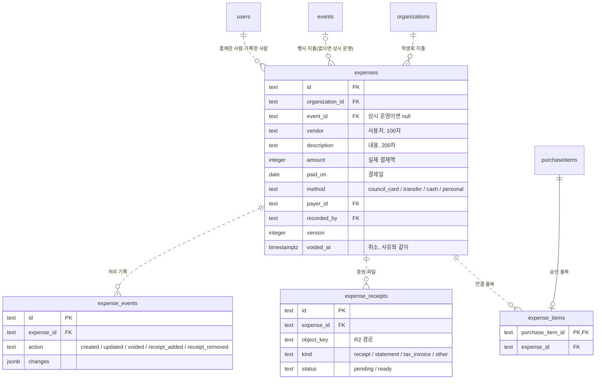

# M2-1 결제·증빙과 사용 내역 Implementation Plan

> **For agentic workers:** REQUIRED SUB-SKILL: Use superpowers:subagent-driven-development (recommended) or superpowers:executing-plans to implement this plan task-by-task. Steps use checkbox (`- [ ]`) syntax for tracking.

**Goal:** 재정 권한자가 결제 한 번마다 지출을 기록하고 영수증을 붙이며, 학생회 구성원은 누구나 사용 내역과 증빙 여부를 본다.

**Architecture:**
- 새 표 4개(`expenses`, `expense_items`, `expense_receipts`, `expense_events`)를 마이그레이션 0015로 더한다.
- `apps/api/src/expenses/`에 조회(summaries), 지출 서비스, 영수증 서비스, 저장소(R2), 라우트를 둔다.
- 영수증 파일은 브라우저가 서명 주소로 R2에 바로 올린다. 서버는 서명, 확인(HEAD), 보기 이동(302)만 한다.
- 화면은 새 메뉴 "사용 내역"(`apps/web/src/expenses/`)이다. 구매 검토의 구매·배송 보기에도 [지출 기록]을 둔다.

**Tech Stack:** Hono 4, drizzle-orm 0.45.3 / drizzle-kit 0.31, PGlite 테스트(`npx tsx --test`), zod 4.6.5, aws4fetch 1.0.20(새 의존성), React 19.3, Vite 8, vitest 5 + jsdom

**Spec:** `docs/superpowers/specs/2026-10-09-expenses-design.md`

## Global Constraints

- 요청 본문은 contracts의 `z.strictObject`이다. 문자열은 `text(max)`/`token(max)`만 쓰고, 문자열·배열·숫자에 모두 상한을 둔다.
- 라우트는 `json(Schema)`를 인증·소속 미들웨어보다 앞에 두고 `c.req.valid('json')`만 쓴다. 변경 라우트는 `/api/organizations/` 아래에 둔다.
- 실패는 `ApiError(code, status)`로 던진다. 라우트별 `onError`를 만들지 않는다.
- 길이 제한이 있는 칸은 DB에도 같은 값의 CHECK를 둔다. 사용처 100, 내용 200, 메모 200, 취소 사유 200, 파일 이름 200, 저장 경로 300자다.
- 금액은 0 ~ 2,147,483,647 정수이고, 결제일은 2000-01-01 ~ 2999-12-31이다.
- 결제 수단은 `council_card` / `transfer` / `cash` / `personal`, 증빙 종류는 `receipt` / `statement` / `tax_invoice` / `other`다.
- 파일 형식은 `image/jpeg`, `image/png`, `image/webp`, `image/heic`, `image/heif`, `application/pdf`만 받는다. 파일 하나 10,485,760바이트, 지출 하나에 ready 영수증 10개까지다.
- 서명 주소 수명은 PUT 600초, GET 300초다. 저장 경로는 `receipts/{조직}/{지출}/{영수증}`이고 사용자 입력을 쓰지 않는다.
- R2 환경변수는 `R2_ACCOUNT_ID`, `R2_ACCESS_KEY_ID`, `R2_SECRET_ACCESS_KEY`, `R2_BUCKET`이다. 하나라도 없으면 저장소를 끄고, 영수증 올리기·보기는 `STORAGE_NOT_CONFIGURED`(503)다.
- 로그와 응답에 파일 이름·금액·서명 주소·키·오류 원문을 넣지 않는다. 서명 주소는 올리기 응답 본문과 보기 응답의 `Location`에만 담는다.
- 화면은 `apps/web/src/components/ui` 부품과 Tailwind 스케일만 쓴다. 긴 사용처·내용·파일 이름에는 `wrap-anywhere`를 준다. 버튼 활성화는 같은 스키마의 `safeParse`로 정한다.
- 화면 문구(그대로 쓴다):
  - "아직 기록된 지출이 없어요"
  - "결제한 뒤 지출을 기록해 주세요."
  - "영수증 저장소가 아직 준비되지 않았어요."
  - "합계에서 빠지고 연결 품목은 풀려요."
  - "올린 증빙이 없어요."
- 마이그레이션 0015는 새 표만 더한다. dev와 배포 DB에 먼저 적용하고 배포한다. DB 적용 전에 사용자 승인을 받는다.

## Review Focus

1. **형식이 비었거나(`File.type === ''`) 서명과 다른 형식으로 올라간 파일:** 확인 단계가 지우고 거절해야 한다. 화면에는 그 파일만 실패로 보이고 증빙 개수는 그대로다. → Task 5 확인 불일치 테스트, Task 8 형식 검사 테스트
2. **같은 품목을 두 지출에 연결:** 하나만 성공한다. 품목 행 잠금(`FOR UPDATE`)과 `expense_items` PK가 막는다. → Task 4 "이미 연결된 품목" 테스트(실제 동시성은 리뷰에서 잠금 순서로 확인)
3. **수정으로 행사를 바꾸면서 이전 행사 품목을 남김:** 거절하고 아무것도 바꾸지 않는다. → Task 4 수정 테스트
4. **취소한 지출:** 합계·증빙 누락에서 빠지고, 풀린 품목은 다른 지출에 다시 연결된다. → Task 4 취소 테스트
5. **긴 한글·띄어쓰기 파일 이름:** 보기 주소의 `Content-Disposition`이 깨지지 않고 저장 경로에는 쓰이지 않는다. → Task 3 보기 주소 테스트, Task 5 경로 테스트

## 파일 구조

| 파일 | 책임 |
|---|---|
| `packages/contracts/src/expenses.ts` (새) | 지출·영수증 스키마, 상한, 응답 타입 |
| `apps/api/src/db/schema.ts` | 새 표 4개 |
| `apps/api/migrations/0015_expenses.sql` (생성) | 새 표만 만든다 |
| `apps/api/src/expenses/storage.ts` (새) | R2 서명 주소, HEAD, DELETE |
| `apps/api/src/expenses/summaries.ts` (새) | 목록·상세 응답 조립, 연결 품목 조회 |
| `apps/api/src/expenses/service.ts` (새) | 기록·수정·취소·목록·연결 가능 품목 |
| `apps/api/src/expenses/receipts.ts` (새) | 올리기 시작·확인·삭제·보기 주소 |
| `apps/api/src/expenses/routes.ts` (새) | Hono 라우트 |
| `apps/api/src/purchases/review.ts` | `requireFinance` 내보내기, 연결 품목 구매 표시 취소 막기 |
| `apps/api/src/app.ts`, `serve.ts` | 연결 |
| `apps/web/src/expenses/*` (새) | 화면 문구 도우미, 데이터 훅, 사용 내역·카드·상세·기록 대화상자, 올리기 훅 |
| `apps/web/src/workspace/*`, `purchases/PurchaseReview.tsx` | 메뉴·진입점 연결 |

---

### Task 1: 지출·영수증 계약

**Files:**
- Create: `packages/contracts/src/expenses.ts`, `packages/contracts/src/expenses.test.ts`
- Modify: `packages/contracts/src/index.ts`, `packages/contracts/package.json`

**Interfaces:**
- Consumes: `text`, `token`(input.ts), `purchaseDate`, `PURCHASE_INTEGER_MAX`(purchases.ts)
- Produces:
  - 상수: `EXPENSE_VENDOR_MAX`(100), `EXPENSE_DESCRIPTION_MAX`(200), `EXPENSE_NOTE_MAX`(200), `EXPENSE_VOID_REASON_MAX`(200), `EXPENSE_ITEMS_MAX`(50), `RECEIPTS_PER_EXPENSE_MAX`(10), `RECEIPT_FILE_NAME_MAX`(200), `RECEIPT_SIZE_MAX`(10485760), `EXPENSE_METHODS`, `RECEIPT_KINDS`, `RECEIPT_CONTENT_TYPES`
  - 스키마: `CreateExpenseSchema`, `UpdateExpenseSchema`, `VoidExpenseSchema`, `CreateReceiptUploadSchema`, `ReceiptActionSchema`
  - 타입: `ExpenseMethod`, `ReceiptKind`, `ReceiptContentType`, `ExpenseAction`, `CreateExpenseRequest`, `UpdateExpenseRequest`, `VoidExpenseRequest`, `CreateReceiptUploadRequest`, `ExpensePerson`, `ExpenseItem`, `ExpenseSummary`, `ReceiptSummary`, `ExpenseHistoryEntry`, `ExpenseDetail`, `ExpensesResponse`, `ExpenseResponse`, `ReceiptUploadResponse`, `LinkableItemsResponse`

- [ ] **Step 1: 실패하는 계약 테스트 작성**

`packages/contracts/src/expenses.test.ts`:

```ts
import assert from 'node:assert/strict'
import { test } from 'node:test'
import { isStrictObject } from './input.js'
import { EXPENSE_DESCRIPTION_MAX, EXPENSE_ITEMS_MAX, EXPENSE_NOTE_MAX, EXPENSE_VENDOR_MAX, EXPENSE_VOID_REASON_MAX, RECEIPT_FILE_NAME_MAX,
  RECEIPT_SIZE_MAX, CreateExpenseSchema, CreateReceiptUploadSchema, ReceiptActionSchema, UpdateExpenseSchema, VoidExpenseSchema } from './expenses.js'

// 테스트 파일에 제어 문자를 그대로 쓰지 않는다.
const nul = String.fromCharCode(0)
const lone = String.fromCharCode(0xd800)
const emoji = '😀'
const valid = { eventId: 'e', vendor: '쿠팡', description: '체육대회 물품', amount: 137500, paidOn: '2026-10-09', method: 'council_card',
  payerMembershipId: 'mf', note: null, itemIds: ['i1', 'i2'] }
const without = (key: string) => Object.fromEntries(Object.entries(valid).filter(([name]) => name !== key))

test('지출 칸: 앞뒤 공백을 지우고, 상시 운영(행사 없음)·품목 없음·0원도 받는다', () => {
  assert.deepEqual(CreateExpenseSchema.parse({ ...valid, vendor: ' 쿠팡 ', note: ' 영수증 늦게 옴 ' }), { ...valid, note: '영수증 늦게 옴' })
  assert.equal(CreateExpenseSchema.safeParse({ ...valid, eventId: null, itemIds: [] }).success, true)
  assert.equal(CreateExpenseSchema.safeParse({ ...valid, amount: 0, paidOn: '2000-01-01' }).success, true)
})

test('지출 칸: 빠진 값·빈 값·상한+1·제어 문자·범위 밖 값·모르는 키는 거절한다', () => {
  const bodies: unknown[] = [
    without('vendor'), without('description'), without('amount'), without('paidOn'), without('method'), without('payerMembershipId'),
    without('itemIds'), without('eventId'), without('note'),
    { ...valid, vendor: '' }, { ...valid, vendor: '   ' }, { ...valid, vendor: emoji.repeat(EXPENSE_VENDOR_MAX + 1) },
    { ...valid, vendor: `쿠팡${nul}` }, { ...valid, vendor: `쿠팡${lone}` },
    { ...valid, description: ' ' }, { ...valid, description: emoji.repeat(EXPENSE_DESCRIPTION_MAX + 1) },
    { ...valid, note: '' }, { ...valid, note: emoji.repeat(EXPENSE_NOTE_MAX + 1) },
    { ...valid, amount: -1 }, { ...valid, amount: 1.5 }, { ...valid, amount: 2147483648 }, { ...valid, amount: '1000' },
    { ...valid, paidOn: '2026-02-30' }, { ...valid, paidOn: '1999-12-31' }, { ...valid, paidOn: '3000-01-01' }, { ...valid, paidOn: '2026-1-1' },
    { ...valid, method: 'card' }, { ...valid, payerMembershipId: '' }, { ...valid, payerMembershipId: 'm'.repeat(65) },
    { ...valid, eventId: '' }, { ...valid, eventId: `e${nul}` },
    { ...valid, itemIds: ['i1', 'i1'] }, { ...valid, itemIds: Array.from({ length: EXPENSE_ITEMS_MAX + 1 }, (_, n) => `i${n}`) },
    { ...valid, itemIds: [nul] }, { ...valid, extra: 1 },
  ]
  for (const body of bodies) assert.equal(CreateExpenseSchema.safeParse(body).success, false, JSON.stringify(body))
})

test('수정·취소: 버전이 필요하고, 취소 사유는 비울 수 없다', () => {
  assert.equal(UpdateExpenseSchema.safeParse({ ...valid, version: 2 }).success, true)
  for (const body of [valid, { ...valid, version: 0 }, { ...valid, version: '2' }]) {
    assert.equal(UpdateExpenseSchema.safeParse(body).success, false, JSON.stringify(body))
  }
  assert.deepEqual(VoidExpenseSchema.parse({ version: 3, reason: ' 중복 기록 ' }), { version: 3, reason: '중복 기록' })
  for (const body of [{ version: 3 }, { version: 3, reason: ' ' }, { version: 3, reason: emoji.repeat(EXPENSE_VOID_REASON_MAX + 1) },
    { version: 3, reason: `a${nul}` }, { reason: '중복' }, { version: 3, reason: '중복', extra: 1 }]) {
    assert.equal(VoidExpenseSchema.safeParse(body).success, false, JSON.stringify(body))
  }
})

test('영수증 올리기: 형식·크기·종류를 정해진 값으로만 받고, 확인·삭제 본문은 빈 객체다', () => {
  const upload = { fileName: '영수증.jpg', contentType: 'image/jpeg', size: 1234, kind: 'receipt' }
  assert.equal(CreateReceiptUploadSchema.safeParse(upload).success, true)
  assert.equal(CreateReceiptUploadSchema.safeParse({ ...upload, contentType: 'application/pdf', size: RECEIPT_SIZE_MAX, kind: 'tax_invoice' }).success, true)
  for (const change of [{ fileName: '' }, { fileName: emoji.repeat(RECEIPT_FILE_NAME_MAX + 1) }, { fileName: `a${nul}.jpg` },
    { contentType: 'image/gif' }, { contentType: '' }, { size: 0 }, { size: RECEIPT_SIZE_MAX + 1 }, { size: 1.5 }, { kind: 'invoice' }, { extra: 1 }]) {
    assert.equal(CreateReceiptUploadSchema.safeParse({ ...upload, ...change }).success, false, JSON.stringify(change))
  }
  assert.equal(ReceiptActionSchema.safeParse({}).success, true)
  assert.equal(ReceiptActionSchema.safeParse({ receiptId: 'r' }).success, false)
  for (const schema of [CreateExpenseSchema, UpdateExpenseSchema, VoidExpenseSchema, CreateReceiptUploadSchema, ReceiptActionSchema]) {
    assert.equal(isStrictObject(schema), true)
  }
})
```

`packages/contracts/package.json`의 `"test"`를 `tsx --test src/input.test.ts src/coupang.test.ts src/expenses.test.ts`로 바꾼다.

- [ ] **Step 2: 실패 확인**

Run: `npm test --workspace @vada/contracts`
Expected: FAIL — `./expenses.js`가 없다

- [ ] **Step 3: 계약 구현**

`packages/contracts/src/expenses.ts`:

```ts
import { z } from 'zod'
import { text, token } from './input.js'
import { PURCHASE_INTEGER_MAX, purchaseDate } from './purchases.js'

export const EXPENSE_VENDOR_MAX = 100
export const EXPENSE_DESCRIPTION_MAX = 200
export const EXPENSE_NOTE_MAX = 200
export const EXPENSE_VOID_REASON_MAX = 200
export const EXPENSE_ITEMS_MAX = 50
export const RECEIPTS_PER_EXPENSE_MAX = 10
export const RECEIPT_FILE_NAME_MAX = 200
export const RECEIPT_SIZE_MAX = 10 * 1024 * 1024
export const EXPENSE_METHODS = ['council_card', 'transfer', 'cash', 'personal'] as const
export const RECEIPT_KINDS = ['receipt', 'statement', 'tax_invoice', 'other'] as const
export const RECEIPT_CONTENT_TYPES = ['image/jpeg', 'image/png', 'image/webp', 'image/heic', 'image/heif', 'application/pdf'] as const
export type ExpenseMethod = typeof EXPENSE_METHODS[number]
export type ReceiptKind = typeof RECEIPT_KINDS[number]
export type ReceiptContentType = typeof RECEIPT_CONTENT_TYPES[number]
export type ExpenseAction = 'created' | 'updated' | 'voided' | 'receipt_added' | 'receipt_removed'

const id = token(64)
const version = z.number().int().min(1).max(PURCHASE_INTEGER_MAX)
// 결제일. 달력에 있는 날짜이고, DB 검사와 같은 범위만 받는다.
const expenseDate = purchaseDate.refine(value => value >= '2000-01-01' && value <= '2999-12-31')
const fields = {
  // null이면 상시 운영 지출이다.
  eventId: id.nullable(),
  vendor: text(EXPENSE_VENDOR_MAX),
  description: text(EXPENSE_DESCRIPTION_MAX),
  amount: z.number().int().min(0).max(PURCHASE_INTEGER_MAX),
  paidOn: expenseDate,
  method: z.enum(EXPENSE_METHODS),
  // 같은 학생회 소속(memberships.id)만 받는다. 서버가 사용자로 바꿔 저장한다.
  payerMembershipId: id,
  note: text(EXPENSE_NOTE_MAX).nullable(),
  itemIds: z.array(id).max(EXPENSE_ITEMS_MAX).refine(ids => new Set(ids).size === ids.length),
}
export const CreateExpenseSchema = z.strictObject(fields)
// 수정은 모든 칸을 다시 보낸다. 연결 품목도 바뀐 목록 전체다.
export const UpdateExpenseSchema = z.strictObject({ version, ...fields })
export const VoidExpenseSchema = z.strictObject({ version, reason: text(EXPENSE_VOID_REASON_MAX) })
export const CreateReceiptUploadSchema = z.strictObject({
  fileName: text(RECEIPT_FILE_NAME_MAX),
  contentType: z.enum(RECEIPT_CONTENT_TYPES),
  size: z.number().int().min(1).max(RECEIPT_SIZE_MAX),
  kind: z.enum(RECEIPT_KINDS),
})
// 영수증 확인·삭제는 경로로 대상을 정한다. 본문은 빈 객체만 받는다.
export const ReceiptActionSchema = z.strictObject({})

export type CreateExpenseRequest = z.infer<typeof CreateExpenseSchema>
export type UpdateExpenseRequest = z.infer<typeof UpdateExpenseSchema>
export type VoidExpenseRequest = z.infer<typeof VoidExpenseSchema>
export type CreateReceiptUploadRequest = z.infer<typeof CreateReceiptUploadSchema>

export interface ExpensePerson { id: string; name: string }
// 지출에 연결했거나 연결할 수 있는 승인 품목.
export interface ExpenseItem {
  id: string
  event: { id: string; name: string }
  productName: string | null
  quantity: number | null
  estimatedUnitPrice: number | null
  requester: ExpensePerson
  purchasedAt: string | null
}
export interface ExpenseSummary {
  id: string
  // null이면 상시 운영 지출이다.
  event: { id: string; name: string } | null
  vendor: string
  description: string
  amount: number
  paidOn: string
  method: ExpenseMethod
  payer: ExpensePerson
  // 수정 대화상자가 결제한 사람을 고를 때 쓴다. 학생회를 떠났으면 null이다.
  payerMembershipId: string | null
  note: string | null
  recordedBy: ExpensePerson
  items: ExpenseItem[]
  // 연결 품목의 수량 × 예상 단가 합. 품목이 없거나 값을 모르는 품목이 있으면 null이다.
  approvedTotal: number | null
  // 다 올라가 확인된 증빙 수.
  receiptCount: number
  evidence: 'complete' | 'missing'
  voided: { by: ExpensePerson; at: string; reason: string } | null
  version: number
  createdAt: string
  updatedAt: string
}
export interface ReceiptSummary {
  id: string
  fileName: string
  contentType: ReceiptContentType
  size: number
  kind: ReceiptKind
  uploadedBy: ExpensePerson
  createdAt: string
}
export interface ExpenseHistoryEntry {
  id: string
  action: ExpenseAction
  actor: ExpensePerson
  changes: Record<string, unknown>
  createdAt: string
}
export interface ExpenseDetail extends ExpenseSummary {
  receipts: ReceiptSummary[]
  history: ExpenseHistoryEntry[]
}
export interface ExpensesResponse {
  expenses: ExpenseSummary[]
  truncated: boolean
  // 셋 다 취소한 지출을 뺀다. 이번 달은 한국 시간 기준이다.
  totals: { thisMonth: number; total: number; missingEvidence: number }
}
export interface ExpenseResponse { expense: ExpenseDetail }
export interface ReceiptUploadResponse {
  receiptId: string
  // 브라우저가 이 주소로 파일을 그대로 PUT한다. headers를 바꾸지 않고 보낸다.
  upload: { url: string; headers: Record<string, string> }
  expiresAt: string
}
export interface LinkableItemsResponse { items: ExpenseItem[]; truncated: boolean }
```

`packages/contracts/src/index.ts` 끝에 더한다:

```ts
export { EXPENSE_VENDOR_MAX, EXPENSE_DESCRIPTION_MAX, EXPENSE_NOTE_MAX, EXPENSE_VOID_REASON_MAX, EXPENSE_ITEMS_MAX, RECEIPTS_PER_EXPENSE_MAX,
  RECEIPT_FILE_NAME_MAX, RECEIPT_SIZE_MAX, EXPENSE_METHODS, RECEIPT_KINDS, RECEIPT_CONTENT_TYPES, CreateExpenseSchema, UpdateExpenseSchema,
  VoidExpenseSchema, CreateReceiptUploadSchema, ReceiptActionSchema } from './expenses.js'
export type { ExpenseMethod, ReceiptKind, ReceiptContentType, ExpenseAction, CreateExpenseRequest, UpdateExpenseRequest, VoidExpenseRequest,
  CreateReceiptUploadRequest, ExpensePerson, ExpenseItem, ExpenseSummary, ReceiptSummary, ExpenseHistoryEntry, ExpenseDetail,
  ExpensesResponse, ExpenseResponse, ReceiptUploadResponse, LinkableItemsResponse } from './expenses.js'
```

- [ ] **Step 4: 통과 확인**

Run: `npm test --workspace @vada/contracts && npm run typecheck --workspace @vada/contracts`
Expected: PASS (기존 21개 + 새 4개)

- [ ] **Step 5: 커밋**

```bash
git add packages/contracts
git commit -m "지출·영수증 계약 추가"
```

---

### Task 2: 지출 표와 마이그레이션 0015

**Files:**
- Modify: `apps/api/src/db/schema.ts`, `apps/api/src/db/migrations.test.ts`
- Create(생성기): `apps/api/migrations/0015_expenses.sql`, `apps/api/migrations/meta/0015_snapshot.json`, `meta/_journal.json` 갱신

**Interfaces:**
- Produces: drizzle 표 `expenses`, `expenseItems`, `expenseReceipts`, `expenseEvents`. 제약 이름은 아래 테스트가 쓰는 이름이다.

- [ ] **Step 1: 실패하는 마이그레이션 테스트 작성**

`apps/api/src/db/migrations.test.ts` 끝에 더한다(파일 위쪽 import에 이미 `migrationsBefore`, `migrationsFolder`, `PGlite`, `drizzle`, `migrate`, `assert`, `test`가 있다):

```ts
test('0015 adds expenses without touching purchase items', async (t) => {
  const pg = new PGlite()
  const previous = migrationsBefore('0015_expenses')
  try {
    const db = drizzle(pg)
    await migrate(db, { migrationsFolder: previous.folder })
    await pg.exec(`
      INSERT INTO users (id,name,email) VALUES ('u','재정','u@example.test');
      INSERT INTO organizations (id,name) VALUES ('o','Council'),('o2','Other');
      INSERT INTO events (id,organization_id,name,created_by) VALUES ('e','o','체육대회','u'),('e2','o2','남의 행사','u');
      INSERT INTO purchase_items (id,organization_id,event_id,requester_id,product_url) VALUES ('i','o','e','u','https://www.coupang.com/vp/products/1');
    `)
    const before = (await pg.query<Record<string, unknown>>('SELECT * FROM purchase_items')).rows
    await migrate(db, { migrationsFolder })
    const insert = (table: string, id: string, values: Record<string, string>) =>
      pg.exec(`INSERT INTO ${table} (id,${Object.keys(values).join(',')}) VALUES ('${id}',${Object.values(values).join(',')})`)
    const expense = (id: string, change: Record<string, string> = {}) => insert('expenses', id, { organization_id: "'o'", event_id: "'e'",
      vendor: "'쿠팡'", description: "'물품'", amount: '1000', paid_on: "'2026-10-09'", method: "'council_card'", payer_id: "'u'",
      recorded_by: "'u'", note: 'NULL', voided_at: 'NULL', voided_by: 'NULL', void_reason: 'NULL', ...change })

    await t.test('existing items keep their values', async () => {
      assert.deepEqual((await pg.query<Record<string, unknown>>('SELECT * FROM purchase_items')).rows, before)
    })
    await t.test('expense text, amount, date, method and cancellation fields are checked', async () => {
      await expense('x1')
      await expense('x2', { event_id: 'NULL' })
      const cases: [Record<string, string>, string][] = [
        [{ vendor: "'  '" }, 'expenses_vendor_not_blank'],
        [{ vendor: `'${'가'.repeat(101)}'` }, 'expenses_vendor_length'],
        [{ description: "''" }, 'expenses_description_not_blank'],
        [{ description: `'${'가'.repeat(201)}'` }, 'expenses_description_length'],
        [{ amount: '-1' }, 'expenses_amount_nonnegative'],
        [{ paid_on: "'1999-12-31'" }, 'expenses_paid_on_range'],
        [{ method: "'card'" }, 'expenses_method_valid'],
        [{ note: "' '" }, 'expenses_note_not_blank'],
        [{ note: `'${'가'.repeat(201)}'` }, 'expenses_note_length'],
        [{ voided_at: 'now()' }, 'expenses_void_triple'],
        [{ voided_at: 'now()', voided_by: "'u'", void_reason: "' '" }, 'expenses_void_reason_not_blank'],
        [{ event_id: "'e2'" }, 'expenses_event_same_organization'],
      ]
      for (const [change, constraint] of cases) await assert.rejects(expense(`bad-${constraint}`, change), { constraint }, constraint)
    })
    await t.test('an item links to one expense of the same council', async () => {
      const link = (expenseId: string, organizationId = 'o') =>
        pg.exec(`INSERT INTO expense_items (purchase_item_id,organization_id,expense_id) VALUES ('i','${organizationId}','${expenseId}')`)
      await link('x1')
      await assert.rejects(link('x2'), { constraint: 'expense_items_pkey' })
      await pg.exec('DELETE FROM expense_items')
      await insert('expenses', 'y', { organization_id: "'o2'", vendor: "'가게'", description: "'다과'", amount: '1', paid_on: "'2026-10-09'",
        method: "'cash'", payer_id: "'u'", recorded_by: "'u'" })
      await assert.rejects(link('y'), { constraint: 'expense_items_expense_same_organization' })
      await assert.rejects(link('y', 'o2'), { constraint: 'expense_items_item_same_organization' })
    })
    await t.test('receipts keep a known type, a bounded size and a confirmation time when ready', async () => {
      const receipt = (id: string, change: Record<string, string> = {}) => insert('expense_receipts', id, { organization_id: "'o'",
        expense_id: "'x1'", object_key: `'receipts/o/x1/${id}'`, file_name: "'영수증.jpg'", content_type: "'image/jpeg'", size_bytes: '1234',
        kind: "'receipt'", status: "'pending'", uploaded_by: "'u'", confirmed_at: 'NULL', ...change })
      await receipt('r1')
      await receipt('r2', { status: "'ready'", confirmed_at: 'now()' })
      const cases: [Record<string, string>, string][] = [
        [{ object_key: "'receipts/o/x1/r1'" }, 'expense_receipts_object_key_unique'],
        [{ object_key: `'${'k'.repeat(301)}'` }, 'expense_receipts_object_key_length'],
        [{ file_name: "' '" }, 'expense_receipts_file_name_not_blank'],
        [{ file_name: `'${'가'.repeat(201)}'` }, 'expense_receipts_file_name_length'],
        [{ content_type: "'image/gif'" }, 'expense_receipts_content_type_valid'],
        [{ size_bytes: '0' }, 'expense_receipts_size_range'],
        [{ size_bytes: '10485761' }, 'expense_receipts_size_range'],
        [{ kind: "'invoice'" }, 'expense_receipts_kind_valid'],
        [{ status: "'done'" }, 'expense_receipts_status_valid'],
        [{ status: "'ready'" }, 'expense_receipts_ready_confirmed'],
        [{ expense_id: "'y'" }, 'expense_receipts_expense_same_organization'],
      ]
      for (const [index, [change, constraint]] of cases.entries()) {
        await assert.rejects(receipt(`bad-${index}`, change), { constraint }, constraint)
      }
    })
    await t.test('history actions are known and changes are objects', async () => {
      const entry = (id: string, action: string, changes = "'{}'") => insert('expense_events', id, { organization_id: "'o'",
        expense_id: "'x1'", actor_id: "'u'", action: `'${action}'`, changes })
      await entry('h1', 'created')
      await assert.rejects(entry('h2', 'deleted'), { constraint: 'expense_events_action_valid' })
      await assert.rejects(entry('h3', 'updated', "'[]'"), { constraint: 'expense_events_changes_object' })
    })
  } finally {
    previous.remove()
    await pg.close()
  }
})
```

- [ ] **Step 2: 실패 확인**

Run: `cd apps/api && npx tsx --test src/db/migrations.test.ts`
Expected: FAIL — `Migration not found: 0015_expenses`

- [ ] **Step 3: 표 정의**

`apps/api/src/db/schema.ts` 맨 끝에 더한다:

```ts
// 결제 한 번(영수증 한 장 단위)의 지출. 지우지 않고 취소로 남긴다(2026-10-09 결정).
export const expenses = pgTable('expenses', {
  id: text('id').primaryKey(),
  organizationId: text('organization_id').notNull()
    .references(() => organizations.id, { onDelete: 'restrict' }),
  // 비어 있으면 상시 운영 지출이다.
  eventId: text('event_id'),
  vendor: text('vendor').notNull(),
  description: text('description').notNull(),
  amount: integer('amount').notNull(),
  paidOn: date('paid_on').notNull(),
  method: text('method', { enum: ['council_card', 'transfer', 'cash', 'personal'] }).notNull(),
  payerId: text('payer_id').notNull().references(() => users.id, { onDelete: 'restrict' }),
  note: text('note'),
  recordedBy: text('recorded_by').notNull().references(() => users.id, { onDelete: 'restrict' }),
  version: integer('version').notNull().default(1),
  voidedAt: timestamp('voided_at', { withTimezone: true }),
  voidedBy: text('voided_by').references(() => users.id, { onDelete: 'restrict' }),
  voidReason: text('void_reason'),
  createdAt: timestamp('created_at', { withTimezone: true }).notNull().defaultNow(),
  updatedAt: timestamp('updated_at', { withTimezone: true }).notNull().defaultNow().$onUpdate(() => new Date()),
}, (table) => [
  foreignKey({
    name: 'expenses_event_same_organization',
    columns: [table.organizationId, table.eventId],
    foreignColumns: [events.organizationId, events.id],
  }).onDelete('restrict'),
  unique('expenses_organization_id_unique').on(table.organizationId, table.id),
  check('expenses_vendor_not_blank', sql`${table.vendor} ~ '[^[:space:]]'`),
  check('expenses_vendor_length', sql`char_length(${table.vendor}) <= 100`),
  check('expenses_description_not_blank', sql`${table.description} ~ '[^[:space:]]'`),
  check('expenses_description_length', sql`char_length(${table.description}) <= 200`),
  check('expenses_amount_nonnegative', sql`${table.amount} >= 0`),
  check('expenses_paid_on_range', sql`${table.paidOn} BETWEEN '2000-01-01' AND '2999-12-31'`),
  check('expenses_method_valid', sql`${table.method} IN ('council_card','transfer','cash','personal')`),
  check('expenses_note_not_blank', sql`${table.note} ~ '[^[:space:]]'`),
  check('expenses_note_length', sql`char_length(${table.note}) <= 200`),
  check('expenses_version_positive', sql`${table.version} >= 1`),
  check('expenses_void_triple', sql`(${table.voidedAt} IS NULL) = (${table.voidedBy} IS NULL) AND (${table.voidedAt} IS NULL) = (${table.voidReason} IS NULL)`),
  check('expenses_void_reason_not_blank', sql`${table.voidReason} ~ '[^[:space:]]'`),
  check('expenses_void_reason_length', sql`char_length(${table.voidReason}) <= 200`),
  index('expenses_organization_paid_idx').on(table.organizationId, table.paidOn.desc(), table.createdAt.desc()),
])

// 지출에 연결한 승인 품목. 품목 하나는 지출 하나에만 연결된다.
export const expenseItems = pgTable('expense_items', {
  purchaseItemId: text('purchase_item_id').primaryKey(),
  organizationId: text('organization_id').notNull(),
  expenseId: text('expense_id').notNull(),
}, (table) => [
  foreignKey({
    name: 'expense_items_expense_same_organization',
    columns: [table.organizationId, table.expenseId],
    foreignColumns: [expenses.organizationId, expenses.id],
  }).onDelete('restrict'),
  foreignKey({
    name: 'expense_items_item_same_organization',
    columns: [table.organizationId, table.purchaseItemId],
    foreignColumns: [purchaseItems.organizationId, purchaseItems.id],
  }).onDelete('restrict'),
  index('expense_items_expense_idx').on(table.organizationId, table.expenseId),
])

// 증빙 파일. 파일은 R2에 두고 경로만 저장한다. 다 올라가 확인된 파일만 ready다.
export const expenseReceipts = pgTable('expense_receipts', {
  id: text('id').primaryKey(),
  organizationId: text('organization_id').notNull(),
  expenseId: text('expense_id').notNull(),
  objectKey: text('object_key').notNull().unique(),
  fileName: text('file_name').notNull(),
  contentType: text('content_type').notNull(),
  sizeBytes: integer('size_bytes').notNull(),
  kind: text('kind', { enum: ['receipt', 'statement', 'tax_invoice', 'other'] }).notNull(),
  status: text('status', { enum: ['pending', 'ready'] }).notNull().default('pending'),
  uploadedBy: text('uploaded_by').notNull().references(() => users.id, { onDelete: 'restrict' }),
  createdAt: timestamp('created_at', { withTimezone: true }).notNull().defaultNow(),
  confirmedAt: timestamp('confirmed_at', { withTimezone: true }),
}, (table) => [
  foreignKey({
    name: 'expense_receipts_expense_same_organization',
    columns: [table.organizationId, table.expenseId],
    foreignColumns: [expenses.organizationId, expenses.id],
  }).onDelete('restrict'),
  check('expense_receipts_object_key_length', sql`char_length(${table.objectKey}) <= 300`),
  check('expense_receipts_file_name_not_blank', sql`${table.fileName} ~ '[^[:space:]]'`),
  check('expense_receipts_file_name_length', sql`char_length(${table.fileName}) <= 200`),
  check('expense_receipts_content_type_valid', sql`${table.contentType} IN ('image/jpeg','image/png','image/webp','image/heic','image/heif','application/pdf')`),
  check('expense_receipts_size_range', sql`${table.sizeBytes} BETWEEN 1 AND 10485760`),
  check('expense_receipts_kind_valid', sql`${table.kind} IN ('receipt','statement','tax_invoice','other')`),
  check('expense_receipts_status_valid', sql`${table.status} IN ('pending','ready')`),
  check('expense_receipts_ready_confirmed', sql`(${table.status} = 'ready') = (${table.confirmedAt} IS NOT NULL)`),
  index('expense_receipts_expense_idx').on(table.organizationId, table.expenseId),
])

// 지출 처리 기록. 고치거나 지우지 않는다.
export const expenseEvents = pgTable('expense_events', {
  id: text('id').primaryKey(),
  organizationId: text('organization_id').notNull(),
  expenseId: text('expense_id').notNull(),
  actorId: text('actor_id').notNull().references(() => users.id, { onDelete: 'restrict' }),
  action: text('action', { enum: ['created', 'updated', 'voided', 'receipt_added', 'receipt_removed'] }).notNull(),
  changes: jsonb('changes').$type<Record<string, unknown>>().notNull().default({}),
  createdAt: timestamp('created_at', { withTimezone: true }).notNull().defaultNow(),
}, (table) => [
  foreignKey({
    name: 'expense_events_expense_same_organization',
    columns: [table.organizationId, table.expenseId],
    foreignColumns: [expenses.organizationId, expenses.id],
  }).onDelete('restrict'),
  check('expense_events_action_valid', sql`${table.action} IN ('created','updated','voided','receipt_added','receipt_removed')`),
  check('expense_events_changes_object', sql`jsonb_typeof(${table.changes}) = 'object'`),
  index('expense_events_expense_idx').on(table.expenseId, table.createdAt),
])
```

- [ ] **Step 4: 마이그레이션 생성과 검토**

Run: `cd apps/api && npx drizzle-kit generate --name expenses`
Expected: `migrations/0015_expenses.sql` 생성

생성된 SQL을 읽고 확인한다.
- `CREATE TABLE`이 4개, 새 표에 대한 `ALTER TABLE ... ADD CONSTRAINT`(FK), `CREATE INDEX`만 있다.
- 기존 표를 바꾸거나 지우는 문장이 없다.
- 줄바꿈은 LF다. `.gitattributes`가 `*.sql`을 LF로 고정한다. 작업 사본이 CRLF여도 커밋은 LF다.

- [ ] **Step 5: 통과 확인**

Run: `cd apps/api && npx tsx --test src/db/migrations.test.ts src/db/schema.test.ts src/db/purchases.test.ts`
Expected: PASS

- [ ] **Step 6: 커밋**

```bash
git add apps/api/src/db apps/api/migrations
git commit -m "지출·증빙 표와 0015 마이그레이션 추가"
```

---

### Task 3: R2 영수증 저장소

**Files:**
- Create: `apps/api/src/expenses/storage.ts`, `apps/api/src/expenses/storage.test.ts`
- Modify: `apps/api/package.json`(의존성 `aws4fetch` 1.0.20, test 목록), `package-lock.json`

**Interfaces:**
- Produces:
  - `interface ReceiptStorage { uploadUrl(key, contentType): Promise<{ url: string; headers: Record<string, string>; expiresAt: Date }>; downloadUrl(key, fileName, contentType): Promise<string>; head(key): Promise<{ size: number; contentType: string | null } | null>; remove(key): Promise<void> }`
  - `interface R2Config { accountId; accessKeyId; secretAccessKey; bucket }`
  - `r2ConfigFrom(env: NodeJS.ProcessEnv): R2Config | null`
  - `createR2Storage(config: R2Config, fetcher?: typeof fetch, now?: () => Date): ReceiptStorage`
  - `UPLOAD_SECONDS = 600`, `DOWNLOAD_SECONDS = 300`

- [ ] **Step 1: 의존성 설치**

Run: `npm install aws4fetch@1.0.20 --save-exact --workspace @vada/api`
Expected: `apps/api/package.json`의 `dependencies`에 `"aws4fetch": "1.0.20"`

- [ ] **Step 2: 실패하는 저장소 테스트 작성**

`apps/api/src/expenses/storage.test.ts`:

```ts
import assert from 'node:assert/strict'
import { test } from 'node:test'
import { createR2Storage, r2ConfigFrom } from './storage.js'

const config = { accountId: 'acc', accessKeyId: 'AKID', secretAccessKey: 'secret-value', bucket: 'vada-receipts' }
const fixed = () => new Date('2026-10-09T05:00:00.000Z')

test('올리기 주소는 버킷 경로·10분 만료·형식 서명을 담고, 보기 주소는 5분 만료와 파일 이름을 담는다', async () => {
  const storage = createR2Storage(config, fetch, fixed)
  const upload = await storage.uploadUrl('receipts/a/e1/r1', 'image/jpeg')
  const url = new URL(upload.url)
  assert.equal(url.origin, 'https://acc.r2.cloudflarestorage.com')
  assert.equal(url.pathname, '/vada-receipts/receipts/a/e1/r1')
  assert.equal(url.searchParams.get('X-Amz-Expires'), '600')
  assert.equal(url.searchParams.get('X-Amz-SignedHeaders'), 'content-type;host')
  assert.equal(url.searchParams.get('X-Amz-Date'), '20261009T050000Z')
  assert.equal(url.searchParams.get('X-Amz-Credential'), 'AKID/20261009/auto/s3/aws4_request')
  assert.match(url.searchParams.get('X-Amz-Signature') ?? '', /^[0-9a-f]{64}$/)
  assert.deepEqual(upload.headers, { 'Content-Type': 'image/jpeg' })
  assert.equal(upload.expiresAt.toISOString(), '2026-10-09T05:10:00.000Z')
  assert.ok(!upload.url.includes('secret-value'))
  const name = '체육대회 영수증 (1).jpg'
  const download = new URL(await storage.downloadUrl('receipts/a/e1/r1', name, 'image/jpeg'))
  assert.equal(download.pathname, '/vada-receipts/receipts/a/e1/r1')
  assert.equal(download.searchParams.get('X-Amz-Expires'), '300')
  assert.equal(download.searchParams.get('X-Amz-SignedHeaders'), 'host')
  assert.equal(download.searchParams.get('response-content-type'), 'image/jpeg')
  assert.equal(download.searchParams.get('response-content-disposition'), `inline; filename*=UTF-8''${encodeURIComponent(name)}`)
})

test('HEAD는 크기·형식을 읽고 404는 없음으로 본다. DELETE의 404는 지운 것으로 본다', async () => {
  const seen: Request[] = []
  const responses = [
    new Response(null, { status: 200, headers: { 'Content-Length': '1234', 'Content-Type': 'image/jpeg' } }),
    new Response(null, { status: 404 }), new Response(null, { status: 500 }),
    new Response(null, { status: 204 }), new Response(null, { status: 404 }), new Response(null, { status: 403 }),
  ]
  const fetcher = (async (input: RequestInfo | URL) => { seen.push(input as Request); return responses.shift()! }) as typeof fetch
  const storage = createR2Storage(config, fetcher, fixed)
  assert.deepEqual(await storage.head('receipts/a/e1/r1'), { size: 1234, contentType: 'image/jpeg' })
  assert.equal(await storage.head('receipts/a/e1/r1'), null)
  await assert.rejects(storage.head('receipts/a/e1/r1'), /STORAGE_HEAD_FAILED/)
  await storage.remove('receipts/a/e1/r1')
  await storage.remove('receipts/a/e1/r1')
  await assert.rejects(storage.remove('receipts/a/e1/r1'), /STORAGE_DELETE_FAILED/)
  assert.deepEqual(seen.map(request => request.method), ['HEAD', 'HEAD', 'HEAD', 'DELETE', 'DELETE', 'DELETE'])
  for (const request of seen) {
    assert.equal(new URL(request.url).pathname, '/vada-receipts/receipts/a/e1/r1')
    assert.ok(request.headers.get('Authorization')?.startsWith('AWS4-HMAC-SHA256 Credential=AKID/20261009/auto/s3/aws4_request'))
  }
})

test('네 환경변수가 모두 있어야 저장소를 켠다', () => {
  const env = { R2_ACCOUNT_ID: 'acc', R2_ACCESS_KEY_ID: 'AKID', R2_SECRET_ACCESS_KEY: 'secret-value', R2_BUCKET: ' vada-receipts ' }
  assert.deepEqual(r2ConfigFrom(env), config)
  for (const key of Object.keys(env)) assert.equal(r2ConfigFrom({ ...env, [key]: ' ' }), null, key)
  assert.equal(r2ConfigFrom({}), null)
})
```

`apps/api/package.json`의 `"test"`에서 ` src/http/boundary.test.ts` 앞에 ` src/expenses/storage.test.ts`를 더한다.

- [ ] **Step 3: 실패 확인**

Run: `cd apps/api && npx tsx --test src/expenses/storage.test.ts`
Expected: FAIL — `./storage.js`가 없다

- [ ] **Step 4: 저장소 구현**

`apps/api/src/expenses/storage.ts`:

```ts
import { AwsClient } from 'aws4fetch'

export interface StoredObject { size: number; contentType: string | null }
// 영수증 파일 저장소. 파일은 브라우저가 서명 주소로 바로 올리고 받는다.
export interface ReceiptStorage {
  uploadUrl(key: string, contentType: string): Promise<{ url: string; headers: Record<string, string>; expiresAt: Date }>
  downloadUrl(key: string, fileName: string, contentType: string): Promise<string>
  head(key: string): Promise<StoredObject | null>
  remove(key: string): Promise<void>
}
export interface R2Config { accountId: string; accessKeyId: string; secretAccessKey: string; bucket: string }
export const UPLOAD_SECONDS = 600
export const DOWNLOAD_SECONDS = 300

// 네 값이 모두 있어야 켠다. 하나라도 없으면 영수증 올리기·보기만 막는다.
export function r2ConfigFrom(env: NodeJS.ProcessEnv): R2Config | null {
  const config = { accountId: env.R2_ACCOUNT_ID?.trim() ?? '', accessKeyId: env.R2_ACCESS_KEY_ID?.trim() ?? '',
    secretAccessKey: env.R2_SECRET_ACCESS_KEY?.trim() ?? '', bucket: env.R2_BUCKET?.trim() ?? '' }
  return Object.values(config).every(Boolean) ? config : null
}

// Cloudflare R2의 S3 호환 주소에 SigV4로 서명한다. 버킷은 비공개다.
export function createR2Storage(config: R2Config, fetcher: typeof fetch = fetch, now: () => Date = () => new Date()): ReceiptStorage {
  const client = new AwsClient({ accessKeyId: config.accessKeyId, secretAccessKey: config.secretAccessKey, service: 's3', region: 'auto' })
  const objectUrl = (key: string) => new URL(`https://${config.accountId}.r2.cloudflarestorage.com/${encodeURIComponent(config.bucket)}/${
    key.split('/').map(encodeURIComponent).join('/')}`)
  const stamp = () => now().toISOString().replace(/[:-]|\.\d{3}/g, '')
  // 서명 주소. 올리기는 Content-Type까지 서명해 다른 형식으로 올리지 못하게 한다.
  async function presign(method: 'PUT' | 'GET', url: URL, seconds: number, headers: Record<string, string> = {}) {
    url.searchParams.set('X-Amz-Expires', String(seconds))
    const signed = await client.sign(url.toString(), { method, headers, aws: { signQuery: true, allHeaders: true, datetime: stamp() } })
    return signed.url
  }
  async function call(method: 'HEAD' | 'DELETE', key: string) {
    return fetcher(await client.sign(objectUrl(key).toString(), { method, aws: { datetime: stamp() } }))
  }
  return {
    async uploadUrl(key, contentType) {
      const headers = { 'Content-Type': contentType }
      return { url: await presign('PUT', objectUrl(key), UPLOAD_SECONDS, headers), headers,
        expiresAt: new Date(now().getTime() + UPLOAD_SECONDS * 1000) }
    },
    async downloadUrl(key, fileName, contentType) {
      const url = objectUrl(key)
      url.searchParams.set('response-content-type', contentType)
      url.searchParams.set('response-content-disposition', `inline; filename*=UTF-8''${encodeURIComponent(fileName)}`)
      return presign('GET', url, DOWNLOAD_SECONDS)
    },
    async head(key) {
      const response = await call('HEAD', key)
      if (response.status === 404) return null
      if (!response.ok) throw new Error('STORAGE_HEAD_FAILED')
      return { size: Number(response.headers.get('content-length') ?? '-1'), contentType: response.headers.get('content-type') }
    },
    async remove(key) {
      const response = await call('DELETE', key)
      if (!response.ok && response.status !== 404) throw new Error('STORAGE_DELETE_FAILED')
    },
  }
}
```

- [ ] **Step 5: 통과 확인**

Run: `cd apps/api && npx tsx --test src/expenses/storage.test.ts && npx tsc --noEmit -p .`
Expected: PASS

- [ ] **Step 6: 커밋**

```bash
git add apps/api/src/expenses/storage.ts apps/api/src/expenses/storage.test.ts apps/api/package.json package-lock.json
git commit -m "R2 영수증 저장소 서명 주소 추가"
```

---

### Task 4: 지출 기록·수정·취소·목록 API

**Files:**
- Create: `apps/api/src/expenses/summaries.ts`, `apps/api/src/expenses/service.ts`, `apps/api/src/expenses/routes.ts`, `apps/api/src/expenses/expenses.test.ts`
- Modify: `apps/api/src/purchases/review.ts`(`requireFinance` 내보내기), `apps/api/src/app.ts`, `apps/api/src/http/boundary.test.ts`, `apps/api/src/purchases/test-setup.ts`, `apps/api/package.json`

**Interfaces:**
- Consumes: Task 1 계약, Task 2 표, Task 3 `ReceiptStorage`, `StoredObject`
- Produces:
  - `createExpenseRoutes(db: ExpenseDatabase, session: SessionReader, storage?: ReceiptStorage)`
  - `createExpenseService(db)` → `{ list(scope), get(scope, id), create(scope, input), update(scope, id, input), void(scope, id, input) }`
  - `service.ts` 내보내기: `ExpenseDatabase`, `ExpenseTransaction`, `ExpenseScope`, `recordExpense`, `lockExpense`, `detailOf`
  - `summaries.ts` 내보내기: `expenseSummaries(db, organizationId, where, limit)`, `expenseDetail(db, organizationId, summary)`, `expenseItemRows(db, organizationId, where, limit?)`, `approvedTotalOf(items)`
  - `AppOptions.expenses`
  - `test-setup.ts`: `fakeStorage()` → `{ storage, removed, put(key, size, contentType) }`, `type FakeStorage`. `setupPurchases(migrations?, { storage?: FakeStorage | null })`는 지출 라우트를 같이 연결하고 `storage`를 돌려준다.

- [ ] **Step 1: 테스트 도우미에 지출 라우트와 가짜 저장소 연결**

`apps/api/src/purchases/test-setup.ts`:
- import에 더한다:

```ts
import { createExpenseRoutes } from '../expenses/routes.js'
import type { ReceiptStorage, StoredObject } from '../expenses/storage.js'
```

- `export const refs = …` 아래에 더한다:

```ts
// 영수증 저장소 가짜. 올라간 파일은 put으로 흉내 내고, 지운 경로를 남긴다.
export function fakeStorage() {
  const objects = new Map<string, StoredObject>()
  const removed: string[] = []
  const storage: ReceiptStorage = {
    async uploadUrl(key, contentType) {
      return { url: `https://r2.test/${key}`, headers: { 'Content-Type': contentType }, expiresAt: new Date(Date.now() + 600_000) }
    },
    async downloadUrl(key) { return `https://r2.test/${key}?signed=1` },
    async head(key) { return objects.get(key) ?? null },
    async remove(key) { removed.push(key); objects.delete(key) },
  }
  return { storage, removed, put: (key: string, size: number, contentType: string) => { objects.set(key, { size, contentType }) } }
}
export type FakeStorage = ReturnType<typeof fakeStorage>
```

- 함수 머리와 라우트·앱 생성을 바꾼다:

```ts
export async function setupPurchases(migrations = migrationsFolder, { storage = fakeStorage() }: { storage?: FakeStorage | null } = {}) {
```

```ts
  const session = async () => state.userId ? { user: { id: state.userId } } : null
  const routes = createPurchaseRoutes(db, session,
    async input => { state.calls++; return state.generate(input) },
    async (productId, timeoutMs) => { state.lookups++; return state.fetch(productId, timeoutMs) })
  const app = createApp({ auth: { handler: async () => new Response() }, trustedOrigin: origin, purchases: routes,
    expenses: createExpenseRoutes(db, session, storage?.storage) })
```

(기존 `createPurchaseRoutes(db, async () => state.userId ? …, …)` 호출과 `createApp(…)` 줄을 위 코드로 바꾼다.)

- 반환 객체에 `storage`를 더한다.

`apps/api/src/purchases/review.ts`의 `async function requireFinance(`를 `export async function requireFinance(`로 바꾼다.

- [ ] **Step 2: 실패하는 지출 API 테스트 작성**

`apps/api/src/expenses/expenses.test.ts`:

```ts
import assert from 'node:assert/strict'
import { test } from 'node:test'
import type { ExpenseResponse, ExpensesResponse } from '@vada/contracts'
import { link, setupPurchases } from '../purchases/test-setup.js'

type Env = Awaited<ReturnType<typeof setupPurchases>>
const body = (overrides: Record<string, unknown> = {}) => ({ eventId: 'e', vendor: '쿠팡', description: '체육대회 물품', amount: 46000,
  paidOn: '2026-10-09', method: 'council_card', payerMembershipId: 'mf', note: null, itemIds: [] as string[], ...overrides })
// 기획(p)이 담아 제출하고 재정(f)이 승인한 품목. 끝나면 재정으로 남는다.
async function approved(env: Env, links: string[], event = 'e') {
  env.as('p')
  const items = await env.submitted(links, event)
  env.as('f')
  await env.ok(env.request('POST', '/purchase-review/decisions', { decisions: items.map(item => ({ id: item.id, version: item.version, decision: 'approved' })) }))
  return items.map(item => item.id)
}
const create = async (env: Env, overrides: Record<string, unknown> = {}) =>
  (await env.ok<ExpenseResponse>(env.request('POST', '/expenses', body(overrides)), 201)).expense
const quoted = (ids: string[]) => ids.map(id => `'${id}'`).join(',')

test('지출 기록: 재정 권한자만 기록하고, 승인 품목을 연결하면 구매함으로 표시하며, 승인 금액을 계산한다', async () => {
  const env = await setupPurchases()
  const { pg, request, as } = env
  try {
    const itemIds = await approved(env, [link(1), link(2)])
    for (const user of ['p', 'n', 'x']) {
      as(user)
      assert.equal((await request('POST', '/expenses', body({ itemIds }))).status, 403, user)
    }
    as(null)
    assert.equal((await request('POST', '/expenses', body({ itemIds }))).status, 401)
    as('f')
    const expense = await create(env, { itemIds, vendor: ' 쿠팡 ' })
    assert.deepEqual([expense.vendor, expense.amount, expense.method, expense.payer, expense.recordedBy, expense.event],
      ['쿠팡', 46000, 'council_card', { id: 'f', name: '재정' }, { id: 'f', name: '재정' }, { id: 'e', name: '체육대회' }])
    assert.equal(expense.payerMembershipId, 'mf')
    assert.deepEqual(expense.items.map(item => item.id).sort(), [...itemIds].sort())
    // 가짜 생성기의 품목은 수량 2, 예상 단가 11,590원이다.
    assert.equal(expense.approvedTotal, 46360)
    assert.deepEqual([expense.evidence, expense.receiptCount, expense.voided, expense.version], ['missing', 0, null, 1])
    assert.deepEqual(expense.history.map(entry => [entry.action, entry.actor.name]), [['created', '재정']])
    const bought = (await pg.query<{ purchased_by: string | null }>(`SELECT purchased_by FROM purchase_items WHERE id IN (${quoted(itemIds)})`)).rows
    assert.deepEqual(bought.map(row => row.purchased_by), ['f', 'f'])
    assert.equal((await pg.query("SELECT id FROM purchase_item_events WHERE action = 'purchased'")).rows.length, 2)
    // 회장단도 기록한다. 상시 운영 지출은 품목 없이 기록한다.
    as('l')
    assert.equal((await request('POST', '/expenses', body({ eventId: null, vendor: '다이소', payerMembershipId: 'ml' }))).status, 201)
    assert.equal((await request('POST', '/expenses', { ...body(), amount: -1 })).status, 400)
  } finally { await pg.close() }
})

test('연결 규칙: 승인 전 품목·다른 행사 품목·이미 연결된 품목·상시 운영의 품목은 거절하고 아무것도 남기지 않는다', async () => {
  const env = await setupPurchases()
  const { pg, request, as, submitted } = env
  try {
    const [mine] = await approved(env, [link(1)])
    const [other] = await approved(env, [link(2)], 'e2')
    as('p')
    const [waiting] = await submitted([link(3)])
    as('f')
    await create(env, { itemIds: [mine] })
    const reject = async (overrides: Record<string, unknown>, status: number, error: string) => {
      const response = await request('POST', '/expenses', body(overrides))
      assert.equal(response.status, status, JSON.stringify(overrides))
      assert.deepEqual(await response.json(), { error }, JSON.stringify(overrides))
    }
    await reject({ itemIds: [mine] }, 409, 'ITEM_NOT_LINKABLE')
    await reject({ itemIds: [other] }, 409, 'ITEM_NOT_LINKABLE')
    await reject({ itemIds: [waiting!.id] }, 409, 'ITEM_NOT_LINKABLE')
    await reject({ eventId: null, itemIds: [other] }, 409, 'ITEM_NOT_LINKABLE')
    await reject({ itemIds: ['missing'] }, 404, 'NOT_FOUND')
    await reject({ eventId: 'ex' }, 404, 'NOT_FOUND')
    await reject({ eventId: 'missing' }, 404, 'NOT_FOUND')
    await reject({ payerMembershipId: 'mx' }, 400, 'PAYER_NOT_MEMBER')
    assert.equal((await pg.query('SELECT id FROM expenses')).rows.length, 1)
    assert.equal((await pg.query('SELECT purchase_item_id FROM expense_items')).rows.length, 1)
    assert.equal((await pg.query(`SELECT id FROM purchase_items WHERE id = '${waiting!.id}' AND purchased_at IS NULL`)).rows.length, 1)
  } finally { await pg.close() }
})

test('수정: 버전이 맞을 때만 바꾸고, 바뀐 칸과 품목 수를 남기며, 행사를 바꾸면 이전 행사 품목은 연결할 수 없다', async () => {
  const env = await setupPurchases()
  const { pg, request, ok } = env
  try {
    const itemIds = await approved(env, [link(1), link(2)])
    const expense = await create(env, { itemIds })
    const path = `/expenses/${expense.id}`
    const update = (overrides: Record<string, unknown>, version = expense.version) => request('PATCH', path, { ...body(overrides), version })
    const kept = { amount: 47000, payerMembershipId: 'ml', itemIds: [itemIds[0]] }
    const changed = (await ok<ExpenseResponse>(update(kept))).expense
    assert.deepEqual([changed.amount, changed.payer.name, changed.version, changed.items.length], [47000, '회장', 2, 1])
    assert.deepEqual(changed.history.at(-1)?.changes,
      { amount: { from: 46000, to: 47000 }, payer: { from: '재정', to: '회장' }, items: { added: 0, removed: 1 } })
    const stale = await update({ amount: 1 })
    assert.equal(stale.status, 409)
    assert.deepEqual(await stale.json(), { error: 'VERSION_CONFLICT' })
    // 바뀐 것이 없으면 버전과 기록을 그대로 둔다.
    const same = (await ok<ExpenseResponse>(update(kept, 2))).expense
    assert.deepEqual([same.version, same.history.length], [2, 2])
    // 풀린 품목은 다른 지출에 연결할 수 있다.
    assert.equal((await request('POST', '/expenses', body({ itemIds: [itemIds[1]] }))).status, 201)
    const moved = await update({ ...kept, eventId: 'e2' }, 2)
    assert.equal(moved.status, 409)
    assert.deepEqual(await moved.json(), { error: 'ITEM_NOT_LINKABLE' })
    const toEvent = (await ok<ExpenseResponse>(update({ ...kept, eventId: 'e2', itemIds: [] }, 2))).expense
    assert.deepEqual(toEvent.history.at(-1)?.changes, { event: { from: '체육대회', to: '축제' }, items: { added: 0, removed: 1 } })
    for (const id of ['missing', 'x'.repeat(65)]) {
      assert.equal((await request('PATCH', `/expenses/${id}`, { ...body(), version: 1 })).status, 404, id)
    }
  } finally { await pg.close() }
})

test('취소: 사유를 남기고 연결 품목을 풀며, 합계와 증빙 누락에서 빠지고, 다시 취소하거나 고칠 수 없다', async () => {
  const env = await setupPurchases()
  const { pg, request, ok } = env
  try {
    const itemIds = await approved(env, [link(1)])
    const expense = await create(env, { itemIds })
    const voided = (await ok<ExpenseResponse>(request('POST', `/expenses/${expense.id}/void`, { version: 1, reason: ' 중복 기록 ' }))).expense
    assert.deepEqual([voided.voided?.by.name, voided.voided?.reason, voided.items, voided.version], ['재정', '중복 기록', [], 2])
    assert.deepEqual(voided.history.at(-1)?.changes, { reason: '중복 기록', releasedItems: 1 })
    for (const response of [await request('POST', `/expenses/${expense.id}/void`, { version: 2, reason: '다시' }),
      await request('PATCH', `/expenses/${expense.id}`, { ...body(), version: 2 })]) {
      assert.equal(response.status, 409)
      assert.deepEqual(await response.json(), { error: 'INVALID_STATE' })
    }
    const list = await ok<ExpensesResponse>(request('GET', '/expenses'))
    assert.deepEqual(list.totals, { thisMonth: 0, total: 0, missingEvidence: 0 })
    assert.equal(list.expenses[0]!.voided?.reason, '중복 기록')
    // 풀린 품목은 다시 연결할 수 있다. 구매함 표시는 그대로다.
    assert.equal((await request('POST', '/expenses', body({ itemIds }))).status, 201)
  } finally { await pg.close() }
})

test('사용 내역: 구성원 누구나 결제일 최근 순으로 보고, 이번 달(한국 시간)·전체 합계와 증빙 누락을 센다', async () => {
  const env = await setupPurchases()
  const { pg, request, ok, as } = env
  try {
    const dates = (await pg.query<{ today: string; last: string }>(`SELECT
      to_char((now() AT TIME ZONE 'Asia/Seoul')::date, 'YYYY-MM-DD') AS today,
      to_char((date_trunc('month', now() AT TIME ZONE 'Asia/Seoul') - interval '1 day')::date, 'YYYY-MM-DD') AS last`)).rows[0]!
    as('f')
    const recent = await create(env, { eventId: null, vendor: '다이소', amount: 15000, paidOn: dates.today })
    const old = await create(env, { eventId: null, vendor: '인쇄소', amount: 60000, paidOn: dates.last })
    await pg.exec(`INSERT INTO expense_receipts (id,organization_id,expense_id,object_key,file_name,content_type,size_bytes,kind,status,uploaded_by,confirmed_at)
      VALUES ('r1','a','${old.id}','receipts/a/${old.id}/r1','영수증.jpg','image/jpeg',1234,'receipt','ready','f',now()),
             ('r2','a','${recent.id}','receipts/a/${recent.id}/r2','올리는 중.jpg','image/jpeg',1234,'receipt','pending','f',NULL)`)
    as('n')
    const list = await ok<ExpensesResponse>(request('GET', '/expenses'))
    assert.deepEqual(list.expenses.map(expense => expense.id), [recent.id, old.id])
    // 확인 전(pending) 파일은 세지 않는다.
    assert.deepEqual(list.expenses.map(expense => [expense.evidence, expense.receiptCount]), [['missing', 0], ['complete', 1]])
    assert.deepEqual(list.totals, { thisMonth: 15000, total: 75000, missingEvidence: 1 })
    assert.equal(list.truncated, false)
    const detail = (await ok<ExpenseResponse>(request('GET', `/expenses/${old.id}`))).expense
    assert.deepEqual(detail.receipts.map(receipt => [receipt.fileName, receipt.kind, receipt.uploadedBy.name]), [['영수증.jpg', 'receipt', '재정']])
    as('x')
    assert.equal((await request('GET', '/expenses')).status, 403)
    as(null)
    assert.equal((await request('GET', '/expenses')).status, 401)
  } finally { await pg.close() }
})

test('사용 내역은 최근 300개까지 주고 잘렸다고 알린다. 다른 학생회의 지출은 보이지 않는다', async () => {
  const { pg, request, ok, as } = await setupPurchases()
  try {
    await pg.exec(`INSERT INTO expenses (id,organization_id,vendor,description,amount,paid_on,method,payer_id,recorded_by)
      SELECT 'bulk-' || n, 'a', '가게', '다과', 1000, DATE '2026-01-01' + n, 'cash', 'f', 'f' FROM generate_series(1, 301) AS n;
      INSERT INTO expenses (id,organization_id,vendor,description,amount,paid_on,method,payer_id,recorded_by)
      VALUES ('theirs','b','가게','남의 지출',5,'2026-12-31','cash','x','x');`)
    as('f')
    const list = await ok<ExpensesResponse>(request('GET', '/expenses'))
    assert.deepEqual([list.expenses.length, list.truncated, list.expenses[0]!.id, list.totals.total], [300, true, 'bulk-301', 301000])
    for (const id of ['theirs', 'missing', 'x'.repeat(65)]) assert.equal((await request('GET', `/expenses/${id}`)).status, 404, id)
  } finally { await pg.close() }
})
```

`apps/api/package.json`의 `"test"`에서 ` src/http/boundary.test.ts` 앞에 ` src/expenses/expenses.test.ts`를 더한다.

- [ ] **Step 3: 실패 확인**

Run: `cd apps/api && npx tsx --test src/expenses/expenses.test.ts`
Expected: FAIL — `../expenses/routes.js`가 없다

- [ ] **Step 4: 응답 조립 구현**

`apps/api/src/expenses/summaries.ts`:

```ts
import { and, asc, desc, eq, inArray, sql, type SQL } from 'drizzle-orm'
import { alias, type PgDatabase, type PgQueryResultHKT } from 'drizzle-orm/pg-core'
import type { ExpenseDetail, ExpenseItem, ExpenseSummary, ReceiptContentType } from '@vada/contracts'
import { events, expenseEvents, expenseItems, expenseReceipts, expenses, memberships, purchaseItems as items, users } from '../db/schema.js'

type Reader = Pick<PgDatabase<PgQueryResultHKT>, 'select'>
const payers = alias(users, 'expense_payers')
const payerMemberships = alias(memberships, 'expense_payer_memberships')
const recorders = alias(users, 'expense_recorders')
const voiders = alias(users, 'expense_voiders')
const requesters = alias(users, 'expense_item_requesters')
const actors = alias(users, 'expense_actors')
const uploaders = alias(users, 'expense_uploaders')
const itemEventsTable = alias(events, 'linked_item_events')

// 연결 품목의 승인 금액. 품목이 없거나 수량·단가를 모르는 품목이 있으면 비교하지 않는다.
export function approvedTotalOf(list: ExpenseItem[]) {
  if (!list.length || list.some(item => item.quantity === null || item.estimatedUnitPrice === null)) return null
  return list.reduce((sum, item) => sum + item.quantity! * item.estimatedUnitPrice!, 0)
}

// 품목과 그 품목이 연결된 지출. 연결 품목과 연결할 수 있는 품목 목록이 같이 쓴다.
export async function expenseItemRows(db: Reader, organizationId: string, where: SQL | undefined, limit = 1000) {
  const rows = await db.select({
    id: items.id, eventId: items.eventId, eventName: itemEventsTable.name, productName: items.productName, quantity: items.quantity,
    estimatedUnitPrice: items.estimatedUnitPrice, purchasedAt: items.purchasedAt, requester: { id: requesters.id, name: requesters.name },
    expenseId: expenseItems.expenseId,
  }).from(items)
    .innerJoin(itemEventsTable, and(eq(itemEventsTable.id, items.eventId), eq(itemEventsTable.organizationId, items.organizationId)))
    .innerJoin(requesters, eq(requesters.id, items.requesterId))
    .leftJoin(expenseItems, and(eq(expenseItems.purchaseItemId, items.id), eq(expenseItems.organizationId, items.organizationId)))
    .where(and(eq(items.organizationId, organizationId), where))
    .orderBy(asc(itemEventsTable.name), asc(items.createdAt), asc(items.id)).limit(limit)
  return rows.map(row => ({ expenseId: row.expenseId, item: { id: row.id, event: { id: row.eventId, name: row.eventName },
    productName: row.productName, quantity: row.quantity, estimatedUnitPrice: row.estimatedUnitPrice, requester: row.requester,
    purchasedAt: row.purchasedAt?.toISOString() ?? null } satisfies ExpenseItem }))
}

// 목록·상세·변경 응답이 같은 칸을 쓴다. 증빙은 확인된(ready) 파일만 센다.
export async function expenseSummaries(db: Reader, organizationId: string, where: SQL | undefined, limit: number): Promise<ExpenseSummary[]> {
  const rows = await db.select({
    expense: expenses, eventName: events.name, payerName: payers.name, payerMembershipId: payerMemberships.id, recorderName: recorders.name,
    voiderName: voiders.name,
    receiptCount: sql<number>`(select count(*)::int from ${expenseReceipts} where ${expenseReceipts.expenseId} = ${expenses.id} and ${expenseReceipts.status} = 'ready')`,
  }).from(expenses)
    .leftJoin(events, and(eq(events.id, expenses.eventId), eq(events.organizationId, expenses.organizationId)))
    .innerJoin(payers, eq(payers.id, expenses.payerId))
    // 학생회를 떠난 사람이면 소속이 없다.
    .leftJoin(payerMemberships, and(eq(payerMemberships.organizationId, expenses.organizationId), eq(payerMemberships.userId, expenses.payerId)))
    .innerJoin(recorders, eq(recorders.id, expenses.recordedBy))
    .leftJoin(voiders, eq(voiders.id, expenses.voidedBy))
    .where(and(eq(expenses.organizationId, organizationId), where))
    .orderBy(desc(expenses.paidOn), desc(expenses.createdAt), desc(expenses.id)).limit(limit)
  const ids = rows.map(row => row.expense.id)
  const linked = ids.length ? await expenseItemRows(db, organizationId, inArray(expenseItems.expenseId, ids)) : []
  return rows.map(({ expense, ...row }): ExpenseSummary => {
    const list = linked.filter(link => link.expenseId === expense.id).map(link => link.item)
    return {
      id: expense.id, event: expense.eventId && row.eventName ? { id: expense.eventId, name: row.eventName } : null,
      vendor: expense.vendor, description: expense.description, amount: expense.amount, paidOn: expense.paidOn, method: expense.method,
      payer: { id: expense.payerId, name: row.payerName }, payerMembershipId: row.payerMembershipId, note: expense.note, recordedBy: { id: expense.recordedBy, name: row.recorderName },
      items: list, approvedTotal: approvedTotalOf(list), receiptCount: row.receiptCount, evidence: row.receiptCount > 0 ? 'complete' : 'missing',
      voided: expense.voidedAt && expense.voidedBy && expense.voidReason
        ? { by: { id: expense.voidedBy, name: row.voiderName ?? '' }, at: expense.voidedAt.toISOString(), reason: expense.voidReason } : null,
      version: expense.version, createdAt: expense.createdAt.toISOString(), updatedAt: expense.updatedAt.toISOString(),
    }
  })
}

// 상세는 확인된 증빙과 처리 기록을 더한다.
export async function expenseDetail(db: Reader, organizationId: string, summary: ExpenseSummary): Promise<ExpenseDetail> {
  const receipts = await db.select({ receipt: expenseReceipts, uploaderName: uploaders.name }).from(expenseReceipts)
    .innerJoin(uploaders, eq(uploaders.id, expenseReceipts.uploadedBy))
    .where(and(eq(expenseReceipts.organizationId, organizationId), eq(expenseReceipts.expenseId, summary.id), eq(expenseReceipts.status, 'ready')))
    .orderBy(asc(expenseReceipts.createdAt), asc(expenseReceipts.id))
  const history = await db.select({ entry: expenseEvents, actorName: actors.name }).from(expenseEvents)
    .innerJoin(actors, eq(actors.id, expenseEvents.actorId))
    .where(and(eq(expenseEvents.organizationId, organizationId), eq(expenseEvents.expenseId, summary.id)))
    .orderBy(asc(expenseEvents.createdAt), asc(expenseEvents.id))
  return {
    ...summary,
    receipts: receipts.map(({ receipt, uploaderName }) => ({ id: receipt.id, fileName: receipt.fileName,
      contentType: receipt.contentType as ReceiptContentType, size: receipt.sizeBytes, kind: receipt.kind,
      uploadedBy: { id: receipt.uploadedBy, name: uploaderName }, createdAt: receipt.createdAt.toISOString() })),
    history: history.map(({ entry, actorName }) => ({ id: entry.id, action: entry.action, actor: { id: entry.actorId, name: actorName },
      changes: entry.changes, createdAt: entry.createdAt.toISOString() })),
  }
}
```

- [ ] **Step 5: 지출 서비스 구현**

`apps/api/src/expenses/service.ts`:

```ts
import { randomUUID } from 'node:crypto'
import { and, asc, eq, inArray, isNull, ne, sql } from 'drizzle-orm'
import type { PgDatabase, PgQueryResultHKT } from 'drizzle-orm/pg-core'
import type { CreateExpenseRequest, ExpenseAction, ExpenseDetail, ExpensesResponse, UpdateExpenseRequest, VoidExpenseRequest } from '@vada/contracts'
import { events, expenseEvents, expenseItems, expenseReceipts, expenses, memberships, purchaseItemEvents, purchaseItems as items,
  users } from '../db/schema.js'
import { ApiError } from '../http/errors.js'
import { requireFinance } from '../purchases/review.js'
import { expenseDetail, expenseSummaries } from './summaries.js'

type Db = PgDatabase<PgQueryResultHKT>
export type ExpenseDatabase = Pick<Db, 'select' | 'insert' | 'update' | 'delete' | 'transaction'>
type Reader = Pick<Db, 'select'>
export type ExpenseTransaction = Parameters<Parameters<ExpenseDatabase['transaction']>[0]>[0]
export interface ExpenseScope { organizationId: string; userId: string }
const LIST_LIMIT = 300

export async function recordExpense(tx: ExpenseTransaction, scope: ExpenseScope, expenseId: string, action: ExpenseAction,
  changes: Record<string, unknown> = {}) {
  await tx.insert(expenseEvents).values({ id: randomUUID(), organizationId: scope.organizationId, expenseId, actorId: scope.userId, action, changes })
}
// 지출 행을 잠가 가져온다. 다른 학생회의 지출은 없는 것으로 본다.
export async function lockExpense(tx: ExpenseTransaction, scope: ExpenseScope, id: string) {
  const [row] = await tx.select().from(expenses).where(and(eq(expenses.organizationId, scope.organizationId), eq(expenses.id, id))).for('update')
  if (!row) throw new ApiError('NOT_FOUND', 404)
  return row
}
export async function detailOf(db: Reader, scope: ExpenseScope, id: string): Promise<ExpenseDetail> {
  const [summary] = await expenseSummaries(db, scope.organizationId, eq(expenses.id, id), 1)
  if (!summary) throw new ApiError('NOT_FOUND', 404)
  return expenseDetail(db, scope.organizationId, summary)
}
// 행사 이름. 상시 운영은 null이다. 다른 학생회의 행사는 없는 것으로 본다.
async function eventName(db: Reader, scope: ExpenseScope, eventId: string | null) {
  if (eventId === null) return null
  const [event] = await db.select({ name: events.name }).from(events)
    .where(and(eq(events.organizationId, scope.organizationId), eq(events.id, eventId)))
  if (!event) throw new ApiError('NOT_FOUND', 404)
  return event.name
}
// 결제한 사람은 같은 학생회 소속이어야 한다.
async function payerOf(db: Reader, scope: ExpenseScope, membershipId: string) {
  const [member] = await db.select({ userId: memberships.userId, name: users.name }).from(memberships)
    .innerJoin(users, eq(users.id, memberships.userId))
    .where(and(eq(memberships.organizationId, scope.organizationId), eq(memberships.id, membershipId)))
  if (!member) throw new ApiError('PAYER_NOT_MEMBER', 400)
  return member
}
async function userName(db: Reader, userId: string) {
  const [user] = await db.select({ name: users.name }).from(users).where(eq(users.id, userId))
  return user?.name ?? ''
}
async function linkedIds(db: Reader, scope: ExpenseScope, expenseId: string) {
  const rows = await db.select({ id: expenseItems.purchaseItemId }).from(expenseItems)
    .where(and(eq(expenseItems.organizationId, scope.organizationId), eq(expenseItems.expenseId, expenseId)))
  return rows.map(row => row.id)
}
// 품목을 지출에 연결한다. 같은 행사의 승인 품목만, 다른 지출에 연결되지 않은 것만 받는다.
// 품목 행을 ID 순서로 잠가 같은 품목을 두 지출이 동시에 연결하지 못하게 한다. 아직 사기 전이면 구매함으로 표시한다.
async function linkItems(tx: ExpenseTransaction, scope: ExpenseScope, expenseId: string, eventId: string | null, itemIds: string[]) {
  if (!itemIds.length) return
  if (eventId === null) throw new ApiError('ITEM_NOT_LINKABLE', 409)
  const rows = await tx.select().from(items).where(and(eq(items.organizationId, scope.organizationId), inArray(items.id, itemIds)))
    .orderBy(asc(items.id)).for('update')
  if (rows.length !== itemIds.length) throw new ApiError('NOT_FOUND', 404)
  if (rows.some(row => row.status !== 'approved' || row.eventId !== eventId)) throw new ApiError('ITEM_NOT_LINKABLE', 409)
  const taken = await tx.select({ id: expenseItems.purchaseItemId }).from(expenseItems).where(and(eq(expenseItems.organizationId, scope.organizationId),
    inArray(expenseItems.purchaseItemId, itemIds), ne(expenseItems.expenseId, expenseId)))
  if (taken.length) throw new ApiError('ITEM_NOT_LINKABLE', 409)
  await tx.insert(expenseItems).values(itemIds.map(purchaseItemId => ({ purchaseItemId, organizationId: scope.organizationId, expenseId })))
  const unbought = rows.filter(row => row.purchasedAt === null)
  if (!unbought.length) return
  await tx.update(items).set({ purchasedAt: sql`now()`, purchasedBy: scope.userId, version: sql`${items.version} + 1` })
    .where(inArray(items.id, unbought.map(row => row.id)))
  await tx.insert(purchaseItemEvents).values(unbought.map(row => ({ id: randomUUID(), organizationId: scope.organizationId, itemId: row.id,
    actorId: scope.userId, action: 'purchased' as const, changes: { expenseId } })))
}
const fieldsOf = (input: CreateExpenseRequest, payerId: string) => ({ eventId: input.eventId, vendor: input.vendor, description: input.description,
  amount: input.amount, paidOn: input.paidOn, method: input.method, payerId, note: input.note })

export function createExpenseService(db: ExpenseDatabase) {
  return {
    // 학생회 누구나 본다. 합계는 취소한 지출을 빼고, 이번 달은 한국 시간 기준이다.
    async list(scope: ExpenseScope): Promise<ExpensesResponse> {
      const rows = await expenseSummaries(db, scope.organizationId, undefined, LIST_LIMIT + 1)
      const month = sql`date_trunc('month', now() AT TIME ZONE 'Asia/Seoul')`
      const [totals] = await db.select({
        thisMonth: sql<string>`coalesce(sum(${expenses.amount}) filter (where ${expenses.paidOn} >= (${month})::date and ${expenses.paidOn} < (${month} + interval '1 month')::date), 0)`,
        total: sql<string>`coalesce(sum(${expenses.amount}), 0)`,
        missingEvidence: sql<number>`(count(*) filter (where not exists (select 1 from ${expenseReceipts} where ${expenseReceipts.expenseId} = ${expenses.id} and ${expenseReceipts.status} = 'ready')))::int`,
      }).from(expenses).where(and(eq(expenses.organizationId, scope.organizationId), isNull(expenses.voidedAt)))
      return { expenses: rows.slice(0, LIST_LIMIT), truncated: rows.length > LIST_LIMIT,
        totals: { thisMonth: Number(totals!.thisMonth), total: Number(totals!.total), missingEvidence: totals!.missingEvidence } }
    },
    get: (scope: ExpenseScope, id: string) => detailOf(db, scope, id),
    async create(scope: ExpenseScope, input: CreateExpenseRequest): Promise<ExpenseDetail> {
      return db.transaction(async tx => {
        await requireFinance(tx, scope, true)
        await eventName(tx, scope, input.eventId)
        const payer = await payerOf(tx, scope, input.payerMembershipId)
        const id = randomUUID()
        await tx.insert(expenses).values({ id, organizationId: scope.organizationId, ...fieldsOf(input, payer.userId), recordedBy: scope.userId })
        await linkItems(tx, scope, id, input.eventId, input.itemIds)
        await recordExpense(tx, scope, id, 'created')
        return detailOf(tx, scope, id)
      })
    },
    // 모든 칸과 연결 품목 전체를 받는다. 바뀐 칸은 이전·이후 값으로, 품목은 더하고 뺀 수로 남긴다.
    async update(scope: ExpenseScope, id: string, input: UpdateExpenseRequest): Promise<ExpenseDetail> {
      return db.transaction(async tx => {
        await requireFinance(tx, scope, true)
        const row = await lockExpense(tx, scope, id)
        if (row.version !== input.version) throw new ApiError('VERSION_CONFLICT', 409)
        if (row.voidedAt) throw new ApiError('INVALID_STATE', 409)
        const nextEvent = await eventName(tx, scope, input.eventId)
        const payer = await payerOf(tx, scope, input.payerMembershipId)
        const changes: Record<string, unknown> = {}
        if (row.eventId !== input.eventId) changes.event = { from: await eventName(tx, scope, row.eventId), to: nextEvent }
        const plain = { vendor: input.vendor, description: input.description, amount: input.amount, paidOn: input.paidOn, method: input.method, note: input.note }
        for (const key of Object.keys(plain) as (keyof typeof plain)[]) {
          if (row[key] !== plain[key]) changes[key] = { from: row[key], to: plain[key] }
        }
        if (row.payerId !== payer.userId) changes.payer = { from: await userName(tx, row.payerId), to: payer.name }
        const before = await linkedIds(tx, scope, id)
        const added = input.itemIds.filter(itemId => !before.includes(itemId)).length
        const removed = before.filter(itemId => !input.itemIds.includes(itemId)).length
        if (added || removed) changes.items = { added, removed }
        if (!Object.keys(changes).length) return detailOf(tx, scope, id)
        await tx.update(expenses).set({ ...fieldsOf(input, payer.userId), version: sql`${expenses.version} + 1` }).where(eq(expenses.id, id))
        await tx.delete(expenseItems).where(and(eq(expenseItems.organizationId, scope.organizationId), eq(expenseItems.expenseId, id)))
        await linkItems(tx, scope, id, input.eventId, input.itemIds)
        await recordExpense(tx, scope, id, 'updated', changes)
        return detailOf(tx, scope, id)
      })
    },
    // 지우지 않고 취소로 남긴다. 연결 품목은 풀어 다른 지출에 연결할 수 있게 한다.
    async void(scope: ExpenseScope, id: string, input: VoidExpenseRequest): Promise<ExpenseDetail> {
      return db.transaction(async tx => {
        await requireFinance(tx, scope, true)
        const row = await lockExpense(tx, scope, id)
        if (row.version !== input.version) throw new ApiError('VERSION_CONFLICT', 409)
        if (row.voidedAt) throw new ApiError('INVALID_STATE', 409)
        const released = await linkedIds(tx, scope, id)
        await tx.update(expenses).set({ voidedAt: sql`now()`, voidedBy: scope.userId, voidReason: input.reason,
          version: sql`${expenses.version} + 1` }).where(eq(expenses.id, id))
        await tx.delete(expenseItems).where(and(eq(expenseItems.organizationId, scope.organizationId), eq(expenseItems.expenseId, id)))
        await recordExpense(tx, scope, id, 'voided', { reason: input.reason, releasedItems: released.length })
        return detailOf(tx, scope, id)
      })
    },
  }
}
```

- [ ] **Step 6: 라우트와 앱 연결**

`apps/api/src/expenses/routes.ts`:

```ts
import { Hono, type Context } from 'hono'
import { CreateExpenseSchema, token, UpdateExpenseSchema, VoidExpenseSchema, type ExpenseDetail, type ExpenseResponse,
  type ExpensesResponse } from '@vada/contracts'
import { requireSession, type SessionReader } from '../auth/require-session.js'
import { requireMembership, type MembershipEnv } from '../access/membership.js'
import { ApiError } from '../http/errors.js'
import { json } from '../http/validate.js'
import { createExpenseService, type ExpenseDatabase, type ExpenseScope } from './service.js'
import type { ReceiptStorage } from './storage.js'

// 경로의 ID도 본문과 같은 규칙으로 검사한다. 제어 문자나 너무 긴 값은 없는 ID로 본다.
const pathId = token(64)
function idOf(value: string | undefined) {
  const parsed = pathId.safeParse(value)
  if (!parsed.success) throw new ApiError('NOT_FOUND', 404)
  return parsed.data
}

// 저장소가 없으면 영수증 올리기·보기만 막힌다(Task 5).
export function createExpenseRoutes(db: ExpenseDatabase, session: SessionReader, storage?: ReceiptStorage) {
  const routes = new Hono<MembershipEnv>()
  const service = createExpenseService(db)
  const auth = requireSession(session)
  const member = requireMembership(db)
  const base = '/organizations/:organizationId/expenses'
  const scope = (c: Context<MembershipEnv>): ExpenseScope => ({ organizationId: c.get('membership').organization.id, userId: c.get('userId') })
  const reply = (expense: ExpenseDetail) => ({ expense }) satisfies ExpenseResponse
  routes.get(base, auth, member, async c => c.json(await service.list(scope(c)) satisfies ExpensesResponse))
  routes.post(base, json(CreateExpenseSchema), auth, member, async c => c.json(reply(await service.create(scope(c), c.req.valid('json'))), 201))
  routes.get(`${base}/:expenseId`, auth, member, async c => c.json(reply(await service.get(scope(c), idOf(c.req.param('expenseId'))))))
  routes.patch(`${base}/:expenseId`, json(UpdateExpenseSchema), auth, member, async c =>
    c.json(reply(await service.update(scope(c), idOf(c.req.param('expenseId')), c.req.valid('json')))))
  routes.post(`${base}/:expenseId/void`, json(VoidExpenseSchema), auth, member, async c =>
    c.json(reply(await service.void(scope(c), idOf(c.req.param('expenseId')), c.req.valid('json')))))
  void storage
  return routes
}
```

(`void storage`는 Task 5에서 영수증 라우트를 더하며 지운다.)

`apps/api/src/app.ts`:
- `import type { createExpenseRoutes } from './expenses/routes.js'`를 더한다.
- `AppOptions`에 `expenses?: ReturnType<typeof createExpenseRoutes>`를 더한다.
- `createApp`의 구조 분해에 `expenses`를 더하고, `if (deliveries) app.route('/api', deliveries)` 아래에 `if (expenses) app.route('/api', expenses)`를 더한다.

`apps/api/src/http/boundary.test.ts`:
- `import { createExpenseRoutes } from '../expenses/routes.js'`를 더한다.
- `modules`에 `expenses: createExpenseRoutes(db, session),`를 더한다.

- [ ] **Step 7: 통과 확인**

Run: `cd apps/api && npx tsx --test src/expenses/expenses.test.ts src/http/boundary.test.ts src/purchases/review.test.ts && npx tsc --noEmit -p .`
Expected: PASS. 경계 테스트가 `POST/PATCH …/expenses…` 라우트를 새로 검사한다.

- [ ] **Step 8: 커밋**

```bash
git add apps/api/src apps/api/package.json
git commit -m "지출 기록·수정·취소·사용 내역 API 추가"
```

---

### Task 5: 영수증 올리기·확인·삭제·보기

**Files:**
- Create: `apps/api/src/expenses/receipts.ts`, `apps/api/src/expenses/receipts.test.ts`
- Modify: `apps/api/src/expenses/routes.ts`, `apps/api/package.json`

**Interfaces:**
- Consumes: `ReceiptStorage`(Task 3), `ExpenseDatabase`, `ExpenseScope`, `lockExpense`, `recordExpense`, `detailOf`(Task 4), `fakeStorage`(Task 4)
- Produces:
  - `createReceiptService(db, storage?)` → `{ createUpload(scope, expenseId, input): ReceiptUploadResponse, confirm(scope, expenseId, receiptId): ExpenseDetail, remove(scope, expenseId, receiptId): ExpenseDetail, fileUrl(scope, expenseId, receiptId): string }`
  - 라우트:
    - `POST …/expenses/:expenseId/receipts`
    - `POST …/receipts/:receiptId/confirm`
    - `POST …/receipts/:receiptId/delete`
    - `GET …/receipts/:receiptId/file`(302)

- [ ] **Step 1: 실패하는 영수증 테스트 작성**

`apps/api/src/expenses/receipts.test.ts`:

```ts
import assert from 'node:assert/strict'
import { test } from 'node:test'
import type { ExpenseResponse, ReceiptUploadResponse } from '@vada/contracts'
import { setupPurchases } from '../purchases/test-setup.js'

type Env = Awaited<ReturnType<typeof setupPurchases>>
const upload = { fileName: '영수증 1.jpg', contentType: 'image/jpeg', size: 1234, kind: 'receipt' }
async function expense(env: Env) {
  env.as('f')
  return (await env.ok<ExpenseResponse>(env.request('POST', '/expenses', { eventId: null, vendor: '다이소', description: '다과', amount: 12000,
    paidOn: '2026-10-09', method: 'council_card', payerMembershipId: 'mf', note: null, itemIds: [] }), 201)).expense
}
const readyReceipts = (expenseId: string, count: number) => `INSERT INTO expense_receipts
  (id,organization_id,expense_id,object_key,file_name,content_type,size_bytes,kind,status,uploaded_by,confirmed_at)
  SELECT 'r' || n, 'a', '${expenseId}', 'receipts/a/${expenseId}/r' || n, '영수증.jpg', 'image/jpeg', 1234, 'receipt', 'ready', 'f', now()
  FROM generate_series(1, ${count}) AS n`

test('영수증: 서명 주소로 올리고 확인하면 증빙 완료가 되고, 확인 전에는 보이지 않으며, 구성원 누구나 파일을 연다', async () => {
  const env = await setupPurchases()
  const { pg, request, ok, as, storage } = env
  try {
    const { id } = await expense(env)
    const path = `/expenses/${id}/receipts`
    const started = await ok<ReceiptUploadResponse>(request('POST', path, upload), 201)
    const key = `receipts/a/${id}/${started.receiptId}`
    assert.deepEqual([started.upload.url, started.upload.headers], [`https://r2.test/${key}`, { 'Content-Type': 'image/jpeg' }])
    assert.ok(Date.parse(started.expiresAt) > Date.now())
    assert.deepEqual((await ok<ExpenseResponse>(request('GET', `/expenses/${id}`))).expense.receipts, [])
    storage!.put(key, 1234, 'image/jpeg')
    const confirmed = (await ok<ExpenseResponse>(request('POST', `${path}/${started.receiptId}/confirm`, {}))).expense
    assert.deepEqual([confirmed.evidence, confirmed.receiptCount, confirmed.receipts.map(receipt => receipt.fileName)], ['complete', 1, ['영수증 1.jpg']])
    const last = confirmed.history.at(-1)!
    assert.deepEqual([last.action, last.changes], ['receipt_added', { fileName: '영수증 1.jpg', kind: 'receipt' }])
    // 같은 확인을 다시 보내도 한 번만 기록한다.
    const again = (await ok<ExpenseResponse>(request('POST', `${path}/${started.receiptId}/confirm`, {}))).expense
    assert.equal(again.history.length, confirmed.history.length)
    as('n')
    const file = await request('GET', `${path}/${started.receiptId}/file`)
    assert.deepEqual([file.status, file.headers.get('Location'), file.headers.get('Cache-Control')], [302, `https://r2.test/${key}?signed=1`, 'no-store'])
  } finally { await pg.close() }
})

test('확인할 때 파일이 없거나 크기·형식이 다르면 파일과 행을 지우고 거절한다. 형식의 매개변수는 무시한다', async () => {
  const env = await setupPurchases()
  const { pg, request, ok, storage } = env
  try {
    const { id } = await expense(env)
    const path = `/expenses/${id}/receipts`
    const cases: [{ size: number; contentType: string } | null, string][] = [
      [null, '파일 없음'], [{ size: 999, contentType: 'image/jpeg' }, '크기 다름'], [{ size: 1234, contentType: 'image/png' }, '형식 다름']]
    for (const [stored, label] of cases) {
      const started = await ok<ReceiptUploadResponse>(request('POST', path, upload), 201)
      const key = `receipts/a/${id}/${started.receiptId}`
      if (stored) storage!.put(key, stored.size, stored.contentType)
      const response = await request('POST', `${path}/${started.receiptId}/confirm`, {})
      assert.equal(response.status, 400, label)
      assert.deepEqual(await response.json(), { error: 'UPLOAD_MISMATCH' }, label)
      assert.ok(storage!.removed.includes(key), label)
      assert.equal((await pg.query(`SELECT id FROM expense_receipts WHERE id = '${started.receiptId}'`)).rows.length, 0, label)
    }
    const started = await ok<ReceiptUploadResponse>(request('POST', path, upload), 201)
    storage!.put(`receipts/a/${id}/${started.receiptId}`, 1234, 'image/jpeg; charset=binary')
    assert.equal((await request('POST', `${path}/${started.receiptId}/confirm`, {})).status, 200)
  } finally { await pg.close() }
})

test('영수증은 지출당 10개까지이고, 삭제하면 기록을 남기고 파일을 지우며, 취소한 지출에는 올리거나 지울 수 없다', async () => {
  const env = await setupPurchases()
  const { pg, request, ok, storage } = env
  try {
    const { id } = await expense(env)
    const path = `/expenses/${id}/receipts`
    await pg.exec(readyReceipts(id, 10))
    const full = await request('POST', path, upload)
    assert.equal(full.status, 409)
    assert.deepEqual(await full.json(), { error: 'RECEIPT_LIMIT' })
    const removed = (await ok<ExpenseResponse>(request('POST', `${path}/r1/delete`, {}))).expense
    assert.equal(removed.receiptCount, 9)
    assert.deepEqual([removed.history.at(-1)?.action, removed.history.at(-1)?.changes], ['receipt_removed', { fileName: '영수증.jpg', kind: 'receipt' }])
    assert.ok(storage!.removed.includes(`receipts/a/${id}/r1`))
    assert.equal((await request('POST', `${path}/r1/delete`, {})).status, 404)
    await ok(request('POST', `/expenses/${id}/void`, { version: removed.version, reason: '잘못 기록' }))
    for (const response of [await request('POST', path, upload), await request('POST', `${path}/r2/delete`, {})]) {
      assert.equal(response.status, 409)
      assert.deepEqual(await response.json(), { error: 'INVALID_STATE' })
    }
  } finally { await pg.close() }
})

test('권한·경계: 재정이 아니면 올리거나 지우지 못하지만 파일은 연다. 다른 학생회와 없는 영수증은 없는 것으로 본다', async () => {
  const env = await setupPurchases()
  const { pg, request, as } = env
  try {
    const { id } = await expense(env)
    const path = `/expenses/${id}/receipts`
    await pg.exec(readyReceipts(id, 1))
    as('p')
    assert.equal((await request('POST', path, upload)).status, 403)
    assert.equal((await request('POST', `${path}/r1/delete`, {})).status, 403)
    assert.equal((await request('GET', `${path}/r1/file`)).status, 302)
    as('x')
    assert.equal((await request('GET', `${path}/r1/file`)).status, 403)
    as(null)
    assert.equal((await request('GET', `${path}/r1/file`)).status, 401)
    as('f')
    for (const response of [await request('GET', `${path}/missing/file`), await request('POST', `${path}/missing/confirm`, {}),
      await request('POST', '/expenses/missing/receipts', upload), await request('GET', `${path}/${'x'.repeat(65)}/file`)]) {
      assert.equal(response.status, 404)
    }
    assert.equal((await request('POST', path, { ...upload, contentType: 'image/gif' })).status, 400)
  } finally { await pg.close() }
})

test('저장소가 없으면 지출은 기록하지만 영수증 올리기·보기는 503이다', async () => {
  const env = await setupPurchases(undefined, { storage: null })
  const { pg, request } = env
  try {
    const { id } = await expense(env)
    const started = await request('POST', `/expenses/${id}/receipts`, upload)
    assert.equal(started.status, 503)
    assert.deepEqual(await started.json(), { error: 'STORAGE_NOT_CONFIGURED' })
    await pg.exec(readyReceipts(id, 1))
    assert.equal((await request('GET', `/expenses/${id}/receipts/r1/file`)).status, 503)
  } finally { await pg.close() }
})
```

`apps/api/package.json`의 `"test"`에서 ` src/expenses/expenses.test.ts` 뒤에 ` src/expenses/receipts.test.ts`를 더한다.

- [ ] **Step 2: 실패 확인**

Run: `cd apps/api && npx tsx --test src/expenses/receipts.test.ts`
Expected: FAIL — 영수증 경로가 없다(404)

- [ ] **Step 3: 영수증 서비스 구현**

`apps/api/src/expenses/receipts.ts`:

```ts
import { randomUUID } from 'node:crypto'
import { and, eq, sql } from 'drizzle-orm'
import { RECEIPTS_PER_EXPENSE_MAX, type CreateReceiptUploadRequest, type ExpenseDetail, type ReceiptUploadResponse } from '@vada/contracts'
import { expenseReceipts as receipts } from '../db/schema.js'
import { ApiError } from '../http/errors.js'
import { requireFinance } from '../purchases/review.js'
import { detailOf, lockExpense, recordExpense, type ExpenseDatabase, type ExpenseScope, type ExpenseTransaction } from './service.js'
import type { ReceiptStorage } from './storage.js'

type Receipt = typeof receipts.$inferSelect
async function readyCount(tx: ExpenseTransaction, expenseId: string) {
  const [row] = await tx.select({ count: sql<number>`count(*)::int` }).from(receipts)
    .where(and(eq(receipts.expenseId, expenseId), eq(receipts.status, 'ready')))
  return row!.count
}

// 영수증은 브라우저가 서명 주소로 저장소에 바로 올린다. 서버는 행을 만들고, 올라간 파일을 확인하고, 보기 주소를 준다.
export function createReceiptService(db: ExpenseDatabase, storage?: ReceiptStorage) {
  const store = () => {
    if (!storage) throw new ApiError('STORAGE_NOT_CONFIGURED', 503)
    return storage
  }
  async function find(scope: ExpenseScope, expenseId: string, receiptId: string, ready: boolean) {
    const [row] = await db.select().from(receipts).where(and(eq(receipts.organizationId, scope.organizationId),
      eq(receipts.expenseId, expenseId), eq(receipts.id, receiptId), ...(ready ? [eq(receipts.status, 'ready')] : [])))
    if (!row) throw new ApiError('NOT_FOUND', 404)
    return row
  }
  // 확인에 실패한 파일은 저장소와 DB에서 지운다. 저장소 삭제가 실패해도 행은 지운다.
  async function discard(bucket: ReceiptStorage, receipt: Receipt) {
    await bucket.remove(receipt.objectKey).catch(() => console.error('RECEIPT_DELETE_FAILED'))
    await db.delete(receipts).where(and(eq(receipts.id, receipt.id), eq(receipts.status, 'pending')))
  }
  return {
    async createUpload(scope: ExpenseScope, expenseId: string, input: CreateReceiptUploadRequest): Promise<ReceiptUploadResponse> {
      const bucket = store()
      const created = await db.transaction(async tx => {
        await requireFinance(tx, scope, true)
        const expense = await lockExpense(tx, scope, expenseId)
        if (expense.voidedAt) throw new ApiError('INVALID_STATE', 409)
        if (await readyCount(tx, expenseId) >= RECEIPTS_PER_EXPENSE_MAX) throw new ApiError('RECEIPT_LIMIT', 409)
        const id = randomUUID()
        // 저장 경로는 서버가 정한다. 파일 이름은 경로에 쓰지 않는다.
        const objectKey = `receipts/${scope.organizationId}/${expenseId}/${id}`
        await tx.insert(receipts).values({ id, organizationId: scope.organizationId, expenseId, objectKey, fileName: input.fileName,
          contentType: input.contentType, sizeBytes: input.size, kind: input.kind, uploadedBy: scope.userId })
        return { id, objectKey }
      })
      const upload = await bucket.uploadUrl(created.objectKey, input.contentType)
      return { receiptId: created.id, upload: { url: upload.url, headers: upload.headers }, expiresAt: upload.expiresAt.toISOString() }
    },
    // 올라간 파일의 크기·형식이 신고와 같아야 증빙으로 받는다. 같은 확인을 다시 보내면 그대로 돌려준다.
    async confirm(scope: ExpenseScope, expenseId: string, receiptId: string): Promise<ExpenseDetail> {
      const bucket = store()
      await requireFinance(db, scope)
      const receipt = await find(scope, expenseId, receiptId, false)
      if (receipt.status === 'ready') return detailOf(db, scope, expenseId)
      const stored = await bucket.head(receipt.objectKey)
      const type = stored?.contentType?.split(';')[0]?.trim().toLowerCase()
      if (!stored || stored.size !== receipt.sizeBytes || type !== receipt.contentType) {
        await discard(bucket, receipt)
        throw new ApiError('UPLOAD_MISMATCH', 400)
      }
      return db.transaction(async tx => {
        await requireFinance(tx, scope, true)
        const expense = await lockExpense(tx, scope, expenseId)
        if (expense.voidedAt) throw new ApiError('INVALID_STATE', 409)
        if (await readyCount(tx, expenseId) >= RECEIPTS_PER_EXPENSE_MAX) throw new ApiError('RECEIPT_LIMIT', 409)
        const [updated] = await tx.update(receipts).set({ status: 'ready', confirmedAt: sql`now()` })
          .where(and(eq(receipts.id, receiptId), eq(receipts.status, 'pending'))).returning({ id: receipts.id })
        if (updated) await recordExpense(tx, scope, expenseId, 'receipt_added', { fileName: receipt.fileName, kind: receipt.kind })
        return detailOf(tx, scope, expenseId)
      })
    },
    async remove(scope: ExpenseScope, expenseId: string, receiptId: string): Promise<ExpenseDetail> {
      const bucket = store()
      const removed = await db.transaction(async tx => {
        await requireFinance(tx, scope, true)
        const expense = await lockExpense(tx, scope, expenseId)
        if (expense.voidedAt) throw new ApiError('INVALID_STATE', 409)
        const [row] = await tx.delete(receipts).where(and(eq(receipts.organizationId, scope.organizationId), eq(receipts.expenseId, expenseId),
          eq(receipts.id, receiptId), eq(receipts.status, 'ready'))).returning()
        if (!row) throw new ApiError('NOT_FOUND', 404)
        await recordExpense(tx, scope, expenseId, 'receipt_removed', { fileName: row.fileName, kind: row.kind })
        return { detail: await detailOf(tx, scope, expenseId), objectKey: row.objectKey }
      })
      await bucket.remove(removed.objectKey).catch(() => console.error('RECEIPT_DELETE_FAILED'))
      return removed.detail
    },
    // 학생회 구성원 누구나 연다. 짧게 사는 서명 주소로 보낸다.
    async fileUrl(scope: ExpenseScope, expenseId: string, receiptId: string): Promise<string> {
      const bucket = store()
      const receipt = await find(scope, expenseId, receiptId, true)
      return bucket.downloadUrl(receipt.objectKey, receipt.fileName, receipt.contentType)
    },
  }
}
```

- [ ] **Step 4: 영수증 라우트**

`apps/api/src/expenses/routes.ts`:
- contracts import에 `CreateReceiptUploadSchema, ReceiptActionSchema, type ReceiptUploadResponse`를 더한다.
- `import { createReceiptService } from './receipts.js'`를 더한다.
- `void storage` 줄을 지우고 그 자리에 더한다:

```ts
  const receipts = createReceiptService(db, storage)
  const receiptBase = `${base}/:expenseId/receipts`
  const ids = (c: Context<MembershipEnv>) => [idOf(c.req.param('expenseId')), idOf(c.req.param('receiptId'))] as const
  routes.post(receiptBase, json(CreateReceiptUploadSchema), auth, member, async c =>
    c.json(await receipts.createUpload(scope(c), idOf(c.req.param('expenseId')), c.req.valid('json')) satisfies ReceiptUploadResponse, 201))
  routes.post(`${receiptBase}/:receiptId/confirm`, json(ReceiptActionSchema), auth, member, async c =>
    c.json(reply(await receipts.confirm(scope(c), ...ids(c)))))
  routes.post(`${receiptBase}/:receiptId/delete`, json(ReceiptActionSchema), auth, member, async c =>
    c.json(reply(await receipts.remove(scope(c), ...ids(c)))))
  routes.get(`${receiptBase}/:receiptId/file`, auth, member, async c => {
    const url = await receipts.fileUrl(scope(c), ...ids(c))
    c.header('Cache-Control', 'no-store')
    return c.redirect(url, 302)
  })
```

- [ ] **Step 5: 통과 확인**

Run: `cd apps/api && npx tsx --test src/expenses/receipts.test.ts src/expenses/expenses.test.ts src/http/boundary.test.ts && npx tsc --noEmit -p .`
Expected: PASS

- [ ] **Step 6: 커밋**

```bash
git add apps/api/src/expenses apps/api/package.json
git commit -m "영수증 올리기·확인·삭제·보기 API 추가"
```

---

### Task 6: 연결할 품목 목록, 구매 표시 취소 막기, 서버 연결

**Files:**
- Modify: `apps/api/src/expenses/service.ts`, `apps/api/src/expenses/routes.ts`, `apps/api/src/expenses/expenses.test.ts`, `apps/api/src/purchases/review.ts`, `apps/api/src/serve.ts`

**Interfaces:**
- Consumes: `expenseItemRows`(Task 4), `r2ConfigFrom`, `createR2Storage`(Task 3)
- Produces:
  - `service.linkableItems(scope): Promise<LinkableItemsResponse>`
  - 라우트 `GET /organizations/:organizationId/purchase-review/linkable-items`
  - 구매 표시 취소 오류 `LINKED_TO_EXPENSE`(409)

- [ ] **Step 1: 실패하는 테스트 작성**

`apps/api/src/expenses/expenses.test.ts`:
- contracts 타입 import에 `LinkableItemsResponse`를 더한다.
- 끝에 더한다:

```ts
test('연결할 품목 목록은 재정만 보고, 연결 안 된 승인 품목만 행사·요청자와 함께 준다', async () => {
  const env = await setupPurchases()
  const { pg, request, ok, as } = env
  try {
    const [first, second] = await approved(env, [link(1), link(2)])
    await create(env, { itemIds: [first] })
    const list = await ok<LinkableItemsResponse>(request('GET', '/purchase-review/linkable-items'))
    assert.deepEqual(list.items.map(item => [item.id, item.event.name, item.requester.name]), [[second, '체육대회', '기획']])
    assert.equal(list.truncated, false)
    for (const user of ['p', 'n', 'x']) {
      as(user)
      assert.equal((await request('GET', '/purchase-review/linkable-items')).status, 403, user)
    }
  } finally { await pg.close() }
})

test('지출에 연결된 품목은 구매 표시를 취소할 수 없고, 지출을 취소하면 다시 할 수 있다', async () => {
  const env = await setupPurchases()
  const { pg, request, ok } = env
  try {
    const [itemId] = await approved(env, [link(1)])
    const expense = await create(env, { itemIds: [itemId] })
    const version = async () => (await pg.query<{ version: number }>(`SELECT version FROM purchase_items WHERE id = '${itemId}'`)).rows[0]!.version
    const undo = await request('POST', `/purchase-review/${itemId}/purchased`, { version: await version(), purchased: false })
    assert.equal(undo.status, 409)
    assert.deepEqual(await undo.json(), { error: 'LINKED_TO_EXPENSE' })
    await ok(request('POST', `/expenses/${expense.id}/void`, { version: expense.version, reason: '잘못 기록' }))
    await ok(request('POST', `/purchase-review/${itemId}/purchased`, { version: await version(), purchased: false }))
  } finally { await pg.close() }
})
```

- [ ] **Step 2: 실패 확인**

Run: `cd apps/api && npx tsx --test src/expenses/expenses.test.ts`
Expected: FAIL — 연결할 품목 경로가 404이고, 구매 표시 취소가 200이다

- [ ] **Step 3: 구현**

`apps/api/src/expenses/service.ts`:
- contracts 타입 import에 `LinkableItemsResponse`를, `./summaries.js` import에 `expenseItemRows`를 더한다.
- `const LIST_LIMIT = 300` 아래에 `const LINKABLE_LIMIT = 300`을 둔다.
- 반환 객체의 `get` 아래에 더한다:

```ts
    // 지출 기록 대화상자의 품목 고르기. 연결 안 된 승인 품목만 행사 이름 순으로 준다.
    async linkableItems(scope: ExpenseScope): Promise<LinkableItemsResponse> {
      await requireFinance(db, scope)
      const rows = await expenseItemRows(db, scope.organizationId, and(eq(items.status, 'approved'), isNull(expenseItems.expenseId)), LINKABLE_LIMIT + 1)
      return { items: rows.slice(0, LINKABLE_LIMIT).map(row => row.item), truncated: rows.length > LINKABLE_LIMIT }
    },
```

`apps/api/src/expenses/routes.ts`:
- contracts import에 `type LinkableItemsResponse`를 더한다.
- `routes.get(base, …)` 위에 더한다:

```ts
  routes.get('/organizations/:organizationId/purchase-review/linkable-items', auth, member, async c =>
    c.json(await service.linkableItems(scope(c)) satisfies LinkableItemsResponse))
```

`apps/api/src/purchases/review.ts`:
- schema import에 `expenseItems`를 더한다.
- `shipped` 함수 아래에 더한다:

```ts
// 지출에 연결된 품목은 산 기록이 지출에 남아 있으므로 구매 표시를 되돌리지 않는다.
async function linkedToExpense(db: Reader, organizationId: string, itemId: string) {
  const [link] = await db.select({ id: expenseItems.purchaseItemId }).from(expenseItems)
    .where(and(eq(expenseItems.organizationId, organizationId), eq(expenseItems.purchaseItemId, itemId))).limit(1)
  return Boolean(link)
}
```

- `setPurchased`의 `if (!purchased && await shipped(…)) throw …` 줄 아래에 더한다:

```ts
        if (!purchased && await linkedToExpense(tx, scope.organizationId, id)) throw new PurchaseError('LINKED_TO_EXPENSE', 409)
```

`apps/api/src/serve.ts`:
- import에 더한다:

```ts
import { createExpenseRoutes } from './expenses/routes.js'
import { createR2Storage, r2ConfigFrom } from './expenses/storage.js'
```

- `const purchases = …` 아래에 더한다:

```ts
  // 영수증 저장소 키는 서버 런타임에서만 쓴다. 없으면 영수증 올리기·보기만 막힌다.
  const r2 = r2ConfigFrom(env)
  if (r2) console.log('영수증 저장소 켜짐 (R2)')
  const expenses = createExpenseRoutes(db, (headers) => auth.api.getSession({ headers }), r2 ? createR2Storage(r2) : undefined)
```

- `createApp({ … })` 인자에 `expenses`를 더한다.

- [ ] **Step 4: 통과 확인**

Run: `cd apps/api && npx tsx --test src/expenses/expenses.test.ts src/expenses/receipts.test.ts src/purchases/review.test.ts src/http/boundary.test.ts && cd ../.. && npm run typecheck`
Expected: PASS

- [ ] **Step 5: 커밋**

```bash
git add apps/api/src
git commit -m "연결할 품목 목록과 구매 표시 취소 막기, 서버 연결"
```

---

### Task 7: 사용 내역 화면(목록·합계·빈 상태)

**Files:**
- Create:
  - `apps/web/src/expenses/expense-view.ts`, `apps/web/src/expenses/expense-view.test.ts`
  - `apps/web/src/expenses/useExpenses.ts`, `apps/web/src/expenses/expense-fixtures.ts`
  - `apps/web/src/expenses/ExpenseCard.tsx`, `apps/web/src/expenses/Expenses.tsx`, `apps/web/src/expenses/Expenses.test.tsx`

**Interfaces:**
- Consumes: Task 1 타입, `won`(purchase-view)
- Produces:
  - `expense-view.ts`:
    - 레이블: `methodLabels`, `kindLabels`
    - 문구: `eventText(expense)`, `dayText(paidOn)`, `monthTitle(paidOn)`, `groupByMonth(list)`, `comparisonText(expense)`, `historyText(entry)`, `fitFileName(name, max)`
    - 오류: `expenseErrors`, `expenseFailure`, `expenseMessage(code)`
  - `useExpenses.ts`:
    - 훅: `useExpenses(organizationId, enabled)` → `{ data, loadError, refresh, create(input), update(id, input), voidExpense(id, version, reason) }`, `type Expenses`
    - 도우미: `type ExpenseResult`, `expensesBase(organizationId)`, `sendExpense(url, method, body): Promise<ExpenseResult>`, `fetchExpense(organizationId, id)`
  - `expense-fixtures.ts`: `expense(overrides)`, `expenseItem(overrides)`
  - `ExpenseCard({ expense, onOpen })`
  - `Expenses({ organizationId, finance, viewerMembershipId, events, state })`

- [ ] **Step 1: 실패하는 테스트 작성**

`apps/web/src/expenses/expense-fixtures.ts`:

```ts
import type { ExpenseDetail, ExpenseItem } from '@vada/contracts'

// 화면 테스트용 연결 품목과 지출. 기본은 체육대회의 증빙 없는 학생회 카드 결제다.
export const expenseItem = (overrides: Partial<ExpenseItem> = {}): ExpenseItem => ({ id: 'i1', event: { id: 'e', name: '체육대회' },
  productName: '박스테이프', quantity: 2, estimatedUnitPrice: 4900, requester: { id: 'u', name: '기획 테스터' },
  purchasedAt: '2026-10-08T06:00:00.000Z', ...overrides })
export function expense(overrides: Partial<ExpenseDetail> = {}): ExpenseDetail {
  return {
    id: 'x1', event: { id: 'e', name: '체육대회' }, vendor: '쿠팡', description: '체육대회 물품', amount: 10000, paidOn: '2026-10-09',
    method: 'council_card', payer: { id: 'f', name: '재정 테스터' }, payerMembershipId: 'mf', note: null,
    recordedBy: { id: 'f', name: '재정 테스터' }, items: [expenseItem()], approvedTotal: 9800, receiptCount: 0, evidence: 'missing',
    voided: null, version: 1, createdAt: '2026-10-09T05:00:00.000Z', updatedAt: '2026-10-09T05:00:00.000Z', receipts: [], history: [],
    ...overrides,
  }
}
```

`apps/web/src/expenses/expense-view.test.ts`:

```ts
import { expect, test } from 'vitest'
import type { ExpenseAction } from '@vada/contracts'
import { comparisonText, dayText, fitFileName, groupByMonth, historyText } from './expense-view'

test('결제일·달 묶음·승인 금액 비교 문구', () => {
  expect(dayText('2026-10-09')).toBe('10.9')
  expect(groupByMonth([{ paidOn: '2026-10-09' }, { paidOn: '2026-10-01' }, { paidOn: '2026-09-30' }]).map(group => [group.title, group.expenses.length]))
    .toEqual([['2026년 10월', 2], ['2026년 9월', 1]])
  expect(comparisonText({ approvedTotal: 135000, amount: 137500 })).toBe('승인 135,000원 → 실제 137,500원 · 2,500원 많음')
  expect(comparisonText({ approvedTotal: 25000, amount: 24500 })).toBe('승인 25,000원 → 실제 24,500원 · 500원 적음')
  expect(comparisonText({ approvedTotal: 5000, amount: 5000 })).toBe('승인 5,000원 → 실제 5,000원')
  expect(comparisonText({ approvedTotal: null, amount: 5000 })).toBeNull()
})

test('처리 기록 문구: 수정은 바뀐 칸을, 취소는 사유를, 증빙은 종류와 파일 이름을 적는다', () => {
  const entry = (action: ExpenseAction, changes: Record<string, unknown>) =>
    ({ id: 'h', action, actor: { id: 'f', name: '재정' }, changes, createdAt: '2026-10-09T00:00:00.000Z' })
  expect(historyText(entry('updated', { amount: { from: 46000, to: 47000 }, event: { from: '체육대회', to: null },
    method: { from: 'cash', to: 'transfer' }, items: { added: 1, removed: 2 } })))
    .toBe('수정: 금액 46,000원 → 47,000원 · 행사 체육대회 → 상시 운영 · 결제 수단 현금 → 계좌이체 · 연결 품목 1개 더함, 2개 뺌')
  expect(historyText(entry('voided', { reason: '중복', releasedItems: 1 }))).toBe('취소: 중복')
  expect(historyText(entry('receipt_added', { fileName: 'a.jpg', kind: 'statement' }))).toBe('증빙 추가: 거래명세서 a.jpg')
  expect(historyText(entry('created', {}))).toBe('기록')
})

test('긴 파일 이름은 확장자를 남기고 줄인다', () => {
  expect(fitFileName('  영수증.jpg  ', 200)).toBe('영수증.jpg')
  expect(fitFileName(`${'가'.repeat(250)}.jpeg`, 200)).toBe(`${'가'.repeat(195)}.jpeg`)
  expect(fitFileName('😀'.repeat(300), 200)).toBe('😀'.repeat(200))
  expect(fitFileName('   ', 200)).toBe('증빙')
})
```

`apps/web/src/expenses/Expenses.test.tsx`:

```tsx
// @vitest-environment jsdom
import { afterEach, expect, test, vi } from 'vitest'
import { cleanup, fireEvent, render, screen, within } from '@testing-library/react'
import type { ExpenseSummary } from '@vada/contracts'
import { json, mockApi } from '../test-support/mock-api'
import { event } from '../test-support/workflow-fixtures'
import Expenses from './Expenses'
import { expense } from './expense-fixtures'
import { useExpenses } from './useExpenses'

afterEach(() => { cleanup(); vi.unstubAllGlobals() })
const base = '/api/organizations/o/expenses'
function Harness({ finance = true }: { finance?: boolean }) {
  const state = useExpenses('o', true)
  return <Expenses organizationId="o" finance={finance} viewerMembershipId="mf" events={[event()]} state={state} />
}
const totals = { thisMonth: 25000, total: 85000, missingEvidence: 1 }
function setup(expenses: ExpenseSummary[], finance = true) {
  const api = mockApi()
  api.on('GET', base, () => json({ expenses, truncated: false, totals }))
  render(<Harness finance={finance} />)
  return api
}

test('합계를 보여 주고, 지출을 결제한 달별로 묶어 증빙 상태와 취소를 표시한다', async () => {
  setup([
    expense({ id: 'x1', vendor: '쿠팡', amount: 25000, paidOn: '2026-10-09' }),
    expense({ id: 'x2', vendor: '인쇄소', description: '현수막', amount: 60000, paidOn: '2026-09-30', event: null, evidence: 'complete',
      receiptCount: 1, items: [], approvedTotal: null }),
    expense({ id: 'x3', vendor: '다이소', amount: 3000, paidOn: '2026-09-02',
      voided: { by: { id: 'f', name: '재정 테스터' }, at: '2026-09-03T00:00:00.000Z', reason: '중복' } }),
  ])
  const summary = await screen.findByRole('region', { name: '지출 요약' })
  expect(within(summary).getByText('25,000원')).toBeTruthy()
  expect(within(summary).getByText('85,000원')).toBeTruthy()
  expect(within(summary).getByText('1건')).toBeTruthy()
  const october = screen.getByRole('region', { name: '2026년 10월' })
  expect(within(october).getByRole('button', { name: '쿠팡' })).toBeTruthy()
  expect(within(october).getByText('10.9 · 학생회 카드 · 재정 테스터')).toBeTruthy()
  expect(within(october).getByText('증빙 누락')).toBeTruthy()
  const september = screen.getByRole('region', { name: '2026년 9월' })
  expect(within(september).getByText('상시 운영')).toBeTruthy()
  expect(within(september).getByText('증빙 완료')).toBeTruthy()
  expect(within(september).getByText('취소됨')).toBeTruthy()
  expect(within(september).queryByText('증빙 누락')).toBeNull()
})

test('지출이 없으면 안내하고, 재정 권한이 있을 때만 기록하라고 덧붙인다', async () => {
  setup([], false)
  expect(await screen.findByText('아직 기록된 지출이 없어요')).toBeTruthy()
  expect(screen.queryByText('결제한 뒤 지출을 기록해 주세요.')).toBeNull()
  cleanup()
  setup([], true)
  expect(await screen.findByText('결제한 뒤 지출을 기록해 주세요.')).toBeTruthy()
})

test('사용 내역을 불러오지 못하면 알리고 다시 시도한다', async () => {
  const api = mockApi()
  api.on('GET', base, () => json({ error: 'X' }, 500))
  render(<Harness />)
  expect(await screen.findByText('사용 내역을 불러오지 못했어요.')).toBeTruthy()
  api.on('GET', base, () => json({ expenses: [expense()], truncated: false, totals }))
  fireEvent.click(screen.getByRole('button', { name: '다시 시도' }))
  expect(await screen.findByRole('button', { name: '쿠팡' })).toBeTruthy()
})

test('긴 사용처·내용은 카드 안에서 줄을 바꾼다', async () => {
  const vendor = '가'.repeat(120)
  const description = '나'.repeat(200)
  setup([expense({ vendor, description })])
  expect((await screen.findByRole('button', { name: vendor })).className).toContain('wrap-anywhere')
  expect(screen.getByText(description).className).toContain('wrap-anywhere')
})
```

- [ ] **Step 2: 실패 확인**

Run: `cd apps/web && npx vitest run --no-file-parallelism src/expenses`
Expected: FAIL — `./expense-view`, `./Expenses`, `./useExpenses`가 없다

- [ ] **Step 3: 문구 도우미**

`apps/web/src/expenses/expense-view.ts`:

```ts
import { codePoints, RECEIPTS_PER_EXPENSE_MAX, type ExpenseAction, type ExpenseHistoryEntry, type ExpenseMethod, type ExpenseSummary,
  type ReceiptKind } from '@vada/contracts'
import { won } from '../purchases/purchase-view'

export const methodLabels: Record<ExpenseMethod, string> = { council_card: '학생회 카드', transfer: '계좌이체', cash: '현금',
  personal: '개인 결제(환급 필요)' }
export const kindLabels: Record<ReceiptKind, string> = { receipt: '영수증', statement: '거래명세서', tax_invoice: '세금계산서', other: '기타' }
const actionLabels: Record<ExpenseAction, string> = { created: '기록', updated: '수정', voided: '취소', receipt_added: '증빙 추가',
  receipt_removed: '증빙 삭제' }
const fieldLabels: Record<string, string> = { event: '행사', vendor: '사용처', description: '내용', amount: '금액', paidOn: '결제일',
  method: '결제 수단', payer: '결제한 사람', note: '메모' }

export const eventText = (expense: Pick<ExpenseSummary, 'event'>) => expense.event?.name ?? '상시 운영'
// 2026-10-09 → 10.9
export const dayText = (paidOn: string) => `${Number(paidOn.slice(5, 7))}.${Number(paidOn.slice(8, 10))}`
export const monthTitle = (paidOn: string) => `${paidOn.slice(0, 4)}년 ${Number(paidOn.slice(5, 7))}월`
// 결제한 달별로 묶는다. 서버가 결제일 최근 순으로 준다.
export function groupByMonth<T extends Pick<ExpenseSummary, 'paidOn'>>(list: T[]) {
  const groups: { title: string; expenses: T[] }[] = []
  for (const expense of list) {
    const title = monthTitle(expense.paidOn)
    const last = groups.at(-1)
    if (last?.title === title) last.expenses.push(expense)
    else groups.push({ title, expenses: [expense] })
  }
  return groups
}
// 연결 품목의 승인 금액과 실제 결제액. 값을 모르면 비교하지 않는다.
export function comparisonText(expense: Pick<ExpenseSummary, 'approvedTotal' | 'amount'>) {
  if (expense.approvedTotal === null) return null
  const diff = expense.amount - expense.approvedTotal
  return `승인 ${won(expense.approvedTotal)} → 실제 ${won(expense.amount)}${diff === 0 ? '' : ` · ${won(Math.abs(diff))} ${diff > 0 ? '많음' : '적음'}`}`
}
function valueText(key: string, value: unknown) {
  if (value === null || value === undefined) return key === 'event' ? '상시 운영' : '없음'
  if (key === 'amount' && typeof value === 'number') return won(value)
  if (key === 'method' && typeof value === 'string' && value in methodLabels) return methodLabels[value as ExpenseMethod]
  return String(value)
}
// 처리 기록 한 줄. 수정은 바뀐 칸을 이전 → 이후로 적는다.
export function historyText(entry: ExpenseHistoryEntry) {
  const changes = entry.changes
  if (entry.action === 'updated') {
    const parts = Object.entries(changes).map(([key, change]) => {
      if (key === 'items') {
        const { added, removed } = change as { added: number; removed: number }
        return `연결 품목 ${[added ? `${added}개 더함` : '', removed ? `${removed}개 뺌` : ''].filter(Boolean).join(', ')}`
      }
      const { from, to } = change as { from: unknown; to: unknown }
      return `${fieldLabels[key] ?? key} ${valueText(key, from)} → ${valueText(key, to)}`
    })
    return `${actionLabels.updated}: ${parts.join(' · ')}`
  }
  if (entry.action === 'voided') return `${actionLabels.voided}: ${String(changes.reason ?? '')}`
  if (entry.action === 'receipt_added' || entry.action === 'receipt_removed') {
    const kind = typeof changes.kind === 'string' && changes.kind in kindLabels ? kindLabels[changes.kind as ReceiptKind] : '증빙'
    return `${actionLabels[entry.action]}: ${kind} ${String(changes.fileName ?? '')}`
  }
  return actionLabels[entry.action]
}
// 이름이 너무 길면 확장자를 남기고 줄인다. 길이는 서버와 같이 코드 포인트로 센다.
export function fitFileName(name: string, max: number) {
  const trimmed = name.trim() || '증빙'
  if (codePoints(trimmed) <= max) return trimmed
  const dot = trimmed.lastIndexOf('.')
  const extension = dot > 0 && codePoints(trimmed.slice(dot)) <= 10 ? trimmed.slice(dot) : ''
  return [...trimmed.slice(0, trimmed.length - extension.length)].slice(0, max - codePoints(extension)).join('') + extension
}

export const expenseErrors: Record<string, string> = {
  FORBIDDEN: '권한이 없어요. 재정 부서나 회장단만 할 수 있어요.',
  NOT_FOUND: '지출이나 품목을 찾을 수 없어요. 새로 불러와 주세요.',
  VERSION_CONFLICT: '다른 곳에서 먼저 바뀌었어요. 새로 불러와 주세요.',
  INVALID_STATE: '취소된 지출은 바꿀 수 없어요.',
  ITEM_NOT_LINKABLE: '연결할 수 없는 품목이 있어요. 같은 행사의 승인 품목 중 다른 지출에 연결되지 않은 것만 고를 수 있어요.',
  PAYER_NOT_MEMBER: '결제한 사람을 학생회 구성원 중에서 골라 주세요.',
  RECEIPT_LIMIT: `증빙은 지출 하나에 ${RECEIPTS_PER_EXPENSE_MAX}개까지 올릴 수 있어요.`,
  UPLOAD_MISMATCH: '파일이 제대로 올라가지 않았어요. 다시 올려 주세요.',
  STORAGE_NOT_CONFIGURED: '영수증 저장소가 아직 준비되지 않았어요.',
  INVALID_INPUT: '입력값을 확인해 주세요.',
}
export const expenseFailure = '처리하지 못했어요. 다시 시도해 주세요.'
export const expenseMessage = (code: unknown) => typeof code === 'string' ? expenseErrors[code] ?? expenseFailure : expenseFailure
```

- [ ] **Step 4: 데이터 훅**

`apps/web/src/expenses/useExpenses.ts`:

```ts
import { useCallback, useEffect, useState } from 'react'
import type { CreateExpenseRequest, ExpenseDetail, ExpenseResponse, ExpensesResponse, UpdateExpenseRequest } from '@vada/contracts'
import { expenseFailure, expenseMessage } from './expense-view'

export type ExpenseResult = { ok: true; expense: ExpenseDetail } | { ok: false; message: string }
const isList = (body: unknown): body is ExpensesResponse => typeof body === 'object' && body !== null
  && Array.isArray((body as ExpensesResponse).expenses) && typeof (body as ExpensesResponse).totals === 'object'
export const expensesBase = (organizationId: string) => `/api/organizations/${encodeURIComponent(organizationId)}/expenses`

// 지출을 바꾸는 요청을 보낸다. 성공하면 바뀐 상세를, 실패하면 화면 문구를 돌려준다.
export async function sendExpense(url: string, method: 'POST' | 'PATCH', body: unknown): Promise<ExpenseResult> {
  try {
    const response = await fetch(url, { method, credentials: 'same-origin', headers: { 'Content-Type': 'application/json' }, body: JSON.stringify(body) })
    const result = await response.json().catch(() => null) as (Partial<ExpenseResponse> & { error?: unknown }) | null
    if (!response.ok || !result?.expense) return { ok: false, message: expenseMessage(result?.error) }
    return { ok: true, expense: result.expense }
  } catch {
    return { ok: false, message: expenseFailure }
  }
}
// 상세를 연다. 실패하면 null이다.
export async function fetchExpense(organizationId: string, id: string): Promise<ExpenseDetail | null> {
  try {
    const response = await fetch(`${expensesBase(organizationId)}/${encodeURIComponent(id)}`, { credentials: 'same-origin', cache: 'no-store' })
    const body = await response.json() as Partial<ExpenseResponse> | null
    return response.ok && body?.expense ? body.expense : null
  } catch {
    return null
  }
}

// 사용 내역 화면을 열 때 불러온다. 바꾸는 요청은 결과만 돌려주고, 화면이 refresh로 목록을 새로 불러온다.
export function useExpenses(organizationId: string, enabled: boolean) {
  const base = expensesBase(organizationId)
  const [data, setData] = useState<ExpensesResponse | null>(null)
  const [loadError, setLoadError] = useState(false)
  const [attempt, setAttempt] = useState(0)
  useEffect(() => {
    if (!enabled) return
    const controller = new AbortController()
    setLoadError(false)
    void (async () => {
      try {
        const response = await fetch(base, { credentials: 'same-origin', cache: 'no-store', signal: controller.signal })
        const body: unknown = await response.json()
        if (!response.ok || !isList(body)) throw new Error('Expenses lookup failed')
        if (!controller.signal.aborted) setData(body)
      } catch {
        if (!controller.signal.aborted) setLoadError(true)
      }
    })()
    return () => controller.abort()
  }, [base, enabled, attempt])
  const refresh = useCallback(() => setAttempt(value => value + 1), [])
  return {
    data, loadError, refresh,
    create: (input: CreateExpenseRequest) => sendExpense(base, 'POST', input),
    update: (id: string, input: UpdateExpenseRequest) => sendExpense(`${base}/${encodeURIComponent(id)}`, 'PATCH', input),
    voidExpense: (id: string, version: number, reason: string) => sendExpense(`${base}/${encodeURIComponent(id)}/void`, 'POST', { version, reason }),
  }
}
export type Expenses = ReturnType<typeof useExpenses>
```

- [ ] **Step 5: 카드와 화면**

`apps/web/src/expenses/ExpenseCard.tsx`:

```tsx
import type { ExpenseSummary } from '@vada/contracts'
import { Badge } from '@/components/ui/badge'
import { Button } from '@/components/ui/button'
import { cardClass } from '@/components/ui/card'
import { cn } from '@/lib/utils'
import { won } from '../purchases/purchase-view'
import { dayText, eventText, methodLabels } from './expense-view'

// 사용 내역의 지출 한 건. 누르면 상세를 연다. 취소한 지출은 금액에 줄을 긋고 "취소됨"만 붙인다.
export default function ExpenseCard({ expense, onOpen }: { expense: ExpenseSummary; onOpen: () => void }) {
  return <li className={cn(cardClass, 'flex flex-col gap-1.5 p-4', expense.voided && 'bg-gray-50')}>
    <div className="flex items-start gap-2">
      <Button variant="ghost" onClick={onOpen} className="h-auto min-w-0 flex-1 shrink justify-start p-0 text-left text-sm font-medium whitespace-normal wrap-anywhere text-gray-900 hover:bg-transparent hover:underline">{expense.vendor}</Button>
      <span className={cn('shrink-0 text-sm font-semibold text-gray-900', expense.voided && 'text-gray-400 line-through')}>{won(expense.amount)}</span>
    </div>
    <p className="text-xs wrap-anywhere text-gray-700">{expense.description}</p>
    <p className="text-xs wrap-anywhere text-gray-500">{dayText(expense.paidOn)} · {methodLabels[expense.method]} · {expense.payer.name}</p>
    <div className="flex flex-wrap items-center gap-1.5">
      <Badge className="whitespace-normal wrap-anywhere">{eventText(expense)}</Badge>
      {expense.voided ? <Badge>취소됨</Badge>
        : <Badge tone={expense.evidence === 'complete' ? 'success' : 'warning'}>{expense.evidence === 'complete' ? '증빙 완료' : '증빙 누락'}</Badge>}
    </div>
  </li>
}
```

`apps/web/src/expenses/Expenses.tsx`:

```tsx
import { Receipt } from 'lucide-react'
import type { EventSummary } from '@vada/contracts'
import { EmptyState } from '@/components/EmptyState'
import StateMessage from '@/components/StateMessage'
import { Button } from '@/components/ui/button'
import { Card, cardClass } from '@/components/ui/card'
import { cn } from '@/lib/utils'
import { won } from '../purchases/purchase-view'
import ExpenseCard from './ExpenseCard'
import { groupByMonth } from './expense-view'
import type { Expenses as State } from './useExpenses'

type Props = { organizationId: string; finance: boolean; viewerMembershipId: string; events: EventSummary[]; state: State }

// 사용 내역. 학생회 구성원 누구나 결제일 최근 순으로 지출과 증빙 여부를 본다.
export default function Expenses({ finance, state }: Props) {
  if (!state.data) return <div className="p-4 sm:p-6">{state.loadError
    ? <Card className="flex flex-col gap-3 p-6"><StateMessage kind="error">사용 내역을 불러오지 못했어요.</StateMessage>
      <Button variant="outline" className="self-start" onClick={state.refresh}>다시 시도</Button></Card>
    : <StateMessage kind="loading">사용 내역 불러오는 중…</StateMessage>}</div>
  const { expenses, totals, truncated } = state.data
  const stats: [string, string][] = [['이번 달', won(totals.thisMonth)], ['전체', won(totals.total)], ['증빙 누락', `${totals.missingEvidence}건`]]
  return <div className="min-h-0 flex-1 overflow-y-auto p-4 sm:p-6">
    <div className="mx-auto flex max-w-3xl flex-col gap-4">
      <section aria-label="지출 요약" className={cn(cardClass, 'grid grid-cols-3 gap-2 p-4')}>
        {stats.map(([label, value]) => <div key={label} className="flex min-w-0 flex-col gap-0.5">
          <span className="text-xs text-gray-500">{label}</span>
          <span className="text-sm font-semibold wrap-anywhere text-gray-900">{value}</span>
        </div>)}
      </section>
      {truncated && <StateMessage kind="notice">최근 300개만 보여요.</StateMessage>}
      {expenses.length === 0
        ? <Card><EmptyState icon={Receipt} title="아직 기록된 지출이 없어요" description={finance ? '결제한 뒤 지출을 기록해 주세요.' : undefined} /></Card>
        : groupByMonth(expenses).map(group => <section key={group.title} aria-label={group.title} className="flex flex-col gap-2">
          <h3 className="text-sm font-semibold text-gray-900">{group.title}</h3>
          <ul className="flex flex-col gap-2">{group.expenses.map(expense => <ExpenseCard key={expense.id} expense={expense} onOpen={() => {}} />)}</ul>
        </section>)}
    </div>
  </div>
}
```

(카드의 `onOpen`은 Task 8에서 상세를 열도록 바꾼다.)

- [ ] **Step 6: 통과 확인**

Run: `cd apps/web && npx vitest run --no-file-parallelism src/expenses && npx tsc --noEmit -p .`
Expected: PASS

- [ ] **Step 7: 커밋**

```bash
git add apps/web/src/expenses
git commit -m "사용 내역 목록 화면 추가"
```

---

### Task 8: 지출 상세와 영수증 올리기

**Files:**
- Create: `apps/web/src/expenses/useReceiptUpload.ts`, `apps/web/src/expenses/ExpenseDetailDialog.tsx`, `apps/web/src/expenses/ExpenseDetailDialog.test.tsx`
- Modify: `apps/web/src/expenses/Expenses.tsx`, `apps/web/src/expenses/Expenses.test.tsx`

**Interfaces:**
- Consumes: Task 7의 `fetchExpense`, `sendExpense`, `expensesBase`, 문구 도우미
- Produces:
  - `useReceiptUpload(organizationId, expenseId, onUploaded)` → `{ uploads: UploadState[], busy, upload(files, kind) }`
  - `ExpenseDetailDialog({ organizationId, expenseId, finance, onClose, onChanged, onEdit? })`

- [ ] **Step 1: 실패하는 테스트 작성**

`apps/web/src/expenses/ExpenseDetailDialog.test.tsx`:

```tsx
// @vitest-environment jsdom
import { afterEach, expect, test, vi } from 'vitest'
import { cleanup, fireEvent, render, screen, waitFor, within } from '@testing-library/react'
import type { ReceiptSummary } from '@vada/contracts'
import { json, mockApi } from '../test-support/mock-api'
import ExpenseDetailDialog from './ExpenseDetailDialog'
import { expense } from './expense-fixtures'

afterEach(() => { cleanup(); vi.unstubAllGlobals() })
const detail = '/api/organizations/o/expenses/x1'
const receipt = (overrides: Partial<ReceiptSummary> = {}): ReceiptSummary => ({ id: 'r1', fileName: '영수증.jpg', contentType: 'image/jpeg', size: 3,
  kind: 'statement', uploadedBy: { id: 'f', name: '재정 테스터' }, createdAt: '2026-10-09T06:00:00.000Z', ...overrides })
function setup(initial = expense(), finance = true) {
  const api = mockApi()
  api.on('GET', detail, () => json({ expense: initial }))
  const onChanged = vi.fn()
  render(<ExpenseDetailDialog organizationId="o" expenseId="x1" finance={finance} onClose={() => {}} onChanged={onChanged} />)
  return { api, onChanged }
}
const choose = (dialog: HTMLElement, file: File) => fireEvent.change(within(dialog).getByLabelText('증빙 파일 고르기'), { target: { files: [file] } })

test('상세는 연결 품목·승인 금액 비교·증빙 없음·처리 기록을 보여 준다', async () => {
  setup(expense({ history: [{ id: 'h1', action: 'created', actor: { id: 'f', name: '재정 테스터' }, changes: {}, createdAt: '2026-10-09T05:00:00.000Z' }] }))
  const dialog = await screen.findByRole('dialog', { name: '쿠팡 · 10,000원' })
  expect(within(dialog).getByText('승인 9,800원 → 실제 10,000원 · 200원 많음')).toBeTruthy()
  expect(within(dialog).getByText('박스테이프 · 2개 · 기획 테스터')).toBeTruthy()
  expect(within(dialog).getByText('올린 증빙이 없어요.')).toBeTruthy()
  expect(within(dialog).getByText(/^재정 테스터 · .+ · 기록$/)).toBeTruthy()
})

test('증빙을 고르면 서명 주소를 받아 저장소에 바로 올리고 확인해 목록에 보여 준다', async () => {
  const { api, onChanged } = setup()
  api.on('POST', `${detail}/receipts`, () => json({ receiptId: 'r1', upload: { url: 'http://localhost/r2/receipts/o/x1/r1',
    headers: { 'Content-Type': 'image/jpeg' } }, expiresAt: '2026-10-09T06:10:00.000Z' }, 201))
  api.on('PUT', '/r2/receipts/o/x1/r1', () => new Response(null, { status: 200 }))
  api.on('POST', `${detail}/receipts/r1/confirm`, () => json({ expense: expense({ receipts: [receipt()], receiptCount: 1, evidence: 'complete' }) }))
  const dialog = await screen.findByRole('dialog', { name: '쿠팡 · 10,000원' })
  fireEvent.change(within(dialog).getByLabelText('증빙 종류'), { target: { value: 'statement' } })
  choose(dialog, new File(['abc'], '영수증.jpg', { type: 'image/jpeg' }))
  expect(await within(dialog).findByText('증빙 완료')).toBeTruthy()
  expect(within(dialog).getByRole('link', { name: '거래명세서 · 영수증.jpg' }).getAttribute('href')).toBe(`${detail}/receipts/r1/file`)
  expect(within(dialog).getByText('영수증.jpg · 올렸어요')).toBeTruthy()
  expect(api.calls.map(call => `${call.method} ${call.path}`)).toEqual([`GET ${detail}`, `POST ${detail}/receipts`, 'PUT /r2/receipts/o/x1/r1',
    `POST ${detail}/receipts/r1/confirm`])
  expect(api.calls[1]!.body).toEqual({ fileName: '영수증.jpg', contentType: 'image/jpeg', size: 3, kind: 'statement' })
  expect(onChanged).toHaveBeenCalled()
})

test('정해진 형식이 아니면 서버에 보내지 않고, 저장소에 올리지 못하면 확인을 보내지 않고 실패로 표시한다', async () => {
  const { api } = setup()
  api.on('POST', `${detail}/receipts`, () => json({ receiptId: 'r1', upload: { url: 'http://localhost/r2/receipts/o/x1/r1',
    headers: { 'Content-Type': 'image/png' } }, expiresAt: '2026-10-09T06:10:00.000Z' }, 201))
  api.on('PUT', '/r2/receipts/o/x1/r1', () => new Response(null, { status: 403 }))
  const dialog = await screen.findByRole('dialog', { name: '쿠팡 · 10,000원' })
  choose(dialog, new File(['memo'], 'memo.txt', { type: 'text/plain' }))
  expect(await within(dialog).findByText('memo.txt · 사진(JPG·PNG·WEBP·HEIC)이나 PDF만, 10MB까지 올릴 수 있어요.')).toBeTruthy()
  expect(api.calls).toHaveLength(1)
  choose(dialog, new File(['png'], '사진.png', { type: 'image/png' }))
  expect(await within(dialog).findByText('사진.png · 파일을 올리지 못했어요. 다시 시도해 주세요.')).toBeTruthy()
  expect(api.calls.some(call => call.path.endsWith('/confirm'))).toBe(false)
  expect(within(dialog).getByText('올린 증빙이 없어요.')).toBeTruthy()
})

test('증빙을 지우고, 지출을 취소하면 사유를 보내고 바꾸는 버튼을 감춘다', async () => {
  const { api } = setup(expense({ receipts: [receipt({ kind: 'receipt', contentType: 'application/pdf', fileName: '명세.pdf' })], receiptCount: 1, evidence: 'complete' }))
  api.on('POST', `${detail}/receipts/r1/delete`, () => json({ expense: expense() }))
  api.on('POST', `${detail}/void`, () => json({ expense: expense({ version: 2, voided: { by: { id: 'f', name: '재정 테스터' }, at: '2026-10-09T07:00:00.000Z', reason: '중복' } }) }))
  const dialog = await screen.findByRole('dialog', { name: '쿠팡 · 10,000원' })
  expect(within(dialog).getByRole('link', { name: '영수증 · 명세.pdf' })).toBeTruthy()
  fireEvent.click(within(dialog).getByRole('button', { name: '삭제' }))
  expect(await within(dialog).findByText('올린 증빙이 없어요.')).toBeTruthy()
  fireEvent.click(within(dialog).getByRole('button', { name: '지출 취소' }))
  expect(within(dialog).getByText('합계에서 빠지고 연결 품목은 풀려요.')).toBeTruthy()
  const confirm = within(dialog).getByRole('button', { name: '취소하기' })
  expect(confirm.hasAttribute('disabled')).toBe(true)
  fireEvent.change(within(dialog).getByLabelText('취소 사유'), { target: { value: ' 중복 ' } })
  fireEvent.click(confirm)
  expect(await within(dialog).findByText('취소됨 · 재정 테스터 · 중복')).toBeTruthy()
  expect(api.calls.find(call => call.path === `${detail}/void`)?.body).toEqual({ version: 1, reason: ' 중복 ' })
  expect(within(dialog).queryByRole('button', { name: '증빙 추가' })).toBeNull()
  expect(within(dialog).queryByRole('button', { name: '지출 취소' })).toBeNull()
})

test('재정 권한이 없으면 보기만 한다', async () => {
  setup(expense({ receipts: [receipt()], receiptCount: 1, evidence: 'complete' }), false)
  const dialog = await screen.findByRole('dialog', { name: '쿠팡 · 10,000원' })
  expect(within(dialog).getByRole('link', { name: '거래명세서 · 영수증.jpg' })).toBeTruthy()
  for (const name of ['증빙 추가', '삭제', '지출 취소']) expect(within(dialog).queryByRole('button', { name })).toBeNull()
})

test('긴 파일 이름과 사유는 대화상자 안에서 줄을 바꾼다', async () => {
  const name = `${'가'.repeat(150)}.jpg`
  setup(expense({ receipts: [receipt({ fileName: name })], receiptCount: 1, evidence: 'complete' }))
  const dialog = await screen.findByRole('dialog', { name: '쿠팡 · 10,000원' })
  await waitFor(() => expect(within(dialog).getByRole('link', { name: `거래명세서 · ${name}` }).className).toContain('wrap-anywhere'))
})
```

`apps/web/src/expenses/Expenses.test.tsx` 끝에 더한다:

```tsx
test('카드를 누르면 상세를 연다', async () => {
  const api = setup([expense()])
  api.on('GET', `${base}/x1`, () => json({ expense: expense() }))
  fireEvent.click(await screen.findByRole('button', { name: '쿠팡' }))
  expect(await screen.findByRole('dialog', { name: '쿠팡 · 10,000원' })).toBeTruthy()
})
```

- [ ] **Step 2: 실패 확인**

Run: `cd apps/web && npx vitest run --no-file-parallelism src/expenses`
Expected: FAIL — `./ExpenseDetailDialog`가 없고, 카드를 눌러도 상세가 열리지 않는다

- [ ] **Step 3: 올리기 훅**

`apps/web/src/expenses/useReceiptUpload.ts`:

```ts
import { useState } from 'react'
import { CreateReceiptUploadSchema, RECEIPT_FILE_NAME_MAX, RECEIPT_SIZE_MAX, type ExpenseDetail, type ReceiptKind,
  type ReceiptUploadResponse } from '@vada/contracts'
import { expenseFailure, expenseMessage, fitFileName } from './expense-view'
import { expensesBase, sendExpense } from './useExpenses'

export type UploadState = { name: string; status: 'uploading' | 'done' | 'failed'; message?: string }
const invalidFile = `사진(JPG·PNG·WEBP·HEIC)이나 PDF만, ${RECEIPT_SIZE_MAX / 1024 / 1024}MB까지 올릴 수 있어요.`

// 파일마다 서명 주소 받기 → 저장소에 바로 올리기 → 확인 순서로 올린다. 하나가 실패해도 다음 파일을 올린다.
export function useReceiptUpload(organizationId: string, expenseId: string, onUploaded: (expense: ExpenseDetail) => void) {
  const [uploads, setUploads] = useState<UploadState[]>([])
  const [busy, setBusy] = useState(false)
  const base = `${expensesBase(organizationId)}/${encodeURIComponent(expenseId)}/receipts`
  const mark = (index: number, next: Partial<UploadState>) => setUploads(list => list.map((entry, n) => n === index ? { ...entry, ...next } : entry))
  async function uploadOne(file: File, kind: ReceiptKind, index: number) {
    const input = { fileName: fitFileName(file.name, RECEIPT_FILE_NAME_MAX), contentType: file.type, size: file.size, kind }
    if (!CreateReceiptUploadSchema.safeParse(input).success) { mark(index, { status: 'failed', message: invalidFile }); return }
    try {
      const response = await fetch(base, { method: 'POST', credentials: 'same-origin', headers: { 'Content-Type': 'application/json' },
        body: JSON.stringify(input) })
      const started = await response.json().catch(() => null) as (Partial<ReceiptUploadResponse> & { error?: unknown }) | null
      if (!response.ok || !started?.receiptId || !started.upload) { mark(index, { status: 'failed', message: expenseMessage(started?.error) }); return }
      // 저장소에는 쿠키 없이 서명 주소와 서명한 헤더만 보낸다.
      const put = await fetch(started.upload.url, { method: 'PUT', headers: started.upload.headers, body: file, credentials: 'omit' })
      if (!put.ok) { mark(index, { status: 'failed', message: '파일을 올리지 못했어요. 다시 시도해 주세요.' }); return }
      const confirmed = await sendExpense(`${base}/${encodeURIComponent(started.receiptId)}/confirm`, 'POST', {})
      if (!confirmed.ok) { mark(index, { status: 'failed', message: confirmed.message }); return }
      mark(index, { status: 'done' })
      onUploaded(confirmed.expense)
    } catch {
      mark(index, { status: 'failed', message: expenseFailure })
    }
  }
  async function upload(files: File[], kind: ReceiptKind) {
    if (!files.length) return
    setBusy(true)
    setUploads(files.map(file => ({ name: file.name, status: 'uploading' })))
    try {
      for (const [index, file] of files.entries()) await uploadOne(file, kind, index)
    } finally {
      setBusy(false)
    }
  }
  return { uploads, busy, upload }
}
```

- [ ] **Step 4: 상세 대화상자**

`apps/web/src/expenses/ExpenseDetailDialog.tsx`:

```tsx
import { useEffect, useRef, useState } from 'react'
import { FileText, Upload } from 'lucide-react'
import { RECEIPT_KINDS, VoidExpenseSchema, type ExpenseDetail, type ReceiptKind, type ReceiptSummary } from '@vada/contracts'
import StateMessage from '@/components/StateMessage'
import { Badge } from '@/components/ui/badge'
import { Button } from '@/components/ui/button'
import { Dialog, DialogContent, DialogDescription, DialogFooter, DialogHeader, DialogTitle } from '@/components/ui/dialog'
import { Label } from '@/components/ui/label'
import { NativeSelect } from '@/components/ui/native-select'
import { Textarea } from '@/components/ui/textarea'
import { cn } from '@/lib/utils'
import { productNameOf } from '../purchases/PurchaseItemCard'
import { timeText, won } from '../purchases/purchase-view'
import { comparisonText, eventText, historyText, kindLabels, methodLabels } from './expense-view'
import { expensesBase, fetchExpense, sendExpense } from './useExpenses'
import { useReceiptUpload } from './useReceiptUpload'

type Props = {
  organizationId: string
  expenseId: string | null
  finance: boolean
  onClose: () => void
  // 증빙·취소로 지출이 바뀌면 목록을 새로 불러오게 알린다.
  onChanged: () => void
  // 수정 대화상자를 연다. 없으면 수정 버튼을 두지 않는다.
  onEdit?: (expense: ExpenseDetail) => void
}
// 브라우저가 바로 보여 주는 사진만 미리 보기로 그린다. HEIC·PDF는 파일 이름 링크다.
const previewable = (receipt: ReceiptSummary) => ['image/jpeg', 'image/png', 'image/webp'].includes(receipt.contentType)

// 지출 상세. 연결 품목, 승인 금액 비교, 증빙, 처리 기록을 보여 주고, 재정 권한자는 증빙을 올리고 지우거나 지출을 취소한다.
export default function ExpenseDetailDialog({ expenseId, onClose, ...props }: Props) {
  return <Dialog open={expenseId !== null} onOpenChange={open => { if (!open) onClose() }}>
    {expenseId && <DialogContent><Detail key={expenseId} expenseId={expenseId} {...props} /></DialogContent>}
  </Dialog>
}

function Detail({ organizationId, expenseId, finance, onChanged, onEdit }: Omit<Props, 'expenseId' | 'onClose'> & { expenseId: string }) {
  const [expense, setExpense] = useState<ExpenseDetail | null | undefined>(undefined)
  const [kind, setKind] = useState<ReceiptKind>('receipt')
  const [voidReason, setVoidReason] = useState<string | null>(null)
  const [message, setMessage] = useState('')
  const [busy, setBusy] = useState(false)
  const fileInput = useRef<HTMLInputElement>(null)
  useEffect(() => {
    let current = true
    void fetchExpense(organizationId, expenseId).then(value => { if (current) setExpense(value) })
    return () => { current = false }
  }, [organizationId, expenseId])
  const uploader = useReceiptUpload(organizationId, expenseId, next => { setExpense(next); onChanged() })
  if (expense === undefined) return <>
    <DialogHeader><DialogTitle>지출</DialogTitle><DialogDescription>불러오는 중…</DialogDescription></DialogHeader>
    <StateMessage kind="loading">불러오는 중…</StateMessage>
  </>
  if (expense === null) return <>
    <DialogHeader><DialogTitle>지출</DialogTitle><DialogDescription>상세를 볼 수 없어요.</DialogDescription></DialogHeader>
    <StateMessage kind="error">지출을 불러오지 못했어요.</StateMessage>
  </>
  const current = expense
  const base = `${expensesBase(organizationId)}/${encodeURIComponent(current.id)}`
  const editable = finance && !current.voided
  async function run(path: string, body: unknown) {
    setBusy(true)
    setMessage('')
    const result = await sendExpense(`${base}${path}`, 'POST', body)
    setBusy(false)
    if (!result.ok) { setMessage(result.message); return false }
    setExpense(result.expense)
    onChanged()
    return true
  }
  const voidValid = VoidExpenseSchema.safeParse({ version: current.version, reason: voidReason ?? '' }).success
  const comparison = comparisonText(current)
  const fields: [string, string][] = [['결제일', current.paidOn], ['결제 수단', methodLabels[current.method]], ['결제한 사람', current.payer.name],
    ['행사', eventText(current)], ['메모', current.note ?? '—'], ['기록한 사람', current.recordedBy.name]]
  return <>
    <DialogHeader>
      <DialogTitle className="wrap-anywhere">{current.vendor} · {won(current.amount)}</DialogTitle>
      <DialogDescription className="wrap-anywhere">{current.description}</DialogDescription>
    </DialogHeader>
    {current.voided && <StateMessage kind="notice">취소됨 · {current.voided.by.name} · {current.voided.reason}</StateMessage>}
    <dl className="grid grid-cols-3 gap-x-3 gap-y-1.5 text-sm">{fields.map(([label, value]) => <div key={label} className="contents">
      <dt className="text-gray-500">{label}</dt><dd className="col-span-2 wrap-anywhere text-gray-900">{value}</dd></div>)}</dl>
    {comparison && <p className="text-xs text-gray-700">{comparison}</p>}
    {current.items.length > 0 && <section aria-label="연결 품목" className="flex flex-col gap-1">
      <h3 className="text-sm font-semibold">연결 품목 {current.items.length}</h3>
      <ul className="flex flex-col gap-0.5 text-xs text-gray-700">{current.items.map(item => <li key={item.id} className="wrap-anywhere">
        {productNameOf(item)} · {item.quantity === null ? '수량 확인 필요' : `${item.quantity}개`} · {item.requester.name}</li>)}</ul>
    </section>}
    <section aria-label="증빙" className="flex flex-col gap-2">
      <div className="flex items-center justify-between gap-2">
        <h3 className="text-sm font-semibold">증빙 {current.receiptCount}</h3>
        <Badge tone={current.evidence === 'complete' ? 'success' : 'warning'}>{current.evidence === 'complete' ? '증빙 완료' : '증빙 누락'}</Badge>
      </div>
      {current.receipts.length ? <ul className="grid grid-cols-2 gap-2 sm:grid-cols-3">{current.receipts.map(receipt => {
        const url = `${base}/receipts/${encodeURIComponent(receipt.id)}/file`
        return <li key={receipt.id} className="flex min-w-0 flex-col gap-1">
          <a href={url} target="_blank" rel="noopener noreferrer" className="flex min-w-0 flex-col gap-1 text-xs wrap-anywhere text-blue-600 hover:underline">
            {previewable(receipt) ? 
              : <FileText aria-hidden className="size-6 text-gray-400" />}
            <span>{kindLabels[receipt.kind]} · {receipt.fileName}</span>
          </a>
          {editable && <Button variant="ghost" size="sm" className="self-start" disabled={busy || uploader.busy}
            onClick={() => void run(`/receipts/${encodeURIComponent(receipt.id)}/delete`, {})}>삭제</Button>}
        </li>
      })}</ul> : <p className="text-sm text-gray-500">올린 증빙이 없어요.</p>}
      {editable && <div className="flex flex-wrap items-end gap-2">
        <Label className="flex flex-col gap-1.5">증빙 종류
          <NativeSelect value={kind} disabled={uploader.busy} onChange={event => setKind(event.target.value as ReceiptKind)}>
            {RECEIPT_KINDS.map(value => <option key={value} value={value}>{kindLabels[value]}</option>)}
          </NativeSelect></Label>
        <Button variant="outline" disabled={uploader.busy || busy} onClick={() => fileInput.current?.click()}><Upload />증빙 추가</Button>
        {/* 카메라와 사진첩을 둘 다 고를 수 있게 capture를 두지 않는다. 버튼이 이 칸을 대신 연다. */}
        <input ref={fileInput} type="file" multiple accept="image/*,application/pdf" className="sr-only" tabIndex={-1} aria-label="증빙 파일 고르기"
          onChange={event => { const files = [...(event.target.files ?? [])]; event.target.value = ''; void uploader.upload(files, kind) }} />
      </div>}
      {uploader.uploads.length > 0 && <ul aria-label="올리는 파일" className="flex flex-col gap-0.5 text-xs">{uploader.uploads.map((upload, index) =>
        <li key={index} className={cn('wrap-anywhere', upload.status === 'failed' ? 'text-destructive' : 'text-gray-600')}>
          {upload.name} · {upload.status === 'uploading' ? '올리는 중…' : upload.status === 'done' ? '올렸어요' : upload.message}</li>)}</ul>}
    </section>
    {current.history.length > 0 && <section aria-label="처리 기록" className="flex flex-col gap-1">
      <h3 className="text-sm font-semibold">처리 기록</h3>
      <ol className="flex flex-col gap-0.5 text-xs text-gray-600">{current.history.map(entry => <li key={entry.id} className="wrap-anywhere">
        {entry.actor.name} · {timeText(entry.createdAt)} · {historyText(entry)}</li>)}</ol>
    </section>}
    {message && <StateMessage kind="error">{message}</StateMessage>}
    {editable && (voidReason === null
      ? <DialogFooter>
        {onEdit && <Button variant="outline" disabled={busy} onClick={() => onEdit(current)}>수정</Button>}
        <Button variant="destructive" disabled={busy} onClick={() => setVoidReason('')}>지출 취소</Button>
      </DialogFooter>
      : <div className="flex flex-col gap-2">
        <Label className="flex flex-col gap-1.5">취소 사유<Textarea rows={2} value={voidReason} onChange={event => setVoidReason(event.target.value)} /></Label>
        <p className="text-xs text-gray-500">합계에서 빠지고 연결 품목은 풀려요.</p>
        <div className="flex justify-end gap-2">
          <Button variant="outline" disabled={busy} onClick={() => setVoidReason(null)}>돌아가기</Button>
          <Button variant="destructive" disabled={busy || !voidValid}
            onClick={() => void run('/void', { version: current.version, reason: voidReason }).then(done => { if (done) setVoidReason(null) })}>취소하기</Button>
        </div>
      </div>)}
  </>
}
```

`apps/web/src/expenses/Expenses.tsx`:
- import에 `useState`(react)와 `import ExpenseDetailDialog from './ExpenseDetailDialog'`를 더한다.
- 함수 머리를 `export default function Expenses({ organizationId, finance, state }: Props) {`로 바꾸고, 첫 줄에 `const [opened, setOpened] = useState<string | null>(null)`을 둔다(이른 return보다 앞).
- 카드의 `onOpen={() => {}}`를 `onOpen={() => setOpened(expense.id)}`로 바꾼다.
- 바깥 `<div className="min-h-0 …">`의 마지막 자식으로 더한다:

```tsx
    <ExpenseDetailDialog organizationId={organizationId} expenseId={opened} finance={finance} onClose={() => setOpened(null)} onChanged={state.refresh} />
```

- [ ] **Step 5: 통과 확인**

Run: `cd apps/web && npx vitest run --no-file-parallelism src/expenses && npx tsc --noEmit -p .`
Expected: PASS

- [ ] **Step 6: 커밋**

```bash
git add apps/web/src/expenses
git commit -m "지출 상세와 영수증 올리기 화면 추가"
```

---

### Task 9: 지출 기록·수정 대화상자

**Files:**
- Create: `apps/web/src/expenses/useLinkableItems.ts`, `apps/web/src/expenses/ExpenseFormDialog.tsx`, `apps/web/src/expenses/ExpenseFormDialog.test.tsx`
- Modify: `apps/web/src/expenses/Expenses.tsx`, `apps/web/src/expenses/Expenses.test.tsx`

**Interfaces:**
- Consumes: `useOrganizationMembers`(organization), `todayInSeoul`, `won`(purchase-view), `productNameOf`(PurchaseItemCard), Task 7·8
- Produces:
  - `useLinkableItems(organizationId, enabled)` → `{ data: LinkableItemsResponse | null, loadError }`
  - `ExpenseFormDialog({ organizationId, viewerMembershipId, events, open, expense, onClose, onSubmit(input): Promise<ExpenseResult>, onSaved(expense) })`

- [ ] **Step 1: 실패하는 테스트 작성**

`apps/web/src/expenses/ExpenseFormDialog.test.tsx`:

```tsx
// @vitest-environment jsdom
import { afterEach, expect, test, vi } from 'vitest'
import { cleanup, fireEvent, render, screen, waitFor, within } from '@testing-library/react'
import type { CreateExpenseRequest, ExpenseDetail } from '@vada/contracts'
import { json, mockApi } from '../test-support/mock-api'
import { event, membership } from '../test-support/workflow-fixtures'
import { todayInSeoul } from '../purchases/purchase-view'
import ExpenseFormDialog from './ExpenseFormDialog'
import { expense, expenseItem } from './expense-fixtures'
import type { ExpenseResult } from './useExpenses'

afterEach(() => { cleanup(); vi.unstubAllGlobals() })
const members = { viewer: membership(true), departments: [], members: [{ id: 'mf', name: '재정 테스터', title: null, departmentId: 'df' },
  { id: 'mp', name: '기획 테스터', title: null, departmentId: 'd' }] }
function setup(initial: ExpenseDetail | null = null,
  onSubmit = vi.fn(async (_input: CreateExpenseRequest): Promise<ExpenseResult> => ({ ok: true, expense: expense() }))) {
  const api = mockApi()
  api.on('GET', '/api/organizations/o/members', () => json(members))
  api.on('GET', '/api/organizations/o/purchase-review/linkable-items', () => json({ items: [
    expenseItem({ id: 'i2', productName: '생수', quantity: 3, estimatedUnitPrice: 1000 }),
    expenseItem({ id: 'i3', productName: '현수막', event: { id: 'e2', name: '축제' } })], truncated: false }))
  const onSaved = vi.fn()
  render(<ExpenseFormDialog organizationId="o" viewerMembershipId="mf" events={[event(), event('e2')]} open expense={initial}
    onClose={() => {}} onSubmit={onSubmit} onSaved={onSaved} />)
  return { onSubmit, onSaved }
}
const fill = (dialog: HTMLElement, label: string, value: string) => fireEvent.change(within(dialog).getByLabelText(label), { target: { value } })

test('필수 칸이 맞아야 기록이 켜지고, 상시 운영과 빈 메모는 null로 보낸다', async () => {
  const { onSubmit, onSaved } = setup()
  const dialog = await screen.findByRole('dialog', { name: '지출 기록' })
  const save = within(dialog).getByRole('button', { name: '기록' })
  expect(save.hasAttribute('disabled')).toBe(true)
  fill(dialog, '사용처', ' 다이소 ')
  fill(dialog, '내용', '회의 다과')
  fill(dialog, '금액(원)', '12000')
  expect(save.hasAttribute('disabled')).toBe(false)
  fill(dialog, '금액(원)', '-1')
  expect(save.hasAttribute('disabled')).toBe(true)
  fill(dialog, '금액(원)', '12000')
  fill(dialog, '메모', '   ')
  fireEvent.click(save)
  await waitFor(() => expect(onSubmit).toHaveBeenCalledWith({ eventId: null, vendor: ' 다이소 ', description: '회의 다과', amount: 12000,
    paidOn: todayInSeoul(), method: 'council_card', payerMembershipId: 'mf', note: null, itemIds: [] }))
  expect(onSaved).toHaveBeenCalledWith(expense())
})

test('행사를 고르면 그 행사의 연결 가능한 품목만 보이고, 행사를 바꾸면 고른 품목을 비운다', async () => {
  const { onSubmit } = setup()
  const dialog = await screen.findByRole('dialog', { name: '지출 기록' })
  expect(within(dialog).queryByRole('region', { name: '연결할 품목' })).toBeNull()
  fill(dialog, '행사', 'e')
  const items = await within(dialog).findByRole('region', { name: '연결할 품목' })
  fireEvent.click(await within(items).findByRole('checkbox', { name: '생수 · 3개 · 예상 3,000원 · 기획 테스터' }))
  expect(within(items).queryByText(/현수막/)).toBeNull()
  fill(dialog, '행사', 'e2')
  expect((await within(dialog).findByRole('checkbox', { name: /현수막/ }) as HTMLInputElement).checked).toBe(false)
  fill(dialog, '행사', 'e')
  expect((within(dialog).getByRole('checkbox', { name: /생수/ }) as HTMLInputElement).checked).toBe(false)
  fireEvent.click(within(dialog).getByRole('checkbox', { name: /생수/ }))
  fill(dialog, '결제한 사람', 'mp')
  fill(dialog, '결제 수단', 'personal')
  fill(dialog, '사용처', '쿠팡')
  fill(dialog, '내용', '생수')
  fill(dialog, '금액(원)', '3000')
  fireEvent.click(within(dialog).getByRole('button', { name: '기록' }))
  await waitFor(() => expect(onSubmit).toHaveBeenCalledWith(expect.objectContaining({ eventId: 'e', itemIds: ['i2'], payerMembershipId: 'mp',
    method: 'personal' })))
})

test('수정은 원래 값과 연결 품목을 채우고, 결제한 사람을 소속으로 고른다', async () => {
  const initial = expense({ vendor: '쿠팡', amount: 9800, payer: { id: 'u', name: '기획 테스터' }, payerMembershipId: 'mp',
    items: [expenseItem({ id: 'i1', productName: '박스테이프' })] })
  const { onSubmit } = setup(initial)
  const dialog = await screen.findByRole('dialog', { name: '지출 수정' })
  expect((within(dialog).getByLabelText('사용처') as HTMLInputElement).value).toBe('쿠팡')
  expect((within(dialog).getByLabelText('결제한 사람') as HTMLSelectElement).value).toBe('mp')
  expect((within(dialog).getByRole('checkbox', { name: /박스테이프/ }) as HTMLInputElement).checked).toBe(true)
  fireEvent.click(within(dialog).getByRole('button', { name: '저장' }))
  await waitFor(() => expect(onSubmit).toHaveBeenCalledWith(expect.objectContaining({ eventId: 'e', amount: 9800, payerMembershipId: 'mp',
    itemIds: ['i1'] })))
})

test('저장하지 못하면 대화상자 안에 알린다', async () => {
  setup(null, vi.fn(async (): Promise<ExpenseResult> => ({ ok: false, message: '결제한 사람을 학생회 구성원 중에서 골라 주세요.' })))
  const dialog = await screen.findByRole('dialog', { name: '지출 기록' })
  fill(dialog, '사용처', '다이소')
  fill(dialog, '내용', '다과')
  fill(dialog, '금액(원)', '1000')
  fireEvent.click(within(dialog).getByRole('button', { name: '기록' }))
  expect(await within(dialog).findByText('결제한 사람을 학생회 구성원 중에서 골라 주세요.')).toBeTruthy()
})
```

`apps/web/src/expenses/Expenses.test.tsx`:
- 첫 테스트 끝에 `expect(screen.getByRole('button', { name: '지출 기록' })).toBeTruthy()`를 더한다.
- 두 번째 테스트의 `setup([], false)` 뒤에 `expect(screen.queryByRole('button', { name: '지출 기록' })).toBeNull()`을 더한다(빈 안내를 찾은 다음 줄).
- 끝에 더한다:

```tsx
test('지출을 기록하면 목록을 새로 불러오고 상세를 열어 증빙을 올리게 한다', async () => {
  const api = setup([])
  api.on('GET', '/api/organizations/o/members', () => json({ viewer: membership(true), departments: [], members: [{ id: 'mf', name: '재정 테스터', title: null, departmentId: 'df' }] }))
  api.on('GET', '/api/organizations/o/purchase-review/linkable-items', () => json({ items: [], truncated: false }))
  api.on('POST', base, () => json({ expense: expense({ event: null, items: [] }) }, 201))
  api.on('GET', `${base}/x1`, () => json({ expense: expense({ event: null, items: [] }) }))
  fireEvent.click(await screen.findByRole('button', { name: '지출 기록' }))
  const form = await screen.findByRole('dialog', { name: '지출 기록' })
  fireEvent.change(within(form).getByLabelText('사용처'), { target: { value: '쿠팡' } })
  fireEvent.change(within(form).getByLabelText('내용'), { target: { value: '체육대회 물품' } })
  fireEvent.change(within(form).getByLabelText('금액(원)'), { target: { value: '10000' } })
  fireEvent.click(within(form).getByRole('button', { name: '기록' }))
  expect(await screen.findByRole('dialog', { name: '쿠팡 · 10,000원' })).toBeTruthy()
  expect(api.calls.filter(call => call.method === 'GET' && call.path === base)).toHaveLength(2)
})
```

(이 파일 import에 `membership`(workflow-fixtures)을 더한다.)

- [ ] **Step 2: 실패 확인**

Run: `cd apps/web && npx vitest run --no-file-parallelism src/expenses`
Expected: FAIL — `./ExpenseFormDialog`가 없고 [지출 기록] 버튼이 없다

- [ ] **Step 3: 연결할 품목 훅**

`apps/web/src/expenses/useLinkableItems.ts`:

```ts
import { useEffect, useState } from 'react'
import type { LinkableItemsResponse } from '@vada/contracts'

const isLinkable = (body: unknown): body is LinkableItemsResponse => typeof body === 'object' && body !== null
  && Array.isArray((body as LinkableItemsResponse).items)

// 지출에 연결할 수 있는 승인 품목. 기록 대화상자를 열 때만 불러온다(재정 권한).
export function useLinkableItems(organizationId: string, enabled: boolean) {
  const url = `/api/organizations/${encodeURIComponent(organizationId)}/purchase-review/linkable-items`
  const [data, setData] = useState<LinkableItemsResponse | null>(null)
  const [loadError, setLoadError] = useState(false)
  useEffect(() => {
    if (!enabled) return
    const controller = new AbortController()
    void (async () => {
      try {
        const response = await fetch(url, { credentials: 'same-origin', cache: 'no-store', signal: controller.signal })
        const body: unknown = await response.json()
        if (!response.ok || !isLinkable(body)) throw new Error('Linkable items lookup failed')
        if (!controller.signal.aborted) setData(body)
      } catch {
        if (!controller.signal.aborted) setLoadError(true)
      }
    })()
    return () => controller.abort()
  }, [url, enabled])
  return { data, loadError }
}
```

- [ ] **Step 4: 기록·수정 대화상자**

`apps/web/src/expenses/ExpenseFormDialog.tsx`:

```tsx
import { useState } from 'react'
import { CreateExpenseSchema, EXPENSE_METHODS, UpdateExpenseSchema, type CreateExpenseRequest, type EventSummary, type ExpenseDetail,
  type ExpenseItem, type ExpenseMethod } from '@vada/contracts'
import StateMessage from '@/components/StateMessage'
import { Button } from '@/components/ui/button'
import { Dialog, DialogContent, DialogDescription, DialogFooter, DialogHeader, DialogTitle } from '@/components/ui/dialog'
import { Input } from '@/components/ui/input'
import { Label } from '@/components/ui/label'
import { NativeSelect } from '@/components/ui/native-select'
import { Textarea } from '@/components/ui/textarea'
import { useOrganizationMembers } from '../organization/useOrganizationMembers'
import { productNameOf } from '../purchases/PurchaseItemCard'
import { todayInSeoul, won } from '../purchases/purchase-view'
import { methodLabels } from './expense-view'
import type { ExpenseResult } from './useExpenses'
import { useLinkableItems } from './useLinkableItems'

type Props = {
  organizationId: string
  viewerMembershipId: string
  events: EventSummary[]
  open: boolean
  // 있으면 수정, 없으면 새 기록이다.
  expense: ExpenseDetail | null
  onClose: () => void
  onSubmit: (input: CreateExpenseRequest) => Promise<ExpenseResult>
  onSaved: (expense: ExpenseDetail) => void
}

// 지출 기록·수정. 영수증은 기록한 뒤 상세에서 올린다.
export default function ExpenseFormDialog({ open, expense, onClose, ...props }: Props) {
  return <Dialog open={open} onOpenChange={next => { if (!next) onClose() }}>
    {open && <DialogContent><Form key={expense?.id ?? 'new'} expense={expense} onClose={onClose} {...props} /></DialogContent>}
  </Dialog>
}

const itemText = (item: ExpenseItem) => [productNameOf(item), item.quantity === null ? '수량 확인 필요' : `${item.quantity}개`,
  ...(item.quantity !== null && item.estimatedUnitPrice !== null ? [`예상 ${won(item.quantity * item.estimatedUnitPrice)}`] : []),
  item.requester.name].join(' · ')

function Form({ organizationId, viewerMembershipId, events, expense, onClose, onSubmit, onSaved }: Omit<Props, 'open'>) {
  const [eventId, setEventId] = useState(expense?.event?.id ?? '')
  const [vendor, setVendor] = useState(expense?.vendor ?? '')
  const [description, setDescription] = useState(expense?.description ?? '')
  const [paidOn, setPaidOn] = useState(expense?.paidOn ?? todayInSeoul())
  const [method, setMethod] = useState<ExpenseMethod>(expense?.method ?? 'council_card')
  const [payer, setPayer] = useState(expense?.payerMembershipId ?? viewerMembershipId)
  const [amount, setAmount] = useState(expense ? String(expense.amount) : '')
  const [note, setNote] = useState(expense?.note ?? '')
  const [itemIds, setItemIds] = useState<string[]>(expense?.items.map(item => item.id) ?? [])
  const [message, setMessage] = useState('')
  const [busy, setBusy] = useState(false)
  const members = useOrganizationMembers(organizationId, true)
  const linkable = useLinkableItems(organizationId, true)
  // 고른 행사의 품목만 고른다. 수정할 때는 이미 연결한 품목도 목록에 둔다.
  const choices = eventId ? [...(expense?.items ?? []), ...(linkable.data?.items ?? [])]
    .filter((item, index, list) => item.event.id === eventId && list.findIndex(other => other.id === item.id) === index) : []
  const input: CreateExpenseRequest = { eventId: eventId || null, vendor, description, amount: amount.trim() === '' ? Number.NaN : Number(amount),
    paidOn, method, payerMembershipId: payer, note: note.trim() ? note : null, itemIds }
  // 버튼은 서버와 같은 스키마로 켠다. 길이 숫자를 화면에 다시 적지 않는다.
  const valid = expense ? UpdateExpenseSchema.safeParse({ ...input, version: expense.version }).success : CreateExpenseSchema.safeParse(input).success
  const loaded = members.data?.members ?? []
  // 구성원 목록을 받기 전에도 지금 고른 사람은 고를 수 있게 둔다.
  const people = loaded.some(member => member.id === payer) ? loaded
    : [{ id: payer, name: payer === expense?.payerMembershipId ? expense.payer.name : '나' }, ...loaded]
  function chooseEvent(next: string) {
    setEventId(next)
    setItemIds([])
  }
  async function save() {
    setBusy(true)
    setMessage('')
    const result = await onSubmit(input)
    setBusy(false)
    if (result.ok) onSaved(result.expense)
    else setMessage(result.message)
  }
  return <>
    <DialogHeader>
      <DialogTitle>{expense ? '지출 수정' : '지출 기록'}</DialogTitle>
      <DialogDescription>결제 한 번을 기록해요. 영수증은 기록한 뒤 올려요.</DialogDescription>
    </DialogHeader>
    <div className="flex flex-col gap-3">
      <Label className="flex flex-col gap-1.5">행사
        <NativeSelect value={eventId} onChange={event => chooseEvent(event.target.value)}>
          <option value="">상시 운영</option>
          {events.map(item => <option key={item.id} value={item.id}>{item.name}</option>)}
        </NativeSelect></Label>
      <Label className="flex flex-col gap-1.5">사용처<Input value={vendor} onChange={event => setVendor(event.target.value)} /></Label>
      <Label className="flex flex-col gap-1.5">내용<Input value={description} onChange={event => setDescription(event.target.value)} /></Label>
      <div className="grid grid-cols-2 gap-3">
        <Label className="flex flex-col gap-1.5">결제일<Input type="date" value={paidOn} onChange={event => setPaidOn(event.target.value)} /></Label>
        <Label className="flex flex-col gap-1.5">금액(원)
          <Input type="number" inputMode="numeric" min={0} step={1} value={amount} onChange={event => setAmount(event.target.value)} /></Label>
      </div>
      <div className="grid grid-cols-2 gap-3">
        <Label className="flex flex-col gap-1.5">결제 수단
          <NativeSelect value={method} onChange={event => setMethod(event.target.value as ExpenseMethod)}>
            {EXPENSE_METHODS.map(value => <option key={value} value={value}>{methodLabels[value]}</option>)}
          </NativeSelect></Label>
        <Label className="flex flex-col gap-1.5">결제한 사람
          <NativeSelect value={payer} onChange={event => setPayer(event.target.value)}>
            {people.map(member => <option key={member.id} value={member.id}>{member.name}</option>)}
          </NativeSelect></Label>
      </div>
      <Label className="flex flex-col gap-1.5">메모<Textarea rows={2} value={note} onChange={event => setNote(event.target.value)} /></Label>
      {eventId && <section aria-label="연결할 품목" className="flex flex-col gap-1.5">
        <h3 className="text-sm font-medium text-gray-700">연결할 품목</h3>
        {linkable.loadError && <StateMessage kind="error">연결할 품목을 불러오지 못했어요.</StateMessage>}
        {choices.length === 0 ? <p className="text-xs text-gray-500">연결할 승인 품목이 없어요.</p>
          : choices.map(item => <Label key={item.id} className="flex items-start gap-2 font-normal">
            <input type="checkbox" className="mt-0.5 size-4 shrink-0 accent-blue-600" checked={itemIds.includes(item.id)}
              onChange={event => setItemIds(previous => event.target.checked ? [...previous, item.id] : previous.filter(id => id !== item.id))} />
            <span className="min-w-0 text-sm wrap-anywhere">{itemText(item)}</span>
          </Label>)}
      </section>}
      {message && <StateMessage kind="error">{message}</StateMessage>}
    </div>
    <DialogFooter>
      <Button variant="outline" disabled={busy} onClick={onClose}>닫기</Button>
      <Button disabled={busy || !valid} onClick={() => void save()}>{expense ? '저장' : '기록'}</Button>
    </DialogFooter>
  </>
}
```

`apps/web/src/expenses/Expenses.tsx`:
- import에 `Plus`(lucide-react), `type ExpenseDetail`(contracts), `import ExpenseFormDialog from './ExpenseFormDialog'`를 더한다.
- 함수 머리를 `export default function Expenses({ organizationId, finance, viewerMembershipId, events, state }: Props) {`로 바꾸고, `opened` 아래에 `const [form, setForm] = useState<{ expense: ExpenseDetail | null } | null>(null)`을 둔다.
- 요약 `<section>` 아래에 더한다:

```tsx
      {finance && <Button className="self-start" onClick={() => setForm({ expense: null })}><Plus />지출 기록</Button>}
```

- `ExpenseDetailDialog`에 `onEdit={expense => { setOpened(null); setForm({ expense }) }}`를 더하고, 그 아래에 더한다:

```tsx
    <ExpenseFormDialog organizationId={organizationId} viewerMembershipId={viewerMembershipId} events={events} open={form !== null}
      expense={form?.expense ?? null} onClose={() => setForm(null)}
      onSubmit={input => form?.expense ? state.update(form.expense.id, { ...input, version: form.expense.version }) : state.create(input)}
      onSaved={saved => { setForm(null); state.refresh(); setOpened(saved.id) }} />
```

- [ ] **Step 5: 통과 확인**

Run: `cd apps/web && npx vitest run --no-file-parallelism src/expenses && npx tsc --noEmit -p .`
Expected: PASS

- [ ] **Step 6: 커밋**

```bash
git add apps/web/src/expenses
git commit -m "지출 기록·수정 대화상자 추가"
```

---

### Task 10: 메뉴·구매 검토 연결

**Files:**
- Modify: `apps/web/src/workspace/Workspace.tsx`, `apps/web/src/workspace/WorkspaceSidebar.tsx`, `apps/web/src/workspace/Workspace.test.tsx`
- Modify: `apps/web/src/purchases/PurchaseReview.tsx`, `apps/web/src/purchases/PurchaseReview.test.tsx`, `apps/web/src/purchases/purchase-view.ts`

**Interfaces:**
- Consumes: `Expenses`, `useExpenses`, `ExpenseFormDialog`, `ExpenseDetailDialog`, `sendExpense`, `expensesBase`(Task 7~9)
- Produces:
  - 옆 메뉴 "사용 내역"(구성원 모두), 작업 공간 보기 `'expenses'`
  - `PurchaseReview({ organizationId, state, events, viewerMembershipId })`
  - 오류 문구 `LINKED_TO_EXPENSE`

- [ ] **Step 1: 실패하는 테스트 작성**

`apps/web/src/workspace/Workspace.test.tsx`:
- `setup`의 가짜 응답에서 `: url.endsWith('/purchase-review') ? review` 앞에 `: url.endsWith('/expenses') ? { expenses: [], truncated: false, totals: { thisMonth: 0, total: 0, missingEvidence: 0 } }`를 더한다.
- 끝에 더한다:

```tsx
test('사용 내역은 구성원 누구나 옆 메뉴에서 열고, 열 때 지출을 불러온다', async () => {
  const fetcher = setup()
  render(<Workspace {...props} />)
  await screen.findByRole('button', { name: '체육대회' })
  expect(fetcher.mock.calls.some(([url]) => String(url).endsWith('/expenses'))).toBe(false)
  fireEvent.click(within(screen.getByRole('navigation', { name: '학생회 메뉴' })).getByRole('button', { name: '사용 내역' }))
  expect(await screen.findByText('아직 기록된 지출이 없어요')).toBeTruthy()
  expect(screen.getByRole('heading', { name: '사용 내역' })).toBeTruthy()
  expect(screen.queryByRole('button', { name: '지출 기록' })).toBeNull()
  expect(fetcher).toHaveBeenCalledWith('/api/organizations/o1/expenses', expect.anything())
})
```

`apps/web/src/purchases/PurchaseReview.test.tsx`:
- `Harness`를 바꾼다:

```tsx
function Harness() {
  const state = usePurchaseReview('o', true)
  return <PurchaseReview organizationId="o" state={state} events={[event()]} viewerMembershipId="mf" />
}
```

- import에 `import { event, membership } from '../test-support/workflow-fixtures'`, `import { expense } from '../expenses/expense-fixtures'`를 더한다.
- 끝에 더한다:

```tsx
test('구매·배송 보기에서 지출을 기록하면 목록을 새로 불러오고 상세를 열어 증빙을 올리게 한다', async () => {
  const bought = item({ id: 'b1', productName: '생수', status: 'approved', submissionId: 's1', purchasedAt: '2026-10-08T06:00:00Z' })
  const api = setup({ pending: [], approved: [bought], truncated: false })
  api.on('GET', '/api/organizations/o/members', () => json({ viewer: membership(true), departments: [],
    members: [{ id: 'mf', name: '재정 테스터', title: null, departmentId: 'df' }] }))
  api.on('GET', '/api/organizations/o/purchase-review/linkable-items', () => json({ items: [], truncated: false }))
  api.on('POST', '/api/organizations/o/expenses', () => json({ expense: expense() }, 201))
  api.on('GET', '/api/organizations/o/expenses/x1', () => json({ expense: expense() }))
  fireEvent.click(await screen.findByRole('button', { name: /구매·배송/ }))
  fireEvent.click(screen.getByRole('button', { name: '지출 기록' }))
  const form = await screen.findByRole('dialog', { name: '지출 기록' })
  fireEvent.change(within(form).getByLabelText('사용처'), { target: { value: '쿠팡' } })
  fireEvent.change(within(form).getByLabelText('내용'), { target: { value: '체육대회 물품' } })
  fireEvent.change(within(form).getByLabelText('금액(원)'), { target: { value: '10000' } })
  fireEvent.click(within(form).getByRole('button', { name: '기록' }))
  expect(await screen.findByRole('dialog', { name: '쿠팡 · 10,000원' })).toBeTruthy()
  await waitFor(() => expect(reviewGets(api)).toHaveLength(2))
})

test('지출에 연결된 품목의 구매 표시 취소는 지출 연결을 먼저 풀라고 안내한다', async () => {
  const bought = item({ id: 'b1', productName: '생수', status: 'approved', submissionId: 's1', purchasedAt: '2026-10-08T06:00:00Z', version: 3 })
  const api = setup({ pending: [], approved: [bought], truncated: false })
  api.on('POST', `${base}/b1/purchased`, () => json({ error: 'LINKED_TO_EXPENSE' }, 409))
  fireEvent.click(await screen.findByRole('button', { name: /구매·배송/ }))
  fireEvent.click(screen.getByRole('button', { name: '구매 표시 취소' }))
  expect(await screen.findByText('지출에 연결된 품목이에요. 사용 내역에서 지출의 연결을 먼저 풀어 주세요.')).toBeTruthy()
})
```

- [ ] **Step 2: 실패 확인**

Run: `cd apps/web && npx vitest run --no-file-parallelism src/workspace/Workspace.test.tsx src/purchases/PurchaseReview.test.tsx`
Expected: FAIL — "사용 내역" 메뉴와 [지출 기록] 버튼이 없고 안내 문구가 없다

- [ ] **Step 3: 구현**

`apps/web/src/purchases/purchase-view.ts`의 `purchaseErrors`에서 `ALREADY_SHIPPED` 줄 아래에 더한다:

```ts
  LINKED_TO_EXPENSE: '지출에 연결된 품목이에요. 사용 내역에서 지출의 연결을 먼저 풀어 주세요.',
```

`apps/web/src/workspace/WorkspaceSidebar.tsx`:
- lucide import에 `Receipt`를 더한다.
- `Props`에 `expensesActive: boolean; onExpenses: () => void`를 더하고 함수 인자 구조 분해에도 더한다.
- 구매 검토 `NavItem` 아래(같은 `nav` 안)에 더한다:

```tsx
      <NavItem active={expensesActive} className="flex items-center gap-2" onClick={onExpenses}>
        <Receipt aria-hidden className="size-4" />사용 내역
      </NavItem>
```

`apps/web/src/workspace/Workspace.tsx`:
- import에 `import Expenses from '../expenses/Expenses'`, `import { useExpenses } from '../expenses/useExpenses'`를 더한다.
- `type View = 'events' | 'members' | 'review' | 'expenses'`로 바꾼다.
- `const review = …` 아래에 `const expenses = useExpenses(membership.organization.id, view === 'expenses')`를 둔다.
- `openReview` 아래에 더한다:

```tsx
  function openExpenses() {
    if (view !== 'expenses' && canLeave()) { setView('expenses'); expenses.refresh() }
    setNavOpen(false)
  }
```

- `WorkspaceSidebar`에 `expensesActive={view === 'expenses'} onExpenses={openExpenses}`를 더한다.
- `WorkspaceHeader`의 `section`과 `title`을 바꾼다:

```tsx
      <WorkspaceHeader councilName={membership.organization.name}
        section={view === 'members' ? '구성원' : view === 'review' ? '구매' : view === 'expenses' ? '재정' : '행사'}
        title={view === 'members' ? '구성원' : view === 'review' ? '구매 검토' : view === 'expenses' ? '사용 내역' : selected?.name ?? '행사'}
        onMenu={() => setNavOpen(true)} />
```

- `main`의 분기를 바꾼다:

```tsx
        {view === 'members' ? <Members inviteCode={membership.organization.inviteCode} state={members} />
          : view === 'review' ? <PurchaseReview organizationId={membership.organization.id} state={review} events={events.events ?? []}
            viewerMembershipId={membership.id} />
          : view === 'expenses' ? <Expenses organizationId={membership.organization.id} finance={finance} viewerMembershipId={membership.id}
            events={events.events ?? []} state={expenses} />
          : selected ? <EventWorkspace key={selected.id} event={selected} onLeaveRiskChange={setLeaveRisk} />
          : <div className="min-h-0 flex-1 overflow-y-auto p-4 sm:p-6"><Card>
            <EmptyState icon={CalendarDays} title="행사를 선택해 주세요" description="왼쪽에서 행사를 선택하거나 새 행사를 만들어 대화를 시작하세요." />
          </Card></div>}
```

- `select`의 주석을 `// 구성원·구매 검토·사용 내역 화면에는 입력 중인 구매가 없으므로 묻지 않고 행사 화면으로 간다.`로 바꾼다.

`apps/web/src/purchases/PurchaseReview.tsx`:
- import에 더한다:

```tsx
import type { EventSummary } from '@vada/contracts'
import ExpenseDetailDialog from '../expenses/ExpenseDetailDialog'
import ExpenseFormDialog from '../expenses/ExpenseFormDialog'
import { expensesBase, sendExpense } from '../expenses/useExpenses'
```

(`@vada/contracts`의 기존 import 줄에 `type EventSummary`를 합쳐도 된다.)

- `Props`를 `{ organizationId: string; state: State; events: EventSummary[]; viewerMembershipId: string }`로 바꾸고 함수 인자에 `events, viewerMembershipId`를 더한다.
- 상태에 더한다(`unlinking` 아래):

```tsx
  // 구매·배송에서 지출을 기록하고, 기록하면 상세를 열어 증빙을 바로 올리게 한다.
  const [recording, setRecording] = useState(false)
  const [recorded, setRecorded] = useState<string | null>(null)
```

- "산 품목" 제목 줄의 `송장 등록` 버튼 앞에 더한다:

```tsx
        <Button variant="outline" size="sm" disabled={state.busy} onClick={() => setRecording(true)}>지출 기록</Button>
```

그리고 그 줄의 감싸는 요소를 `<div className="flex flex-wrap items-center justify-between gap-2">` 안에서 버튼 둘을 묶도록 바꾼다:

```tsx
      <div className="flex flex-wrap items-center justify-between gap-2">
        <h3 className="text-sm font-semibold text-gray-900">산 품목 {bought.length}</h3>
        <div className="flex flex-wrap gap-2">
          <Button variant="outline" size="sm" disabled={state.busy} onClick={() => setRecording(true)}>지출 기록</Button>
          {deliveries.available && bought.length > 0 && <Button variant="outline" size="sm" disabled={state.busy || deliveries.busy}
            onClick={() => setShipping(true)}>송장 등록</Button>}
        </div>
      </div>
```

- 마지막 `Dialog`(송장 등록) 아래에 더한다:

```tsx
    <ExpenseFormDialog organizationId={organizationId} viewerMembershipId={viewerMembershipId} events={events} open={recording} expense={null}
      onClose={() => setRecording(false)} onSubmit={input => sendExpense(expensesBase(organizationId), 'POST', input)}
      onSaved={saved => { setRecording(false); state.refresh(); setRecorded(saved.id) }} />
    <ExpenseDetailDialog organizationId={organizationId} expenseId={recorded} finance onClose={() => setRecorded(null)} onChanged={() => {}} />
```

- [ ] **Step 4: 통과 확인**

Run: `npm test --workspace @vada/web && npm run typecheck`
Expected: PASS(전체 화면 테스트 포함)

- [ ] **Step 5: 커밋**

```bash
git add apps/web/src
git commit -m "사용 내역 메뉴와 구매 검토의 지출 기록 연결"
```

---

### Task 11: 문서

**Files:**
- Modify: `docs/ERD.md`, `docs/purchase-model.md`

- [ ] **Step 1: ERD**

`docs/ERD.md`의 "## 배송 추적" 바로 앞에 절을 더한다:

````markdown
## 지출·증빙

결제 한 번(영수증 한 장 단위)을 지출로 기록한다. 설계는 [M2-1 결제·증빙과 사용 내역](superpowers/specs/2026-10-09-expenses-design.md)에 있다.



- `expenses`: 지우지 않고 취소로 남긴다. 취소하면 합계에서 빠지고 연결 품목이 풀린다.
- `expense_items`: 품목 하나는 지출 하나에만 연결된다(PK). 같은 행사의 승인 품목만 연결하고, 연결하면 구매함으로 표시한다.
- `expense_receipts`: 파일은 비공개 R2 버킷에 있고 서명 주소로만 올리고 연다. 확인(HEAD)을 통과한 ready 파일만 증빙으로 센다.
- `expense_events`: 기록·수정(바뀐 칸)·취소·증빙 추가·삭제를 남기고 고치지 않는다.
````

- [ ] **Step 2: 구매 도메인 문서**

`docs/purchase-model.md`의 머리 목록 끝에 더한다:

```markdown
- 2026-10-09 M2-1(결제·증빙과 사용 내역)을 더했다. 구매 뒤 결제는 [결제·증빙 설계](superpowers/specs/2026-10-09-expenses-design.md)를 따른다. 지출에 연결된 품목은 구매 표시를 취소할 수 없다.
```

- [ ] **Step 3: 커밋**

```bash
git add docs/ERD.md docs/purchase-model.md
git commit -m "지출·증빙을 문서에 반영"
```

---

### Task 12: DB 적용, R2 준비, dev 확인, 배포

**Files:**
- Create(커밋하지 않음): `.superpowers/apply-0015.mts`

- [ ] **Step 1: 적용 스크립트(점검 전용 기본값)**

`.superpowers/apply-0014.mts`를 바탕으로 만든다.
- 마지막 로컬 마이그레이션이 `0015_expenses`인지 확인한다.
- 점검에서는 적용 기록 개수와 순서·해시가 맞는지, 새 표 넷(`expenses`, `expense_items`, `expense_receipts`, `expense_events`)이 이미 있는지(`to_regclass`), `purchase_items` 행 수를 본다.
- `--apply`는 `applied === local.length - 1`, 순서 일치, 새 표 0개일 때만 `migrate()`를 부른다.
- 적용 뒤에는 적용 기록이 `local.length`이고, 새 표가 4개이고, `purchase_items` 행 수가 그대로면 `MIGRATION_0015_APPLIED`를 출력한다.
- 접속 주소·값·오류 원문은 출력하지 않는다.

Run: `cd apps/api && npx tsx ../../.superpowers/apply-0015.mts dev && npx tsx ../../.superpowers/apply-0015.mts preview`
Expected: 둘 다 `applied 15/16 (in order: true) | new tables 0/4`

- [ ] **Step 2: 적용 승인과 R2 준비 요청**

AskUserQuestion으로 DB 적용을 묻는다. 추천은 "dev 먼저 → 확인 → 배포 DB → 병합·푸시"다. 새 표만 더하므로 지금 배포된 코드는 영향을 받지 않는다.

R2는 사용자가 직접 준비한다. 순서를 그대로 안내한다.
1. Cloudflare 대시보드 → R2 → Create bucket에서 이름 `vada-receipts`로 만든다(비공개 기본값 그대로).
2. 버킷 → Settings → CORS Policy에 넣는다:

```json
[{ "AllowedOrigins": ["https://vada-m1.onrender.com", "http://127.0.0.1:5180"], "AllowedMethods": ["GET", "PUT"],
   "AllowedHeaders": ["Content-Type"], "MaxAgeSeconds": 3600 }]
```

3. R2 → Manage API tokens → Create API token에서 권한 Object Read & Write, 버킷은 `vada-receipts`만 고른다. Access Key ID, Secret Access Key, 계정 ID를 복사한다.
4. 로컬 `.env`와 Render 환경변수에 `R2_ACCOUNT_ID`, `R2_ACCESS_KEY_ID`, `R2_SECRET_ACCESS_KEY`, `R2_BUCKET=vada-receipts`를 넣는다.

키를 받기 전에도 배포는 할 수 있다(정책 12). dev 확인의 영수증 부분만 키가 생긴 뒤에 한다.

- [ ] **Step 3: dev 적용과 화면 확인**

Run: `cd apps/api && npx tsx ../../.superpowers/apply-0015.mts dev --apply`
Expected: `MIGRATION_0015_APPLIED`

API·웹 개발 서버로 확인한다. Chrome 창이 가려져 있으면 페이지에서 보이는 상태를 흉내 내고 DOM으로 누른다(메모리 UI verification 5번).
- 재정 권한 계정으로 사용 내역 → [지출 기록](상시 운영) → 상세가 열린다.
- 영수증 사진을 올린다(실제 R2). 미리보기가 보이고, 링크가 새 탭에서 열리고, 삭제·다시 올리기가 된다.
- 구매 검토 → 구매·배송 → [지출 기록]에서 승인 품목을 연결한다. 품목이 "산 품목"으로 가고, 승인 금액 비교 문구가 나온다.
- 지출을 취소하면 합계와 증빙 누락에서 빠지고 품목 연결이 풀린다.
- 390px에서 사용 내역 카드, 상세, 기록 대화상자가 넘치지 않는다.

- [ ] **Step 4: 배포 DB 적용, 병합, 푸시**

Run: `cd apps/api && npx tsx ../../.superpowers/apply-0015.mts preview --apply`
Expected: `MIGRATION_0015_APPLIED`

```bash
git checkout main && git merge --ff-only expenses && git push origin main
```

운영 번들 이름이 로컬 빌드와 같아질 때까지 기다린 뒤, 읽기만 해서 확인한다.
- 운영 사용 내역 GET이 200이다.
- R2 키가 있으면 서버 시작 로그에 "영수증 저장소 켜짐 (R2)"이 있다. 없으면 보고에 "영수증 올리기는 키 설정 뒤에 된다"라고 적는다.
