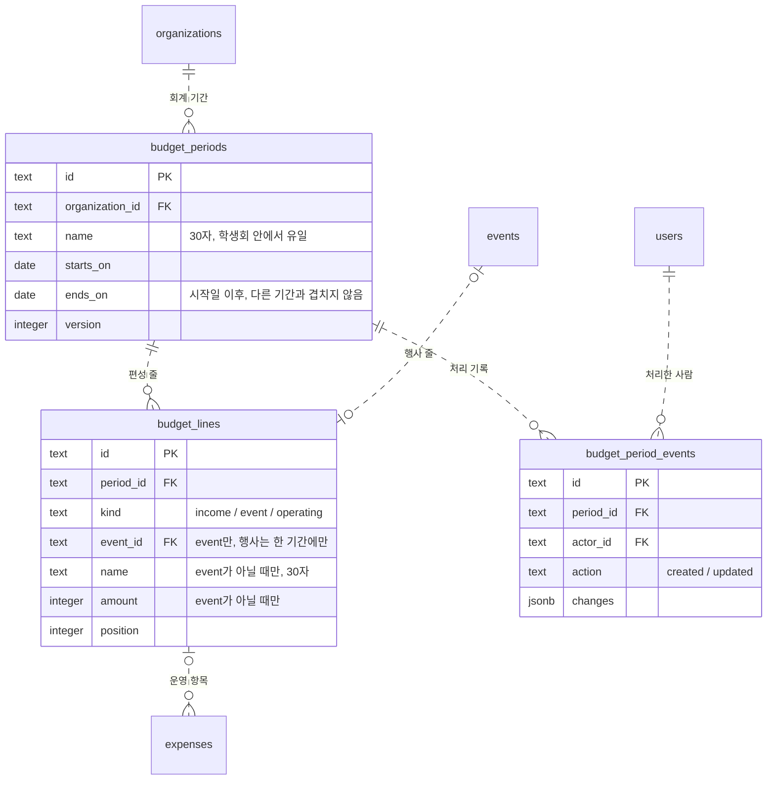

# M2-3a 학생회 예산 편성 Implementation Plan

> **For agentic workers:** REQUIRED SUB-SKILL: Use superpowers:subagent-driven-development (recommended) or superpowers:executing-plans to implement this plan task-by-task. Steps use checkbox (`- [ ]`) syntax for tracking.

**Goal:** 재정 권한자가 회계 기간마다 수입·행사·운영 예산을 편성하고, 학생회 구성원은 누구나 "예산" 화면에서 편성 대비 집행을 본다. 상시 운영 지출에는 운영 항목을 고른다.

**Architecture:**
- 마이그레이션 0017로 새 표 3개(`budget_periods`, `budget_lines`, `budget_period_events`)와 `expenses.budget_line_id`를 더한다.
- `apps/api/src/budget/`에 `service.ts`(기간·편성 읽기·만들기·저장)와 `routes.ts`를 둔다.
- 행사 줄의 금액은 `event_finances.budget` 한 곳에 둔다. 행사 재정(M2-2)의 숫자 계산은 행사 여럿을 한 번에 세는 함수로 바꾸고, 예산 변경은 `changeEventBudget`으로 꺼내 예산 편성도 같이 쓴다.
- 학생회 단위 advisory lock으로 기간·편성 변경을 한 줄로 세운다. 운영 항목을 고르는 지출은 그 기간 행을 `FOR SHARE`로 잠근다.
- 화면 코드는 `apps/web/src/budget/`에 둔다. 옆 메뉴에 "예산"을 더하고, 지출 대화상자에 운영 항목 고르기를 더한다.

**Tech Stack:**
- 서버: Hono 4.13.9, drizzle-orm 0.45.3 / drizzle-kit 0.31.11, PGlite 테스트(`npx tsx --test`), zod 4.6.5
- 화면: React 19, Vite, vitest + jsdom, Testing Library
- 새 의존성 없음

**Spec:** `docs/superpowers/specs/2026-10-10-budget-plan-design.md`

## Global Constraints

- **요청 본문:** contracts의 `z.strictObject`만 쓴다.
  - 문자열은 `text(max)`/`token(max)`만 쓴다.
  - 문자열·배열·숫자에는 모두 상한을 둔다.
- **라우트:**
  - `json(Schema)`를 인증·소속 미들웨어보다 앞에 두고, `c.req.valid('json')`만 쓴다.
  - 변경 라우트는 `/api/organizations/` 아래에 둔다.
  - 실패는 `ApiError(code, status)`로 던지고, 라우트별 `onError`를 만들지 않는다.
  - 새 라우트 모듈은 `createApp`의 `AppOptions`로만 연결한다.
- **값의 범위:**
  - 기간 이름 30자, 줄 이름 30자. DB CHECK도 30이다.
  - 날짜는 2000-01-01 ~ 2999-12-31이고, 시작일 ≤ 끝일이다.
  - 금액은 0 ~ 2,147,483,647 정수다. 행사 예산은 null(미정)도 된다.
  - 수입 줄 30, 운영 줄 50, 행사 100개까지다.
  - 기간 버전은 1 이상이다. 행사 재정 버전은 0 이상이고, 0은 "행 없음"이다.
- **오류 코드:**
  - `PERIOD_OVERLAP`, `PERIOD_NAME_TAKEN`, `EVENT_IN_OTHER_PERIOD`, `EVENT_SETTLED`, `LINE_IN_USE`, `EXPENSES_OUTSIDE_PERIOD`, `BUDGET_LINE_INVALID`, `VERSION_CONFLICT`: 모두 409
  - `FORBIDDEN` 403, `NOT_FOUND` 404
- **잠금 순서:**
  - 편성 수정·기간 만들기: 재정 권한(`FOR SHARE`) → 학생회 advisory lock → 기간 행(`FOR UPDATE`) → 예산이 바뀌는 행사 행(ID 순 `FOR NO KEY UPDATE`)
  - 운영 항목을 고르는 지출 기록·수정: 기간 행(`FOR SHARE`)을 행사 행(`requireOpenEvents`)보다 먼저 잠근다.
- **화면:**
  - `src/components/ui` 부품만 쓴다. 체크박스만 `size-4 accent-blue-600`이다.
  - Tailwind 표준 클래스만 쓴다. 임의 값은 쓰지 않는다.
  - 긴 이름에는 `wrap-anywhere`를 준다.
  - 저장 버튼은 같은 스키마의 `safeParse`로 켠다. 길이 숫자를 화면에 다시 적지 않는다.
- **문구:** spec의 "화면 문구" 표를 그대로 쓴다.
- **로그:** 로그와 오류 응답에 이름·금액을 남기지 않는다.
- **커밋:** 제목은 50자 안팎의 한국어 명령형이다. AI 서명이나 Co-Authored-By는 붙이지 않는다.

## Review Focus

- **편성 저장 중 다른 사람이 행사 재정 탭에서 그 행사 예산을 바꿈:** 바꾸지 않은 줄은 그대로 통과하고, 바꾼 줄만 `VERSION_CONFLICT`가 나야 한다. → Task 6 테스트 "행사 예산 버전"
- **운영 항목을 고른 지출의 결제일을 다른 기간으로 바꿈:** 화면은 고른 항목을 지우고, 서버는 옛 항목을 그대로 보내면 `BUDGET_LINE_INVALID`로 막아야 한다. → Task 4 테스트, Task 10 테스트
- **편성 수정 중 넣었다 뺀 행사를 다시 넣음:** 원래 이 기간에 있던 행사도 [넣을 행사] 목록에 다시 나와야 한다. → Task 8 테스트 "뺀 행사를 다시 넣기"
- **취소한 지출만 고른 운영 줄 지우기:** 막히지 않고, 취소한 지출의 항목 표시만 지워져야 한다. → Task 6 테스트
- **새 기간을 만든 직후 화면:** 목록을 새로 받기 전에도 새 기간의 편성이 열려야 한다(다른 기간으로 튀지 않음). → Task 9 테스트 "새 기간"

---

### Task 1: 예산 계약

**Files:**
- Create: `packages/contracts/src/budget.ts`
- Create: `packages/contracts/src/budget.test.ts`
- Modify: `packages/contracts/src/index.ts`
- Modify: `packages/contracts/package.json` (test 스크립트에 `src/budget.test.ts`)

**Interfaces:**
- Produces:
  - `CreateBudgetPeriodSchema`, `SaveBudgetPlanSchema`
  - 상수: `BUDGET_PERIOD_NAME_MAX`, `BUDGET_LINE_NAME_MAX`, `BUDGET_INCOME_LINES_MAX`, `BUDGET_OPERATING_LINES_MAX`, `BUDGET_EVENTS_MAX`, `BUDGET_PERIODS_MAX`, `BUDGET_CANDIDATES_MAX`, `BUDGET_HISTORY_MAX`
  - 타입: `CreateBudgetPeriodRequest`, `SaveBudgetPlanRequest`, `BudgetGroup`, `BudgetPeriodAction`, `BudgetPeriodSummary`, `BudgetPeriodsResponse`, `BudgetIncomeLine`, `BudgetEventLine`, `BudgetOperatingLine`, `BudgetCandidate`, `BudgetChange`, `BudgetHistoryEntry`, `BudgetTotals`, `BudgetPlanResponse`

- [ ] **Step 1: 실패하는 계약 테스트를 쓴다**

`packages/contracts/src/budget.test.ts`:

```ts
import assert from 'node:assert/strict'
import { test } from 'node:test'
import { BUDGET_EVENTS_MAX, BUDGET_INCOME_LINES_MAX, BUDGET_LINE_NAME_MAX, BUDGET_OPERATING_LINES_MAX, BUDGET_PERIOD_NAME_MAX,
  CreateBudgetPeriodSchema, SaveBudgetPlanSchema } from './budget.js'
import { isStrictObject } from './input.js'

// 테스트 파일에 제어 문자를 그대로 쓰지 않는다.
const nul = String.fromCharCode(0)
const lone = String.fromCharCode(0xd800)
const emoji = '😀'
const period = { name: '2026년 2학기', startsOn: '2026-09-01', endsOn: '2027-02-28' }
const plan = { version: 1, ...period, incomes: [{ id: null, name: '학생회비', amount: 800000 }, { id: 'l1', name: '이월금', amount: 0 }],
  operating: [{ id: 'l2', name: '회의비', amount: 100000 }], events: [{ eventId: 'e', version: 0, budget: null }, { eventId: 'e2', version: 3, budget: 300000 }] }

test('기간: 이름 앞뒤 공백을 지우고, 하루짜리 기간과 범위 끝 날짜를 받는다', () => {
  assert.deepEqual(CreateBudgetPeriodSchema.parse({ ...period, name: ' 2026년 2학기 ' }), period)
  for (const body of [{ ...period, endsOn: period.startsOn }, { name: emoji.repeat(BUDGET_PERIOD_NAME_MAX), startsOn: '2000-01-01', endsOn: '2999-12-31' }]) {
    assert.equal(CreateBudgetPeriodSchema.safeParse(body).success, true, JSON.stringify(body))
  }
})

test('기간: 빠진 값·빈 이름·상한+1·제어 문자·없는 날짜·범위 밖·거꾸로 된 날짜·모르는 키는 거절한다', () => {
  for (const body of [{ startsOn: '2026-09-01', endsOn: '2027-02-28' }, { name: '학기', endsOn: '2027-02-28' }, { name: '학기', startsOn: '2026-09-01' },
    { ...period, name: '' }, { ...period, name: '   ' }, { ...period, name: emoji.repeat(BUDGET_PERIOD_NAME_MAX + 1) },
    { ...period, name: `학기${nul}` }, { ...period, name: `학기${lone}` },
    { ...period, startsOn: '2026-02-30' }, { ...period, startsOn: '1999-12-31' }, { ...period, endsOn: '3000-01-01' }, { ...period, startsOn: '2026-9-1' },
    { ...period, startsOn: '2027-03-01' }, { ...period, extra: 1 }]) {
    assert.equal(CreateBudgetPeriodSchema.safeParse(body).success, false, JSON.stringify(body))
  }
})

test('편성: 새 줄(id null), 0원, 미정 행사, 버전 0인 행사를 받고 이름의 앞뒤 공백을 지운다', () => {
  const parsed = SaveBudgetPlanSchema.parse({ ...plan, incomes: [{ id: null, name: ' 학생회비 ', amount: 800000 }] })
  assert.equal(parsed.incomes[0]!.name, '학생회비')
  assert.equal(SaveBudgetPlanSchema.safeParse(plan).success, true)
  assert.equal(SaveBudgetPlanSchema.safeParse({ ...plan, incomes: [], operating: [], events: [] }).success, true)
})

test('편성: 상한+1·중복 이름·중복 ID·중복 행사·잘못된 금액·버전·모르는 키는 거절한다', () => {
  const line = (n: number) => ({ id: null, name: `줄${n}`, amount: 1 })
  const bodies: unknown[] = [
    { ...plan, version: 0 }, { ...plan, version: 1.5 }, { ...plan, startsOn: '2027-03-01' },
    { ...plan, incomes: Array.from({ length: BUDGET_INCOME_LINES_MAX + 1 }, (_, n) => line(n)) },
    { ...plan, operating: Array.from({ length: BUDGET_OPERATING_LINES_MAX + 1 }, (_, n) => line(n)) },
    { ...plan, events: Array.from({ length: BUDGET_EVENTS_MAX + 1 }, (_, n) => ({ eventId: `e${n}`, version: 0, budget: null })) },
    { ...plan, incomes: [line(1), { ...line(1), name: ' 줄1 ' }] },
    { ...plan, incomes: [{ id: 'l9', name: '가', amount: 1 }], operating: [{ id: 'l9', name: '나', amount: 1 }] },
    { ...plan, events: [{ eventId: 'e', version: 0, budget: 1 }, { eventId: 'e', version: 0, budget: 2 }] },
    { ...plan, incomes: [{ id: null, name: emoji.repeat(BUDGET_LINE_NAME_MAX + 1), amount: 1 }] },
    { ...plan, incomes: [{ id: null, name: ' ', amount: 1 }] }, { ...plan, incomes: [{ id: null, name: `가${nul}`, amount: 1 }] },
    { ...plan, incomes: [{ id: null, name: '가', amount: -1 }] }, { ...plan, incomes: [{ id: null, name: '가', amount: 1.5 }] },
    { ...plan, incomes: [{ id: null, name: '가', amount: 2147483648 }] }, { ...plan, incomes: [{ id: null, name: '가', amount: null }] },
    { ...plan, incomes: [{ id: null, name: '가', amount: 1, extra: 1 }] },
    { ...plan, events: [{ eventId: 'e', version: -1, budget: null }] }, { ...plan, events: [{ eventId: 'e', budget: null }] },
    { ...plan, events: [{ eventId: 'e', version: 0, budget: -1 }] }, { ...plan, events: [{ eventId: '', version: 0, budget: null }] },
    { ...plan, extra: 1 },
  ]
  for (const body of bodies) assert.equal(SaveBudgetPlanSchema.safeParse(body).success, false, JSON.stringify(body).slice(0, 120))
})

test('요청 스키마는 모르는 키를 조용히 버리지 않는다', () => {
  for (const schema of [CreateBudgetPeriodSchema, SaveBudgetPlanSchema]) assert.equal(isStrictObject(schema), true)
})
```

`packages/contracts/package.json`의 test 스크립트 끝에 ` src/budget.test.ts`를 더한다.

- [ ] **Step 2: 실패를 확인한다**

Run: `npm test --workspace @vada/contracts`
Expected: FAIL — `Cannot find module './budget.js'`

- [ ] **Step 3: 계약을 만든다**

`packages/contracts/src/budget.ts`:

```ts
import { z } from 'zod'
import type { ExpensePerson } from './expenses.js'
import { text, token } from './input.js'
import { PURCHASE_INTEGER_MAX, purchaseDate } from './purchases.js'

export const BUDGET_PERIOD_NAME_MAX = 30
export const BUDGET_LINE_NAME_MAX = 30
export const BUDGET_INCOME_LINES_MAX = 30
export const BUDGET_OPERATING_LINES_MAX = 50
export const BUDGET_EVENTS_MAX = 100
export const BUDGET_PERIODS_MAX = 100
export const BUDGET_CANDIDATES_MAX = 300
export const BUDGET_HISTORY_MAX = 100
export type BudgetGroup = 'income' | 'event' | 'operating'
export type BudgetPeriodAction = 'created' | 'updated'

const id = token(64)
const amount = z.number().int().min(0).max(PURCHASE_INTEGER_MAX)
// 회계 기간의 날짜. 지출 결제일과 같은 범위만 받는다.
const day = purchaseDate.refine(value => value >= '2000-01-01' && value <= '2999-12-31')
const period = { name: text(BUDGET_PERIOD_NAME_MAX), startsOn: day, endsOn: day }
const ordered = (value: { startsOn: string; endsOn: string }) => value.startsOn <= value.endsOn
const distinct = (values: string[]) => new Set(values).size === values.length
// 수입·운영 줄. id가 null이면 새 줄이다. 이름은 묶음 안에서 겹치지 않는다(text가 앞뒤 공백을 지운 값으로 비교한다).
const lines = (max: number) => z.array(z.strictObject({ id: id.nullable(), name: text(BUDGET_LINE_NAME_MAX), amount })).max(max)
  .refine(list => distinct(list.map(line => line.name)))
// 행사 줄. version은 그 행사 재정의 버전이고 행이 없으면 0이다. budget이 null이면 미정이다.
const eventLines = z.array(z.strictObject({ eventId: id, version: z.number().int().min(0).max(PURCHASE_INTEGER_MAX), budget: amount.nullable() }))
  .max(BUDGET_EVENTS_MAX).refine(list => distinct(list.map(line => line.eventId)))

export const CreateBudgetPeriodSchema = z.strictObject(period).refine(ordered)
// 편성 전체를 보낸다. 배열 순서가 화면 순서이고, 보내지 않은 기존 줄은 지우며, 보내지 않은 행사는 기간에서 뺀다.
export const SaveBudgetPlanSchema = z.strictObject({
  version: z.number().int().min(1).max(PURCHASE_INTEGER_MAX),
  ...period,
  incomes: lines(BUDGET_INCOME_LINES_MAX),
  operating: lines(BUDGET_OPERATING_LINES_MAX),
  events: eventLines,
}).refine(ordered).refine(value => distinct([...value.incomes, ...value.operating].flatMap(line => line.id === null ? [] : [line.id])))
export type CreateBudgetPeriodRequest = z.infer<typeof CreateBudgetPeriodSchema>
export type SaveBudgetPlanRequest = z.infer<typeof SaveBudgetPlanSchema>

export interface BudgetPeriodSummary { id: string; name: string; startsOn: string; endsOn: string; operating: { id: string; name: string }[] }
// 시작일이 늦은 순. 지출 대화상자가 결제일이 든 기간의 운영 줄을 고를 때도 쓴다.
export interface BudgetPeriodsResponse { periods: BudgetPeriodSummary[] }
export interface BudgetIncomeLine { id: string; name: string; amount: number }
// 숫자는 행사 재정 탭과 같은 정의다. version은 편성 저장에 다시 보낸다.
export interface BudgetEventLine {
  eventId: string
  name: string
  budget: number | null
  spent: number
  planned: number
  plannedUnknown: number
  remaining: number | null
  settled: boolean
  version: number
}
// expenseCount: 이 항목을 고른 지출 가운데 취소하지 않은 것의 수. 0이 아니면 지울 수 없다.
export interface BudgetOperatingLine { id: string; name: string; amount: number; spent: number; remaining: number; expenseCount: number }
// 어느 기간에도 넣지 않은 행사.
export interface BudgetCandidate { eventId: string; name: string; budget: number | null; version: number; settled: boolean; spent: number }
// 편성 수정 한 번의 변경 한 줄. added는 to만, removed는 from만 있다. 행사 줄의 null은 미정이다.
export interface BudgetChange {
  group: BudgetGroup
  action: 'added' | 'removed' | 'changed'
  name: string
  previousName?: string
  from?: number | null
  to?: number | null
}
export interface BudgetHistoryEntry {
  id: string
  action: BudgetPeriodAction
  actor: ExpensePerson
  // created: { name, startsOn, endsOn }, updated: { name?, startsOn?, endsOn?: { from, to }, lines?: BudgetChange[] }
  changes: Record<string, unknown>
  createdAt: string
}
export interface BudgetTotals {
  // 수입 줄의 합
  income: number
  // 행사 예산(미정은 0)과 운영 줄의 합. undecided는 예산이 미정인 행사 수다.
  budget: number
  undecided: number
  // 행사 줄 + 운영 줄 + 운영 항목을 고르지 않은 상시 운영 지출
  spent: number
  planned: number
  plannedUnknown: number
  // 예산 − 실제 지출 − 지출 예정
  remaining: number
}
export interface BudgetPlanResponse {
  period: { id: string; name: string; startsOn: string; endsOn: string; version: number }
  incomes: BudgetIncomeLine[]
  events: BudgetEventLine[]
  operating: BudgetOperatingLine[]
  // 결제일이 기간 안인 상시 운영 지출 가운데 운영 항목이 없는 것
  unassigned: { spent: number; count: number }
  totals: BudgetTotals
  // 최근에 만든 순으로 300개까지
  candidates: BudgetCandidate[]
  // 학생회 전체: 지출이 있는데 기간에 넣지 않은 행사 수, 결제일이 어느 기간에도 들지 않는 상시 운영 지출 수
  notices: { eventsWithSpending: number; operatingOutside: number }
  // 최근 100개, 오래된 순
  history: BudgetHistoryEntry[]
}
```

`packages/contracts/src/index.ts` 끝에 더한다:

```ts
export { BUDGET_PERIOD_NAME_MAX, BUDGET_LINE_NAME_MAX, BUDGET_INCOME_LINES_MAX, BUDGET_OPERATING_LINES_MAX, BUDGET_EVENTS_MAX, BUDGET_PERIODS_MAX,
  BUDGET_CANDIDATES_MAX, BUDGET_HISTORY_MAX, CreateBudgetPeriodSchema, SaveBudgetPlanSchema } from './budget.js'
export type { CreateBudgetPeriodRequest, SaveBudgetPlanRequest, BudgetGroup, BudgetPeriodAction, BudgetPeriodSummary, BudgetPeriodsResponse,
  BudgetIncomeLine, BudgetEventLine, BudgetOperatingLine, BudgetCandidate, BudgetChange, BudgetHistoryEntry, BudgetTotals,
  BudgetPlanResponse } from './budget.js'
```

- [ ] **Step 4: 통과를 확인한다**

Run: `npm test --workspace @vada/contracts` → PASS
Run: `npm run typecheck` → 오류 없음

- [ ] **Step 5: 커밋**

```bash
git add packages/contracts
git commit -m "예산 편성 계약 추가"
```

---

### Task 2: 예산 표와 마이그레이션 0017

**Files:**
- Modify: `apps/api/src/db/schema.ts` (`budgetPeriods`, `budgetLines`, `budgetPeriodEvents`를 `expenses` 앞에 두고, `expenses.budgetLineId` 추가)
- Create: `apps/api/migrations/0017_budget_plan.sql` (+ `meta/0017_snapshot.json`, `meta/_journal.json`) — drizzle-kit이 만든다
- Modify: `apps/api/src/db/migrations.test.ts` (0017 테스트 추가)

**Interfaces:**
- Produces: drizzle 표 `budgetPeriods`, `budgetLines`, `budgetPeriodEvents`, 칸 `expenses.budgetLineId`
  - 제약 이름: `budget_periods_organization_name_unique`, `budget_periods_name_not_blank`, `budget_periods_name_length`, `budget_periods_dates_range`, `budget_periods_dates_order`, `budget_periods_version_positive`, `budget_lines_event_unique`, `budget_lines_kind_valid`, `budget_lines_event_kind`, `budget_lines_named_kind`, `budget_lines_amount_kind`, `budget_lines_name_not_blank`, `budget_lines_name_length`, `budget_lines_amount_nonnegative`, `budget_lines_position_nonnegative`, `budget_lines_period_same_organization`, `budget_lines_event_same_organization`, `budget_period_events_action_valid`, `budget_period_events_changes_object`, `budget_period_events_period_same_organization`, `expenses_budget_line_same_organization`, `expenses_budget_line_operating_only`

- [ ] **Step 1: 실패하는 마이그레이션 테스트를 쓴다**

`apps/api/src/db/migrations.test.ts` 끝에 더한다(파일 위의 `sameColumns`, `migrationsBefore`, `migrationsFolder`를 쓴다):

```ts
test('0017 adds budget plans and an optional operating line on expenses', async (t) => {
  const pg = new PGlite()
  const previous = migrationsBefore('0017_budget_plan')
  try {
    const db = drizzle(pg)
    await migrate(db, { migrationsFolder: previous.folder })
    await pg.exec(`
      INSERT INTO users (id,name,email) VALUES ('u','재정','u@example.test');
      INSERT INTO organizations (id,name) VALUES ('o','Council'),('o2','Other');
      INSERT INTO events (id,organization_id,name,created_by) VALUES ('e','o','체육대회','u'),('e2','o2','남의 행사','u');
      INSERT INTO expenses (id,organization_id,event_id,vendor,description,amount,paid_on,method,payer_id,recorded_by)
        VALUES ('x','o','e','쿠팡','물품',1000,'2026-10-09','council_card','u','u'),('y','o',NULL,'다이소','다과',500,'2026-10-09','cash','u','u');
    `)
    const before = (await pg.query<Record<string, unknown>>('SELECT * FROM expenses ORDER BY id')).rows
    await migrate(db, { migrationsFolder })
    const insert = (table: string, values: Record<string, string>) =>
      pg.exec(`INSERT INTO ${table} (${Object.keys(values).join(',')}) VALUES (${Object.values(values).join(',')})`)
    const period = (id: string, change: Record<string, string> = {}) => insert('budget_periods', { id: `'${id}'`, organization_id: "'o'",
      name: `'${id} 기간'`, starts_on: "'2026-09-01'", ends_on: "'2027-02-28'", created_by: "'u'", ...change })
    const line = (id: string, change: Record<string, string> = {}) => insert('budget_lines', { id: `'${id}'`, organization_id: "'o'",
      period_id: "'p'", kind: "'income'", event_id: 'NULL', name: "'학생회비'", amount: '1000', position: '0', ...change })

    await t.test('existing expenses keep their values and have no operating line', async () => {
      const after = (await pg.query<Record<string, unknown>>('SELECT * FROM expenses ORDER BY id')).rows
      assert.deepEqual(sameColumns(after, before), before)
      assert.deepEqual(after.map(row => row.budget_line_id), [null, null])
    })
    await t.test('a period has a short name unique in its council and ordered dates in range', async () => {
      await period('p')
      await period('q', { organization_id: "'o2'", name: "'p 기간'" })
      const cases: [Record<string, string>, string][] = [
        [{ name: "'p 기간'" }, 'budget_periods_organization_name_unique'],
        [{ name: "' '" }, 'budget_periods_name_not_blank'],
        [{ name: `'${'가'.repeat(31)}'` }, 'budget_periods_name_length'],
        [{ starts_on: "'2027-03-01'" }, 'budget_periods_dates_order'],
        [{ starts_on: "'1999-12-31'" }, 'budget_periods_dates_range'],
        [{ ends_on: "'3000-01-01'" }, 'budget_periods_dates_range'],
        [{ version: '0' }, 'budget_periods_version_positive'],
      ]
      for (const [index, [change, constraint]] of cases.entries()) await assert.rejects(period(`bad${index}`, change), { constraint }, constraint)
    })
    await t.test('a line is either a named amount or an event, and an event sits in one period of its council', async () => {
      await line('l1')
      await line('l2', { kind: "'operating'", name: "'회의비'" })
      await line('l3', { kind: "'event'", event_id: "'e'", name: 'NULL', amount: 'NULL' })
      const cases: [Record<string, string>, string][] = [
        [{ kind: "'other'" }, 'budget_lines_kind_valid'],
        [{ kind: "'event'", name: 'NULL', amount: 'NULL' }, 'budget_lines_event_kind'],
        [{ event_id: "'e'" }, 'budget_lines_event_kind'],
        [{ name: 'NULL' }, 'budget_lines_named_kind'],
        [{ amount: 'NULL' }, 'budget_lines_amount_kind'],
        [{ name: "' '" }, 'budget_lines_name_not_blank'],
        [{ name: `'${'가'.repeat(31)}'` }, 'budget_lines_name_length'],
        [{ amount: '-1' }, 'budget_lines_amount_nonnegative'],
        [{ position: '-1' }, 'budget_lines_position_nonnegative'],
        [{ kind: "'event'", event_id: "'e'", name: 'NULL', amount: 'NULL' }, 'budget_lines_event_unique'],
        [{ period_id: "'q'" }, 'budget_lines_period_same_organization'],
        [{ kind: "'event'", event_id: "'e2'", name: 'NULL', amount: 'NULL' }, 'budget_lines_event_same_organization'],
      ]
      for (const [index, [change, constraint]] of cases.entries()) await assert.rejects(line(`bad${index}`, change), { constraint }, constraint)
    })
    await t.test('only an operating expense of the same council points at a line, and a used line is not deleted', async () => {
      await pg.exec("UPDATE expenses SET budget_line_id = 'l2' WHERE id = 'y'")
      await assert.rejects(pg.exec("UPDATE expenses SET budget_line_id = 'l2' WHERE id = 'x'"), { constraint: 'expenses_budget_line_operating_only' })
      await line('lq', { organization_id: "'o2'", period_id: "'q'", kind: "'operating'", name: "'남의 항목'" })
      await assert.rejects(pg.exec("UPDATE expenses SET budget_line_id = 'lq' WHERE id = 'y'"), { constraint: 'expenses_budget_line_same_organization' })
      await assert.rejects(pg.exec("DELETE FROM budget_lines WHERE id = 'l2'"), { constraint: 'expenses_budget_line_same_organization' })
    })
    await t.test('history actions are known, changes are objects, and the period is in the same council', async () => {
      const entry = (id: string, action: string, changes = "'{}'", periodId = 'p') => insert('budget_period_events', { id: `'${id}'`,
        organization_id: "'o'", period_id: `'${periodId}'`, actor_id: "'u'", action: `'${action}'`, changes })
      await entry('h1', 'created')
      await entry('h2', 'updated', `'{"lines":[]}'`)
      await assert.rejects(entry('h3', 'deleted'), { constraint: 'budget_period_events_action_valid' })
      await assert.rejects(entry('h4', 'updated', "'[]'"), { constraint: 'budget_period_events_changes_object' })
      await assert.rejects(entry('h5', 'created', "'{}'", 'q'), { constraint: 'budget_period_events_period_same_organization' })
    })
  } finally {
    previous.remove()
    await pg.close()
  }
})
```

- [ ] **Step 2: 실패를 확인한다**

Run (in `apps/api`): `npx tsx --test src/db/migrations.test.ts`
Expected: FAIL — `Migration not found: 0017_budget_plan`

- [ ] **Step 3: 스키마를 더한다**

`apps/api/src/db/schema.ts`의 `// 결제 한 번(영수증 한 장 단위)의 지출.` 주석 바로 앞에 넣는다(지출 표가 참조하므로 앞에 둔다):

```ts
// 회계 기간. 같은 학생회의 기간은 날짜가 겹치지 않는다. 겹침은 서버가 학생회 단위 잠금 안에서 확인한다.
// DB 제약(exclusion)은 btree_gist 확장이 있어야 해서 쓰지 않는다.
export const budgetPeriods = pgTable('budget_periods', {
  id: text('id').primaryKey(),
  organizationId: text('organization_id').notNull()
    .references(() => organizations.id, { onDelete: 'restrict' }),
  name: text('name').notNull(),
  startsOn: date('starts_on').notNull(),
  endsOn: date('ends_on').notNull(),
  version: integer('version').notNull().default(1),
  createdBy: text('created_by').notNull().references(() => users.id, { onDelete: 'restrict' }),
  createdAt: timestamp('created_at', { withTimezone: true }).notNull().defaultNow(),
  updatedAt: timestamp('updated_at', { withTimezone: true }).notNull().defaultNow().$onUpdate(() => new Date()),
}, (table) => [
  unique('budget_periods_organization_id_unique').on(table.organizationId, table.id),
  unique('budget_periods_organization_name_unique').on(table.organizationId, table.name),
  check('budget_periods_name_not_blank', sql`${table.name} ~ '[^[:space:]]'`),
  check('budget_periods_name_length', sql`char_length(${table.name}) <= 30`),
  check('budget_periods_dates_range', sql`${table.startsOn} >= '2000-01-01' AND ${table.endsOn} <= '2999-12-31'`),
  check('budget_periods_dates_order', sql`${table.startsOn} <= ${table.endsOn}`),
  check('budget_periods_version_positive', sql`${table.version} >= 1`),
  index('budget_periods_organization_starts_idx').on(table.organizationId, table.startsOn),
])

// 편성의 한 줄. 수입·운영 줄은 이름과 금액이 있고, 행사 줄은 행사만 가리킨다. 행사 줄의 금액은 event_finances.budget에 있다.
export const budgetLines = pgTable('budget_lines', {
  id: text('id').primaryKey(),
  organizationId: text('organization_id').notNull(),
  periodId: text('period_id').notNull(),
  kind: text('kind', { enum: ['income', 'event', 'operating'] }).notNull(),
  eventId: text('event_id'),
  name: text('name'),
  amount: integer('amount'),
  // 묶음(kind) 안 화면 순서
  position: integer('position').notNull(),
  createdAt: timestamp('created_at', { withTimezone: true }).notNull().defaultNow(),
  updatedAt: timestamp('updated_at', { withTimezone: true }).notNull().defaultNow().$onUpdate(() => new Date()),
}, (table) => [
  foreignKey({
    name: 'budget_lines_period_same_organization',
    columns: [table.organizationId, table.periodId],
    foreignColumns: [budgetPeriods.organizationId, budgetPeriods.id],
  }).onDelete('restrict'),
  foreignKey({
    name: 'budget_lines_event_same_organization',
    columns: [table.organizationId, table.eventId],
    foreignColumns: [events.organizationId, events.id],
  }).onDelete('restrict'),
  unique('budget_lines_organization_id_unique').on(table.organizationId, table.id),
  // 행사는 한 기간에만 들어간다.
  unique('budget_lines_event_unique').on(table.eventId),
  check('budget_lines_kind_valid', sql`${table.kind} IN ('income','event','operating')`),
  check('budget_lines_event_kind', sql`(${table.kind} = 'event') = (${table.eventId} IS NOT NULL)`),
  check('budget_lines_named_kind', sql`(${table.kind} = 'event') = (${table.name} IS NULL)`),
  check('budget_lines_amount_kind', sql`(${table.kind} = 'event') = (${table.amount} IS NULL)`),
  check('budget_lines_name_not_blank', sql`${table.name} ~ '[^[:space:]]'`),
  check('budget_lines_name_length', sql`char_length(${table.name}) <= 30`),
  check('budget_lines_amount_nonnegative', sql`${table.amount} >= 0`),
  check('budget_lines_position_nonnegative', sql`${table.position} >= 0`),
  index('budget_lines_period_idx').on(table.periodId, table.kind, table.position),
])

// 기간·편성 처리 기록. 고치거나 지우지 않는다.
export const budgetPeriodEvents = pgTable('budget_period_events', {
  id: text('id').primaryKey(),
  organizationId: text('organization_id').notNull(),
  periodId: text('period_id').notNull(),
  actorId: text('actor_id').notNull().references(() => users.id, { onDelete: 'restrict' }),
  action: text('action', { enum: ['created', 'updated'] }).notNull(),
  changes: jsonb('changes').$type<Record<string, unknown>>().notNull().default({}),
  createdAt: timestamp('created_at', { withTimezone: true }).notNull().defaultNow(),
}, (table) => [
  foreignKey({
    name: 'budget_period_events_period_same_organization',
    columns: [table.organizationId, table.periodId],
    foreignColumns: [budgetPeriods.organizationId, budgetPeriods.id],
  }).onDelete('restrict'),
  check('budget_period_events_action_valid', sql`${table.action} IN ('created','updated')`),
  check('budget_period_events_changes_object', sql`jsonb_typeof(${table.changes}) = 'object'`),
  index('budget_period_events_period_idx').on(table.periodId, table.createdAt),
])
```

`expenses` 표: `eventId` 칸 바로 아래에 칸을 더한다.

```ts
  // 상시 운영 지출의 운영 항목. 운영 줄인지, 결제일이 그 줄의 기간 안인지는 서버가 확인한다.
  budgetLineId: text('budget_line_id'),
```

`expenses`의 제약 목록 끝(`index('expenses_organization_paid_idx')` 다음)에 더한다.

```ts
  foreignKey({
    name: 'expenses_budget_line_same_organization',
    columns: [table.organizationId, table.budgetLineId],
    foreignColumns: [budgetLines.organizationId, budgetLines.id],
  }).onDelete('restrict'),
  // 행사 지출은 그 행사 줄로 세므로 운영 항목이 없다.
  check('expenses_budget_line_operating_only', sql`${table.budgetLineId} IS NULL OR ${table.eventId} IS NULL`),
  index('expenses_budget_line_idx').on(table.organizationId, table.budgetLineId),
```

- [ ] **Step 4: 마이그레이션을 만든다**

Run (in `apps/api`): `npx drizzle-kit generate --name budget_plan`
Expected: `migrations/0017_budget_plan.sql` 생성. 열어서 아래를 확인한다.
- `CREATE TABLE "budget_periods"`, `"budget_lines"`, `"budget_period_events"`가 있다.
- `ALTER TABLE "expenses" ADD COLUMN "budget_line_id" text;`가 있다.
- 기존 표의 칸을 지우거나 바꾸는 문장이 없다.
- 줄바꿈이 LF다(`.gitattributes`).

- [ ] **Step 5: 통과를 확인한다**

Run (in `apps/api`): `npx tsx --test src/db/migrations.test.ts src/db/schema.test.ts` → PASS
Run: `npm run typecheck` → 오류 없음

- [ ] **Step 6: 커밋**

```bash
git add apps/api/src/db/schema.ts apps/api/migrations apps/api/src/db/migrations.test.ts
git commit -m "예산 표와 마이그레이션 0017 추가"
```

---

### Task 3: 행사 재정 숫자를 여럿 한 번에 세고 예산 변경 꺼내기

동작은 바꾸지 않는다. 행사 재정 테스트가 그대로 통과해야 한다.

**Files:**
- Modify: `apps/api/src/settlement/service.ts`

**Interfaces:**
- Produces:
  - `export interface FinanceNumbers { spent; expenseCount; missingEvidence; pendingRequests; unrecordedItems; planned; plannedUnknown }` (모두 number)
  - `export async function financeNumbersByEvent(db: Reader, scope: SettlementScope, eventIds: string[]): Promise<Map<string, FinanceNumbers>>` — 넘긴 ID마다 값이 있다(지출이 없으면 0)
  - `export async function financeNumbers(db, scope, eventId): Promise<FinanceNumbers>` (기존 이름 유지)
  - `export type SettlementTransaction`
  - `export async function changeEventBudget(tx: SettlementTransaction, scope: SettlementScope, eventId: string, version: number, budget: number | null): Promise<void>` — 행사 행 잠금 → 버전(`VERSION_CONFLICT`) → 정산(`EVENT_SETTLED`) → 같은 값이면 끝 → 저장·`budget_set` 기록. 재정 권한은 부르는 쪽이 확인한다.

- [ ] **Step 1: 숫자 함수를 여럿 세는 함수로 바꾼다**

`financeNumbers`를 아래로 바꾼다(import에 `inArray`가 이미 있다).

```ts
export interface FinanceNumbers {
  spent: number
  expenseCount: number
  missingEvidence: number
  pendingRequests: number
  unrecordedItems: number
  planned: number
  plannedUnknown: number
}
const noNumbers: FinanceNumbers = { spent: 0, expenseCount: 0, missingEvidence: 0, pendingRequests: 0, unrecordedItems: 0, planned: 0, plannedUnknown: 0 }

// 행사 여럿의 숫자와 정산 조건을 한 번에 센다. 행사 재정 탭과 예산 화면이 같은 정의를 쓴다.
// 지출 예정은 지출에 연결되지 않은 승인 품목이고, 수량·단가를 모르는 품목은 합에서 빼고 따로 센다.
export async function financeNumbersByEvent(db: Reader, scope: SettlementScope, eventIds: string[]) {
  const numbers = new Map(eventIds.map(id => [id, { ...noNumbers }]))
  if (!eventIds.length) return numbers
  const spending = await db.select({
    eventId: expenses.eventId,
    spent: sql<string>`coalesce(sum(${expenses.amount}), 0)`,
    expenseCount: sql<number>`count(*)::int`,
    // 표 하나만 고르는 select는 sql 안의 열에서 표 이름을 떼므로, 바깥 지출을 가리키는 하위 질의는 질의 빌더로 만든다.
    missingEvidence: sql<number>`(count(*) filter (where ${notExists(db.select({ one: sql`1` }).from(expenseReceipts)
      .where(and(eq(expenseReceipts.expenseId, expenses.id), eq(expenseReceipts.status, 'ready'))))}))::int`,
  }).from(expenses)
    .where(and(eq(expenses.organizationId, scope.organizationId), inArray(expenses.eventId, eventIds), isNull(expenses.voidedAt)))
    .groupBy(expenses.eventId)
  const unrecorded = sql`${items.status} = 'approved' and ${expenseItems.purchaseItemId} is null`
  const requests = await db.select({
    eventId: items.eventId,
    pendingRequests: sql<number>`(count(*) filter (where ${items.status} = 'pending'))::int`,
    unrecordedItems: sql<number>`(count(*) filter (where ${unrecorded}))::int`,
    planned: sql<string>`coalesce(sum(${items.quantity}::bigint * ${items.estimatedUnitPrice}) filter (where ${unrecorded}), 0)`,
    plannedUnknown: sql<number>`(count(*) filter (where ${unrecorded} and (${items.quantity} is null or ${items.estimatedUnitPrice} is null)))::int`,
  }).from(items)
    .leftJoin(expenseItems, and(eq(expenseItems.purchaseItemId, items.id), eq(expenseItems.organizationId, items.organizationId)))
    .where(and(eq(items.organizationId, scope.organizationId), inArray(items.eventId, eventIds)))
    .groupBy(items.eventId)
  for (const row of spending) {
    Object.assign(numbers.get(row.eventId!)!, { spent: Number(row.spent), expenseCount: row.expenseCount, missingEvidence: row.missingEvidence })
  }
  for (const row of requests) {
    Object.assign(numbers.get(row.eventId)!, { pendingRequests: row.pendingRequests, unrecordedItems: row.unrecordedItems,
      planned: Number(row.planned), plannedUnknown: row.plannedUnknown })
  }
  return numbers
}

export async function financeNumbers(db: Reader, scope: SettlementScope, eventId: string) {
  return (await financeNumbersByEvent(db, scope, [eventId])).get(eventId)!
}
```

- [ ] **Step 2: 예산 변경을 모듈 함수로 꺼낸다**

`type Transaction = ...` 줄을 `export type SettlementTransaction = Parameters<Parameters<SettlementDatabase['transaction']>[0]>[0]`로 바꾸고 파일 안의 `Transaction`을 모두 `SettlementTransaction`으로 바꾼다. `createSettlementService` 안의 `begin`·`save`·`record`를 밖으로 옮겨 아래처럼 만든다.

```ts
// 행사 행을 FOR NO KEY UPDATE로 잠그고 재정 행의 버전을 본다. 행이 없으면 버전 0이다.
async function lockFinance(tx: SettlementTransaction, scope: SettlementScope, eventId: string, version: number) {
  await eventOf(tx, scope, eventId, true)
  const [row] = await tx.select().from(eventFinances)
    .where(and(eq(eventFinances.organizationId, scope.organizationId), eq(eventFinances.eventId, eventId)))
  if ((row?.version ?? 0) !== version) throw new ApiError('VERSION_CONFLICT', 409)
  return row ?? null
}
// 행이 없으면 버전 1로 만들고, 있으면 버전을 올려 바꾼다.
async function saveFinance(tx: SettlementTransaction, scope: SettlementScope, eventId: string, exists: boolean,
  values: { budget?: number | null; settledAt?: SQL | null; settledBy?: string | null }) {
  if (exists) await tx.update(eventFinances).set({ ...values, version: sql`${eventFinances.version} + 1` }).where(eq(eventFinances.eventId, eventId))
  else await tx.insert(eventFinances).values({ eventId, organizationId: scope.organizationId, ...values })
}
async function recordFinance(tx: SettlementTransaction, scope: SettlementScope, eventId: string, action: EventFinanceAction,
  changes: Record<string, unknown>, reason: string | null = null) {
  await tx.insert(eventFinanceEvents).values({ id: randomUUID(), organizationId: scope.organizationId, eventId, actorId: scope.userId,
    action, changes, reason })
}
// 행사 예산을 바꾼다. 정산된 행사는 막고, 같은 값이면 버전과 기록을 그대로 둔다.
// 재정 권한은 부르는 쪽이 먼저 확인한다. 예산 편성(budget/service.ts)도 이 함수로 행사 예산을 바꾼다.
export async function changeEventBudget(tx: SettlementTransaction, scope: SettlementScope, eventId: string, version: number, budget: number | null) {
  const row = await lockFinance(tx, scope, eventId, version)
  if (row?.settledAt) throw new ApiError('EVENT_SETTLED', 409)
  const from = row?.budget ?? null
  if (from === budget) return
  await saveFinance(tx, scope, eventId, row !== null, { budget })
  await recordFinance(tx, scope, eventId, 'budget_set', { from, to: budget })
}
```

`createSettlementService` 안은 아래처럼 바꾼다.

```ts
export function createSettlementService(db: SettlementDatabase) {
  // 바꾸기 전에: 재정 권한(부서 변경과 겹치지 않게 잠금), 행사 행 잠금, 버전.
  async function begin(tx: SettlementTransaction, scope: SettlementScope, eventId: string, version: number) {
    await requireFinance(tx, scope, true)
    return lockFinance(tx, scope, eventId, version)
  }
  return {
    async get(scope: SettlementScope, eventId: string) {
      await eventOf(db, scope, eventId)
      return responseOf(db, scope, eventId)
    },
    async setBudget(scope: SettlementScope, eventId: string, input: SetEventBudgetRequest) {
      return db.transaction(async tx => {
        await requireFinance(tx, scope, true)
        await changeEventBudget(tx, scope, eventId, input.version, input.budget)
        return responseOf(tx, scope, eventId)
      })
    },
    // settle, reopen은 begin을 그대로 쓰고, 안의 save/record 호출만 saveFinance/recordFinance로 바꾼다.
    // exportData는 바꾸지 않는다.
  }
}
```

- [ ] **Step 3: 행사 재정 테스트가 그대로 통과하는지 본다**

Run (in `apps/api`): `npx tsx --test src/settlement/settlement.test.ts src/settlement/lock.test.ts src/settlement/workbook.test.ts`
Expected: PASS (동작 변경 없음)
Run: `npm run typecheck` → 오류 없음

- [ ] **Step 4: 커밋**

```bash
git add apps/api/src/settlement/service.ts
git commit -m "행사 재정 숫자를 여럿 세고 예산 변경 함수 분리"
```

---

### Task 4: 지출의 운영 항목 고르기(API)

예산 API(Task 5·6)의 테스트가 운영 항목을 고른 지출을 만들 수 있도록 먼저 한다. 기간과 줄은 테스트에서 표에 바로 넣는다.

**Files:**
- Modify: `packages/contracts/src/expenses.ts` (`budgetLineId`, `ExpenseSummary.budgetLine`)
- Modify: `packages/contracts/src/expenses.test.ts`
- Modify: `apps/api/src/expenses/service.ts`
- Modify: `apps/api/src/expenses/summaries.ts`
- Modify: `apps/api/src/expenses/expenses.test.ts` (테스트 추가, 지출 본문에 `budgetLineId: null`)
- Modify: `apps/api/src/expenses/receipts.test.ts`, `apps/api/src/settlement/settlement.test.ts`, `apps/api/src/settlement/lock.test.ts` (지출 본문에 `budgetLineId: null`)
- Modify: `apps/web/src/expenses/expense-fixtures.ts` (`budgetLine: null`) — 타입 검사를 위해

**Interfaces:**
- Consumes: Task 2 표(`budgetLines`, `budgetPeriods`, `expenses.budgetLineId`)
- Produces:
  - 계약: 지출 기록·수정 본문 `budgetLineId: string | null`(꼭 보냄). `eventId`가 있으면 null이어야 한다.
  - `ExpenseSummary.budgetLine: { id: string; name: string } | null`
  - 오류 `BUDGET_LINE_INVALID`(409)
  - 처리 기록 `changes.budgetLine = { from: string | null, to: string | null }`(이름)

- [ ] **Step 1: 계약 테스트를 고치고 더한다**

`packages/contracts/src/expenses.test.ts`의 `valid`에 `budgetLineId: null`을 더하고, 거절 목록에 `without('budgetLineId')`를 더한다. 그리고 테스트를 하나 더한다.

```ts
test('운영 항목: 상시 운영 지출만 고를 수 있다', () => {
  assert.equal(CreateExpenseSchema.safeParse({ ...valid, eventId: null, itemIds: [], budgetLineId: 'l1' }).success, true)
  assert.equal(CreateExpenseSchema.safeParse({ ...valid, budgetLineId: 'l1' }).success, false)
  assert.equal(UpdateExpenseSchema.safeParse({ ...valid, version: 1, budgetLineId: 'l1' }).success, false)
  assert.equal(CreateExpenseSchema.safeParse({ ...valid, eventId: null, itemIds: [], budgetLineId: '' }).success, false)
})
```

- [ ] **Step 2: 실패를 확인한다**

Run: `npm test --workspace @vada/contracts`
Expected: FAIL — 모르는 키 `budgetLineId`

- [ ] **Step 3: 계약을 바꾼다**

`packages/contracts/src/expenses.ts`:

```ts
const fields = {
  // ... 기존 칸 그대로 ...
  itemIds: z.array(id).max(EXPENSE_ITEMS_MAX).refine(ids => new Set(ids).size === ids.length),
  // 상시 운영 지출의 운영 항목. 행사 지출이면 null이어야 한다.
  budgetLineId: id.nullable(),
}
const operatingOnly = (value: { eventId: string | null; budgetLineId: string | null }) => value.eventId === null || value.budgetLineId === null
export const CreateExpenseSchema = z.strictObject(fields).refine(operatingOnly)
// 수정은 모든 칸을 다시 보낸다. 연결 품목도 바뀐 목록 전체다.
export const UpdateExpenseSchema = z.strictObject({ version, ...fields }).refine(operatingOnly)
```

`ExpenseSummary`의 `event` 다음에 더한다.

```ts
  // 상시 운영 지출의 운영 항목. 없으면 null이다.
  budgetLine: { id: string; name: string } | null
```

Run: `npm test --workspace @vada/contracts` → PASS

- [ ] **Step 4: 기존 테스트의 지출 본문에 `budgetLineId: null`을 더한다**

`expenses.test.ts`·`receipts.test.ts`·`settlement.test.ts`·`lock.test.ts`에서 지출 본문을 만드는 도우미(`payerMembershipId: 'mf'`가 있는 객체)마다 `budgetLineId: null`을 더한다. `apps/web/src/expenses/expense-fixtures.ts`의 `expense()`에는 `budgetLine: null`을 더한다.

- [ ] **Step 5: 실패하는 API 테스트를 쓴다**

`apps/api/src/expenses/expenses.test.ts` 끝에 더한다(필요한 타입 `ExpenseResponse`, `ExpensesResponse`를 import에 더한다).

```ts
test('운영 항목: 상시 운영 지출은 결제일이 든 기간의 운영 줄만 고르고, 고친 것은 처리 기록에 남는다', async () => {
  const env = await setupPurchases()
  const { pg, ok, request, as } = env
  try {
    await pg.exec(`
      INSERT INTO budget_periods (id,organization_id,name,starts_on,ends_on,created_by) VALUES
        ('pa','a','2026년 2학기','2026-09-01','2027-02-28','f'),('pb','b','B 기간','2026-09-01','2027-02-28','x');
      INSERT INTO budget_lines (id,organization_id,period_id,kind,name,amount,position) VALUES
        ('lm','a','pa','operating','회의비',100000,0),('ls','a','pa','operating','소모품',50000,1),
        ('li','a','pa','income','학생회비',800000,0),('lb','b','pb','operating','남의 항목',1,0);
    `)
    as('f')
    const operating = (overrides: Record<string, unknown> = {}) => ({ eventId: null, vendor: '다이소', description: '회의 다과', amount: 12000,
      paidOn: '2026-10-09', method: 'council_card', payerMembershipId: 'mf', note: null, itemIds: [] as string[], budgetLineId: 'lm', ...overrides })
    const expense = (await ok<ExpenseResponse>(request('POST', '/expenses', operating()), 201)).expense
    assert.deepEqual(expense.budgetLine, { id: 'lm', name: '회의비' })
    for (const [label, overrides] of [['기간 밖 결제일', { paidOn: '2026-08-31' }], ['수입 줄', { budgetLineId: 'li' }],
      ['다른 학생회의 줄', { budgetLineId: 'lb' }], ['없는 줄', { budgetLineId: 'missing' }]] as const) {
      const response = await request('POST', '/expenses', operating(overrides))
      assert.equal(response.status, 409, label)
      assert.deepEqual(await response.json(), { error: 'BUDGET_LINE_INVALID' }, label)
    }
    assert.equal((await request('POST', '/expenses', operating({ eventId: 'e' }))).status, 400)
    const patch = (overrides: Record<string, unknown>, version: number) =>
      request('PATCH', `/expenses/${expense.id}`, { ...operating(overrides), version })
    const moved = (await ok<ExpenseResponse>(patch({ budgetLineId: 'ls' }, 1))).expense
    assert.deepEqual([moved.budgetLine, moved.history.at(-1)!.changes], [{ id: 'ls', name: '소모품' }, { budgetLine: { from: '회의비', to: '소모품' } }])
    // 결제일을 다른 기간으로 옮기면서 옛 항목을 그대로 보내면 막는다.
    assert.equal((await patch({ budgetLineId: 'ls', paidOn: '2027-03-02' }, 2)).status, 409)
    const cleared = (await ok<ExpenseResponse>(patch({ budgetLineId: null }, 2))).expense
    assert.deepEqual([cleared.budgetLine, cleared.history.at(-1)!.changes], [null, { budgetLine: { from: '소모품', to: null } }])
    assert.equal((await ok<ExpensesResponse>(request('GET', '/expenses'))).expenses[0]!.budgetLine, null)
  } finally { await pg.close() }
})
```

Run (in `apps/api`): `npx tsx --test src/expenses/expenses.test.ts`
Expected: FAIL — `budgetLine`이 응답에 없음

- [ ] **Step 6: 지출 서비스와 요약을 바꾼다**

`apps/api/src/expenses/service.ts`:
- import에 `budgetLines`, `budgetPeriods`를 더한다.
- 아래 함수를 `linkedIds` 앞에 더한다.

```ts
// 운영 항목. 상시 운영 지출만 고르고(계약이 막는다), 결제일이 든 기간의 운영 줄이어야 한다.
// 그 기간 행을 FOR SHARE로 잠가 편성 수정(기간 FOR UPDATE)과 겹치지 않게 한다. 행사 행보다 먼저 잠가 잠금 순서(기간 → 행사)를 맞춘다.
async function budgetLineName(tx: ExpenseTransaction, scope: ExpenseScope, lineId: string | null, paidOn: string) {
  if (lineId === null) return null
  const find = () => tx.select({ name: budgetLines.name, kind: budgetLines.kind, periodId: budgetLines.periodId }).from(budgetLines)
    .where(and(eq(budgetLines.organizationId, scope.organizationId), eq(budgetLines.id, lineId)))
  const [line] = await find()
  if (!line || line.kind !== 'operating') throw new ApiError('BUDGET_LINE_INVALID', 409)
  const [period] = await tx.select({ startsOn: budgetPeriods.startsOn, endsOn: budgetPeriods.endsOn }).from(budgetPeriods)
    .where(eq(budgetPeriods.id, line.periodId)).for('share')
  // 잠그기 전에 편성 수정이 줄을 지웠거나 이름을 바꿨을 수 있어 다시 읽는다.
  const [locked] = await find()
  if (!period || !locked || paidOn < period.startsOn || paidOn > period.endsOn) throw new ApiError('BUDGET_LINE_INVALID', 409)
  return locked.name
}
async function lineName(db: Reader, lineId: string | null) {
  if (lineId === null) return null
  const [line] = await db.select({ name: budgetLines.name }).from(budgetLines).where(eq(budgetLines.id, lineId))
  return line?.name ?? null
}
```

- `fieldsOf`에 `budgetLineId: input.budgetLineId`를 더한다.
- `create`: `await requireFinance(tx, scope, true)` 다음 줄에 `await budgetLineName(tx, scope, input.budgetLineId, input.paidOn)`를 넣는다(그다음이 `requireOpenEvents`).
- `update`: `if (row.voidedAt) ...` 다음 줄에 `const nextLine = await budgetLineName(tx, scope, input.budgetLineId, input.paidOn)`을 넣는다(그다음이 `requireOpenEvents`). `if (row.payerId !== payer.userId) ...` 다음에 더한다.

```ts
        if (row.budgetLineId !== input.budgetLineId) changes.budgetLine = { from: await lineName(tx, row.budgetLineId), to: nextLine }
```

`apps/api/src/expenses/summaries.ts`:
- import에 `budgetLines`를 더하고 `const lines = alias(budgetLines, 'expense_budget_lines')`를 더한다.
- `expenseSummaries`의 select에 `lineName: lines.name`을, `.leftJoin(eventFinances, ...)` 다음에 `.leftJoin(lines, and(eq(lines.id, expenses.budgetLineId), eq(lines.organizationId, expenses.organizationId)))`를 더한다.
- 반환 객체의 `event` 다음에 `budgetLine: expense.budgetLineId && row.lineName ? { id: expense.budgetLineId, name: row.lineName } : null,`

- [ ] **Step 7: 통과를 확인한다**

Run (in `apps/api`): `npm test --workspace @vada/api`
Expected: PASS
Run: `npm run typecheck` → 오류 없음

- [ ] **Step 8: 커밋**

```bash
git add packages/contracts apps/api/src apps/web/src/expenses/expense-fixtures.ts
git commit -m "상시 운영 지출에 운영 항목 고르기"
```

---

### Task 5: 예산 API — 기간 목록·만들기·편성 읽기

**Files:**
- Create: `apps/api/src/budget/service.ts`
- Create: `apps/api/src/budget/routes.ts`
- Create: `apps/api/src/budget/budget.test.ts`
- Modify: `apps/api/src/app.ts` (`budget` 모듈)
- Modify: `apps/api/src/serve.ts`
- Modify: `apps/api/src/purchases/test-setup.ts` (`budget` 라우트 연결)
- Modify: `apps/api/src/http/boundary.test.ts` (모듈 목록)
- Modify: `apps/api/package.json` (test 스크립트에 `src/budget/budget.test.ts`)

**Interfaces:**
- Consumes: Task 1 계약, Task 2 표, Task 3 `financeNumbersByEvent`, Task 4 지출의 `budgetLineId`
- Produces:
  - `createBudgetRoutes(db: BudgetDatabase, session: SessionReader)`
  - `createBudgetService(db)` → `{ periods(scope), plan(scope, periodId), createPeriod(scope, input) }` (Task 6에서 `savePlan`을 더한다)
  - 경로: `GET/POST /api/organizations/:organizationId/budget/periods`, `GET .../budget/periods/:periodId`

- [ ] **Step 1: 실패하는 API 테스트를 쓴다**

`apps/api/src/budget/budget.test.ts`:

```ts
import assert from 'node:assert/strict'
import { test } from 'node:test'
import type { BudgetPeriodsResponse, BudgetPlanResponse, ExpenseResponse } from '@vada/contracts'
import { setupPurchases } from '../purchases/test-setup.js'

type Env = Awaited<ReturnType<typeof setupPurchases>>
const periodBody = (overrides: Record<string, unknown> = {}) => ({ name: '2026년 2학기', startsOn: '2026-09-01', endsOn: '2027-02-28', ...overrides })
const createPeriod = async (env: Env, overrides: Record<string, unknown> = {}) =>
  env.ok<BudgetPlanResponse>(env.request('POST', '/budget/periods', periodBody(overrides)), 201)
const planOf = (env: Env, periodId: string) => env.ok<BudgetPlanResponse>(env.request('GET', `/budget/periods/${periodId}`))
// 지출 기록 본문. 기본은 상시 운영이다.
const expenseBody = (overrides: Record<string, unknown> = {}) => ({ eventId: null, vendor: '다이소', description: '회의 다과', amount: 12000,
  paidOn: '2026-10-09', method: 'council_card', payerMembershipId: 'mf', note: null, itemIds: [] as string[], budgetLineId: null, ...overrides })
const record = async (env: Env, overrides: Record<string, unknown> = {}) =>
  (await env.ok<ExpenseResponse>(env.request('POST', '/expenses', expenseBody(overrides)), 201)).expense
async function refused(pending: Response | Promise<Response>, status: number, error: string, label = error) {
  const response = await pending
  assert.equal(response.status, status, label)
  assert.deepEqual(await response.json(), { error }, label)
}

test('기간 만들기: 재정 권한자만 만들고, 날짜가 겹치거나 이름이 같으면 막으며, 목록은 시작일이 늦은 순이다', async () => {
  const env = await setupPurchases()
  const { pg, request, ok, as } = env
  try {
    for (const user of ['p', 'n', 'x']) {
      as(user)
      assert.equal((await request('POST', '/budget/periods', periodBody())).status, 403, user)
    }
    as(null)
    assert.equal((await request('POST', '/budget/periods', periodBody())).status, 401)
    as('f')
    const autumn = await createPeriod(env)
    assert.deepEqual(autumn.period, { id: autumn.period.id, name: '2026년 2학기', startsOn: '2026-09-01', endsOn: '2027-02-28', version: 1 })
    assert.deepEqual(autumn.history.map(entry => [entry.action, entry.actor.name, entry.changes]),
      [['created', '재정', { name: '2026년 2학기', startsOn: '2026-09-01', endsOn: '2027-02-28' }]])
    as('l')
    const spring = await createPeriod(env, { name: '2026년 1학기', startsOn: '2026-03-01', endsOn: '2026-08-31' })
    await refused(request('POST', '/budget/periods', periodBody({ name: '겹침', startsOn: '2027-02-28', endsOn: '2027-03-31' })), 409, 'PERIOD_OVERLAP')
    await refused(request('POST', '/budget/periods', periodBody({ startsOn: '2027-03-01', endsOn: '2027-08-31' })), 409, 'PERIOD_NAME_TAKEN')
    as('p')
    const { periods } = await ok<BudgetPeriodsResponse>(request('GET', '/budget/periods'))
    assert.deepEqual(periods.map(period => [period.id, period.name, period.operating]),
      [[autumn.period.id, '2026년 2학기', []], [spring.period.id, '2026년 1학기', []]])
    // 다른 학생회의 기간은 없는 것으로 본다.
    await pg.exec(`INSERT INTO budget_periods (id,organization_id,name,starts_on,ends_on,created_by) VALUES ('pb','b','B 기간','2026-09-01','2027-02-28','x')`)
    for (const id of ['pb', 'missing', 'x'.repeat(65)]) assert.equal((await request('GET', `/budget/periods/${id}`)).status, 404, id)
    as('x')
    assert.equal((await request('GET', '/budget/periods')).status, 403)
  } finally { await pg.close() }
})

test('편성 읽기: 줄·숫자·후보·알림을 준다. 행사 줄은 행사 재정과 같은 정의이고 운영 줄은 고른 지출만 센다', async () => {
  const env = await setupPurchases()
  const { pg, ok, request, as } = env
  try {
    await env.approved()
    as('f')
    const { period } = await createPeriod(env)
    // 편성 저장(Task 6) 전이므로 줄은 표에 바로 넣는다.
    await pg.exec(`
      INSERT INTO budget_lines (id,organization_id,period_id,kind,event_id,name,amount,position) VALUES
        ('li','a','${period.id}','income',NULL,'학생회비',800000,0),
        ('lo1','a','${period.id}','operating',NULL,'회의비',100000,0),
        ('lo2','a','${period.id}','operating',NULL,'소모품',50000,1),
        ('le','a','${period.id}','event','e',NULL,NULL,0);
    `)
    await ok(request('POST', '/events/e/finance/budget', { version: 0, budget: 300000 }))
    await record(env, { eventId: 'e', amount: 50000 })
    // 행사 지출은 결제일과 상관없이 그 행사 줄로 센다.
    await record(env, { eventId: 'e', amount: 7000, paidOn: '2027-03-05' })
    const voided = await record(env, { eventId: 'e', amount: 9000 })
    await ok(request('POST', `/expenses/${voided.id}/void`, { version: 1, reason: '중복' }))
    await record(env, { budgetLineId: 'lo1' })
    await record(env, { amount: 3000, paidOn: '2026-11-01' })
    await record(env, { amount: 4000, paidOn: '2026-08-31' })
    await record(env, { eventId: 'e2', amount: 6000 })
    as('p')
    const plan = await planOf(env, period.id)
    assert.deepEqual(plan.incomes, [{ id: 'li', name: '학생회비', amount: 800000 }])
    // 가짜 생성기의 승인 품목은 수량 2, 예상 단가 11,590원이다.
    assert.deepEqual(plan.events, [{ eventId: 'e', name: '체육대회', budget: 300000, spent: 57000, planned: 23180, plannedUnknown: 0,
      remaining: 219820, settled: false, version: 1 }])
    assert.deepEqual(plan.operating, [{ id: 'lo1', name: '회의비', amount: 100000, spent: 12000, remaining: 88000, expenseCount: 1 },
      { id: 'lo2', name: '소모품', amount: 50000, spent: 0, remaining: 50000, expenseCount: 0 }])
    assert.deepEqual(plan.unassigned, { spent: 3000, count: 1 })
    assert.deepEqual(plan.totals, { income: 800000, budget: 450000, undecided: 0, spent: 72000, planned: 23180, plannedUnknown: 0,
      remaining: 450000 - 72000 - 23180 })
    assert.deepEqual(plan.candidates, [{ eventId: 'e2', name: '축제', budget: null, version: 0, settled: false, spent: 6000 }])
    assert.deepEqual(plan.notices, { eventsWithSpending: 1, operatingOutside: 1 })
  } finally { await pg.close() }
})
```

`apps/api/package.json` test 스크립트의 `src/settlement/workbook.test.ts` 뒤에 ` src/budget/budget.test.ts`를 더한다.

- [ ] **Step 2: 실패를 확인한다**

Run (in `apps/api`): `npx tsx --test src/budget/budget.test.ts`
Expected: FAIL — 경로가 없어 404 또는 모듈 없음

- [ ] **Step 3: 서비스(읽기·만들기)를 만든다**

`apps/api/src/budget/service.ts`:

```ts
import { randomUUID } from 'node:crypto'
import { and, asc, desc, eq, gte, inArray, isNotNull, isNull, lte, ne, notExists, sql } from 'drizzle-orm'
import { alias, type PgDatabase, type PgQueryResultHKT } from 'drizzle-orm/pg-core'
import { BUDGET_CANDIDATES_MAX, BUDGET_HISTORY_MAX, BUDGET_PERIODS_MAX, type BudgetPeriodAction, type BudgetPeriodsResponse,
  type BudgetPlanResponse, type CreateBudgetPeriodRequest } from '@vada/contracts'
import { budgetLines, budgetPeriodEvents, budgetPeriods, eventFinances, events, expenses, users } from '../db/schema.js'
import { ApiError } from '../http/errors.js'
import { requireFinance } from '../purchases/review.js'
import { financeNumbersByEvent } from '../settlement/service.js'

type Db = PgDatabase<PgQueryResultHKT>
export type BudgetDatabase = Pick<Db, 'select' | 'insert' | 'update' | 'delete' | 'transaction'>
type Reader = Pick<Db, 'select'>
type Transaction = Parameters<Parameters<BudgetDatabase['transaction']>[0]>[0]
export interface BudgetScope { organizationId: string; userId: string }
const actors = alias(users, 'budget_actors')
const sum = (values: number[]) => values.reduce((total, value) => total + value, 0)

// 학생회 하나의 기간·편성 변경을 한 줄로 세운다. 그래서 겹침·이름·행사 중복을 미리 조회해도 다른 요청이 끼어들지 못한다.
export async function lockBudget(tx: Transaction, organizationId: string) {
  await tx.execute(sql`SELECT pg_advisory_xact_lock(hashtextextended(${JSON.stringify(['budget', organizationId])}, 0))`)
}
// 이 학생회의 기간. 편성을 바꿀 때는 FOR UPDATE로 잠근다. 운영 항목을 고르는 지출은 같은 행을 FOR SHARE로 잠근다.
export async function periodOf(db: Reader, scope: BudgetScope, periodId: string, lock = false) {
  const query = db.select().from(budgetPeriods).where(and(eq(budgetPeriods.organizationId, scope.organizationId), eq(budgetPeriods.id, periodId)))
  const [period] = await (lock ? query.for('update') : query)
  if (!period) throw new ApiError('NOT_FOUND', 404)
  return period
}
// 날짜가 겹치는 기간과 이름이 같은 기간을 막는다. 고치는 기간 자신은 뺀다.
export async function assertPeriodFree(db: Reader, scope: BudgetScope, input: { name: string; startsOn: string; endsOn: string }, exceptId?: string) {
  const others = and(eq(budgetPeriods.organizationId, scope.organizationId), exceptId === undefined ? undefined : ne(budgetPeriods.id, exceptId))
  const [overlap] = await db.select({ id: budgetPeriods.id }).from(budgetPeriods)
    .where(and(others, lte(budgetPeriods.startsOn, input.endsOn), gte(budgetPeriods.endsOn, input.startsOn))).limit(1)
  if (overlap) throw new ApiError('PERIOD_OVERLAP', 409)
  const [named] = await db.select({ id: budgetPeriods.id }).from(budgetPeriods).where(and(others, eq(budgetPeriods.name, input.name))).limit(1)
  if (named) throw new ApiError('PERIOD_NAME_TAKEN', 409)
}
export async function recordPeriod(tx: Transaction, scope: BudgetScope, periodId: string, action: BudgetPeriodAction, changes: Record<string, unknown>) {
  await tx.insert(budgetPeriodEvents).values({ id: randomUUID(), organizationId: scope.organizationId, periodId, actorId: scope.userId, action, changes })
}
// 행사의 예산·버전·정산 여부. 행이 없으면 Map에 없다(예산 미정, 버전 0, 정산 전).
export async function financeRows(db: Reader, scope: BudgetScope, eventIds: string[]) {
  const rows = eventIds.length ? await db.select({ eventId: eventFinances.eventId, budget: eventFinances.budget, version: eventFinances.version,
    settledAt: eventFinances.settledAt }).from(eventFinances)
    .where(and(eq(eventFinances.organizationId, scope.organizationId), inArray(eventFinances.eventId, eventIds))) : []
  return new Map(rows.map(row => [row.eventId, row]))
}

// 어느 기간에도 넣지 않은 행사. 최근에 만든 순으로 자르고, 지출 합은 행사 재정과 같은 함수로 센다.
async function candidatesOf(db: Reader, scope: BudgetScope) {
  const rows = await db.select({ id: events.id, name: events.name, budget: eventFinances.budget, version: eventFinances.version,
    settledAt: eventFinances.settledAt }).from(events)
    .leftJoin(eventFinances, and(eq(eventFinances.eventId, events.id), eq(eventFinances.organizationId, events.organizationId)))
    .leftJoin(budgetLines, eq(budgetLines.eventId, events.id))
    .where(and(eq(events.organizationId, scope.organizationId), isNull(budgetLines.id)))
    .orderBy(desc(events.createdAt), desc(events.id)).limit(BUDGET_CANDIDATES_MAX)
  const numbers = await financeNumbersByEvent(db, scope, rows.map(row => row.id))
  return rows.map(row => ({ eventId: row.id, name: row.name, budget: row.budget ?? null, version: row.version ?? 0,
    settled: row.settledAt !== null, spent: numbers.get(row.id)!.spent }))
}
// 학생회 전체 알림: 지출이 있는데 기간에 넣지 않은 행사 수, 결제일이 어느 기간에도 들지 않는 상시 운영 지출 수.
async function noticesOf(db: Reader, scope: BudgetScope) {
  const [outsideEvents] = await db.select({ count: sql<number>`count(distinct ${expenses.eventId})::int` }).from(expenses)
    .leftJoin(budgetLines, eq(budgetLines.eventId, expenses.eventId))
    .where(and(eq(expenses.organizationId, scope.organizationId), isNotNull(expenses.eventId), isNull(expenses.voidedAt), isNull(budgetLines.id)))
  // 바깥 지출을 가리키는 하위 질의는 질의 빌더로 만든다.
  const [outsideOperating] = await db.select({ count: sql<number>`count(*)::int` }).from(expenses)
    .where(and(eq(expenses.organizationId, scope.organizationId), isNull(expenses.eventId), isNull(expenses.voidedAt),
      notExists(db.select({ one: sql`1` }).from(budgetPeriods).where(and(eq(budgetPeriods.organizationId, expenses.organizationId),
        lte(budgetPeriods.startsOn, expenses.paidOn), gte(budgetPeriods.endsOn, expenses.paidOn))))))
  return { eventsWithSpending: outsideEvents!.count, operatingOutside: outsideOperating!.count }
}
async function historyOf(db: Reader, scope: BudgetScope, periodId: string) {
  const rows = await db.select({ entry: budgetPeriodEvents, actorName: actors.name }).from(budgetPeriodEvents)
    .innerJoin(actors, eq(actors.id, budgetPeriodEvents.actorId))
    .where(and(eq(budgetPeriodEvents.organizationId, scope.organizationId), eq(budgetPeriodEvents.periodId, periodId)))
    .orderBy(desc(budgetPeriodEvents.createdAt), desc(budgetPeriodEvents.id)).limit(BUDGET_HISTORY_MAX)
  // 최근 것부터 잘라 온 뒤 오래된 순으로 돌린다.
  return rows.reverse().map(({ entry, actorName }) => ({ id: entry.id, action: entry.action, actor: { id: entry.actorId, name: actorName },
    changes: entry.changes, createdAt: entry.createdAt.toISOString() }))
}

// 편성 응답. 바꾸는 요청도 같은 모양으로 돌려준다.
export async function planOf(db: Reader, scope: BudgetScope, periodId: string): Promise<BudgetPlanResponse> {
  const period = await periodOf(db, scope, periodId)
  const lines = await db.select({ line: budgetLines, eventName: events.name }).from(budgetLines)
    .leftJoin(events, and(eq(events.id, budgetLines.eventId), eq(events.organizationId, budgetLines.organizationId)))
    .where(and(eq(budgetLines.organizationId, scope.organizationId), eq(budgetLines.periodId, periodId)))
    .orderBy(asc(budgetLines.position), asc(budgetLines.id))
  const ofKind = (kind: 'income' | 'event' | 'operating') => lines.filter(({ line }) => line.kind === kind)
  // 행사 줄: 금액·버전·정산은 행사 재정에서, 숫자는 행사 재정 탭과 같은 함수로 센다.
  const eventIds = ofKind('event').map(({ line }) => line.eventId!)
  const numbers = await financeNumbersByEvent(db, scope, eventIds)
  const finances = await financeRows(db, scope, eventIds)
  const eventLines = ofKind('event').map(({ line, eventName }) => {
    const finance = finances.get(line.eventId!)
    const counted = numbers.get(line.eventId!)!
    const budget = finance?.budget ?? null
    return { eventId: line.eventId!, name: eventName ?? '', budget, spent: counted.spent, planned: counted.planned,
      plannedUnknown: counted.plannedUnknown, remaining: budget === null ? null : budget - counted.spent - counted.planned,
      settled: Boolean(finance?.settledAt), version: finance?.version ?? 0 }
  })
  // 운영 줄: 그 항목을 고른 지출 가운데 취소하지 않은 것. 고를 때 결제일이 기간 안인지 확인하므로 날짜로 다시 거르지 않는다.
  const operatingIds = ofKind('operating').map(({ line }) => line.id)
  const usage = operatingIds.length ? await db.select({ lineId: expenses.budgetLineId, spent: sql<string>`coalesce(sum(${expenses.amount}), 0)`,
    count: sql<number>`count(*)::int` }).from(expenses)
    .where(and(eq(expenses.organizationId, scope.organizationId), inArray(expenses.budgetLineId, operatingIds), isNull(expenses.voidedAt)))
    .groupBy(expenses.budgetLineId) : []
  const operating = ofKind('operating').map(({ line }) => {
    const used = usage.find(row => row.lineId === line.id)
    const spent = Number(used?.spent ?? 0)
    return { id: line.id, name: line.name!, amount: line.amount!, spent, remaining: line.amount! - spent, expenseCount: used?.count ?? 0 }
  })
  const [unassigned] = await db.select({ spent: sql<string>`coalesce(sum(${expenses.amount}), 0)`, count: sql<number>`count(*)::int` }).from(expenses)
    .where(and(eq(expenses.organizationId, scope.organizationId), isNull(expenses.eventId), isNull(expenses.budgetLineId), isNull(expenses.voidedAt),
      gte(expenses.paidOn, period.startsOn), lte(expenses.paidOn, period.endsOn)))
  const incomes = ofKind('income').map(({ line }) => ({ id: line.id, name: line.name!, amount: line.amount! }))
  const budget = sum(eventLines.map(line => line.budget ?? 0)) + sum(operating.map(line => line.amount))
  const spent = sum(eventLines.map(line => line.spent)) + sum(operating.map(line => line.spent)) + Number(unassigned!.spent)
  const planned = sum(eventLines.map(line => line.planned))
  return {
    period: { id: period.id, name: period.name, startsOn: period.startsOn, endsOn: period.endsOn, version: period.version },
    incomes, events: eventLines, operating, unassigned: { spent: Number(unassigned!.spent), count: unassigned!.count },
    totals: { income: sum(incomes.map(line => line.amount)), budget, undecided: eventLines.filter(line => line.budget === null).length, spent, planned,
      plannedUnknown: sum(eventLines.map(line => line.plannedUnknown)), remaining: budget - spent - planned },
    candidates: await candidatesOf(db, scope),
    notices: await noticesOf(db, scope),
    history: await historyOf(db, scope, periodId),
  }
}

export function createBudgetService(db: BudgetDatabase) {
  return {
    // 시작일이 늦은 순. 기간마다 운영 줄 이름을 붙인다(지출 대화상자의 운영 항목 고르기).
    async periods(scope: BudgetScope): Promise<BudgetPeriodsResponse> {
      const rows = await db.select().from(budgetPeriods).where(eq(budgetPeriods.organizationId, scope.organizationId))
        .orderBy(desc(budgetPeriods.startsOn), desc(budgetPeriods.id)).limit(BUDGET_PERIODS_MAX)
      const ids = rows.map(row => row.id)
      const lines = ids.length ? await db.select({ id: budgetLines.id, name: budgetLines.name, periodId: budgetLines.periodId }).from(budgetLines)
        .where(and(eq(budgetLines.organizationId, scope.organizationId), inArray(budgetLines.periodId, ids), eq(budgetLines.kind, 'operating')))
        .orderBy(asc(budgetLines.position), asc(budgetLines.id)) : []
      return { periods: rows.map(row => ({ id: row.id, name: row.name, startsOn: row.startsOn, endsOn: row.endsOn,
        operating: lines.filter(line => line.periodId === row.id).map(line => ({ id: line.id, name: line.name! })) })) }
    },
    plan: (scope: BudgetScope, periodId: string) => planOf(db, scope, periodId),
    async createPeriod(scope: BudgetScope, input: CreateBudgetPeriodRequest): Promise<BudgetPlanResponse> {
      return db.transaction(async tx => {
        await requireFinance(tx, scope, true)
        await lockBudget(tx, scope.organizationId)
        await assertPeriodFree(tx, scope, input)
        const id = randomUUID()
        await tx.insert(budgetPeriods).values({ id, organizationId: scope.organizationId, name: input.name, startsOn: input.startsOn,
          endsOn: input.endsOn, createdBy: scope.userId })
        await recordPeriod(tx, scope, id, 'created', { name: input.name, startsOn: input.startsOn, endsOn: input.endsOn })
        return planOf(tx, scope, id)
      })
    },
  }
}
```

- [ ] **Step 4: 라우트를 만들고 연결한다**

`apps/api/src/budget/routes.ts`:

```ts
import { Hono, type Context } from 'hono'
import { CreateBudgetPeriodSchema, token, type BudgetPeriodsResponse, type BudgetPlanResponse } from '@vada/contracts'
import { requireMembership, type MembershipEnv } from '../access/membership.js'
import { requireSession, type SessionReader } from '../auth/require-session.js'
import { ApiError } from '../http/errors.js'
import { json } from '../http/validate.js'
import { createBudgetService, type BudgetDatabase, type BudgetScope } from './service.js'

// 경로의 ID도 본문과 같은 규칙으로 검사한다. 제어 문자나 너무 긴 값은 없는 ID로 본다.
const pathId = token(64)
function idOf(value: string | undefined) {
  const parsed = pathId.safeParse(value)
  if (!parsed.success) throw new ApiError('NOT_FOUND', 404)
  return parsed.data
}

// 예산. 기간과 편성은 구성원 누구나 보고, 기간 만들기와 편성 수정은 재정 권한자만 한다.
export function createBudgetRoutes(db: BudgetDatabase, session: SessionReader) {
  const routes = new Hono<MembershipEnv>()
  const service = createBudgetService(db)
  const auth = requireSession(session)
  const member = requireMembership(db)
  const base = '/organizations/:organizationId/budget/periods'
  const scope = (c: Context<MembershipEnv>): BudgetScope => ({ organizationId: c.get('membership').organization.id, userId: c.get('userId') })
  routes.get(base, auth, member, async c => c.json(await service.periods(scope(c)) satisfies BudgetPeriodsResponse))
  routes.post(base, json(CreateBudgetPeriodSchema), auth, member, async c =>
    c.json(await service.createPeriod(scope(c), c.req.valid('json')) satisfies BudgetPlanResponse, 201))
  routes.get(`${base}/:periodId`, auth, member, async c =>
    c.json(await service.plan(scope(c), idOf(c.req.param('periodId'))) satisfies BudgetPlanResponse))
  return routes
}
```

`apps/api/src/app.ts`:
- `import type { createBudgetRoutes } from './budget/routes.js'`
- `AppOptions`에 `budget?: ReturnType<typeof createBudgetRoutes>`
- `createApp` 인자에 `budget`을 더하고 `if (settlement) ...` 다음에 `if (budget) app.route('/api', budget)`

`apps/api/src/serve.ts`:
- `import { createBudgetRoutes } from './budget/routes.js'`
- `const settlement = ...` 다음 줄에 `const budget = createBudgetRoutes(db, (headers) => auth.api.getSession({ headers }))`
- `createApp({ ... settlement, budget, organization, webhook })`

`apps/api/src/purchases/test-setup.ts`:
- `import { createBudgetRoutes } from '../budget/routes.js'`
- `createApp({...})`에 `budget: createBudgetRoutes(db, session)`을 더한다.

`apps/api/src/http/boundary.test.ts`:
- `import { createBudgetRoutes } from '../budget/routes.js'`
- `modules`에 `budget: createBudgetRoutes(db, session),`

- [ ] **Step 5: 통과를 확인한다**

Run (in `apps/api`): `npx tsx --test src/budget/budget.test.ts src/http/boundary.test.ts src/app.test.ts`
Expected: PASS
Run: `npm run typecheck` → 오류 없음

- [ ] **Step 6: 커밋**

```bash
git add apps/api/src/budget apps/api/src/app.ts apps/api/src/serve.ts apps/api/src/purchases/test-setup.ts apps/api/src/http/boundary.test.ts apps/api/package.json
git commit -m "예산 API: 기간 목록·만들기와 편성 읽기"
```

---

### Task 6: 예산 API — 편성 저장

**Files:**
- Modify: `apps/api/src/budget/service.ts` (`savePlan`, `applyLines`, `applyEvents`, `assertExpensesInside`)
- Modify: `apps/api/src/budget/routes.ts` (`POST /:periodId/plan`)
- Modify: `apps/api/src/budget/budget.test.ts`

**Interfaces:**
- Consumes: Task 3 `changeEventBudget`, Task 4 지출의 `budgetLineId`, Task 5 `lockBudget`·`periodOf`·`assertPeriodFree`·`recordPeriod`·`financeRows`·`planOf`
- Produces: `service.savePlan(scope, periodId, input: SaveBudgetPlanRequest): Promise<BudgetPlanResponse>`, 경로 `POST .../budget/periods/:periodId/plan`

- [ ] **Step 1: 실패하는 테스트를 쓴다**

`apps/api/src/budget/budget.test.ts`에 더한다(import에 `MAX_BODY_BYTES`, `SaveBudgetPlanSchema`, 상수를 더한다).

```ts
import { BUDGET_EVENTS_MAX, BUDGET_INCOME_LINES_MAX, BUDGET_LINE_NAME_MAX, BUDGET_OPERATING_LINES_MAX, BUDGET_PERIOD_NAME_MAX,
  SaveBudgetPlanSchema, type EventFinanceResponse } from '@vada/contracts'
import { MAX_BODY_BYTES } from '../http/guard.js'

// 받은 편성을 그대로 다시 보내는 본문. 바꿀 칸만 덮어쓴다.
const planBody = (plan: BudgetPlanResponse, overrides: Record<string, unknown> = {}) => ({ version: plan.period.version, name: plan.period.name,
  startsOn: plan.period.startsOn, endsOn: plan.period.endsOn, incomes: plan.incomes.map(({ id, name, amount }) => ({ id, name, amount })),
  operating: plan.operating.map(({ id, name, amount }) => ({ id, name, amount })),
  events: plan.events.map(({ eventId, version, budget }) => ({ eventId, version, budget })), ...overrides })
const save = (env: Env, plan: BudgetPlanResponse, overrides: Record<string, unknown> = {}) =>
  env.request('POST', `/budget/periods/${plan.period.id}/plan`, planBody(plan, overrides))

test('편성 저장: 줄을 더하고 바꾸고 지우며, 보낸 순서를 지키고, 바뀐 것만 기록한다', async () => {
  const env = await setupPurchases()
  const { pg, ok, as } = env
  try {
    as('f')
    let plan = await createPeriod(env)
    plan = await ok<BudgetPlanResponse>(save(env, plan, {
      incomes: [{ id: null, name: '학생회비', amount: 800000 }, { id: null, name: '이월금', amount: 120000 }],
      operating: [{ id: null, name: '회의비', amount: 100000 }, { id: null, name: '예비비', amount: 50000 }],
    }))
    assert.equal(plan.period.version, 2)
    assert.deepEqual(plan.incomes.map(line => [line.name, line.amount]), [['학생회비', 800000], ['이월금', 120000]])
    const [fees, carried] = plan.incomes
    const [meeting, reserve] = plan.operating
    plan = await ok<BudgetPlanResponse>(save(env, plan, {
      name: '2026 가을', incomes: [{ id: carried!.id, name: '전기 이월금', amount: 120000 }, { id: fees!.id, name: '학생회비', amount: 750000 }],
      operating: [{ id: reserve!.id, name: '예비비', amount: 50000 }],
    }))
    assert.deepEqual(plan.incomes.map(line => [line.id, line.name, line.amount]), [[carried!.id, '전기 이월금', 120000], [fees!.id, '학생회비', 750000]])
    assert.deepEqual(plan.operating.map(line => line.id), [reserve!.id])
    assert.deepEqual(plan.history.at(-1)!.changes, { name: { from: '2026년 2학기', to: '2026 가을' }, lines: [
      { group: 'income', action: 'changed', name: '전기 이월금', previousName: '이월금', from: 120000, to: 120000 },
      { group: 'income', action: 'changed', name: '학생회비', from: 800000, to: 750000 },
      { group: 'operating', action: 'removed', name: '회의비', from: 100000 },
    ] })
    // 바뀐 것이 없으면 버전과 기록을 그대로 둔다.
    const same = await ok<BudgetPlanResponse>(save(env, plan))
    assert.deepEqual([same.period.version, same.history.length], [plan.period.version, plan.history.length])
    await refused(save(env, plan, { version: plan.period.version - 1 }), 409, 'VERSION_CONFLICT')
    // 다른 기간의 줄이나 없는 줄 ID는 없는 것으로 본다.
    await refused(save(env, plan, { incomes: [{ id: meeting!.id, name: '되살림', amount: 1 }] }), 404, 'NOT_FOUND')
    await refused(save(env, plan, { operating: [{ id: fees!.id, name: '옮김', amount: 1 }] }), 404, 'NOT_FOUND')
    assert.equal((await pg.query('SELECT 1 FROM budget_lines WHERE id = $1', [meeting!.id])).rows.length, 0)
  } finally { await pg.close() }
})

test('편성 저장: 행사를 넣고 빼며, 바꾼 행사 예산은 행사 처리 기록에도 남고, 다른 기간·정산된 행사·버전을 지킨다', async () => {
  const env = await setupPurchases()
  const { pg, ok, request, as } = env
  try {
    as('f')
    let autumn = await createPeriod(env)
    const spring = await createPeriod(env, { name: '2027년 1학기', startsOn: '2027-03-01', endsOn: '2027-08-31' })
    autumn = await ok<BudgetPlanResponse>(save(env, autumn, { events: [{ eventId: 'e', version: 0, budget: 300000 }, { eventId: 'e2', version: 0, budget: null }] }))
    assert.deepEqual(autumn.events.map(line => [line.eventId, line.budget, line.version]), [['e', 300000, 1], ['e2', null, 0]])
    assert.deepEqual(autumn.candidates, [])
    assert.deepEqual(autumn.history.at(-1)!.changes, { lines: [{ group: 'event', action: 'added', name: '체육대회', to: 300000 },
      { group: 'event', action: 'added', name: '축제', to: null }] })
    const finance = await ok<EventFinanceResponse>(request('GET', '/events/e/finance'))
    assert.deepEqual(finance.finance.history.map(entry => [entry.action, entry.actor.name, entry.changes]), [['budget_set', '재정', { from: null, to: 300000 }]])
    await refused(save(env, spring, { events: [{ eventId: 'e', version: 1, budget: 300000 }] }), 409, 'EVENT_IN_OTHER_PERIOD')
    await refused(save(env, autumn, { events: [...planBody(autumn).events, { eventId: 'ex', version: 0, budget: null }] }), 404, 'NOT_FOUND')
    // 행사 재정 탭에서 예산이 바뀌면, 그 줄을 옛 버전으로 바꾸려 할 때만 막는다.
    await ok(request('POST', '/events/e/finance/budget', { version: 1, budget: 400000 }))
    await refused(save(env, autumn, { events: [{ eventId: 'e', version: 1, budget: 350000 }, { eventId: 'e2', version: 0, budget: null }] }),
      409, 'VERSION_CONFLICT', '행사 예산 버전')
    autumn = await planOf(env, autumn.period.id)
    // 정산된 행사는 예산을 바꿀 수 없고, 그대로 두면 통과한다.
    await ok(request('POST', '/events/e2/finance/settle', { version: 0 }))
    autumn = await planOf(env, autumn.period.id)
    await refused(save(env, autumn, { events: [{ eventId: 'e', version: 2, budget: 400000 }, { eventId: 'e2', version: 1, budget: 1000 }] }),
      409, 'EVENT_SETTLED')
    autumn = await ok<BudgetPlanResponse>(save(env, autumn, { events: [{ eventId: 'e2', version: 1, budget: null }] }))
    assert.deepEqual(autumn.events.map(line => [line.eventId, line.settled]), [['e2', true]])
    assert.deepEqual(autumn.candidates.map(candidate => [candidate.eventId, candidate.budget]), [['e', 400000]])
    assert.deepEqual(autumn.history.at(-1)!.changes, { lines: [{ group: 'event', action: 'removed', name: '체육대회', from: 400000 }] })
    // 뺀 행사는 다른 기간에 넣을 수 있다.
    const moved = await ok<BudgetPlanResponse>(save(env, spring, { events: [{ eventId: 'e', version: 2, budget: 400000 }] }))
    assert.deepEqual(moved.events.map(line => line.eventId), ['e'])
  } finally { await pg.close() }
})

test('편성 저장: 지출이 고른 운영 줄은 지울 수 없고, 취소한 지출만 고른 줄은 지우면서 표시를 지운다', async () => {
  const env = await setupPurchases()
  const { pg, ok, request, as } = env
  try {
    as('f')
    let plan = await createPeriod(env)
    plan = await ok<BudgetPlanResponse>(save(env, plan, { operating: [{ id: null, name: '회의비', amount: 100000 }, { id: null, name: '소모품', amount: 50000 }] }))
    const [meeting, supplies] = plan.operating
    await record(env, { budgetLineId: meeting!.id })
    const voided = await record(env, { amount: 2000, budgetLineId: supplies!.id })
    await ok(request('POST', `/expenses/${voided.id}/void`, { version: 1, reason: '중복' }))
    plan = await planOf(env, plan.period.id)
    assert.deepEqual(plan.operating.map(line => [line.name, line.expenseCount]), [['회의비', 1], ['소모품', 0]])
    await refused(save(env, plan, { operating: [{ id: supplies!.id, name: '소모품', amount: 50000 }] }), 409, 'LINE_IN_USE')
    plan = await ok<BudgetPlanResponse>(save(env, plan, { operating: [{ id: meeting!.id, name: '회의비', amount: 100000 }] }))
    assert.deepEqual(plan.operating.map(line => line.name), ['회의비'])
    const { rows } = await pg.query<{ budget_line_id: string | null }>('SELECT budget_line_id FROM expenses WHERE id = $1', [voided.id])
    assert.equal(rows[0]!.budget_line_id, null)
  } finally { await pg.close() }
})

test('편성 저장: 날짜를 바꾸면 다른 기간과 겹치지 않아야 하고, 운영 항목을 고른 지출이 기간 밖으로 나가지 않아야 한다', async () => {
  const env = await setupPurchases()
  const { pg, ok, as } = env
  try {
    as('f')
    let plan = await createPeriod(env)
    await createPeriod(env, { name: '2027년 1학기', startsOn: '2027-03-01', endsOn: '2027-08-31' })
    plan = await ok<BudgetPlanResponse>(save(env, plan, { operating: [{ id: null, name: '회의비', amount: 100000 }] }))
    await record(env, { paidOn: '2026-10-09', budgetLineId: plan.operating[0]!.id })
    await refused(save(env, plan, { endsOn: '2027-03-01' }), 409, 'PERIOD_OVERLAP')
    await refused(save(env, plan, { name: '2027년 1학기' }), 409, 'PERIOD_NAME_TAKEN')
    await refused(save(env, plan, { startsOn: '2026-10-10' }), 409, 'EXPENSES_OUTSIDE_PERIOD')
    const shorter = await ok<BudgetPlanResponse>(save(env, plan, { endsOn: '2027-01-31' }))
    assert.deepEqual([shorter.period.endsOn, shorter.history.at(-1)!.changes], ['2027-01-31', { endsOn: { from: '2027-02-28', to: '2027-01-31' } }])
  } finally { await pg.close() }
})

test('편성 저장: 재정 권한자만 하고, 다른 학생회의 기간은 없는 것으로 본다', async () => {
  const env = await setupPurchases()
  const { pg, request, as } = env
  try {
    as('f')
    const plan = await createPeriod(env)
    for (const user of ['p', 'n', 'x']) {
      as(user)
      assert.equal((await save(env, plan)).status, 403, user)
    }
    as(null)
    assert.equal((await save(env, plan)).status, 401)
    as('f')
    await pg.exec(`INSERT INTO budget_periods (id,organization_id,name,starts_on,ends_on,created_by) VALUES ('pb','b','B 기간','2027-03-01','2027-08-31','x')`)
    assert.equal((await request('POST', '/budget/periods/pb/plan', planBody(plan))).status, 404)
  } finally { await pg.close() }
})

test('상한을 채운 편성 본문도 공통 가드의 크기 안에 들고 스키마를 통과한다', () => {
  const id = (n: number) => String(n).padStart(64, 'i')
  const line = (n: number) => ({ id: id(n), name: `${'😀'.repeat(BUDGET_LINE_NAME_MAX - 3)}${String(n).padStart(3, '0')}`, amount: 2147483647 })
  const body = { version: 2147483647, name: '😀'.repeat(BUDGET_PERIOD_NAME_MAX), startsOn: '2026-09-01', endsOn: '2027-02-28',
    incomes: Array.from({ length: BUDGET_INCOME_LINES_MAX }, (_, n) => line(n)),
    operating: Array.from({ length: BUDGET_OPERATING_LINES_MAX }, (_, n) => line(100 + n)),
    events: Array.from({ length: BUDGET_EVENTS_MAX }, (_, n) => ({ eventId: id(200 + n), version: 2147483647, budget: 2147483647 })) }
  assert.equal(SaveBudgetPlanSchema.safeParse(body).success, true)
  assert.ok(Buffer.byteLength(JSON.stringify(body)) <= MAX_BODY_BYTES, `${Buffer.byteLength(JSON.stringify(body))} bytes`)
})
```

- [ ] **Step 2: 실패를 확인한다**

Run (in `apps/api`): `npx tsx --test src/budget/budget.test.ts`
Expected: FAIL — `/plan` 경로가 없어 404

- [ ] **Step 3: 편성 저장을 만든다**

`apps/api/src/budget/service.ts`의 import를 아래로 넓힌다.

```ts
import { and, asc, desc, eq, gt, gte, inArray, isNotNull, isNull, lt, lte, ne, notExists, or, sql } from 'drizzle-orm'
import { BUDGET_CANDIDATES_MAX, BUDGET_HISTORY_MAX, BUDGET_PERIODS_MAX, type BudgetChange, type BudgetPeriodAction, type BudgetPeriodsResponse,
  type BudgetPlanResponse, type CreateBudgetPeriodRequest, type SaveBudgetPlanRequest } from '@vada/contracts'
import { changeEventBudget, financeNumbersByEvent } from '../settlement/service.js'
```

`planOf` 다음에 더한다.

```ts
type Line = typeof budgetLines.$inferSelect
type LineInput = SaveBudgetPlanRequest['incomes'][number]

// 수입·운영 줄을 보낸 목록대로 맞춘다. 보내지 않은 기존 줄은 지운다.
// 운영 줄은 취소하지 않은 지출이 고른 것이면 지우지 않고, 취소한 지출에 남은 항목 표시는 함께 지운다(기록 시각은 그대로 둔다).
async function applyLines(tx: Transaction, scope: BudgetScope, periodId: string, kind: 'income' | 'operating', existing: Line[], input: LineInput[]) {
  const current = existing.filter(line => line.kind === kind)
  const kept = new Set(input.flatMap(entry => entry.id === null ? [] : [entry.id]))
  if ([...kept].some(id => !current.some(line => line.id === id))) throw new ApiError('NOT_FOUND', 404)
  const removed = current.filter(line => !kept.has(line.id))
  const changes: BudgetChange[] = []
  if (removed.length) {
    const ids = removed.map(line => line.id)
    if (kind === 'operating') {
      const [used] = await tx.select({ count: sql<number>`count(*)::int` }).from(expenses)
        .where(and(eq(expenses.organizationId, scope.organizationId), inArray(expenses.budgetLineId, ids), isNull(expenses.voidedAt)))
      if (used!.count) throw new ApiError('LINE_IN_USE', 409)
      await tx.update(expenses).set({ budgetLineId: null, updatedAt: sql`${expenses.updatedAt}` })
        .where(and(eq(expenses.organizationId, scope.organizationId), inArray(expenses.budgetLineId, ids)))
    }
    await tx.delete(budgetLines).where(inArray(budgetLines.id, ids))
  }
  for (const [position, entry] of input.entries()) {
    const before = current.find(line => line.id === entry.id)
    if (!before) {
      await tx.insert(budgetLines).values({ id: randomUUID(), organizationId: scope.organizationId, periodId, kind, name: entry.name, amount: entry.amount,
        position })
      changes.push({ group: kind, action: 'added', name: entry.name, to: entry.amount })
      continue
    }
    const edited = before.name !== entry.name || before.amount !== entry.amount
    if (edited || before.position !== position) {
      await tx.update(budgetLines).set({ name: entry.name, amount: entry.amount, position }).where(eq(budgetLines.id, before.id))
    }
    if (edited) changes.push({ group: kind, action: 'changed', name: entry.name, ...(before.name === entry.name ? {} : { previousName: before.name! }),
      from: before.amount, to: entry.amount })
  }
  for (const line of removed) changes.push({ group: kind, action: 'removed', name: line.name!, from: line.amount })
  return changes
}

// 행사 줄을 보낸 목록대로 맞춘다. 다른 기간에 넣은 행사는 받지 않는다.
// 예산이 바뀐 행사만 행사 재정의 버전을 보고 바꾼다(M2-2와 같은 잠금·기록). 교착을 피하려고 행사 ID 순으로 잠근다.
async function applyEvents(tx: Transaction, scope: BudgetScope, periodId: string, existing: Line[], input: SaveBudgetPlanRequest['events']) {
  const current = existing.filter(line => line.kind === 'event')
  const wanted = new Set(input.map(entry => entry.eventId))
  const involved = [...new Set([...wanted, ...current.map(line => line.eventId!)])]
  const named = involved.length ? await tx.select({ id: events.id, name: events.name }).from(events)
    .where(and(eq(events.organizationId, scope.organizationId), inArray(events.id, involved))) : []
  if (named.length !== involved.length) throw new ApiError('NOT_FOUND', 404)
  const nameOf = (eventId: string) => named.find(row => row.id === eventId)!.name
  const added = input.filter(entry => !current.some(line => line.eventId === entry.eventId))
  if (added.length) {
    const [taken] = await tx.select({ id: budgetLines.id }).from(budgetLines)
      .where(and(eq(budgetLines.organizationId, scope.organizationId), inArray(budgetLines.eventId, added.map(entry => entry.eventId)))).limit(1)
    if (taken) throw new ApiError('EVENT_IN_OTHER_PERIOD', 409)
  }
  const before = await financeRows(tx, scope, involved)
  const budgetOf = (eventId: string) => before.get(eventId)?.budget ?? null
  const removed = current.filter(line => !wanted.has(line.eventId!))
  if (removed.length) await tx.delete(budgetLines).where(inArray(budgetLines.id, removed.map(line => line.id)))
  for (const entry of [...input].sort((a, b) => (a.eventId < b.eventId ? -1 : 1))) {
    if (budgetOf(entry.eventId) !== entry.budget) await changeEventBudget(tx, scope, entry.eventId, entry.version, entry.budget)
  }
  const changes: BudgetChange[] = []
  for (const [position, entry] of input.entries()) {
    const line = current.find(item => item.eventId === entry.eventId)
    if (!line) {
      await tx.insert(budgetLines).values({ id: randomUUID(), organizationId: scope.organizationId, periodId, kind: 'event', eventId: entry.eventId, position })
      changes.push({ group: 'event', action: 'added', name: nameOf(entry.eventId), to: entry.budget })
      continue
    }
    if (line.position !== position) await tx.update(budgetLines).set({ position }).where(eq(budgetLines.id, line.id))
    if (budgetOf(entry.eventId) !== entry.budget) {
      changes.push({ group: 'event', action: 'changed', name: nameOf(entry.eventId), from: budgetOf(entry.eventId), to: entry.budget })
    }
  }
  for (const line of removed) changes.push({ group: 'event', action: 'removed', name: nameOf(line.eventId!), from: budgetOf(line.eventId!) })
  return changes
}

// 날짜를 바꿀 때: 이 기간의 운영 항목을 고른 지출(취소하지 않은 것)은 결제일이 새 기간 안이어야 한다.
async function assertExpensesInside(tx: Transaction, scope: BudgetScope, periodId: string, input: { startsOn: string; endsOn: string }) {
  const [outside] = await tx.select({ id: expenses.id }).from(expenses)
    .innerJoin(budgetLines, and(eq(budgetLines.id, expenses.budgetLineId), eq(budgetLines.organizationId, expenses.organizationId)))
    .where(and(eq(expenses.organizationId, scope.organizationId), eq(budgetLines.periodId, periodId), isNull(expenses.voidedAt),
      or(lt(expenses.paidOn, input.startsOn), gt(expenses.paidOn, input.endsOn)))).limit(1)
  if (outside) throw new ApiError('EXPENSES_OUTSIDE_PERIOD', 409)
}
```

`createBudgetService`가 돌려주는 객체에 더한다.

```ts
    // 편성 전체를 보낸 대로 맞춘다. 바뀐 것이 없으면 버전과 기록을 그대로 둔다.
    async savePlan(scope: BudgetScope, periodId: string, input: SaveBudgetPlanRequest): Promise<BudgetPlanResponse> {
      return db.transaction(async tx => {
        await requireFinance(tx, scope, true)
        await lockBudget(tx, scope.organizationId)
        const period = await periodOf(tx, scope, periodId, true)
        if (period.version !== input.version) throw new ApiError('VERSION_CONFLICT', 409)
        const changes: Record<string, unknown> = {}
        for (const key of ['name', 'startsOn', 'endsOn'] as const) {
          if (period[key] !== input[key]) changes[key] = { from: period[key], to: input[key] }
        }
        if (Object.keys(changes).length) await assertPeriodFree(tx, scope, input, periodId)
        const existing = await tx.select().from(budgetLines)
          .where(and(eq(budgetLines.organizationId, scope.organizationId), eq(budgetLines.periodId, periodId)))
        const lines = [
          ...await applyLines(tx, scope, periodId, 'income', existing, input.incomes),
          ...await applyLines(tx, scope, periodId, 'operating', existing, input.operating),
          ...await applyEvents(tx, scope, periodId, existing, input.events),
        ]
        if (changes.startsOn || changes.endsOn) await assertExpensesInside(tx, scope, periodId, input)
        if (lines.length) changes.lines = lines
        if (Object.keys(changes).length) {
          await tx.update(budgetPeriods).set({ name: input.name, startsOn: input.startsOn, endsOn: input.endsOn,
            version: sql`${budgetPeriods.version} + 1` }).where(eq(budgetPeriods.id, periodId))
          await recordPeriod(tx, scope, periodId, 'updated', changes)
        }
        return planOf(tx, scope, periodId)
      })
    },
```

`apps/api/src/budget/routes.ts`: import에 `SaveBudgetPlanSchema`를 더하고 마지막 GET 다음에 더한다.

```ts
  routes.post(`${base}/:periodId/plan`, json(SaveBudgetPlanSchema), auth, member, async c =>
    c.json(await service.savePlan(scope(c), idOf(c.req.param('periodId')), c.req.valid('json')) satisfies BudgetPlanResponse))
```

- [ ] **Step 4: 통과를 확인한다**

Run (in `apps/api`): `npx tsx --test src/budget/budget.test.ts src/http/boundary.test.ts src/settlement/settlement.test.ts`
Expected: PASS
Run: `npm run typecheck` → 오류 없음

- [ ] **Step 5: 커밋**

```bash
git add apps/api/src/budget
git commit -m "예산 API: 편성 저장"
```

---

### Task 7: 화면 — 예산 자료 훅과 도움 함수

**Files:**
- Create: `apps/web/src/budget/budget-view.ts`
- Create: `apps/web/src/budget/budget-view.test.ts`
- Create: `apps/web/src/budget/budget-fixtures.ts`
- Create: `apps/web/src/budget/useBudget.ts`

**Interfaces:**
- Produces (budget-view.ts):
  - `semesterOf(day: string): { name: string; startsOn: string; endsOn: string }`
  - `defaultNewPeriod(periods: { endsOn: string }[], today: string): { name; startsOn; endsOn }`
  - `currentPeriodId(periods: { id; startsOn; endsOn }[], today: string): string | null`
  - `rateText(spent: number, budget: number | null): string | null`
  - `type DraftLine = { key: string; id: string | null; name: string; amount: string }`
  - `type DraftEvent = { eventId: string; name: string; version: number; settled: boolean; budget: number | null; amount: string }`
  - `type PlanDraft = { name: string; startsOn: string; endsOn: string; incomes: DraftLine[]; operating: DraftLine[]; events: DraftEvent[] }`
  - `draftOf(plan: BudgetPlanResponse): PlanDraft`, `planInput(draft: PlanDraft, version: number): SaveBudgetPlanRequest`(형식이 틀린 값은 NaN·null로 넘겨 스키마가 거절하게 한다)
  - `draftTotals(draft: PlanDraft): { income: number; budget: number; unallocated: number }`
  - `newLine(): DraftLine`, `eventDraft(entry: { eventId; name; version; settled; budget }): DraftEvent`
  - `budgetHistoryText(entry: BudgetHistoryEntry): string`
  - `budgetMessage(code: unknown): string`, `budgetFailure`
- Produces (useBudget.ts):
  - `type BudgetResult = { ok: true; plan: BudgetPlanResponse } | { ok: false; message: string }`
  - `useBudgetPeriods(organizationId: string, enabled: boolean): { data: BudgetPeriodsResponse | null; loadError: boolean; refresh: () => void }`
  - `useBudgetPlan(organizationId: string, periodId: string | null): { data: BudgetPlanResponse | null; loadError: boolean; refresh: () => void; save: (input: SaveBudgetPlanRequest) => Promise<BudgetResult> }`
  - `createBudgetPeriod(organizationId: string, input: CreateBudgetPeriodRequest): Promise<BudgetResult>`
- Produces (budget-fixtures.ts): `budgetPeriod(overrides)`, `budgetEventLine(overrides)`, `budgetPlan(overrides)`

- [ ] **Step 1: 실패하는 테스트를 쓴다**

`apps/web/src/budget/budget-fixtures.ts`:

```ts
import type { BudgetEventLine, BudgetPeriodSummary, BudgetPlanResponse } from '@vada/contracts'

// 화면 테스트용 기간과 편성. 기본은 2026년 2학기에 수입 1줄, 체육대회 1개, 운영 1줄이 있는 편성이다.
export const budgetPeriod = (overrides: Partial<BudgetPeriodSummary> = {}): BudgetPeriodSummary => ({ id: 'p1', name: '2026년 2학기',
  startsOn: '2026-09-01', endsOn: '2027-02-28', operating: [{ id: 'lo', name: '회의비' }], ...overrides })
export const budgetEventLine = (overrides: Partial<BudgetEventLine> = {}): BudgetEventLine => ({ eventId: 'e', name: '체육대회', budget: 300000,
  spent: 57000, planned: 23180, plannedUnknown: 0, remaining: 219820, settled: false, version: 1, ...overrides })
export function budgetPlan(overrides: Partial<BudgetPlanResponse> = {}): BudgetPlanResponse {
  return {
    period: { id: 'p1', name: '2026년 2학기', startsOn: '2026-09-01', endsOn: '2027-02-28', version: 2 },
    incomes: [{ id: 'li', name: '학생회비', amount: 800000 }],
    events: [budgetEventLine()],
    operating: [{ id: 'lo', name: '회의비', amount: 100000, spent: 12000, remaining: 88000, expenseCount: 1 }],
    unassigned: { spent: 0, count: 0 },
    totals: { income: 800000, budget: 400000, undecided: 0, spent: 69000, planned: 23180, plannedUnknown: 0, remaining: 307820 },
    candidates: [{ eventId: 'e2', name: '축제', budget: null, version: 0, settled: false, spent: 0 }],
    notices: { eventsWithSpending: 0, operatingOutside: 0 },
    history: [],
    ...overrides,
  }
}
```

`apps/web/src/budget/budget-view.test.ts`:

```ts
import { expect, test } from 'vitest'
import type { BudgetHistoryEntry } from '@vada/contracts'
import { budgetHistoryText, budgetMessage, currentPeriodId, defaultNewPeriod, draftOf, draftTotals, planInput, rateText, semesterOf } from './budget-view'
import { budgetEventLine, budgetPlan } from './budget-fixtures'

test('학기는 3~8월이 1학기, 9월~다음 해 2월 말일이 2학기다', () => {
  expect(semesterOf('2026-03-01')).toEqual({ name: '2026년 1학기', startsOn: '2026-03-01', endsOn: '2026-08-31' })
  expect(semesterOf('2026-10-10')).toEqual({ name: '2026년 2학기', startsOn: '2026-09-01', endsOn: '2027-02-28' })
  expect(semesterOf('2028-01-15')).toEqual({ name: '2027년 2학기', startsOn: '2027-09-01', endsOn: '2028-02-29' })
})

test('새 기간 기본값: 기간이 없으면 오늘이 든 학기, 있으면 가장 늦은 끝일 다음 날부터 그날이 든 학기 끝까지', () => {
  expect(defaultNewPeriod([], '2026-10-10')).toEqual({ name: '2026년 2학기', startsOn: '2026-09-01', endsOn: '2027-02-28' })
  expect(defaultNewPeriod([{ endsOn: '2026-08-31' }, { endsOn: '2027-02-28' }], '2026-10-10'))
    .toEqual({ name: '2027년 1학기', startsOn: '2027-03-01', endsOn: '2027-08-31' })
  expect(defaultNewPeriod([{ endsOn: '2026-06-30' }], '2026-10-10')).toEqual({ name: '2026년 1학기', startsOn: '2026-07-01', endsOn: '2026-08-31' })
})

test('처음 고를 기간: 오늘이 든 기간, 없으면 목록의 첫 기간(가장 늦게 시작한 기간)', () => {
  const periods = [{ id: 'later', startsOn: '2027-03-01', endsOn: '2027-08-31' }, { id: 'now', startsOn: '2026-09-01', endsOn: '2027-02-28' }]
  expect(currentPeriodId(periods, '2026-10-10')).toBe('now')
  expect(currentPeriodId(periods, '2030-01-01')).toBe('later')
  expect(currentPeriodId([], '2026-10-10')).toBeNull()
})

test('집행률은 예산이 미정이거나 0원이면 없다', () => {
  expect([rateText(54000, 100000), rateText(150, 100), rateText(1, null), rateText(1, 0)]).toEqual(['집행 54%', '집행 150%', null, null])
})

test('편성 입력: 쉼표·원을 지우고, 행사 예산을 비우면 미정, 수입·운영 금액을 비우거나 글자를 넣으면 NaN·null로 넘긴다', () => {
  const draft = draftOf(budgetPlan({ events: [budgetEventLine(), budgetEventLine({ eventId: 'e3', name: '종강총회', budget: null, version: 0 })] }))
  expect(draft.incomes.map(line => [line.id, line.name, line.amount])).toEqual([['li', '학생회비', '800,000']])
  draft.incomes[0]!.amount = '750,000원'
  draft.operating[0]!.amount = ''
  draft.events[0]!.amount = '350000'
  const input = planInput(draft, 2)
  expect(input).toEqual({ version: 2, name: '2026년 2학기', startsOn: '2026-09-01', endsOn: '2027-02-28',
    incomes: [{ id: 'li', name: '학생회비', amount: 750000 }], operating: [{ id: 'lo', name: '회의비', amount: null }],
    events: [{ eventId: 'e', version: 1, budget: 350000 }, { eventId: 'e3', version: 0, budget: null }] })
  draft.incomes[0]!.amount = '삼만'
  expect(Number.isNaN(planInput(draft, 2).incomes[0]!.amount)).toBe(true)
})

test('합계 미리 보기: 형식이 맞는 금액만 더하고, 배정 안 한 돈은 수입 예산 − 예산이다', () => {
  const draft = draftOf(budgetPlan())
  expect(draftTotals(draft)).toEqual({ income: 800000, budget: 400000, unallocated: 400000 })
  draft.operating[0]!.amount = '오류'
  draft.events[0]!.amount = '900,000'
  expect(draftTotals(draft)).toEqual({ income: 800000, budget: 900000, unallocated: -100000 })
})

test('처리 기록 문구', () => {
  const entry = (changes: Record<string, unknown>, action: BudgetHistoryEntry['action'] = 'updated'): BudgetHistoryEntry =>
    ({ id: 'h', action, actor: { id: 'f', name: '재정' }, changes, createdAt: '2026-10-10T01:00:00.000Z' })
  expect(budgetHistoryText(entry({ name: '2026년 2학기', startsOn: '2026-09-01', endsOn: '2027-02-28' }, 'created')))
    .toBe('기간 만듦: 2026년 2학기 (2026-09-01 ~ 2027-02-28)')
  expect(budgetHistoryText(entry({ name: { from: '가을', to: '2학기' }, endsOn: { from: '2027-02-28', to: '2027-01-31' }, lines: [
    { group: 'income', action: 'changed', name: '전기 이월금', previousName: '이월금', from: 120000, to: 120000 },
    { group: 'income', action: 'changed', name: '학생회비', from: 800000, to: 750000 },
    { group: 'event', action: 'added', name: '축제', to: null },
    { group: 'event', action: 'removed', name: '체육대회', from: 400000 },
    { group: 'operating', action: 'added', name: '예비비', to: 50000 },
    { group: 'operating', action: 'removed', name: '회의비', from: 100000 },
  ] }))).toBe('편성 수정: 이름 가을 → 2학기 · 끝일 2027-02-28 → 2027-01-31 · 수입 이월금 → 전기 이월금 · 수입 학생회비 800,000원 → 750,000원'
    + ' · 행사 축제 넣음(미정) · 행사 체육대회 뺌 · 운영 예비비 더함(50,000원) · 운영 회의비 지움')
})

test('오류 코드마다 문구가 있고, 모르는 코드는 기본 문구다', () => {
  expect(budgetMessage('PERIOD_OVERLAP')).toBe('다른 회계 기간과 날짜가 겹쳐요.')
  expect(budgetMessage('LINE_IN_USE')).toBe('지출이 고른 운영 항목은 지울 수 없어요.')
  expect(budgetMessage('WHAT')).toBe('처리하지 못했어요. 다시 시도해 주세요.')
})
```

- [ ] **Step 2: 실패를 확인한다**

Run: `npx vitest run src/budget --root apps/web`
Expected: FAIL — `./budget-view` 없음

- [ ] **Step 3: 도움 함수를 만든다**

`apps/web/src/budget/budget-view.ts`:

```ts
import type { BudgetChange, BudgetHistoryEntry, BudgetPlanResponse, SaveBudgetPlanRequest } from '@vada/contracts'
import { won } from '../purchases/purchase-view'
import { budgetInput, budgetText } from '../settlement/settlement-view'

// 학기와 바로 뒤 방학을 한 기간으로 둔다. 3/1~8/31은 1학기, 9/1~다음 해 2월 말일은 2학기다.
export function semesterOf(day: string) {
  const year = Number(day.slice(0, 4))
  const month = Number(day.slice(5, 7))
  if (month >= 3 && month <= 8) return { name: `${year}년 1학기`, startsOn: `${year}-03-01`, endsOn: `${year}-08-31` }
  const first = month >= 9 ? year : year - 1
  const lastDay = new Date(Date.UTC(first + 1, 2, 0)).getUTCDate()
  return { name: `${first}년 2학기`, startsOn: `${first}-09-01`, endsOn: `${first + 1}-02-${lastDay}` }
}
const nextDay = (day: string) => new Date(Date.parse(`${day}T00:00:00Z`) + 86_400_000).toISOString().slice(0, 10)
// 새 기간 기본값. 기간이 있으면 가장 늦은 끝일 다음 날부터 그날이 든 학기 끝까지다.
export function defaultNewPeriod(periods: { endsOn: string }[], today: string) {
  if (!periods.length) return semesterOf(today)
  const startsOn = nextDay(periods.reduce((latest, period) => period.endsOn > latest ? period.endsOn : latest, periods[0]!.endsOn))
  const semester = semesterOf(startsOn)
  return { name: semester.name, startsOn, endsOn: semester.endsOn }
}
// 처음 고를 기간. 오늘이 든 기간, 없으면 목록의 첫 기간(서버가 시작일이 늦은 순으로 준다).
export const currentPeriodId = (periods: { id: string; startsOn: string; endsOn: string }[], today: string) =>
  (periods.find(period => period.startsOn <= today && today <= period.endsOn) ?? periods[0])?.id ?? null
export const rateText = (spent: number, budget: number | null) => budget === null || budget === 0 ? null : `집행 ${Math.round((spent / budget) * 100)}%`

export type DraftLine = { key: string; id: string | null; name: string; amount: string }
export type DraftEvent = { eventId: string; name: string; version: number; settled: boolean; budget: number | null; amount: string }
export type PlanDraft = { name: string; startsOn: string; endsOn: string; incomes: DraftLine[]; operating: DraftLine[]; events: DraftEvent[] }
const amountText = (value: number | null) => value === null ? '' : value.toLocaleString('ko-KR')
let keys = 0
export const newLine = (): DraftLine => ({ key: `new-${++keys}`, id: null, name: '', amount: '' })
export const eventDraft = (entry: { eventId: string; name: string; version: number; settled: boolean; budget: number | null }): DraftEvent =>
  ({ ...entry, amount: amountText(entry.budget) })
export function draftOf(plan: BudgetPlanResponse): PlanDraft {
  const line = ({ id, name, amount }: { id: string; name: string; amount: number }): DraftLine => ({ key: id, id, name, amount: amountText(amount) })
  return { name: plan.period.name, startsOn: plan.period.startsOn, endsOn: plan.period.endsOn, incomes: plan.incomes.map(line),
    operating: plan.operating.map(line), events: plan.events.map(eventDraft) }
}
// 칸의 글을 본문으로 바꾼다. 형식이 틀린 금액은 NaN·null로 넘겨 같은 스키마가 저장 버튼을 끄게 한다.
// 정산된 행사는 칸이 없으므로 받은 예산을 그대로 보낸다.
export function planInput(draft: PlanDraft, version: number): SaveBudgetPlanRequest {
  const line = ({ id, name, amount }: DraftLine) => ({ id, name, amount: budgetInput(amount) as number })
  return { version, name: draft.name, startsOn: draft.startsOn, endsOn: draft.endsOn, incomes: draft.incomes.map(line), operating: draft.operating.map(line),
    events: draft.events.map(entry => ({ eventId: entry.eventId, version: entry.version, budget: entry.settled ? entry.budget : budgetInput(entry.amount) })) }
}
// 입력하는 대로 바뀌는 합계. 형식이 맞는 금액만 더한다.
export function draftTotals(draft: PlanDraft) {
  const valueOf = (text: string) => {
    const value = budgetInput(text)
    return value !== null && Number.isFinite(value) ? value : 0
  }
  const income = draft.incomes.reduce((sum, line) => sum + valueOf(line.amount), 0)
  const budget = draft.events.reduce((sum, entry) => sum + (entry.settled ? entry.budget ?? 0 : valueOf(entry.amount)), 0)
    + draft.operating.reduce((sum, line) => sum + valueOf(line.amount), 0)
  return { income, budget, unallocated: income - budget }
}

const groupLabels = { income: '수입', event: '행사', operating: '운영' } as const
function changeText(change: BudgetChange) {
  const group = groupLabels[change.group]
  const amount = (value: number | null | undefined) => change.group === 'event' ? budgetText(value ?? null) : won(value ?? 0)
  if (change.action === 'added') return `${group} ${change.name} ${change.group === 'event' ? '넣음' : '더함'}(${amount(change.to)})`
  if (change.action === 'removed') return `${group} ${change.name} ${change.group === 'event' ? '뺌' : '지움'}`
  const name = change.previousName ? `${change.previousName} → ${change.name}` : change.name
  return change.from === change.to ? `${group} ${name}` : `${group} ${name} ${amount(change.from)} → ${amount(change.to)}`
}
// 처리 기록 한 줄.
export function budgetHistoryText(entry: BudgetHistoryEntry) {
  const changes = entry.changes
  if (entry.action === 'created') return `기간 만듦: ${String(changes.name)} (${String(changes.startsOn)} ~ ${String(changes.endsOn)})`
  const labels = { name: '이름', startsOn: '시작일', endsOn: '끝일' } as const
  const parts = (Object.keys(labels) as (keyof typeof labels)[]).flatMap(key => {
    const change = changes[key] as { from: string; to: string } | undefined
    return change ? [`${labels[key]} ${change.from} → ${change.to}`] : []
  })
  for (const change of (changes.lines as BudgetChange[] | undefined) ?? []) parts.push(changeText(change))
  return `편성 수정: ${parts.join(' · ')}`
}

export const budgetErrors: Record<string, string> = {
  FORBIDDEN: '권한이 없어요. 재정 부서나 회장단만 할 수 있어요.',
  NOT_FOUND: '찾을 수 없어요. 새로 불러와 주세요.',
  VERSION_CONFLICT: '다른 곳에서 먼저 바뀌었어요. 새로 불러왔어요.',
  PERIOD_OVERLAP: '다른 회계 기간과 날짜가 겹쳐요.',
  PERIOD_NAME_TAKEN: '같은 이름의 회계 기간이 있어요.',
  EVENT_IN_OTHER_PERIOD: '다른 회계 기간에 넣은 행사예요. 그 기간에서 먼저 빼 주세요.',
  EVENT_SETTLED: '정산이 끝난 행사의 예산은 바꿀 수 없어요.',
  LINE_IN_USE: '지출이 고른 운영 항목은 지울 수 없어요.',
  EXPENSES_OUTSIDE_PERIOD: '운영 항목을 고른 지출이 기간 밖으로 나가요. 날짜를 확인해 주세요.',
  INVALID_INPUT: '입력값을 확인해 주세요.',
}
export const budgetFailure = '처리하지 못했어요. 다시 시도해 주세요.'
export const budgetMessage = (code: unknown) => typeof code === 'string' ? budgetErrors[code] ?? budgetFailure : budgetFailure
```

`apps/web/src/budget/useBudget.ts`:

```ts
import { useCallback, useEffect, useState } from 'react'
import type { BudgetPeriodsResponse, BudgetPlanResponse, CreateBudgetPeriodRequest, SaveBudgetPlanRequest } from '@vada/contracts'
import { budgetFailure, budgetMessage } from './budget-view'

export type BudgetResult = { ok: true; plan: BudgetPlanResponse } | { ok: false; message: string }
const periodsBase = (organizationId: string) => `/api/organizations/${encodeURIComponent(organizationId)}/budget/periods`
const isPeriods = (body: unknown): body is BudgetPeriodsResponse => typeof body === 'object' && body !== null
  && Array.isArray((body as BudgetPeriodsResponse).periods)
const isPlan = (body: unknown): body is BudgetPlanResponse => typeof body === 'object' && body !== null
  && typeof (body as BudgetPlanResponse).period === 'object' && Array.isArray((body as BudgetPlanResponse).events)

// 같은 꼴의 GET 하나를 불러온다. 주소가 바뀌면 이전 응답을 버린다.
function useLoad<T>(url: string | null, accept: (body: unknown) => body is T) {
  const [state, setState] = useState<{ url: string; data: T } | null>(null)
  const [loadError, setLoadError] = useState(false)
  const [attempt, setAttempt] = useState(0)
  useEffect(() => {
    if (url === null) return
    const controller = new AbortController()
    setLoadError(false)
    void (async () => {
      try {
        const response = await fetch(url, { credentials: 'same-origin', cache: 'no-store', signal: controller.signal })
        const body: unknown = await response.json()
        if (!response.ok || !accept(body)) throw new Error('Budget lookup failed')
        if (!controller.signal.aborted) setState({ url, data: body })
      } catch {
        if (!controller.signal.aborted) setLoadError(true)
      }
    })()
    return () => controller.abort()
  }, [url, accept, attempt])
  const refresh = useCallback(() => setAttempt(value => value + 1), [])
  return { data: state && state.url === url ? state.data : null, loadError, refresh, replace: (data: T) => url !== null && setState({ url, data }) }
}

// 기간 목록. 예산 화면과 지출 대화상자(운영 항목 고르기)가 쓴다.
export function useBudgetPeriods(organizationId: string, enabled: boolean) {
  const { data, loadError, refresh } = useLoad(enabled ? periodsBase(organizationId) : null, isPeriods)
  return { data, loadError, refresh }
}

async function send(url: string, body: unknown): Promise<BudgetResult> {
  try {
    const response = await fetch(url, { method: 'POST', credentials: 'same-origin', headers: { 'Content-Type': 'application/json' },
      body: JSON.stringify(body) })
    const result: unknown = await response.json().catch(() => null)
    if (response.ok && isPlan(result)) return { ok: true, plan: result }
    return { ok: false, message: budgetMessage((result as { error?: unknown } | null)?.error) }
  } catch {
    return { ok: false, message: budgetFailure }
  }
}

// 한 기간의 편성. 저장하면 받은 응답으로 바꾸고, 실패하면 새로 불러온다.
export function useBudgetPlan(organizationId: string, periodId: string | null) {
  const url = periodId === null ? null : `${periodsBase(organizationId)}/${encodeURIComponent(periodId)}`
  const { data, loadError, refresh, replace } = useLoad(url, isPlan)
  async function save(input: SaveBudgetPlanRequest): Promise<BudgetResult> {
    if (url === null) return { ok: false, message: budgetFailure }
    const result = await send(`${url}/plan`, input)
    if (result.ok) replace(result.plan)
    else refresh()
    return result
  }
  return { data, loadError, refresh, save }
}
export type BudgetPlanState = ReturnType<typeof useBudgetPlan>

export const createBudgetPeriod = (organizationId: string, input: CreateBudgetPeriodRequest) => send(periodsBase(organizationId), input)
```

- [ ] **Step 4: 통과를 확인한다**

Run: `npx vitest run src/budget --root apps/web` → PASS
Run: `npm run typecheck` → 오류 없음

- [ ] **Step 5: 커밋**

```bash
git add apps/web/src/budget
git commit -m "예산 화면 자료 훅과 도움 함수"
```

---

### Task 8: 화면 — 편성 수정과 새 기간

**Files:**
- Create: `apps/web/src/budget/BudgetPlanForm.tsx`
- Create: `apps/web/src/budget/BudgetPlanForm.test.tsx`
- Create: `apps/web/src/budget/PeriodDialog.tsx`
- Create: `apps/web/src/budget/PeriodDialog.test.tsx`

**Interfaces:**
- Consumes: Task 7 `draftOf`, `planInput`, `draftTotals`, `newLine`, `eventDraft`, `defaultNewPeriod`, `BudgetResult`
- Produces:
  - `BudgetPlanForm({ plan: BudgetPlanResponse; onCancel: () => void; onSave: (input: SaveBudgetPlanRequest) => Promise<BudgetResult> })` — 성공하면 `onCancel`이 아니라 부르는 쪽이 보기로 돌린다(`onSave`가 `ok: true`를 돌려주면 부르는 쪽이 편집을 닫는다)
  - `PeriodDialog({ open: boolean; periods: { endsOn: string }[]; onClose: () => void; onCreate: (input: CreateBudgetPeriodRequest) => Promise<BudgetResult> })` — 성공하면 `onCreate`의 결과를 보고 부르는 쪽이 닫는다

- [ ] **Step 1: 실패하는 테스트를 쓴다**

`apps/web/src/budget/BudgetPlanForm.test.tsx`:

```tsx
// @vitest-environment jsdom
import { afterEach, expect, test, vi } from 'vitest'
import { cleanup, fireEvent, render, screen, waitFor, within } from '@testing-library/react'
import type { SaveBudgetPlanRequest } from '@vada/contracts'
import BudgetPlanForm from './BudgetPlanForm'
import { budgetEventLine, budgetPlan } from './budget-fixtures'
import type { BudgetResult } from './useBudget'

afterEach(() => { cleanup(); vi.restoreAllMocks() })
function setup(plan = budgetPlan(), result: BudgetResult = { ok: true, plan: budgetPlan() }) {
  const onSave = vi.fn(async (_input: SaveBudgetPlanRequest) => result)
  const onCancel = vi.fn()
  render(<BudgetPlanForm plan={plan} onCancel={onCancel} onSave={onSave} />)
  return { onSave, onCancel, form: screen.getByRole('region', { name: '편성 수정' }) }
}
const section = (name: string) => screen.getByRole('region', { name })
const saveButton = () => screen.getByRole('button', { name: '저장' })

test('줄을 더하고 지우면 합계 미리 보기가 바뀌고, 보낸 본문은 화면 순서를 따른다', async () => {
  const { onSave } = setup()
  const incomes = section('수입 예산')
  fireEvent.click(within(incomes).getByRole('button', { name: '수입 추가' }))
  const added = within(incomes).getByRole('listitem', { name: '수입 예산 2' })
  fireEvent.change(within(added).getByLabelText('이름'), { target: { value: '학교 지원금' } })
  expect(saveButton().hasAttribute('disabled')).toBe(true)
  fireEvent.change(within(added).getByLabelText('금액(원)'), { target: { value: '500,000' } })
  const preview = screen.getByRole('region', { name: '합계 미리 보기' })
  for (const text of ['1,300,000원', '400,000원', '900,000원']) expect(within(preview).getByText(text)).toBeTruthy()
  fireEvent.click(saveButton())
  await waitFor(() => expect(onSave).toHaveBeenCalledWith({ version: 2, name: '2026년 2학기', startsOn: '2026-09-01', endsOn: '2027-02-28',
    incomes: [{ id: 'li', name: '학생회비', amount: 800000 }, { id: null, name: '학교 지원금', amount: 500000 }],
    operating: [{ id: 'lo', name: '회의비', amount: 100000 }], events: [{ eventId: 'e', version: 1, budget: 300000 }] }))
})

test('배정이 수입보다 많으면 배정 안 한 돈을 초과로 보여 준다', () => {
  setup()
  const row = within(section('행사 예산')).getByRole('listitem', { name: '체육대회' })
  fireEvent.change(within(row).getByLabelText('예산(원)'), { target: { value: '900000' } })
  expect(within(screen.getByRole('region', { name: '합계 미리 보기' })).getByText('200,000원 초과').className).toContain('text-destructive')
})

test('지출이 고른 운영 줄은 지울 수 없고 이유를 적는다', () => {
  setup(budgetPlan({ operating: [{ id: 'lo', name: '회의비', amount: 100000, spent: 12000, remaining: 88000, expenseCount: 1 },
    { id: 'lo2', name: '소모품', amount: 50000, spent: 0, remaining: 50000, expenseCount: 0 }] }))
  const operating = section('운영 예산')
  const used = within(operating).getByRole('listitem', { name: '운영 예산 1' })
  expect(within(used).getByRole('button', { name: '지우기' }).hasAttribute('disabled')).toBe(true)
  expect(within(used).getByText('이 항목을 고른 지출이 있어요')).toBeTruthy()
  fireEvent.click(within(within(operating).getByRole('listitem', { name: '운영 예산 2' })).getByRole('button', { name: '지우기' }))
  expect(within(operating).queryByRole('listitem', { name: '운영 예산 2' })).toBeNull()
})

test('행사를 넣고 빼며, 뺀 행사를 다시 넣을 수 있고, 정산된 행사는 예산 칸 없이 보인다', async () => {
  const { onSave } = setup(budgetPlan({ events: [budgetEventLine(), budgetEventLine({ eventId: 'e3', name: '개강총회', budget: 200000, settled: true, version: 2 })] }))
  const events = section('행사 예산')
  const settled = within(events).getByRole('listitem', { name: '개강총회' })
  expect(within(settled).queryByLabelText('예산(원)')).toBeNull()
  expect(within(settled).getByText('정산 완료')).toBeTruthy()
  fireEvent.click(within(within(events).getByRole('listitem', { name: '체육대회' })).getByRole('button', { name: '빼기' }))
  const pick = within(events).getByLabelText('넣을 행사') as HTMLSelectElement
  expect([...pick.options].map(option => option.textContent)).toEqual(['—', '체육대회', '축제'])
  fireEvent.change(pick, { target: { value: 'e2' } })
  fireEvent.click(within(events).getByRole('button', { name: '넣기' }))
  fireEvent.change(within(within(events).getByRole('listitem', { name: '축제' })).getByLabelText('예산(원)'), { target: { value: '100000' } })
  fireEvent.click(saveButton())
  await waitFor(() => expect(onSave).toHaveBeenCalledWith(expect.objectContaining({
    events: [{ eventId: 'e3', version: 2, budget: 200000 }, { eventId: 'e2', version: 0, budget: 100000 }] })))
})

test('저장에 실패하면 문구를 보여 주고, 취소하면 부르는 쪽에 알린다', async () => {
  const { onCancel } = setup(budgetPlan(), { ok: false, message: '다른 회계 기간과 날짜가 겹쳐요.' })
  fireEvent.change(screen.getByLabelText('끝일'), { target: { value: '2027-03-31' } })
  fireEvent.click(saveButton())
  expect(await screen.findByText('다른 회계 기간과 날짜가 겹쳐요.')).toBeTruthy()
  fireEvent.change(screen.getByLabelText('시작일'), { target: { value: '2027-04-01' } })
  expect(saveButton().hasAttribute('disabled')).toBe(true)
  fireEvent.click(screen.getByRole('button', { name: '취소' }))
  expect(onCancel).toHaveBeenCalled()
})
```

`apps/web/src/budget/PeriodDialog.test.tsx`:

```tsx
// @vitest-environment jsdom
import { afterEach, expect, test, vi } from 'vitest'
import { cleanup, fireEvent, render, screen, waitFor, within } from '@testing-library/react'
import type { CreateBudgetPeriodRequest } from '@vada/contracts'
import PeriodDialog from './PeriodDialog'
import type { BudgetResult } from './useBudget'

afterEach(() => { cleanup(); vi.useRealTimers() })

test('기본값은 가장 늦은 기간 다음 학기이고, 날짜가 거꾸로면 만들기가 꺼진다', async () => {
  vi.useFakeTimers({ toFake: ['Date'] })
  vi.setSystemTime(new Date('2026-10-10T03:00:00Z'))
  const onCreate = vi.fn(async (_input: CreateBudgetPeriodRequest): Promise<BudgetResult> => ({ ok: false, message: '같은 이름의 회계 기간이 있어요.' }))
  render(<PeriodDialog open periods={[{ endsOn: '2027-02-28' }]} onClose={() => {}} onCreate={onCreate} />)
  const dialog = await screen.findByRole('dialog', { name: '회계 기간 만들기' })
  expect((within(dialog).getByLabelText('이름') as HTMLInputElement).value).toBe('2027년 1학기')
  expect((within(dialog).getByLabelText('시작일') as HTMLInputElement).value).toBe('2027-03-01')
  expect((within(dialog).getByLabelText('끝일') as HTMLInputElement).value).toBe('2027-08-31')
  const create = within(dialog).getByRole('button', { name: '만들기' })
  fireEvent.change(within(dialog).getByLabelText('끝일'), { target: { value: '2027-02-01' } })
  expect(create.hasAttribute('disabled')).toBe(true)
  fireEvent.change(within(dialog).getByLabelText('끝일'), { target: { value: '2027-08-31' } })
  fireEvent.click(create)
  await waitFor(() => expect(onCreate).toHaveBeenCalledWith({ name: '2027년 1학기', startsOn: '2027-03-01', endsOn: '2027-08-31' }))
  expect(await within(dialog).findByText('같은 이름의 회계 기간이 있어요.')).toBeTruthy()
})
```

- [ ] **Step 2: 실패를 확인한다**

Run: `npx vitest run src/budget --root apps/web`
Expected: FAIL — 부품 없음

- [ ] **Step 3: 부품을 만든다**

`apps/web/src/budget/BudgetPlanForm.tsx`:

```tsx
import { useState } from 'react'
import { SaveBudgetPlanSchema, type BudgetPlanResponse, type SaveBudgetPlanRequest } from '@vada/contracts'
import { StatGrid } from '@/components/StatGrid'
import StateMessage from '@/components/StateMessage'
import { Badge } from '@/components/ui/badge'
import { Button } from '@/components/ui/button'
import { cardClass } from '@/components/ui/card'
import { Input } from '@/components/ui/input'
import { Label } from '@/components/ui/label'
import { NativeSelect } from '@/components/ui/native-select'
import { cn } from '@/lib/utils'
import { won } from '../purchases/purchase-view'
import { budgetText } from '../settlement/settlement-view'
import { draftOf, draftTotals, eventDraft, newLine, planInput, type DraftLine } from './budget-view'
import type { BudgetResult } from './useBudget'

type Props = { plan: BudgetPlanResponse; onCancel: () => void; onSave: (input: SaveBudgetPlanRequest) => Promise<BudgetResult> }

// 편성 수정. 기간·수입·행사·운영을 한 번에 고쳐 저장한다. 저장 버튼은 서버와 같은 스키마로 켠다.
export default function BudgetPlanForm({ plan, onCancel, onSave }: Props) {
  const [draft, setDraft] = useState(() => draftOf(plan))
  const [adding, setAdding] = useState('')
  const [message, setMessage] = useState('')
  const [busy, setBusy] = useState(false)
  const input = planInput(draft, plan.period.version)
  const valid = SaveBudgetPlanSchema.safeParse(input).success
  const totals = draftTotals(draft)
  // 원래 이 기간에 있던 행사도 빼면 다시 넣을 수 있다.
  const pool = [...plan.events, ...plan.candidates].filter(entry => !draft.events.some(line => line.eventId === entry.eventId))
  const used = new Map(plan.operating.map(line => [line.id, line.expenseCount]))
  async function save() {
    setBusy(true)
    setMessage('')
    const result = await onSave(input)
    setBusy(false)
    if (!result.ok) setMessage(result.message)
  }
  function addEvent() {
    const entry = pool.find(candidate => candidate.eventId === adding)
    if (!entry) return
    setDraft(previous => ({ ...previous, events: [...previous.events, eventDraft(entry)] }))
    setAdding('')
  }
  return <section aria-label="편성 수정" className="flex flex-col gap-4">
    <section aria-label="기간" className={cn(cardClass, 'flex flex-col gap-3 p-4')}>
      <h3 className="text-sm font-semibold text-gray-900">기간</h3>
      <Label className="flex flex-col gap-1.5">이름<Input value={draft.name} onChange={event => setDraft({ ...draft, name: event.target.value })} /></Label>
      <div className="grid grid-cols-2 gap-3">
        <Label className="flex flex-col gap-1.5">시작일
          <Input type="date" value={draft.startsOn} onChange={event => setDraft({ ...draft, startsOn: event.target.value })} /></Label>
        <Label className="flex flex-col gap-1.5">끝일
          <Input type="date" value={draft.endsOn} onChange={event => setDraft({ ...draft, endsOn: event.target.value })} /></Label>
      </div>
    </section>
    <LinesEditor title="수입 예산" addLabel="수입 추가" lines={draft.incomes} onChange={incomes => setDraft({ ...draft, incomes })} />
    <section aria-label="행사 예산" className={cn(cardClass, 'flex flex-col gap-3 p-4')}>
      <h3 className="text-sm font-semibold text-gray-900">행사 예산</h3>
      {draft.events.length > 0 && <ul className="flex flex-col gap-3">{draft.events.map(line => <li key={line.eventId} aria-label={line.name}
        className="flex flex-col gap-2 sm:flex-row sm:items-end">
        <span className="min-w-0 flex-1 text-sm font-medium wrap-anywhere text-gray-900">{line.name}</span>
        {line.settled
          ? <span className="flex items-center gap-2 text-sm text-gray-700">{budgetText(line.budget)}<Badge tone="success">정산 완료</Badge></span>
          : <Label className="flex flex-col gap-1.5 sm:w-40">예산(원)
            <Input inputMode="numeric" value={line.amount} onChange={event => setDraft({ ...draft,
              events: draft.events.map(item => item.eventId === line.eventId ? { ...item, amount: event.target.value } : item) })} /></Label>}
        <Button variant="outline" size="sm" onClick={() => setDraft({ ...draft, events: draft.events.filter(item => item.eventId !== line.eventId) })}>빼기</Button>
      </li>)}</ul>}
      {pool.length > 0 && <div className="flex items-end gap-2">
        <Label className="flex min-w-0 flex-1 flex-col gap-1.5">넣을 행사
          <NativeSelect value={adding} onChange={event => setAdding(event.target.value)}>
            <option value="">—</option>
            {pool.map(entry => <option key={entry.eventId} value={entry.eventId}>{entry.name}</option>)}
          </NativeSelect></Label>
        <Button variant="outline" disabled={!adding} onClick={addEvent}>넣기</Button>
      </div>}
    </section>
    <LinesEditor title="운영 예산" addLabel="항목 추가" lines={draft.operating} used={used} onChange={operating => setDraft({ ...draft, operating })} />
    <StatGrid label="합계 미리 보기" className="grid-cols-3 gap-3" stats={[{ label: '수입 예산', value: won(totals.income) }, { label: '예산', value: won(totals.budget) },
      { label: '배정 안 한 돈', value: totals.unallocated < 0 ? `${won(-totals.unallocated)} 초과` : won(totals.unallocated),
        tone: totals.unallocated < 0 ? 'danger' : undefined }]} />
    {message && <StateMessage kind="error">{message}</StateMessage>}
    <div className="flex justify-end gap-2">
      <Button variant="outline" disabled={busy} onClick={onCancel}>취소</Button>
      <Button disabled={busy || !valid} onClick={() => void save()}>저장</Button>
    </div>
  </section>
}

type LinesProps = { title: string; addLabel: string; lines: DraftLine[]; used?: Map<string, number>; onChange: (lines: DraftLine[]) => void }
// 이름·금액 줄 묶음. 줄마다 "{묶음} {번호}"로 이름을 붙여 칸을 찾기 쉽게 한다.
function LinesEditor({ title, addLabel, lines, used, onChange }: LinesProps) {
  const update = (key: string, change: Partial<DraftLine>) => onChange(lines.map(line => line.key === key ? { ...line, ...change } : line))
  return <section aria-label={title} className={cn(cardClass, 'flex flex-col gap-3 p-4')}>
    <h3 className="text-sm font-semibold text-gray-900">{title}</h3>
    {lines.length > 0 && <ul className="flex flex-col gap-3">{lines.map((line, index) => {
      const inUse = line.id !== null && (used?.get(line.id) ?? 0) > 0
      return <li key={line.key} aria-label={`${title} ${index + 1}`} className="flex flex-col gap-2">
        <div className="flex flex-col gap-2 sm:flex-row sm:items-end">
          <Label className="flex min-w-0 flex-1 flex-col gap-1.5">이름<Input value={line.name} onChange={event => update(line.key, { name: event.target.value })} /></Label>
          <Label className="flex flex-col gap-1.5 sm:w-40">금액(원)
            <Input inputMode="numeric" value={line.amount} onChange={event => update(line.key, { amount: event.target.value })} /></Label>
          <Button variant="outline" size="sm" disabled={inUse} onClick={() => onChange(lines.filter(item => item.key !== line.key))}>지우기</Button>
        </div>
        {inUse && <p className="text-xs text-gray-500">이 항목을 고른 지출이 있어요</p>}
      </li>
    })}</ul>}
    <Button variant="outline" size="sm" className="self-start" onClick={() => onChange([...lines, newLine()])}>{addLabel}</Button>
  </section>
}
```

`apps/web/src/budget/PeriodDialog.tsx`:

```tsx
import { useState } from 'react'
import { CreateBudgetPeriodSchema, type CreateBudgetPeriodRequest } from '@vada/contracts'
import StateMessage from '@/components/StateMessage'
import { Button } from '@/components/ui/button'
import { Dialog, DialogContent, DialogFooter, DialogHeader, DialogTitle } from '@/components/ui/dialog'
import { Input } from '@/components/ui/input'
import { Label } from '@/components/ui/label'
import { todayInSeoul } from '../purchases/purchase-view'
import { defaultNewPeriod } from './budget-view'
import type { BudgetResult } from './useBudget'

type Props = { open: boolean; periods: { endsOn: string }[]; onClose: () => void; onCreate: (input: CreateBudgetPeriodRequest) => Promise<BudgetResult> }

// 회계 기간 만들기. 기본값은 학기와 바로 뒤 방학을 묶은 기간이다.
export default function PeriodDialog({ open, onClose, ...props }: Props) {
  return <Dialog open={open} onOpenChange={next => { if (!next) onClose() }}>
    {open && <DialogContent><Form onClose={onClose} {...props} /></DialogContent>}
  </Dialog>
}

function Form({ periods, onClose, onCreate }: Omit<Props, 'open'>) {
  const [value, setValue] = useState(() => defaultNewPeriod(periods, todayInSeoul()))
  const [message, setMessage] = useState('')
  const [busy, setBusy] = useState(false)
  // 버튼은 서버와 같은 스키마로 켠다.
  const valid = CreateBudgetPeriodSchema.safeParse(value).success
  async function create() {
    setBusy(true)
    setMessage('')
    const result = await onCreate(value)
    setBusy(false)
    if (!result.ok) setMessage(result.message)
  }
  return <>
    <DialogHeader><DialogTitle>회계 기간 만들기</DialogTitle></DialogHeader>
    <div className="flex flex-col gap-3">
      <Label className="flex flex-col gap-1.5">이름<Input value={value.name} onChange={event => setValue({ ...value, name: event.target.value })} /></Label>
      <div className="grid grid-cols-2 gap-3">
        <Label className="flex flex-col gap-1.5">시작일
          <Input type="date" value={value.startsOn} onChange={event => setValue({ ...value, startsOn: event.target.value })} /></Label>
        <Label className="flex flex-col gap-1.5">끝일
          <Input type="date" value={value.endsOn} onChange={event => setValue({ ...value, endsOn: event.target.value })} /></Label>
      </div>
      {message && <StateMessage kind="error">{message}</StateMessage>}
    </div>
    <DialogFooter>
      <Button variant="outline" disabled={busy} onClick={onClose}>닫기</Button>
      <Button disabled={busy || !valid} onClick={() => void create()}>만들기</Button>
    </DialogFooter>
  </>
}
```

`DialogContent`가 설명(`DialogDescription`)을 요구해 콘솔 경고가 나면, 기존 대화상자처럼 `<DialogDescription>` 없이도 경고가 없는지 확인한다. 경고가 나면 `aria-describedby={undefined}`를 `DialogContent`에 준다(기존 부품의 처리 방식을 따른다).

- [ ] **Step 4: 통과를 확인한다**

Run: `npx vitest run src/budget --root apps/web` → PASS
Run: `npm run typecheck` → 오류 없음

- [ ] **Step 5: 커밋**

```bash
git add apps/web/src/budget
git commit -m "편성 수정과 회계 기간 만들기 화면"
```

---

### Task 9: 화면 — 예산 화면과 옆 메뉴, 행사 재정 탭 열기

**Files:**
- Create: `apps/web/src/budget/BudgetPlanView.tsx`
- Create: `apps/web/src/budget/Budget.tsx`
- Create: `apps/web/src/budget/Budget.test.tsx`
- Modify: `apps/web/src/workspace/WorkspaceSidebar.tsx` (예산 메뉴)
- Modify: `apps/web/src/workspace/Workspace.tsx` (`'budget'` 보기, 행사 재정 탭 열기)
- Modify: `apps/web/src/workspace/EventWorkspace.tsx` (`initialTab`)
- Modify: `apps/web/src/workspace/Workspace.test.tsx`

**Interfaces:**
- Consumes: Task 7 훅·도움 함수, Task 8 부품
- Produces:
  - `Budget({ organizationId: string; finance: boolean; onOpenEvent: (eventId: string) => void })`
  - `BudgetPlanView({ plan: BudgetPlanResponse; finance: boolean; onOpenEvent: (eventId: string) => void })`
  - `EventWorkspace`의 새 prop `initialTab?: 'chat' | 'finance'`
  - `WorkspaceSidebar`의 새 prop `budgetActive: boolean; onBudget: () => void`

- [ ] **Step 1: 실패하는 테스트를 쓴다**

`apps/web/src/budget/Budget.test.tsx`:

```tsx
// @vitest-environment jsdom
import { afterEach, beforeEach, expect, test, vi } from 'vitest'
import { cleanup, fireEvent, render, screen, waitFor, within } from '@testing-library/react'
import { json, mockApi } from '../test-support/mock-api'
import Budget from './Budget'
import { budgetPeriod, budgetPlan } from './budget-fixtures'

const base = '/api/organizations/o/budget/periods'
beforeEach(() => { vi.useFakeTimers({ toFake: ['Date'] }); vi.setSystemTime(new Date('2026-10-10T03:00:00Z')) })
afterEach(() => { cleanup(); vi.useRealTimers(); vi.unstubAllGlobals(); vi.restoreAllMocks() })
function setup(finance = true, periods = [budgetPeriod({ id: 'p2', name: '2027년 1학기', startsOn: '2027-03-01', endsOn: '2027-08-31' }), budgetPeriod()],
  plan = budgetPlan()) {
  const api = mockApi()
  api.on('GET', base, () => json({ periods }))
  api.on('GET', `${base}/p1`, () => json(plan))
  api.on('GET', `${base}/p2`, () => json(budgetPlan({ period: { id: 'p2', name: '2027년 1학기', startsOn: '2027-03-01', endsOn: '2027-08-31', version: 1 },
    incomes: [], events: [], operating: [] })))
  const onOpenEvent = vi.fn()
  render(<Budget organizationId="o" finance={finance} onOpenEvent={onOpenEvent} />)
  return { api, onOpenEvent }
}

test('기간이 없으면 빈 상태이고, 재정 권한자에게만 만들기 버튼이 있다', async () => {
  setup(true, [])
  expect(await screen.findByText('아직 회계 기간이 없어요')).toBeTruthy()
  expect(screen.getByRole('button', { name: '회계 기간 만들기' })).toBeTruthy()
  cleanup()
  setup(false, [])
  await screen.findByText('아직 회계 기간이 없어요')
  expect(screen.queryByRole('button', { name: '회계 기간 만들기' })).toBeNull()
})

test('오늘이 든 기간을 먼저 열고 숫자·수입 줄·행사·운영 카드를 보여 주며, 행사 이름을 누르면 그 행사를 연다', async () => {
  const { onOpenEvent } = setup()
  expect(await screen.findByRole('heading', { name: '2026년 2학기' })).toBeTruthy()
  const numbers = screen.getByRole('region', { name: '예산 요약' })
  for (const text of ['400,000원', '69,000원', '23,180원', '307,820원']) expect(within(numbers).getByText(text)).toBeTruthy()
  expect(screen.getByText('수입 예산 800,000원 · 배정 안 한 돈 400,000원')).toBeTruthy()
  const events = screen.getByRole('region', { name: '행사 예산' })
  expect(within(events).getByText('집행 19%')).toBeTruthy()
  fireEvent.click(within(events).getByRole('button', { name: '체육대회' }))
  expect(onOpenEvent).toHaveBeenCalledWith('e')
  expect(within(screen.getByRole('region', { name: '운영 예산' })).getByText('집행 12%')).toBeTruthy()
  fireEvent.change(screen.getByLabelText('회계 기간'), { target: { value: 'p2' } })
  expect(await screen.findByRole('heading', { name: '2027년 1학기' })).toBeTruthy()
  for (const text of ['수입 예산이 없어요', '넣은 행사가 없어요', '운영 예산이 없어요']) expect(screen.getByText(text)).toBeTruthy()
})

test('배정이 수입보다 많으면 경고하고, 재정 권한자에게만 알림을 보여 준다', async () => {
  const plan = budgetPlan({ totals: { ...budgetPlan().totals, income: 300000 }, notices: { eventsWithSpending: 2, operatingOutside: 1 },
    unassigned: { spent: 3000, count: 1 } })
  setup(true, [budgetPeriod()], plan)
  expect(await screen.findByText('배정이 수입보다 100,000원 많아요')).toBeTruthy()
  expect(screen.getByText('지출이 있는데 기간에 넣지 않은 행사 2개 — 편성 수정에서 행사를 넣어 주세요.')).toBeTruthy()
  expect(screen.getByText('어느 기간에도 들지 않는 상시 운영 지출 1건 — 결제일이 들도록 기간 날짜를 확인해 주세요.')).toBeTruthy()
  expect(screen.getByText('운영 항목을 고르지 않은 지출 1건 · 3,000원')).toBeTruthy()
  cleanup()
  setup(false, [budgetPeriod()], plan)
  await screen.findByText('배정이 수입보다 100,000원 많아요')
  expect(screen.queryByText(/편성 수정에서 행사를 넣어 주세요/)).toBeNull()
  expect(screen.queryByRole('button', { name: '편성 수정' })).toBeNull()
})

test('편성 수정을 저장하면 받은 편성으로 보기로 돌아가고 기간 목록을 새로 받는다', async () => {
  const { api } = setup(true, [budgetPeriod()])
  api.on('POST', `${base}/p1/plan`, () => json(budgetPlan({ incomes: [{ id: 'li', name: '학생회비', amount: 900000 }],
    totals: { ...budgetPlan().totals, income: 900000 } })))
  fireEvent.click(await screen.findByRole('button', { name: '편성 수정' }))
  const row = within(screen.getByRole('region', { name: '수입 예산' })).getByRole('listitem', { name: '수입 예산 1' })
  fireEvent.change(within(row).getByLabelText('금액(원)'), { target: { value: '900,000' } })
  fireEvent.click(screen.getByRole('button', { name: '저장' }))
  expect(await screen.findByText('수입 예산 900,000원 · 배정 안 한 돈 500,000원')).toBeTruthy()
  await waitFor(() => expect(api.calls.filter(call => call.method === 'GET' && call.path === base)).toHaveLength(2))
})

test('새 기간을 만들면 목록을 새로 받기 전에도 새 기간을 연다', async () => {
  const { api } = setup(true, [budgetPeriod()])
  const created = budgetPlan({ period: { id: 'p3', name: '2027년 1학기', startsOn: '2027-03-01', endsOn: '2027-08-31', version: 1 }, incomes: [], events: [],
    operating: [] })
  api.on('POST', base, () => json(created, 201))
  api.on('GET', `${base}/p3`, () => json(created))
  fireEvent.click(await screen.findByRole('button', { name: '새 기간' }))
  fireEvent.click(within(await screen.findByRole('dialog', { name: '회계 기간 만들기' })).getByRole('button', { name: '만들기' }))
  expect(await screen.findByRole('heading', { name: '2027년 1학기' })).toBeTruthy()
  await waitFor(() => expect(screen.queryByRole('dialog')).toBeNull())
})
```

`apps/web/src/workspace/Workspace.test.tsx`:
- import에 `budgetEventLine, budgetPeriod, budgetPlan`(`../budget/budget-fixtures`)을 더한다.
- `setup()`의 fetch 갈래 맨 앞에 더한다: `url.endsWith('/budget/periods') ? { periods: [budgetPeriod()] } : url.endsWith('/budget/periods/p1') ? budgetPlan({ events: [budgetEventLine({ eventId: 'e1' })] }) :`
- 테스트를 더한다.

```tsx
test('예산은 구성원 누구나 옆 메뉴에서 열고, 행사 이름을 누르면 그 행사의 재정 탭이 열린다', async () => {
  vi.useFakeTimers({ toFake: ['Date'] })
  vi.setSystemTime(new Date('2026-10-10T03:00:00Z'))
  try {
    const fetcher = setup()
    render(<Workspace {...props} />)
    fireEvent.click(screen.getByRole('button', { name: '예산' }))
    expect(await screen.findByRole('heading', { name: '2026년 2학기' })).toBeTruthy()
    fireEvent.click(within(screen.getByRole('region', { name: '행사 예산' })).getByRole('button', { name: '체육대회' }))
    await waitFor(() => expect(screen.getByRole('tab', { name: '재정' }).getAttribute('aria-selected')).toBe('true'))
    await waitFor(() => expect(fetcher).toHaveBeenCalledWith('/api/organizations/o1/events/e1/finance', expect.anything()))
  } finally { vi.useRealTimers() }
})
```

- [ ] **Step 2: 실패를 확인한다**

Run: `npx vitest run src/budget src/workspace --root apps/web`
Expected: FAIL — `./Budget` 없음

- [ ] **Step 3: 보기와 화면을 만든다**

`apps/web/src/budget/BudgetPlanView.tsx`:

```tsx
import type { ReactNode } from 'react'
import type { BudgetPlanResponse } from '@vada/contracts'
import { StatGrid, type Stat } from '@/components/StatGrid'
import { Alert } from '@/components/ui/alert'
import { Badge } from '@/components/ui/badge'
import { Button } from '@/components/ui/button'
import { cardClass } from '@/components/ui/card'
import { cn } from '@/lib/utils'
import { timeText, won } from '../purchases/purchase-view'
import { budgetText, remainingText } from '../settlement/settlement-view'
import { budgetHistoryText, rateText } from './budget-view'

type Props = { plan: BudgetPlanResponse; finance: boolean; onOpenEvent: (eventId: string) => void }

// 숫자 한 쌍(이름·값). 카드 안에서 휴대폰은 2열, 넓으면 4열로 놓는다.
function Figure({ label, value, danger = false }: { label: string; value: ReactNode; danger?: boolean }) {
  return <div className="flex min-w-0 flex-col"><dt className="text-gray-500">{label}</dt>
    <dd className={cn('font-medium wrap-anywhere text-gray-900', danger && 'text-destructive')}>{value}</dd></div>
}
const dayText = (day: string) => `${Number(day.slice(0, 4))}.${Number(day.slice(5, 7))}.${Number(day.slice(8, 10))}`

// 예산 보기. 구성원 누구나 편성과 집행을 본다. 알림은 재정 권한자에게만 보인다.
export default function BudgetPlanView({ plan, finance, onOpenEvent }: Props) {
  const { totals } = plan
  const stats: Stat[] = [
    { label: '예산', value: won(totals.budget), note: totals.undecided ? `예산 미정 행사 ${totals.undecided}개` : undefined },
    { label: '실제 지출', value: won(totals.spent) },
    { label: '지출 예정', value: won(totals.planned), note: totals.plannedUnknown ? `금액을 모르는 품목 ${totals.plannedUnknown}개 제외` : undefined },
    { label: '남은 예산', value: remainingText(totals.remaining), tone: totals.remaining < 0 ? 'danger' : undefined },
  ]
  const unallocated = totals.income - totals.budget
  return <div className="flex flex-col gap-4">
    <div className="flex flex-col gap-0.5">
      <h2 className="text-base font-semibold wrap-anywhere text-gray-900">{plan.period.name}</h2>
      <p className="text-xs text-gray-500">{dayText(plan.period.startsOn)} ~ {dayText(plan.period.endsOn)}</p>
    </div>
    <StatGrid label="예산 요약" className="grid-cols-2 gap-3 sm:grid-cols-4" stats={stats} />
    {unallocated < 0
      ? <Alert tone="warning">배정이 수입보다 {won(-unallocated)} 많아요</Alert>
      : <p className="text-sm text-gray-700">수입 예산 {won(totals.income)} · 배정 안 한 돈 {won(unallocated)}</p>}
    {finance && (plan.notices.eventsWithSpending > 0 || plan.notices.operatingOutside > 0) && <Alert tone="info" className="flex flex-col gap-1">
      {plan.notices.eventsWithSpending > 0 && <p>지출이 있는데 기간에 넣지 않은 행사 {plan.notices.eventsWithSpending}개 — 편성 수정에서 행사를 넣어 주세요.</p>}
      {plan.notices.operatingOutside > 0 && <p>어느 기간에도 들지 않는 상시 운영 지출 {plan.notices.operatingOutside}건 — 결제일이 들도록 기간 날짜를 확인해 주세요.</p>}
    </Alert>}
    <section aria-label="수입 예산" className="flex flex-col gap-2">
      <h3 className="text-sm font-semibold text-gray-900">수입 예산</h3>
      {plan.incomes.length === 0 ? <p className="text-xs text-gray-500">수입 예산이 없어요</p>
        : <ul className={cn(cardClass, 'divide-y divide-gray-100')}>{plan.incomes.map(line => <li key={line.id}
          className="flex items-center justify-between gap-3 px-4 py-2.5 text-sm">
          <span className="min-w-0 wrap-anywhere text-gray-700">{line.name}</span>
          <span className="shrink-0 font-medium text-gray-900">{won(line.amount)}</span>
        </li>)}</ul>}
    </section>
    <section aria-label="행사 예산" className="flex flex-col gap-2">
      <h3 className="text-sm font-semibold text-gray-900">행사 예산</h3>
      {plan.events.length === 0 ? <p className="text-xs text-gray-500">넣은 행사가 없어요</p>
        : <ul className="flex flex-col gap-2">{plan.events.map(line => {
          const rate = rateText(line.spent, line.budget)
          return <li key={line.eventId} className={cn(cardClass, 'flex flex-col gap-2 p-4')}>
            <div className="flex flex-wrap items-center gap-2">
              <Button variant="ghost" onClick={() => onOpenEvent(line.eventId)}
                className="h-auto min-w-0 shrink justify-start p-0 text-left text-sm font-medium whitespace-normal wrap-anywhere text-gray-900 hover:bg-transparent hover:underline">{line.name}</Button>
              {line.settled && <Badge tone="success">정산 완료</Badge>}
              {rate && <span className="ml-auto text-xs text-gray-500">{rate}</span>}
            </div>
            <dl className="grid grid-cols-2 gap-x-3 gap-y-1 text-xs sm:grid-cols-4">
              <Figure label="예산" value={budgetText(line.budget)} />
              <Figure label="실제 지출" value={won(line.spent)} />
              <Figure label="지출 예정" value={won(line.planned)} />
              <Figure label="남은 예산" value={remainingText(line.remaining)} danger={line.remaining !== null && line.remaining < 0} />
            </dl>
          </li>
        })}</ul>}
    </section>
    <section aria-label="운영 예산" className="flex flex-col gap-2">
      <h3 className="text-sm font-semibold text-gray-900">운영 예산</h3>
      {plan.operating.length === 0 ? <p className="text-xs text-gray-500">운영 예산이 없어요</p>
        : <ul className="flex flex-col gap-2">{plan.operating.map(line => {
          const rate = rateText(line.spent, line.amount)
          return <li key={line.id} className={cn(cardClass, 'flex flex-col gap-2 p-4')}>
            <div className="flex flex-wrap items-center gap-2">
              <span className="min-w-0 text-sm font-medium wrap-anywhere text-gray-900">{line.name}</span>
              {rate && <span className="ml-auto text-xs text-gray-500">{rate}</span>}
            </div>
            <dl className="grid grid-cols-2 gap-x-3 gap-y-1 text-xs sm:grid-cols-4">
              <Figure label="예산" value={won(line.amount)} />
              <Figure label="실제 지출" value={won(line.spent)} />
              <Figure label="남은 예산" value={remainingText(line.remaining)} danger={line.remaining < 0} />
            </dl>
          </li>
        })}</ul>}
      {plan.unassigned.count > 0 && <p className="text-xs text-gray-600">운영 항목을 고르지 않은 지출 {plan.unassigned.count}건 · {won(plan.unassigned.spent)}</p>}
    </section>
    {plan.history.length > 0 && <section aria-label="처리 기록" className="flex flex-col gap-1">
      <h3 className="text-sm font-semibold text-gray-900">처리 기록</h3>
      <ol className="flex flex-col gap-0.5 text-xs text-gray-600">{plan.history.map(entry => <li key={entry.id} className="wrap-anywhere">
        {entry.actor.name} · {timeText(entry.createdAt)} · {budgetHistoryText(entry)}</li>)}</ol>
    </section>}
  </div>
}
```

`apps/web/src/budget/Budget.tsx`:

```tsx
import { useState } from 'react'
import { Plus, Wallet } from 'lucide-react'
import { EmptyState } from '@/components/EmptyState'
import StateMessage from '@/components/StateMessage'
import { Button } from '@/components/ui/button'
import { Card } from '@/components/ui/card'
import { Label } from '@/components/ui/label'
import { NativeSelect } from '@/components/ui/native-select'
import { todayInSeoul } from '../purchases/purchase-view'
import BudgetPlanForm from './BudgetPlanForm'
import BudgetPlanView from './BudgetPlanView'
import PeriodDialog from './PeriodDialog'
import { currentPeriodId } from './budget-view'
import { createBudgetPeriod, useBudgetPeriods, useBudgetPlan } from './useBudget'

type Props = { organizationId: string; finance: boolean; onOpenEvent: (eventId: string) => void }

// 예산. 구성원 누구나 회계 기간마다 편성과 집행을 본다. 재정 권한자는 기간을 만들고 편성을 고친다.
export default function Budget({ organizationId, finance, onOpenEvent }: Props) {
  const periods = useBudgetPeriods(organizationId, true)
  const [chosen, setChosen] = useState<string | null>(null)
  const [creating, setCreating] = useState(false)
  const [editing, setEditing] = useState(false)
  const list = periods.data?.periods ?? []
  // 방금 만든 기간은 목록을 새로 받기 전에도 연다.
  const periodId = chosen ?? currentPeriodId(list, todayInSeoul())
  const plan = useBudgetPlan(organizationId, periodId)
  if (!periods.data) return <div className="p-4 sm:p-6">{periods.loadError
    ? <Card className="flex flex-col gap-3 p-6"><StateMessage kind="error">예산을 불러오지 못했어요.</StateMessage>
      <Button variant="outline" className="self-start" onClick={periods.refresh}>다시 시도</Button></Card>
    : <StateMessage kind="loading">예산 불러오는 중…</StateMessage>}</div>
  const dialog = <PeriodDialog open={creating} periods={list} onClose={() => setCreating(false)} onCreate={async input => {
    const result = await createBudgetPeriod(organizationId, input)
    if (result.ok) { setCreating(false); setEditing(false); setChosen(result.plan.period.id); periods.refresh() }
    return result
  }} />
  if (periodId === null) return <div className="min-h-0 flex-1 overflow-y-auto p-4 sm:p-6">
    <Card className="mx-auto flex max-w-3xl flex-col items-center pb-6">
      <EmptyState icon={Wallet} title="아직 회계 기간이 없어요" />
      {finance && <Button onClick={() => setCreating(true)}><Plus />회계 기간 만들기</Button>}
    </Card>
    {dialog}
  </div>
  return <div className="min-h-0 flex-1 overflow-y-auto p-4 sm:p-6">
    <div className="mx-auto flex max-w-3xl flex-col gap-4">
      {(list.length > 1 || (finance && !editing)) && <div className="flex flex-wrap items-end gap-2">
        {list.length > 1 && <Label className="flex min-w-0 flex-1 flex-col gap-1.5">회계 기간
          <NativeSelect value={periodId} disabled={editing} onChange={event => setChosen(event.target.value)}>
            {list.map(period => <option key={period.id} value={period.id}>{period.name}</option>)}
          </NativeSelect></Label>}
        {finance && !editing && <div className="flex gap-2">
          <Button variant="outline" disabled={!plan.data} onClick={() => setEditing(true)}>편성 수정</Button>
          <Button variant="outline" onClick={() => setCreating(true)}><Plus />새 기간</Button>
        </div>}
      </div>}
      {!plan.data ? (plan.loadError
        ? <Card className="flex flex-col gap-3 p-6"><StateMessage kind="error">편성을 불러오지 못했어요.</StateMessage>
          <Button variant="outline" className="self-start" onClick={plan.refresh}>다시 시도</Button></Card>
        : <StateMessage kind="loading">편성 불러오는 중…</StateMessage>)
        : editing ? <BudgetPlanForm key={plan.data.period.version} plan={plan.data} onCancel={() => setEditing(false)} onSave={async input => {
          const result = await plan.save(input)
          if (result.ok) { setEditing(false); periods.refresh() }
          return result
        }} />
        : <BudgetPlanView plan={plan.data} finance={finance} onOpenEvent={onOpenEvent} />}
    </div>
    {dialog}
  </div>
}
```

`apps/web/src/workspace/EventWorkspace.tsx`: props 타입에 `initialTab?: 'chat' | 'finance'`를 더하고, 아래처럼 처음 상태에 쓴다.

```tsx
  const [tab, setTab] = useState<Tab>(initialTab ?? 'chat')
  // ...
  const [financeOpened, setFinanceOpened] = useState(initialTab === 'finance')
```

(재정 탭이 처음 열릴 때 불러오는 기존 조건이 `financeOpened`를 보므로, 재정 탭으로 바로 열면 처음부터 불러온다.)

`apps/web/src/workspace/WorkspaceSidebar.tsx`:
- import에 `Wallet`을 더한다.
- Props에 `budgetActive: boolean; onBudget: () => void`를 더하고 인자로 받는다.
- "사용 내역" NavItem 바로 앞에 더한다.

```tsx
      <NavItem active={budgetActive} className="flex items-center gap-2" onClick={onBudget}>
        <Wallet aria-hidden className="size-4" />예산
      </NavItem>
```

`apps/web/src/workspace/Workspace.tsx`:
- `import Budget from '../budget/Budget'`
- `type View = 'events' | 'members' | 'review' | 'expenses' | 'budget'`
- `const [eventTab, setEventTab] = useState<'chat' | 'finance'>('chat')`
- `select()`의 두 갈래에서 `setSelected(event)` 앞에 `setEventTab('chat')`을 넣는다.
- 더한다.

```tsx
  function openBudget() {
    if (view !== 'budget' && canLeave()) setView('budget')
    setNavOpen(false)
  }
  // 예산 화면에서 행사 이름을 누르면 그 행사의 재정 탭을 연다.
  function openEventFinance(eventId: string) {
    const target = events.events?.find(item => item.id === eventId)
    if (!target) return
    setEventTab('finance')
    setSelected(target)
    setView('events')
  }
```

- `WorkspaceSidebar`에 `budgetActive={view === 'budget'} onBudget={openBudget}`를 넘긴다.
- 머리글: `section`은 `view === 'expenses' || view === 'budget' ? '재정'`, `title`은 `view === 'budget' ? '예산'`을 더한다.
- `main`의 갈래에 `view === 'budget' ? <Budget organizationId={membership.organization.id} finance={finance} onOpenEvent={openEventFinance} />`를 `view === 'expenses'` 앞에 더한다.
- `EventWorkspace`에 `initialTab={eventTab}`를 넘긴다.

- [ ] **Step 4: 통과를 확인한다**

Run: `npx vitest run src/budget src/workspace --root apps/web` → PASS
Run: `npm run typecheck` → 오류 없음

- [ ] **Step 5: 커밋**

```bash
git add apps/web/src/budget apps/web/src/workspace
git commit -m "예산 화면과 옆 메뉴 연결"
```

---

### Task 10: 화면 — 지출 대화상자의 운영 항목

**Files:**
- Modify: `apps/web/src/expenses/ExpenseFormDialog.tsx`
- Modify: `apps/web/src/expenses/ExpenseFormDialog.test.tsx`
- Modify: `apps/web/src/expenses/expense-view.ts` (`eventText`, `fieldLabels.budgetLine`, `expenseErrors.BUDGET_LINE_INVALID`)
- Modify: `apps/web/src/expenses/expense-view.test.ts`
- Modify: 상시 운영 지출 대화상자를 여는 테스트(`Expenses.test.tsx`, `PurchaseReview.test.tsx`)의 기대 본문에 `budgetLineId: null`

**Interfaces:**
- Consumes: Task 7 `useBudgetPeriods`, Task 6 계약
- Produces: 지출 본문의 `budgetLineId`, 화면 문구 "상시 운영 · {항목}"

- [ ] **Step 1: 실패하는 테스트를 쓴다**

`apps/web/src/expenses/ExpenseFormDialog.test.tsx`:
- import에 `budgetPeriod`(`../budget/budget-fixtures`)를 더한다.
- `setup()`에 `api.on('GET', '/api/organizations/o/budget/periods', () => json({ periods: [budgetPeriod(), budgetPeriod({ id: 'p2', name: '2027년 1학기', startsOn: '2027-03-01', endsOn: '2027-08-31', operating: [{ id: 'lo2', name: '소모품' }] })] }))`를 더한다.
- 기존 `toHaveBeenCalledWith({...})` 기대 본문마다 `budgetLineId: null`을 더한다.
- 테스트를 더한다.

```tsx
test('상시 운영이면 결제일이 든 기간의 운영 항목을 고르고, 결제일이 다른 기간으로 가면 고른 것을 지운다', async () => {
  const { onSubmit } = setup()
  const dialog = await screen.findByRole('dialog', { name: '지출 기록' })
  fill(dialog, '사용처', '다이소')
  fill(dialog, '내용', '회의 다과')
  fill(dialog, '금액(원)', '12000')
  fill(dialog, '결제일', '2026-10-09')
  const pick = await within(dialog).findByLabelText('운영 항목') as HTMLSelectElement
  expect([...pick.options].map(option => option.textContent)).toEqual(['고르지 않음', '회의비'])
  fireEvent.change(pick, { target: { value: 'lo' } })
  fill(dialog, '결제일', '2027-03-02')
  expect((within(dialog).getByLabelText('운영 항목') as HTMLSelectElement).value).toBe('')
  fill(dialog, '결제일', '2026-10-09')
  fireEvent.change(within(dialog).getByLabelText('운영 항목'), { target: { value: 'lo' } })
  fireEvent.click(within(dialog).getByRole('button', { name: '기록' }))
  await waitFor(() => expect(onSubmit).toHaveBeenCalledWith(expect.objectContaining({ eventId: null, paidOn: '2026-10-09', budgetLineId: 'lo' })))
  // 행사를 고르면 운영 항목 칸이 사라지고 null로 보낸다.
  fireEvent.change(within(dialog).getByLabelText('행사'), { target: { value: 'e' } })
  expect(within(dialog).queryByLabelText('운영 항목')).toBeNull()
})

test('기간이 없는 날짜면 운영 항목 칸이 없다', async () => {
  setup()
  const dialog = await screen.findByRole('dialog', { name: '지출 기록' })
  fill(dialog, '결제일', '2025-01-01')
  await waitFor(() => expect(within(dialog).queryByLabelText('운영 항목')).toBeNull())
})
```

`apps/web/src/expenses/expense-view.test.ts`에 더한다.

```ts
test('상시 운영 지출은 운영 항목을 붙여 보이고, 처리 기록은 운영 항목 변경을 적는다', () => {
  expect(eventText({ event: null, budgetLine: { id: 'lo', name: '회의비' } })).toBe('상시 운영 · 회의비')
  expect(eventText({ event: null, budgetLine: null })).toBe('상시 운영')
  expect(historyText({ id: 'h', action: 'updated', actor: { id: 'f', name: '재정' }, changes: { budgetLine: { from: null, to: '회의비' } },
    createdAt: '2026-10-10T01:00:00.000Z' })).toBe('수정: 운영 항목 없음 → 회의비')
  expect(expenseMessage('BUDGET_LINE_INVALID')).toBe('운영 항목을 다시 골라 주세요.')
})
```

(`eventText`를 import에 더한다.)

- [ ] **Step 2: 실패를 확인한다**

Run: `npx vitest run src/expenses --root apps/web`
Expected: FAIL

- [ ] **Step 3: 구현한다**

`apps/web/src/expenses/expense-view.ts`:

```ts
export const eventText = (expense: Pick<ExpenseSummary, 'event' | 'budgetLine'>) =>
  expense.event?.name ?? (expense.budgetLine ? `상시 운영 · ${expense.budgetLine.name}` : '상시 운영')
```

`fieldLabels`에 `budgetLine: '운영 항목'`을, `expenseErrors`에 `BUDGET_LINE_INVALID: '운영 항목을 다시 골라 주세요.'`를 더한다.

`apps/web/src/expenses/ExpenseFormDialog.tsx`의 `Form`:
- import: `import { useBudgetPeriods } from '../budget/useBudget'`
- 상태와 계산을 더한다.

```tsx
  const [budgetLineId, setBudgetLineId] = useState(expense?.budgetLine?.id ?? '')
  // 상시 운영일 때만 기간 목록을 불러와 결제일이 든 기간의 운영 줄을 고르게 한다.
  const periods = useBudgetPeriods(organizationId, eventId === '')
  const linesOn = (day: string) => periods.data?.periods.find(period => period.startsOn <= day && day <= period.endsOn)?.operating ?? []
  const lines = eventId === '' ? linesOn(paidOn) : []
  // 목록을 받기 전에는 고른 값을 그대로 둔다. 받은 뒤에는 그 기간에 있는 항목만 보낸다.
  const lineId = eventId !== '' ? '' : !periods.data || lines.some(line => line.id === budgetLineId) ? budgetLineId : ''
```

- `input`에 `budgetLineId: lineId || null`을 더한다.
- `chooseEvent`에 `setBudgetLineId('')`를 더한다.
- 결제일 칸의 `onChange`를 `choosePaidOn`으로 바꾼다.

```tsx
  function choosePaidOn(next: string) {
    setPaidOn(next)
    // 다른 기간으로 가면 고른 항목을 지운다.
    if (periods.data && !linesOn(next).some(line => line.id === budgetLineId)) setBudgetLineId('')
  }
```

- "행사" 칸 다음에 더한다.

```tsx
      {lines.length > 0 && <Label className="flex flex-col gap-1.5">운영 항목
        <NativeSelect value={lineId} onChange={event => setBudgetLineId(event.target.value)}>
          <option value="">고르지 않음</option>
          {lines.map(line => <option key={line.id} value={line.id}>{line.name}</option>)}
        </NativeSelect></Label>}
```

다른 테스트 파일(`Expenses.test.tsx`, `PurchaseReview.test.tsx`)에서 지출 본문을 정확히 비교하는 곳이 있으면 `budgetLineId: null`을 더한다.

- [ ] **Step 4: 통과를 확인한다**

Run: `npm test --workspace @vada/web` → PASS
Run: `npm run typecheck` → 오류 없음

- [ ] **Step 5: 커밋**

```bash
git add apps/web/src/expenses apps/web/src/purchases
git commit -m "지출 대화상자에 운영 항목 고르기"
```

---

### Task 11: 문서와 전체 검사

**Files:**
- Modify: `docs/ERD.md` ("행사 재정" 다음에 "예산 편성" 절)

- [ ] **Step 1: ERD에 예산 편성을 더한다**

`docs/ERD.md`의 `## 배송 추적` 앞에 넣는다.

````markdown
## 예산 편성

회계 기간마다 수입·행사·운영 예산을 편성한다. 설계는 [M2-3a 학생회 예산 편성](superpowers/specs/2026-10-10-budget-plan-design.md)에 있다.



- 행사 줄의 금액은 `event_finances.budget`에 있다. 편성 수정과 행사 재정 탭이 같은 값을 고친다.
- `expenses.budget_line_id`: 상시 운영 지출만 운영 줄을 고른다. 결제일이 그 줄의 기간 안이어야 한다(서버 확인).
- 기간 날짜가 겹치지 않는 것과 이름·행사 중복은 학생회 단위 잠금 안에서 서버가 확인한다.
- 운영 줄은 취소하지 않은 지출이 고르고 있으면 지우지 않는다.
````

`## 지출·증빙`의 `expenses` 설명 목록에 한 줄을 더한다: `- \`expenses.budget_line_id\`: 상시 운영 지출의 운영 항목(M2-3a).`

- [ ] **Step 2: 전체 검사를 돌린다**

Run:
- `npm test --workspace @vada/contracts`
- `npm test --workspace @vada/api`
- `npm test --workspace @vada/web`
- `npm run typecheck`

Expected: 모두 PASS

- [ ] **Step 3: 커밋**

```bash
git add docs/ERD.md
git commit -m "예산 편성을 문서에 반영"
```

---

### 이후 (계획 밖, 진행 방식대로)

1. 새 컨텍스트의 Opus 최종 리뷰(브랜치 전체). 지적을 고친다.
2. DB 적용 승인을 받는다. 0017을 dev와 m1-preview에 먼저 적용한다(새 코드가 새 표·칸을 읽음). 적용 전에 적용 기록이 로컬 파일과 순서·해시까지 맞는지 확인한다.
3. dev 브라우저에서 예산 화면·편성 수정·운영 항목 고르기를 확인한다(휴대폰 폭 포함).
4. main에 ff 병합·푸시, CI와 운영 health 확인.
5. 진행 위치 메모와 known-issues 메모를 고친다.
