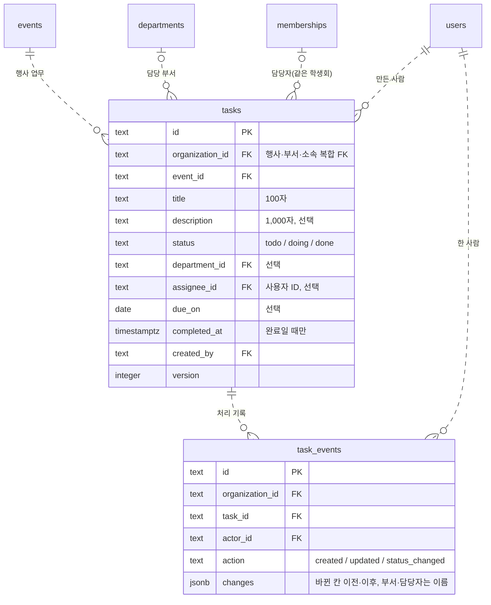

# M4 행사 업무·일정 구현 계획

> **For agentic workers:** 이 저장소는 사용자가 정한 방식(직접 구현 TDD → 새 컨텍스트 Opus 최종 리뷰)으로 실행한다. superpowers:executing-plans로 작업을 차례로 하고, 단계는 체크박스(`- [ ]`)로 따라간다.

**Goal:** 행사마다 업무(담당 부서·담당자·마감일·상태)를 두고, 행사 "업무" 탭의 보드·일정 보기와 앱 첫 화면 "내 업무"로 보이게 한다.

**Architecture:**
- 새 표 `tasks`와 처리 기록 `task_events`(마이그레이션 0024). 담당자는 사용자 ID로 저장하고, `(organization_id, assignee_id)` 복합 외래 키가 같은 학생회 소속만 받는다.
- 새 API 모듈 `apps/api/src/tasks/`(service + routes)를 `AppOptions.tasks`로 연결한다. 보기는 구성원 모두, 바꾸기는 `requireEventManager()`.
- 화면은 새 기능 폴더 `apps/web/src/tasks/`에 둔다. 행사 탭(대화 다음)과 Workspace의 새 보기 `tasks`(내 업무, 기본 보기)가 쓴다.

**Tech Stack:** Hono, drizzle-orm(PostgreSQL·PGlite), zod 4, React 19 + Tailwind, lucide-react, vitest, node:test.

**Spec:** `docs/superpowers/specs/2026-10-11-event-tasks-design.md`

## Global Constraints

- 요청 본문은 contracts의 `z.strictObject`, 문자열은 `text(max)`/`token(max)`. 제목 `text(100)`, 설명 `text(1000)` 또는 null, 부서·담당자 `token(64)` 또는 null, 마감일 YYYY-MM-DD(2000~2999) 또는 null.
- 라우트는 `json(Schema)`를 인증보다 앞에 두고 `c.req.valid('json')`만 쓴다. 실패는 `ApiError(code, status)`. 새 오류 코드: `TASK_DEPARTMENT_INVALID`(409), `TASK_ASSIGNEE_INVALID`(409), `TASKS_FULL`(409).
- 행사마다 업무 300개(`TASKS_PER_EVENT_MAX`). 내 업무 할 일 300개(`MY_TASKS_OPEN_LIMIT`, 넘으면 `truncated`), 완료 50개(`MY_TASKS_DONE_LIMIT`).
- 잠금 순서: 행사(추가만, `FOR NO KEY UPDATE`) → 부서(`FOR KEY SHARE`) → 업무(`FOR UPDATE`) → 담당자 소속(`FOR SHARE OF memberships`). 버전 검사가 부서·담당자 검사보다 먼저다.
- 0024는 새 표 둘만 만든다. 기존 표에 제약을 더하지 않는다. 새 코드가 새 표를 읽으므로 두 DB에 먼저 적용하고 배포한다.
- 처리 기록의 부서·담당자는 이름으로 남긴다. 업무를 지울 때만 기록을 먼저 지운다.
- 화면은 `components/ui` 부품과 Tailwind 기본 스케일·테마 토큰만 쓴다(인라인 style 금지). 제목·설명·이름에는 `wrap-anywhere`. 버튼 활성화는 같은 스키마의 `safeParse`로 하고 길이 숫자를 화면에 적지 않는다.
- 상태 이름은 `TASK_STATUS_LABELS`(예정·진행 중·완료)만 쓴다. 지연 = 완료가 아니고 `dueOn < todayInSeoul()`.
- 커밋 제목은 한국어 명령형 50자 안이다. AI 서명·트레일러를 붙이지 않는다.
- 새 테스트 파일은 `apps/api/package.json`·`packages/contracts/package.json`의 `test` 목록에 더한다.
- 이 PC에서 API 테스트 여러 파일은 `npx tsx --test --test-concurrency=2 <파일들>`로 돌린다(메모리).

## Review Focus

1. 담당자가 맡은 뒤 미배정이 됨: 그 업무의 제목만 고치는 수정은 통과해야 하고, 다른 사람에게 줬다가 그 사람에게 다시 주는 것은 막혀야 한다 → Task 3 테스트
2. 부서를 지움: 그 부서의 업무는 담당 부서가 비고 버전이 올라, 열어 둔 수정 화면이 저장하면 `VERSION_CONFLICT`여야 한다 → Task 4 테스트
3. 같은 행사에 업무가 300개: 하나 더 만들면 `TASKS_FULL`이고 다른 행사는 영향이 없어야 한다 → Task 3 테스트
4. 마감일이 오늘인 업무: 지연이 아니어야 하고, 어제면 지연이어야 한다(한국 날짜 기준) → Task 5 테스트
5. 미배정 구성원이 업무 탭·내 업무를 엶: 보이기만 하고 추가·상태·수정·지우기 버튼이 없어야 한다 → Task 6·7 테스트

---

### Task 1: 업무 계약

**Files:**
- Create: `packages/contracts/src/tasks.ts`
- Modify: `packages/contracts/src/index.ts`, `packages/contracts/package.json`(test 목록에 `src/tasks.test.ts`)
- Test: `packages/contracts/src/tasks.test.ts`

**Interfaces (Produces):**
- 상수 `TASK_TITLE_MAX = 100`, `TASK_DESCRIPTION_MAX = 1000`, `TASKS_PER_EVENT_MAX = 300`, `MY_TASKS_OPEN_LIMIT = 300`, `MY_TASKS_DONE_LIMIT = 50`
- `TASK_STATUSES = ['todo','doing','done']`, `TaskStatus`, `TASK_STATUS_LABELS`, `TaskAction = 'created' | 'updated' | 'status_changed'`
- `CreateTaskSchema`, `UpdateTaskSchema`, `ChangeTaskStatusSchema`, `DeleteTaskSchema`와 각 `…Request` 타입
- `TaskPerson`, `TaskSummary`, `TaskHistoryEntry`, `TaskDetail`, `TaskResponse`, `EventTasksResponse`, `MyTasksResponse`

- [ ] **Step 1: 실패하는 계약 테스트** — `packages/contracts/src/tasks.test.ts`

```ts
import assert from 'node:assert/strict'
import { test } from 'node:test'
import { isStrictObject } from './input.js'
import { ChangeTaskStatusSchema, CreateTaskSchema, DeleteTaskSchema, TASK_DESCRIPTION_MAX, TASK_STATUS_LABELS, TASK_TITLE_MAX,
  UpdateTaskSchema } from './tasks.js'

// 테스트 파일에 제어 문자를 그대로 쓰지 않는다.
const nul = String.fromCharCode(0)
const lone = String.fromCharCode(0xd800)
const emoji = '😀'
type Schema = { safeParse: (value: unknown) => { success: boolean } }
const accepts = (schema: Schema, values: unknown[]) => { for (const value of values) assert.equal(schema.safeParse(value).success, true, JSON.stringify(value)) }
const rejects = (schema: Schema, values: unknown[]) => { for (const value of values) assert.equal(schema.safeParse(value).success, false, JSON.stringify(value)) }

const task = { title: '현수막 디자인', description: '시안 두 개', departmentId: 'dp', assigneeMembershipId: 'mq', dueOn: '2026-10-20' }
const without = (key: keyof typeof task) => Object.fromEntries(Object.entries(task).filter(([name]) => name !== key))

test('업무: 제목은 꼭 있고, 설명·부서·담당자·마감일은 null로 비운다', () => {
  for (const schema of [CreateTaskSchema, UpdateTaskSchema, ChangeTaskStatusSchema, DeleteTaskSchema]) assert.equal(isStrictObject(schema), true)
  accepts(CreateTaskSchema, [task, { ...task, description: null, departmentId: null, assigneeMembershipId: null, dueOn: null },
    { ...task, title: emoji.repeat(TASK_TITLE_MAX) }, { ...task, description: emoji.repeat(TASK_DESCRIPTION_MAX) },
    { ...task, dueOn: '2000-01-01' }, { ...task, dueOn: '2999-12-31' }, { ...task, dueOn: '2028-02-29' }, { ...task, description: '첫 줄\n둘째 줄' }])
  assert.deepEqual(CreateTaskSchema.parse({ ...task, title: '  현수막 디자인 ', description: ' 시안 두 개  ' }), task)
  rejects(CreateTaskSchema, [without('title'), without('description'), without('departmentId'), without('assigneeMembershipId'), without('dueOn'),
    { ...task, title: '' }, { ...task, title: '   ' }, { ...task, title: emoji.repeat(TASK_TITLE_MAX + 1) }, { ...task, title: `현수막${nul}` },
    { ...task, title: `현수막${lone}` }, { ...task, description: '' }, { ...task, description: ' \n ' },
    { ...task, description: emoji.repeat(TASK_DESCRIPTION_MAX + 1) }, { ...task, description: `설명${nul}` },
    { ...task, departmentId: '' }, { ...task, departmentId: 'd'.repeat(65) }, { ...task, assigneeMembershipId: `m${nul}` },
    { ...task, dueOn: '2026-02-30' }, { ...task, dueOn: '2027-02-29' }, { ...task, dueOn: '1999-12-31' }, { ...task, dueOn: '3000-01-01' },
    { ...task, dueOn: '2026-1-1' }, { ...task, dueOn: '' }, { ...task, status: 'todo' }, { ...task, extra: 1 }])
})

test('업무 수정: 버전과 모든 칸을 다시 보낸다', () => {
  accepts(UpdateTaskSchema, [{ ...task, version: 1 }, { ...task, version: 7, dueOn: null }])
  rejects(UpdateTaskSchema, [task, { ...task, version: 0 }, { ...task, version: 1.5 }, { ...task, version: '1' }, { version: 1, title: '제목' }])
})

test('상태 바꾸기·지우기: 버전과 정한 상태만 받는다', () => {
  accepts(ChangeTaskStatusSchema, ['todo', 'doing', 'done'].map(status => ({ version: 1, status })))
  rejects(ChangeTaskStatusSchema, [{ version: 1, status: 'review' }, { version: 1 }, { status: 'done' }, { version: 1, status: 'done', extra: 1 }])
  accepts(DeleteTaskSchema, [{ version: 3 }])
  rejects(DeleteTaskSchema, [{}, { version: 0 }, { version: 1, reason: '중복' }])
  assert.deepEqual(TASK_STATUS_LABELS, { todo: '예정', doing: '진행 중', done: '완료' })
})
```

- [ ] **Step 2: 실패 확인** — `cd packages/contracts && npx tsx --test src/tasks.test.ts` → "Cannot find module './tasks.js'"

- [ ] **Step 3: 구현** — `packages/contracts/src/tasks.ts`

```ts
import { z } from 'zod'
import { text, token } from './input.js'
import { PURCHASE_INTEGER_MAX, purchaseDate } from './purchases.js'

// 업무 칸의 상한. DB CHECK(0024)와 같은 값이다.
export const TASK_TITLE_MAX = 100
export const TASK_DESCRIPTION_MAX = 1000
// 행사마다 업무 수 상한. 보드를 한 번에 그린다.
export const TASKS_PER_EVENT_MAX = 300
// 내 업무가 한 번에 보이는 수. 할 일이 더 많으면 truncated다.
export const MY_TASKS_OPEN_LIMIT = 300
export const MY_TASKS_DONE_LIMIT = 50
export const TASK_STATUSES = ['todo', 'doing', 'done'] as const
export type TaskStatus = typeof TASK_STATUSES[number]
export const TASK_STATUS_LABELS: Record<TaskStatus, string> = { todo: '예정', doing: '진행 중', done: '완료' }
export type TaskAction = 'created' | 'updated' | 'status_changed'

const id = token(64)
const version = z.number().int().min(1).max(PURCHASE_INTEGER_MAX)
// 마감일. 달력에 있는 날짜이고, DB 검사와 같은 범위만 받는다.
const taskDate = purchaseDate.refine(value => value >= '2000-01-01' && value <= '2999-12-31')
const fields = {
  title: text(TASK_TITLE_MAX),
  description: text(TASK_DESCRIPTION_MAX).nullable(),
  departmentId: id.nullable(),
  // 같은 학생회에서 부서가 있는 구성원(memberships.id)만 받는다. 서버가 사용자로 바꿔 저장한다.
  assigneeMembershipId: id.nullable(),
  dueOn: taskDate.nullable(),
}
// 새 업무는 늘 예정이다.
export const CreateTaskSchema = z.strictObject(fields)
// 수정은 모든 칸을 다시 보낸다.
export const UpdateTaskSchema = z.strictObject({ version, ...fields })
export const ChangeTaskStatusSchema = z.strictObject({ version, status: z.enum(TASK_STATUSES) })
export const DeleteTaskSchema = z.strictObject({ version })

export type CreateTaskRequest = z.infer<typeof CreateTaskSchema>
export type UpdateTaskRequest = z.infer<typeof UpdateTaskSchema>
export type ChangeTaskStatusRequest = z.infer<typeof ChangeTaskStatusSchema>
export type DeleteTaskRequest = z.infer<typeof DeleteTaskSchema>

export interface TaskPerson { id: string; name: string }
export interface TaskSummary {
  id: string
  event: { id: string; name: string }
  title: string
  description: string | null
  status: TaskStatus
  department: { id: string; name: string } | null
  // 담당자의 소속 ID와 이름. 화면은 소속 ID로 내 담당을 가린다.
  assignee: { membershipId: string; name: string } | null
  // 한국 날짜 YYYY-MM-DD
  dueOn: string | null
  completedAt: string | null
  createdBy: TaskPerson
  createdAt: string
  version: number
}
export interface TaskHistoryEntry {
  id: string
  action: TaskAction
  actor: TaskPerson
  changes: Record<string, unknown>
  createdAt: string
}
export interface TaskDetail extends TaskSummary { history: TaskHistoryEntry[] }
export interface TaskResponse { task: TaskDetail }
export interface EventTasksResponse {
  // 마감일 순(없으면 뒤), 그다음 만든 순
  tasks: TaskSummary[]
  // 참가 신청 마감(한국 시각 YYYY-MM-DDTHH:mm). 참가 신청이 없으면 null이다.
  registrationClosesAt: string | null
}
export interface MyTasksResponse {
  // 예정·진행 중. 마감일 순(없으면 뒤)
  open: TaskSummary[]
  // 최근 완료 순
  done: TaskSummary[]
  // 할 일이 MY_TASKS_OPEN_LIMIT보다 많은지
  truncated: boolean
}
```

`packages/contracts/src/index.ts`에 더한다(다른 export 줄 옆):

```ts
export { TASK_TITLE_MAX, TASK_DESCRIPTION_MAX, TASKS_PER_EVENT_MAX, MY_TASKS_OPEN_LIMIT, MY_TASKS_DONE_LIMIT, TASK_STATUSES, TASK_STATUS_LABELS,
  CreateTaskSchema, UpdateTaskSchema, ChangeTaskStatusSchema, DeleteTaskSchema } from './tasks.js'
export type { TaskStatus, TaskAction, CreateTaskRequest, UpdateTaskRequest, ChangeTaskStatusRequest, DeleteTaskRequest, TaskPerson, TaskSummary,
  TaskHistoryEntry, TaskDetail, TaskResponse, EventTasksResponse, MyTasksResponse } from './tasks.js'
```

`packages/contracts/package.json`의 test 끝에 ` src/tasks.test.ts`를 더한다.

- [ ] **Step 4: 통과 확인** — `npm test --workspace @vada/contracts` 전부 PASS
- [ ] **Step 5: 커밋** — `git add packages/contracts && git commit -m "업무 계약 추가"`

---

### Task 2: 업무 표와 마이그레이션 0024

**Files:**
- Modify: `apps/api/src/db/schema.ts`(맨 끝에 `tasks`, `taskEvents`)
- Create: `apps/api/migrations/0024_event_tasks.sql`, `meta/0024_snapshot.json`, `meta/_journal.json`(drizzle-kit이 만든다)
- Modify: `docs/ERD.md`(업무 절)
- Test: `apps/api/src/db/migrations.test.ts`(맨 끝에 0024 테스트)

**Interfaces (Produces):** `tasks`, `taskEvents` drizzle 표(칸 이름은 spec 데이터 절과 같다)

- [ ] **Step 1: 실패하는 마이그레이션 테스트** — `migrations.test.ts` 맨 끝

```ts
test('0024 adds tasks and their history tied to one event, department and member of the same council', async (t) => {
  const pg = new PGlite()
  const previous = migrationsBefore('0024_event_tasks')
  try {
    const db = drizzle(pg)
    await migrate(db, { migrationsFolder: previous.folder })
    await pg.exec(`
      INSERT INTO users (id,name,email) VALUES ('u','기획','u@example.test'),('v','홍보','v@example.test'),('w','남','w@example.test');
      INSERT INTO organizations (id,name) VALUES ('o','Council'),('o2','Other');
      INSERT INTO departments (id,organization_id,name) VALUES ('d','o','기획부'),('d2','o2','기획부');
      INSERT INTO memberships (id,user_id,organization_id,department_id) VALUES ('mu','u','o','d'),('mv','v','o',NULL),('mw','w','o2','d2');
      INSERT INTO events (id,organization_id,name,created_by) VALUES ('e','o','체육대회','u'),('x','o2','남의 행사','w');
    `)
    await migrate(db, { migrationsFolder })
    const insert = (values: Record<string, string>) =>
      pg.exec(`INSERT INTO tasks (${Object.keys(values).join(',')}) VALUES (${Object.values(values).join(',')})`)
    const task = (id: string, change: Record<string, string> = {}) =>
      insert({ id: `'${id}'`, organization_id: "'o'", event_id: "'e'", title: "'현수막'", created_by: "'u'", ...change })

    await t.test('a new task is todo, version 1, with optional fields empty', async () => {
      await task('t1')
      const { rows } = await pg.query<Record<string, unknown>>("SELECT status, version, description, department_id, assignee_id, due_on, completed_at FROM tasks WHERE id = 't1'")
      assert.deepEqual(rows[0], { status: 'todo', version: 1, description: null, department_id: null, assignee_id: null, due_on: null, completed_at: null })
    })
    await t.test('title and description are not blank and within length', async () => {
      await task('t2', { title: `'${'😀'.repeat(100)}'`, description: `'${'😀'.repeat(1000)}'` })
      await assert.rejects(task('b1', { title: "'   '" }), { constraint: 'tasks_title_not_blank' })
      await assert.rejects(task('b2', { title: `'${'😀'.repeat(101)}'` }), { constraint: 'tasks_title_length' })
      await assert.rejects(task('b3', { description: "' '" }), { constraint: 'tasks_description_not_blank' })
      await assert.rejects(task('b4', { description: `'${'😀'.repeat(1001)}'` }), { constraint: 'tasks_description_length' })
    })
    await t.test('status is one of three, completion time exists only when done, due date is in range', async () => {
      await task('t3', { status: "'done'", completed_at: 'now()' })
      await assert.rejects(task('b5', { status: "'review'" }), { constraint: 'tasks_status_valid' })
      await assert.rejects(task('b6', { status: "'done'" }), { constraint: 'tasks_completed_state' })
      await assert.rejects(task('b7', { status: "'doing'", completed_at: 'now()' }), { constraint: 'tasks_completed_state' })
      await assert.rejects(task('b8', { due_on: "'1999-12-31'" }), { constraint: 'tasks_due_on_range' })
      await assert.rejects(task('b9', { version: '0' }), { constraint: 'tasks_version_positive' })
    })
    await t.test('event, department and assignee must belong to the same council', async () => {
      await task('t4', { department_id: "'d'", assignee_id: "'u'" })
      // 미배정 구성원도 DB에서는 담당자가 될 수 있다. 부서 조건은 서버가 본다.
      await task('t5', { assignee_id: "'v'" })
      await assert.rejects(task('b10', { event_id: "'x'" }), { constraint: 'tasks_event_same_organization' })
      await assert.rejects(task('b11', { department_id: "'d2'" }), { constraint: 'tasks_department_same_organization' })
      await assert.rejects(task('b12', { assignee_id: "'w'" }), { constraint: 'tasks_assignee_same_organization' })
      await assert.rejects(pg.exec("DELETE FROM departments WHERE id = 'd'"), { constraint: 'tasks_department_same_organization' })
    })
    await t.test('history belongs to a task of the same council and blocks deleting the task alone', async () => {
      const entry = (id: string, change: Record<string, string> = {}) => pg.exec(`INSERT INTO task_events (${['id', 'organization_id', 'task_id', 'actor_id', 'action', ...Object.keys(change)].join(',')})
        VALUES (${[`'${id}'`, "'o'", "'t1'", "'u'", "'created'", ...Object.values(change)].join(',')})`)
      await entry('h1')
      await entry('h2', { action: "'status_changed'", changes: `'{"status":{"from":"todo","to":"doing"}}'` })
      await assert.rejects(entry('h3', { action: "'deleted'" }), { constraint: 'task_events_action_valid' })
      await assert.rejects(entry('h4', { changes: "'[]'" }), { constraint: 'task_events_changes_object' })
      await assert.rejects(entry('h5', { organization_id: "'o2'" }), { constraint: 'task_events_task_same_organization' })
      await assert.rejects(pg.exec("DELETE FROM tasks WHERE id = 't1'"), { constraint: 'task_events_task_same_organization' })
      await pg.exec("DELETE FROM task_events WHERE task_id = 't1'; DELETE FROM tasks WHERE id = 't1'")
    })
  } finally {
    previous.remove()
    await pg.close()
  }
})
```

주의: `entry`의 `organization_id: 'o2'`는 키 목록 순서 때문에 위 헬퍼로 바꿀 수 없다. 헬퍼를 `(values: Record<string, string>)` 한 덩어리로 받게 쓰고 기본값을 펼친 뒤 덮어쓴다(아래가 최종형).

```ts
      const entry = (id: string, change: Record<string, string> = {}) => {
        const values: Record<string, string> = { id: `'${id}'`, organization_id: "'o'", task_id: "'t1'", actor_id: "'u'", action: "'created'", ...change }
        return pg.exec(`INSERT INTO task_events (${Object.keys(values).join(',')}) VALUES (${Object.values(values).join(',')})`)
      }
```

- [ ] **Step 2: 실패 확인** — `cd apps/api && npx tsx --test src/db/migrations.test.ts` → "Migration not found: 0024_event_tasks"

- [ ] **Step 3: 스키마** — `apps/api/src/db/schema.ts` 맨 끝

```ts
// 행사 업무(M4). 담당 부서·담당자·마감일은 비어 있을 수 있다. 담당자는 사용자 ID이고 같은 학생회 소속만 받는다.
export const tasks = pgTable('tasks', {
  id: text('id').primaryKey(),
  organizationId: text('organization_id').notNull(),
  eventId: text('event_id').notNull(),
  title: text('title').notNull(),
  description: text('description'),
  status: text('status', { enum: ['todo', 'doing', 'done'] }).notNull().default('todo'),
  departmentId: text('department_id'),
  assigneeId: text('assignee_id'),
  // 한국 날짜
  dueOn: date('due_on'),
  // 완료일 때만 있다. 완료에서 다른 상태로 돌리면 지운다.
  completedAt: timestamp('completed_at', { withTimezone: true }),
  createdBy: text('created_by').notNull().references(() => users.id, { onDelete: 'restrict' }),
  createdAt: timestamp('created_at', { withTimezone: true }).notNull().defaultNow(),
  version: integer('version').notNull().default(1),
}, (table) => [
  foreignKey({
    name: 'tasks_event_same_organization',
    columns: [table.organizationId, table.eventId],
    foreignColumns: [events.organizationId, events.id],
  }).onDelete('restrict'),
  // 부서를 지우는 서버가 먼저 업무의 담당 부서를 비운다. 이 키는 그 순서를 지키게 한다.
  foreignKey({
    name: 'tasks_department_same_organization',
    columns: [table.organizationId, table.departmentId],
    foreignColumns: [departments.organizationId, departments.id],
  }).onDelete('restrict'),
  foreignKey({
    name: 'tasks_assignee_same_organization',
    columns: [table.organizationId, table.assigneeId],
    foreignColumns: [memberships.organizationId, memberships.userId],
  }).onDelete('restrict'),
  unique('tasks_organization_id_unique').on(table.organizationId, table.id),
  check('tasks_title_not_blank', sql`${table.title} ~ '[^[:space:]]'`),
  check('tasks_title_length', sql`char_length(${table.title}) <= 100`),
  check('tasks_description_not_blank', sql`${table.description} ~ '[^[:space:]]'`),
  check('tasks_description_length', sql`char_length(${table.description}) <= 1000`),
  check('tasks_status_valid', sql`${table.status} IN ('todo','doing','done')`),
  check('tasks_due_on_range', sql`${table.dueOn} BETWEEN '2000-01-01' AND '2999-12-31'`),
  check('tasks_completed_state', sql`(${table.status} = 'done') = (${table.completedAt} IS NOT NULL)`),
  check('tasks_version_positive', sql`${table.version} >= 1`),
  index('tasks_event_idx').on(table.organizationId, table.eventId),
  index('tasks_assignee_idx').on(table.organizationId, table.assigneeId),
])

// 업무 처리 기록. 고치지 않는다. 업무를 지울 때만 서버가 먼저 함께 지운다.
export const taskEvents = pgTable('task_events', {
  id: text('id').primaryKey(),
  organizationId: text('organization_id').notNull(),
  taskId: text('task_id').notNull(),
  actorId: text('actor_id').notNull().references(() => users.id, { onDelete: 'restrict' }),
  action: text('action', { enum: ['created', 'updated', 'status_changed'] }).notNull(),
  changes: jsonb('changes').$type<Record<string, unknown>>().notNull().default({}),
  createdAt: timestamp('created_at', { withTimezone: true }).notNull().defaultNow(),
}, (table) => [
  foreignKey({
    name: 'task_events_task_same_organization',
    columns: [table.organizationId, table.taskId],
    foreignColumns: [tasks.organizationId, tasks.id],
  }).onDelete('restrict'),
  check('task_events_action_valid', sql`${table.action} IN ('created','updated','status_changed')`),
  check('task_events_changes_object', sql`jsonb_typeof(${table.changes}) = 'object'`),
  index('task_events_task_idx').on(table.taskId, table.createdAt),
])
```

- [ ] **Step 4: 마이그레이션 만들기** — `cd apps/api && npx drizzle-kit generate --name event_tasks`
  - 만든 SQL이 `CREATE TABLE "tasks"`, `CREATE TABLE "task_events"`, FK 다섯 개, 색인 셋뿐인지 읽어 확인한다. 기존 표를 건드리는 줄이 있으면 멈추고 원인을 찾는다.
  - 파일이 LF인지 확인한다(`.gitattributes`).
- [ ] **Step 5: 통과 확인** — `npx tsx --test src/db/migrations.test.ts src/db/schema.test.ts` PASS
- [ ] **Step 6: ERD** — `docs/ERD.md` 끝에 절을 더한다.

````markdown
## 업무

행사(`events`)·부서(`departments`)·소속(`memberships`)·사용자(`users`)를 참조한다. 설계는 [행사 업무·일정](superpowers/specs/2026-10-11-event-tasks-design.md)에 있다.



- `tasks`: 담당자는 `(organization_id, assignee_id)` → `memberships (organization_id, user_id)`로 같은 학생회 소속만 받는다. 부서가 있는 구성원만 맡는 조건과 300개 상한은 서버가 지킨다. 부서를 지우면 서버가 먼저 그 부서 업무의 담당 부서를 비우고 버전을 올린다. 완료 시각은 완료일 때만 있다(CHECK).
- `task_events`: 업무를 지울 때만 서버가 함께 지운다. 그 밖에는 고치거나 지우지 않는다.
````

- [ ] **Step 7: 커밋** — `git add apps/api/src/db apps/api/migrations docs/ERD.md && git commit -m "업무 표와 마이그레이션 0024 추가"`

---

### Task 3: 업무 API

**Files:**
- Create: `apps/api/src/tasks/service.ts`, `apps/api/src/tasks/routes.ts`, `apps/api/src/tasks/tasks.test.ts`
- Modify: `apps/api/src/app.ts`(AppOptions·route), `apps/api/src/serve.ts`(만들어 넘기기), `apps/api/src/http/boundary.test.ts`(modules), `apps/api/src/purchases/test-setup.ts`(app에 tasks), `apps/api/package.json`(test 목록에 `src/tasks/tasks.test.ts`)

**Interfaces:**
- Consumes: Task 1 계약, Task 2 표, `requireSession`, `requireMembership`, `requireEventManager`, `json`, `ApiError`, `koreanOf`
- Produces: `createTaskRoutes(db: TaskDatabase, session: SessionReader)`, `TaskDatabase`, 경로는 spec API 절 그대로

- [ ] **Step 1: 실패하는 API 테스트** — `apps/api/src/tasks/tasks.test.ts`

```ts
import assert from 'node:assert/strict'
import { test } from 'node:test'
import type { EventTasksResponse, MyTasksResponse, TaskResponse } from '@vada/contracts'
import { setupPurchases } from '../purchases/test-setup.js'

// 학생회 a: 기획부 p·q, 총무부 f, 회장단 l, 미배정 n. 학생회 b: x. 행사 e·e2(a), ex(b).
type Env = Awaited<ReturnType<typeof setupPurchases>>
const base = '/events/e/tasks'
const body = (overrides: Record<string, unknown> = {}) => ({ title: '현수막 디자인', description: '시안 두 개', departmentId: 'dp',
  assigneeMembershipId: 'mq', dueOn: '2999-08-10', ...overrides })
const create = async (env: Env, overrides: Record<string, unknown> = {}, path = base) =>
  (await env.ok<TaskResponse>(env.request('POST', path, body(overrides)), 201)).task
async function refused(pending: Promise<Response>, status: number, error: string) {
  const response = await pending
  assert.equal(response.status, status, error)
  assert.deepEqual(await response.json(), { error })
}
const edit = (task: TaskResponse['task'], overrides: Record<string, unknown> = {}) => ({ version: task.version, title: task.title,
  description: task.description, departmentId: task.department?.id ?? null, assigneeMembershipId: task.assignee?.membershipId ?? null,
  dueOn: task.dueOn, ...overrides })

test('부서가 있는 구성원이 업무를 만들고, 구성원 누구나 목록과 상세를 본다', async () => {
  const env = await setupPurchases()
  try {
    const task = await create(env)
    assert.equal(task.status, 'todo')
    assert.equal(task.version, 1)
    assert.deepEqual(task.event, { id: 'e', name: '체육대회' })
    assert.deepEqual(task.department, { id: 'dp', name: '기획부' })
    assert.deepEqual(task.assignee, { membershipId: 'mq', name: '기획2' })
    assert.deepEqual(task.createdBy, { id: 'p', name: '기획' })
    assert.equal(task.completedAt, null)
    assert.deepEqual(task.history.map(entry => [entry.action, entry.actor.name]), [['created', '기획']])
    env.as('n')
    const list = await env.ok<EventTasksResponse>(env.request('GET', base))
    assert.deepEqual(list.tasks.map(item => item.id), [task.id])
    assert.equal(list.registrationClosesAt, null)
    assert.equal((await env.ok<TaskResponse>(env.request('GET', `${base}/${task.id}`))).task.title, '현수막 디자인')
  } finally { await env.pg.close() }
})

test('보드는 마감일 순이고 마감일 없는 업무는 뒤에 온다. 참가 신청 마감도 함께 준다', async () => {
  const env = await setupPurchases()
  try {
    const late = await create(env, { title: '정산', dueOn: '2999-09-01' })
    const none = await create(env, { title: '후기', dueOn: null })
    const early = await create(env, { title: '대관', dueOn: '2999-07-01' })
    await env.ok(env.request('PATCH', '/events/e', { version: 1, startsAt: '2999-08-20T10:00', endsAt: null, place: null }))
    await env.ok(env.request('POST', '/events/e/registration', { opensAt: null, closesAt: '2999-08-19T23:59', capacity: null, notice: null,
      collectPhone: false, fee: 0, memberFee: null }), 201)
    const list = await env.ok<EventTasksResponse>(env.request('GET', base))
    assert.deepEqual(list.tasks.map(item => item.id), [early.id, late.id, none.id])
    assert.equal(list.registrationClosesAt, '2999-08-19T23:59')
  } finally { await env.pg.close() }
})

test('상태: 완료는 완료 시각을 남기고, 되돌리면 지운다. 같은 상태는 그대로다', async () => {
  const env = await setupPurchases()
  try {
    const task = await create(env)
    const status = (version: number, value: string) => env.request('POST', `${base}/${task.id}/status`, { version, status: value })
    const done = (await env.ok<TaskResponse>(status(1, 'done'))).task
    assert.equal(done.status, 'done')
    assert.equal(done.version, 2)
    assert.ok(done.completedAt)
    const same = (await env.ok<TaskResponse>(status(2, 'done'))).task
    assert.equal(same.version, 2)
    const back = (await env.ok<TaskResponse>(status(2, 'doing'))).task
    assert.equal(back.completedAt, null)
    assert.deepEqual(back.history.slice(1).map(entry => [entry.action, entry.changes]), [
      ['status_changed', { status: { from: 'todo', to: 'done' } }], ['status_changed', { status: { from: 'done', to: 'doing' } }]])
    await refused(status(2, 'todo'), 409, 'VERSION_CONFLICT')
  } finally { await env.pg.close() }
})

test('수정: 바뀐 칸만 이전·이후로 남기고 부서·담당자는 이름으로 남긴다. 바뀐 것이 없으면 버전도 그대로다', async () => {
  const env = await setupPurchases()
  try {
    const task = await create(env)
    const same = (await env.ok<TaskResponse>(env.request('PATCH', `${base}/${task.id}`, edit(task)))).task
    assert.equal(same.version, 1)
    assert.equal(same.history.length, 1)
    const changed = (await env.ok<TaskResponse>(env.request('PATCH', `${base}/${task.id}`, edit(task, { title: '현수막 인쇄', description: null,
      departmentId: 'df', assigneeMembershipId: 'mf', dueOn: null })))).task
    assert.equal(changed.version, 2)
    assert.deepEqual(changed.history.at(-1)?.changes, { title: { from: '현수막 디자인', to: '현수막 인쇄' }, description: { from: '시안 두 개', to: null },
      department: { from: '기획부', to: '총무부' }, assignee: { from: '기획2', to: '재정' }, dueOn: { from: '2999-08-10', to: null } })
    await refused(env.request('PATCH', `${base}/${task.id}`, edit(task)), 409, 'VERSION_CONFLICT')
  } finally { await env.pg.close() }
})

test('담당자는 같은 학생회에서 부서가 있는 구성원이고, 맡긴 뒤 미배정이 되어도 다른 칸은 고칠 수 있다', async () => {
  const env = await setupPurchases()
  try {
    for (const assigneeMembershipId of ['mn', 'mx', 'nobody']) await refused(env.request('POST', base, body({ assigneeMembershipId })), 409, 'TASK_ASSIGNEE_INVALID')
    for (const departmentId of ['dx', 'nobody']) await refused(env.request('POST', base, body({ departmentId })), 409, 'TASK_DEPARTMENT_INVALID')
    const task = await create(env)
    await env.pg.exec("UPDATE memberships SET department_id = NULL WHERE id = 'mq'")
    const renamed = (await env.ok<TaskResponse>(env.request('PATCH', `${base}/${task.id}`, edit(task, { title: '현수막 수정' })))).task
    assert.deepEqual(renamed.assignee, { membershipId: 'mq', name: '기획2' })
    const moved = (await env.ok<TaskResponse>(env.request('PATCH', `${base}/${task.id}`, edit(renamed, { assigneeMembershipId: 'mp' })))).task
    await refused(env.request('PATCH', `${base}/${task.id}`, edit(moved, { assigneeMembershipId: 'mq' })), 409, 'TASK_ASSIGNEE_INVALID')
    // 버전이 다르면 담당자 오류보다 VERSION_CONFLICT가 먼저다.
    await refused(env.request('PATCH', `${base}/${task.id}`, edit(renamed, { assigneeMembershipId: 'mn' })), 409, 'VERSION_CONFLICT')
  } finally { await env.pg.close() }
})

test('미배정·다른 학생회·로그인 안 함은 막고, 다른 행사의 경로로는 업무를 찾지 못한다', async () => {
  const env = await setupPurchases()
  try {
    const task = await create(env)
    env.as('n')
    await refused(env.request('POST', base, body()), 403, 'FORBIDDEN')
    await refused(env.request('PATCH', `${base}/${task.id}`, edit(task)), 403, 'FORBIDDEN')
    await refused(env.request('POST', `${base}/${task.id}/status`, { version: 1, status: 'done' }), 403, 'FORBIDDEN')
    await refused(env.request('POST', `${base}/${task.id}/delete`, { version: 1 }), 403, 'FORBIDDEN')
    env.as('x')
    await refused(env.request('GET', base), 403, 'FORBIDDEN')
    await refused(env.request('GET', '/my-tasks'), 403, 'FORBIDDEN')
    env.as(null)
    assert.equal((await env.request('GET', base)).status, 401)
    assert.equal((await env.request('POST', base, body())).status, 401)
    env.as('p')
    await refused(env.request('GET', '/events/ex/tasks'), 404, 'NOT_FOUND')
    await refused(env.request('POST', '/events/ex/tasks', body()), 404, 'NOT_FOUND')
    await refused(env.request('GET', `/events/e2/tasks/${task.id}`), 404, 'NOT_FOUND')
    await refused(env.request('POST', `/events/e2/tasks/${task.id}/status`, { version: 1, status: 'done' }), 404, 'NOT_FOUND')
  } finally { await env.pg.close() }
})

test('형식이 틀린 본문은 400이다: 필수값 누락, 공백만, 상한+1, NUL·홀로 쓰인 서러게이트, 모르는 키', async () => {
  const env = await setupPurchases()
  try {
    const { title: _title, ...missing } = body()
    for (const bad of [missing, body({ title: '   ' }), body({ title: '😀'.repeat(101) }), body({ title: `현수막${String.fromCharCode(0)}` }),
      body({ title: `현수막${String.fromCharCode(0xd800)}` }), body({ description: '😀'.repeat(1001) }), body({ dueOn: '2999-02-30' }), body({ extra: 1 })]) {
      await refused(env.request('POST', base, bad), 400, 'INVALID_INPUT')
    }
  } finally { await env.pg.close() }
})

test('지우기: 버전이 맞아야 하고, 처리 기록과 함께 지운 뒤 남은 목록을 준다', async () => {
  const env = await setupPurchases()
  try {
    const keep = await create(env, { title: '대관' })
    const task = await create(env)
    await env.ok(env.request('POST', `${base}/${task.id}/status`, { version: 1, status: 'doing' }))
    await refused(env.request('POST', `${base}/${task.id}/delete`, { version: 1 }), 409, 'VERSION_CONFLICT')
    const list = await env.ok<EventTasksResponse>(env.request('POST', `${base}/${task.id}/delete`, { version: 2 }))
    assert.deepEqual(list.tasks.map(item => item.id), [keep.id])
    await refused(env.request('GET', `${base}/${task.id}`), 404, 'NOT_FOUND')
    assert.equal((await env.pg.query('SELECT 1 FROM task_events WHERE task_id = $1', [task.id])).rows.length, 0)
  } finally { await env.pg.close() }
})

test('행사마다 업무는 300개까지이고, 다른 행사는 영향이 없다', async () => {
  const env = await setupPurchases()
  try {
    await env.pg.exec(`INSERT INTO tasks (id,organization_id,event_id,title,created_by)
      SELECT 'bulk-' || n, 'a', 'e', '업무 ' || n, 'p' FROM generate_series(1, 300) AS n`)
    await refused(env.request('POST', base, body()), 409, 'TASKS_FULL')
    await create(env, {}, '/events/e2/tasks')
  } finally { await env.pg.close() }
})

test('내 업무: 이 학생회에서 내가 맡은 업무를 모든 행사에서 모은다. 할 일은 마감일 순, 완료는 최근 순이다', async () => {
  const env = await setupPurchases()
  try {
    const later = await create(env, { title: '정산', dueOn: '2999-09-01' })
    const undated = await create(env, { title: '후기', dueOn: null })
    const other = await create(env, { title: '축제 포스터', dueOn: '2999-07-01' }, '/events/e2/tasks')
    const finished = await create(env, { title: '대관' })
    await create(env, { title: '남의 일', assigneeMembershipId: 'mp' })
    await env.ok(env.request('POST', `${base}/${finished.id}/status`, { version: 1, status: 'done' }))
    env.as('q')
    const mine = await env.ok<MyTasksResponse>(env.request('GET', '/my-tasks'))
    assert.deepEqual(mine.open.map(item => item.id), [other.id, later.id, undated.id])
    assert.deepEqual(mine.done.map(item => item.id), [finished.id])
    assert.equal(mine.truncated, false)
    assert.deepEqual(mine.open[0]?.event, { id: 'e2', name: '축제' })
  } finally { await env.pg.close() }
})
```

- [ ] **Step 2: 실패 확인** — `cd apps/api && npx tsx --test src/tasks/tasks.test.ts` → 404/모듈 없음으로 실패

- [ ] **Step 3: 서비스** — `apps/api/src/tasks/service.ts`

```ts
import { randomUUID } from 'node:crypto'
import { and, asc, count, desc, eq, ne, sql, type SQL } from 'drizzle-orm'
import { alias, type PgDatabase, type PgQueryResultHKT } from 'drizzle-orm/pg-core'
import { koreanOf, MY_TASKS_DONE_LIMIT, MY_TASKS_OPEN_LIMIT, TASKS_PER_EVENT_MAX, type ChangeTaskStatusRequest, type CreateTaskRequest,
  type DeleteTaskRequest, type EventTasksResponse, type MyTasksResponse, type TaskAction, type TaskDetail, type TaskSummary,
  type UpdateTaskRequest } from '@vada/contracts'
import { departments, events, memberships, registrationForms, taskEvents, tasks, users } from '../db/schema.js'
import { ApiError } from '../http/errors.js'

type Db = PgDatabase<PgQueryResultHKT>
export type TaskDatabase = Pick<Db, 'select' | 'insert' | 'update' | 'delete' | 'transaction'>
type Reader = Pick<Db, 'select'>
type Transaction = Parameters<Parameters<TaskDatabase['transaction']>[0]>[0]
export interface TaskScope { organizationId: string; userId: string }

const assignees = alias(users, 'task_assignees')
const assigneeMemberships = alias(memberships, 'task_assignee_memberships')
const creators = alias(users, 'task_creators')
const actors = alias(users, 'task_actors')
// 보드·내 업무 할 일 순서: 마감일 순(없으면 뒤), 그다음 만든 순
const byDue = [sql`${tasks.dueOn} asc nulls last`, asc(tasks.createdAt), asc(tasks.id)]

async function summaries(db: Reader, where: SQL | undefined, orderBy: SQL[], limit: number): Promise<TaskSummary[]> {
  const rows = await db.select({ task: tasks, eventName: events.name, departmentName: departments.name,
    assigneeMembershipId: assigneeMemberships.id, assigneeName: assignees.name, creatorName: creators.name }).from(tasks)
    .innerJoin(events, and(eq(events.organizationId, tasks.organizationId), eq(events.id, tasks.eventId)))
    .leftJoin(departments, and(eq(departments.organizationId, tasks.organizationId), eq(departments.id, tasks.departmentId)))
    .leftJoin(assigneeMemberships, and(eq(assigneeMemberships.organizationId, tasks.organizationId), eq(assigneeMemberships.userId, tasks.assigneeId)))
    .leftJoin(assignees, eq(assignees.id, tasks.assigneeId))
    .innerJoin(creators, eq(creators.id, tasks.createdBy))
    .where(where).orderBy(...orderBy).limit(limit)
  return rows.map(({ task, ...row }) => ({
    id: task.id, event: { id: task.eventId, name: row.eventName }, title: task.title, description: task.description, status: task.status,
    department: task.departmentId && row.departmentName !== null ? { id: task.departmentId, name: row.departmentName } : null,
    assignee: row.assigneeMembershipId !== null && row.assigneeName !== null ? { membershipId: row.assigneeMembershipId, name: row.assigneeName } : null,
    dueOn: task.dueOn, completedAt: task.completedAt?.toISOString() ?? null, createdBy: { id: task.createdBy, name: row.creatorName },
    createdAt: task.createdAt.toISOString(), version: task.version,
  }))
}
const inOrganization = (scope: TaskScope) => eq(tasks.organizationId, scope.organizationId)

async function detailOf(db: Reader, scope: TaskScope, eventId: string, taskId: string): Promise<TaskDetail> {
  const [summary] = await summaries(db, and(inOrganization(scope), eq(tasks.eventId, eventId), eq(tasks.id, taskId)), byDue, 1)
  if (!summary) throw new ApiError('NOT_FOUND', 404)
  const history = await db.select({ entry: taskEvents, actorName: actors.name }).from(taskEvents)
    .innerJoin(actors, eq(actors.id, taskEvents.actorId))
    .where(and(eq(taskEvents.organizationId, scope.organizationId), eq(taskEvents.taskId, taskId)))
    .orderBy(asc(taskEvents.createdAt), asc(taskEvents.id))
  return { ...summary, history: history.map(({ entry, actorName }) => ({ id: entry.id, action: entry.action, actor: { id: entry.actorId, name: actorName },
    changes: entry.changes, createdAt: entry.createdAt.toISOString() })) }
}
async function record(tx: Transaction, scope: TaskScope, taskId: string, action: TaskAction, changes: Record<string, unknown> = {}) {
  await tx.insert(taskEvents).values({ id: randomUUID(), organizationId: scope.organizationId, taskId, actorId: scope.userId, action, changes })
}
// 부서는 업무 행보다 먼저 FOR KEY SHARE로 잠근다. 부서 지우기(회장단 부서 → 업무)와 순서가 엇갈리지 않게 한다.
async function lockDepartment(tx: Transaction, scope: TaskScope, departmentId: string | null) {
  if (departmentId === null) return { found: true, name: null }
  const [department] = await tx.select({ name: departments.name }).from(departments)
    .where(and(eq(departments.organizationId, scope.organizationId), eq(departments.id, departmentId))).for('key share')
  return department ? { found: true, name: department.name } : { found: false, name: null }
}
// 담당자는 같은 학생회에서 부서가 있는 구성원이다. 소속 행을 FOR SHARE로 잠가 그사이 미배정으로 옮겨지지 않게 한다.
// 이미 맡은 사람(current)은 미배정이 되었어도 그대로 둘 수 있다.
async function lockAssignee(tx: Transaction, scope: TaskScope, membershipId: string | null, current: string | null) {
  if (membershipId === null) return null
  const [member] = await tx.select({ userId: memberships.userId, departmentId: memberships.departmentId, name: users.name }).from(memberships)
    .innerJoin(users, eq(users.id, memberships.userId))
    .where(and(eq(memberships.organizationId, scope.organizationId), eq(memberships.id, membershipId))).for('share', { of: memberships })
  if (!member || (member.departmentId === null && member.userId !== current)) throw new ApiError('TASK_ASSIGNEE_INVALID', 409)
  return member
}
// 업무 행을 잠근다. 다른 학생회나 다른 행사의 업무는 없는 것으로 본다.
async function lockTask(tx: Transaction, scope: TaskScope, eventId: string, taskId: string) {
  const [row] = await tx.select().from(tasks).where(and(inOrganization(scope), eq(tasks.id, taskId))).for('update')
  if (!row || row.eventId !== eventId) throw new ApiError('NOT_FOUND', 404)
  return row
}
async function departmentName(db: Reader, departmentId: string | null) {
  if (departmentId === null) return null
  const [department] = await db.select({ name: departments.name }).from(departments).where(eq(departments.id, departmentId))
  return department?.name ?? null
}
async function userName(db: Reader, userId: string | null) {
  if (userId === null) return null
  const [user] = await db.select({ name: users.name }).from(users).where(eq(users.id, userId))
  return user?.name ?? null
}

export function createTaskService(db: TaskDatabase) {
  async function list(scope: TaskScope, eventId: string): Promise<EventTasksResponse> {
    const [event] = await db.select({ id: events.id }).from(events).where(and(eq(events.organizationId, scope.organizationId), eq(events.id, eventId)))
    if (!event) throw new ApiError('NOT_FOUND', 404)
    const [form] = await db.select({ closesAt: registrationForms.closesAt }).from(registrationForms)
      .where(and(eq(registrationForms.organizationId, scope.organizationId), eq(registrationForms.eventId, eventId)))
    return { tasks: await summaries(db, and(inOrganization(scope), eq(tasks.eventId, eventId)), byDue, TASKS_PER_EVENT_MAX),
      registrationClosesAt: form ? koreanOf(form.closesAt) : null }
  }
  return {
    list,
    get: (scope: TaskScope, eventId: string, taskId: string) => detailOf(db, scope, eventId, taskId),
    // 이 학생회에서 내가 맡은 업무. 할 일은 마감일 순, 완료는 최근 순이다.
    async mine(scope: TaskScope): Promise<MyTasksResponse> {
      const mine = and(inOrganization(scope), eq(tasks.assigneeId, scope.userId))
      const open = await summaries(db, and(mine, ne(tasks.status, 'done')), byDue, MY_TASKS_OPEN_LIMIT + 1)
      const done = await summaries(db, and(mine, eq(tasks.status, 'done')), [desc(tasks.completedAt), desc(tasks.id)], MY_TASKS_DONE_LIMIT)
      return { open: open.slice(0, MY_TASKS_OPEN_LIMIT), done, truncated: open.length > MY_TASKS_OPEN_LIMIT }
    },
    async create(scope: TaskScope, eventId: string, input: CreateTaskRequest): Promise<TaskDetail> {
      return db.transaction(async tx => {
        // 행사 행을 잠그고 센다. 같은 행사에 동시에 더해도 상한을 넘지 않는다.
        const [event] = await tx.select({ id: events.id }).from(events)
          .where(and(eq(events.organizationId, scope.organizationId), eq(events.id, eventId))).for('no key update')
        if (!event) throw new ApiError('NOT_FOUND', 404)
        const department = await lockDepartment(tx, scope, input.departmentId)
        if (!department.found) throw new ApiError('TASK_DEPARTMENT_INVALID', 409)
        const assignee = await lockAssignee(tx, scope, input.assigneeMembershipId, null)
        const [total] = await tx.select({ n: count() }).from(tasks).where(and(inOrganization(scope), eq(tasks.eventId, eventId)))
        if ((total?.n ?? 0) >= TASKS_PER_EVENT_MAX) throw new ApiError('TASKS_FULL', 409)
        const id = randomUUID()
        await tx.insert(tasks).values({ id, organizationId: scope.organizationId, eventId, title: input.title, description: input.description,
          departmentId: input.departmentId, assigneeId: assignee?.userId ?? null, dueOn: input.dueOn, createdBy: scope.userId })
        await record(tx, scope, id, 'created')
        return detailOf(tx, scope, eventId, id)
      })
    },
    // 모든 칸을 받는다. 바뀐 칸만 이전·이후로 남기고, 부서·담당자는 그때의 이름으로 남긴다.
    async update(scope: TaskScope, eventId: string, taskId: string, input: UpdateTaskRequest): Promise<TaskDetail> {
      return db.transaction(async tx => {
        const department = await lockDepartment(tx, scope, input.departmentId)
        const row = await lockTask(tx, scope, eventId, taskId)
        if (row.version !== input.version) throw new ApiError('VERSION_CONFLICT', 409)
        if (!department.found) throw new ApiError('TASK_DEPARTMENT_INVALID', 409)
        const assignee = await lockAssignee(tx, scope, input.assigneeMembershipId, row.assigneeId)
        const assigneeId = assignee?.userId ?? null
        const changes: Record<string, unknown> = {}
        if (row.title !== input.title) changes.title = { from: row.title, to: input.title }
        if (row.description !== input.description) changes.description = { from: row.description, to: input.description }
        if (row.departmentId !== input.departmentId) changes.department = { from: await departmentName(tx, row.departmentId), to: department.name }
        if (row.assigneeId !== assigneeId) changes.assignee = { from: await userName(tx, row.assigneeId), to: assignee?.name ?? null }
        if (row.dueOn !== input.dueOn) changes.dueOn = { from: row.dueOn, to: input.dueOn }
        if (!Object.keys(changes).length) return detailOf(tx, scope, eventId, taskId)
        await tx.update(tasks).set({ title: input.title, description: input.description, departmentId: input.departmentId, assigneeId,
          dueOn: input.dueOn, version: sql`${tasks.version} + 1` }).where(and(inOrganization(scope), eq(tasks.id, taskId)))
        await record(tx, scope, taskId, 'updated', changes)
        return detailOf(tx, scope, eventId, taskId)
      })
    },
    async changeStatus(scope: TaskScope, eventId: string, taskId: string, input: ChangeTaskStatusRequest): Promise<TaskDetail> {
      return db.transaction(async tx => {
        const row = await lockTask(tx, scope, eventId, taskId)
        if (row.version !== input.version) throw new ApiError('VERSION_CONFLICT', 409)
        if (row.status === input.status) return detailOf(tx, scope, eventId, taskId)
        await tx.update(tasks).set({ status: input.status, completedAt: input.status === 'done' ? sql`now()` : null,
          version: sql`${tasks.version} + 1` }).where(and(inOrganization(scope), eq(tasks.id, taskId)))
        await record(tx, scope, taskId, 'status_changed', { status: { from: row.status, to: input.status } })
        return detailOf(tx, scope, eventId, taskId)
      })
    },
    // 업무와 처리 기록을 함께 지우고 남은 목록을 준다.
    async remove(scope: TaskScope, eventId: string, taskId: string, input: DeleteTaskRequest): Promise<EventTasksResponse> {
      await db.transaction(async tx => {
        const row = await lockTask(tx, scope, eventId, taskId)
        if (row.version !== input.version) throw new ApiError('VERSION_CONFLICT', 409)
        await tx.delete(taskEvents).where(and(eq(taskEvents.organizationId, scope.organizationId), eq(taskEvents.taskId, taskId)))
        await tx.delete(tasks).where(and(inOrganization(scope), eq(tasks.id, taskId)))
      })
      return list(scope, eventId)
    },
  }
}
```

`for('share', { of: memberships })`가 drizzle 0.45에서 타입 오류면 `for('share')`로 바꾸지 말고, 소속을 조인 없이 먼저 잠근 뒤 이름을 따로 읽는다(users 행까지 잠그지 않게).

- [ ] **Step 4: 라우트** — `apps/api/src/tasks/routes.ts`

```ts
import { Hono, type Context } from 'hono'
import { ChangeTaskStatusSchema, CreateTaskSchema, DeleteTaskSchema, token, UpdateTaskSchema, type EventTasksResponse, type MyTasksResponse,
  type TaskDetail, type TaskResponse } from '@vada/contracts'
import { requireEventManager, requireMembership, type MembershipEnv } from '../access/membership.js'
import { requireSession, type SessionReader } from '../auth/require-session.js'
import { ApiError } from '../http/errors.js'
import { json } from '../http/validate.js'
import { createTaskService, type TaskDatabase, type TaskScope } from './service.js'

// 경로의 ID도 본문과 같은 규칙으로 검사한다. 제어 문자나 너무 긴 값은 없는 ID로 본다.
const pathId = token(64)
function idOf(value: string | undefined) {
  const parsed = pathId.safeParse(value)
  if (!parsed.success) throw new ApiError('NOT_FOUND', 404)
  return parsed.data
}

// 행사 업무. 구성원 누구나 보고, 부서가 있는 구성원이 만들고 바꾼다.
export function createTaskRoutes(db: TaskDatabase, session: SessionReader) {
  const routes = new Hono<MembershipEnv>()
  const service = createTaskService(db)
  const auth = requireSession(session)
  const member = requireMembership(db)
  const manager = requireEventManager()
  const base = '/organizations/:organizationId/events/:eventId/tasks'
  const scope = (c: Context<MembershipEnv>): TaskScope => ({ organizationId: c.get('membership').organization.id, userId: c.get('userId') })
  const eventId = (c: Context<MembershipEnv>) => idOf(c.req.param('eventId'))
  const taskId = (c: Context<MembershipEnv>) => idOf(c.req.param('taskId'))
  const reply = (task: TaskDetail) => ({ task }) satisfies TaskResponse
  routes.get('/organizations/:organizationId/my-tasks', auth, member, async c => c.json(await service.mine(scope(c)) satisfies MyTasksResponse))
  routes.get(base, auth, member, async c => c.json(await service.list(scope(c), eventId(c)) satisfies EventTasksResponse))
  routes.post(base, json(CreateTaskSchema), auth, member, manager, async c =>
    c.json(reply(await service.create(scope(c), eventId(c), c.req.valid('json'))), 201))
  routes.get(`${base}/:taskId`, auth, member, async c => c.json(reply(await service.get(scope(c), eventId(c), taskId(c)))))
  routes.patch(`${base}/:taskId`, json(UpdateTaskSchema), auth, member, manager, async c =>
    c.json(reply(await service.update(scope(c), eventId(c), taskId(c), c.req.valid('json')))))
  routes.post(`${base}/:taskId/status`, json(ChangeTaskStatusSchema), auth, member, manager, async c =>
    c.json(reply(await service.changeStatus(scope(c), eventId(c), taskId(c), c.req.valid('json')))))
  routes.post(`${base}/:taskId/delete`, json(DeleteTaskSchema), auth, member, manager, async c =>
    c.json(await service.remove(scope(c), eventId(c), taskId(c), c.req.valid('json')) satisfies EventTasksResponse))
  return routes
}
```

- [ ] **Step 5: 연결**
  - `app.ts`: `import type { createTaskRoutes } from './tasks/routes.js'`, `AppOptions`에 `tasks?: ReturnType<typeof createTaskRoutes>`, 구조 분해에 `tasks`, `if (fees) …` 다음 줄에 `if (tasks) app.route('/api', tasks)`
  - `serve.ts`: `const tasks = createTaskRoutes(db, (headers) => auth.api.getSession({ headers }))`, `createApp({ …, fees, tasks, organization, webhook })`
  - `boundary.test.ts`: modules에 `tasks: createTaskRoutes(db, session),`
  - `purchases/test-setup.ts`: createApp에 `tasks: createTaskRoutes(db, session),`
  - `apps/api/package.json`: test 목록의 `src/registrations/attendance.test.ts` 다음에 ` src/tasks/tasks.test.ts`
- [ ] **Step 6: 통과 확인** — `npx tsx --test --test-concurrency=2 src/tasks/tasks.test.ts src/http/boundary.test.ts src/app.test.ts` PASS, `npm run typecheck` PASS
- [ ] **Step 7: 커밋** — `git add apps/api && git commit -m "행사 업무 API 추가"`

---

### Task 4: 부서를 지우면 업무의 담당 부서 비우기

**Files:**
- Modify: `apps/api/src/organization/service.ts`(deleteDepartment)
- Test: `apps/api/src/organization/organization.test.ts`

- [ ] **Step 1: 실패하는 테스트** — organization.test.ts 끝

```ts
test('부서를 지우면 그 부서가 담당인 업무의 담당 부서를 비우고 버전을 올린다', async () => {
  const { pg, send } = await setup()
  try {
    await pg.exec(`
      INSERT INTO events (id,organization_id,name,created_by) VALUES ('e1','org1','체육대회','lead');
      INSERT INTO tasks (id,organization_id,event_id,title,department_id,created_by) VALUES ('t1','org1','e1','현수막','plan1','lead'),
        ('t2','org1','e1','정산','fin1','lead');
    `)
    assert.equal((await send('POST', '/organizations/org1/departments/plan1/delete', {})).status, 200)
    const { rows } = await pg.query<{ id: string; department_id: string | null; version: number }>('SELECT id, department_id, version FROM tasks ORDER BY id')
    assert.deepEqual(rows, [{ id: 't1', department_id: null, version: 2 }, { id: 't2', department_id: 'fin1', version: 1 }])
    assert.equal((await pg.query('SELECT 1 FROM task_events')).rows.length, 0)
  } finally { await pg.close() }
})
```

- [ ] **Step 2: 실패 확인** — `cd apps/api && npx tsx --test src/organization/organization.test.ts` → 409 DEPARTMENT_IN_USE(FK)로 실패
- [ ] **Step 3: 구현** — `deleteDepartment` 안, 제출 기록 검사 다음·`tx.delete(departments)` 앞

```ts
      // 지울 부서 행을 먼저 잠근다. 그사이 업무에 이 부서를 정하려는 요청은 지우기가 끝난 뒤 TASK_DEPARTMENT_INVALID를 받는다.
      await tx.select({ id: departments.id }).from(departments)
        .where(and(eq(departments.organizationId, organizationId), eq(departments.id, departmentId))).for('update')
      // 업무는 담당 부서만 비운다. 업무가 한 번이라도 있던 부서도 지울 수 있게 한다. 열린 수정 화면은 버전으로 막는다.
      await tx.update(tasks).set({ departmentId: null, version: sql`${tasks.version} + 1` })
        .where(and(eq(tasks.organizationId, organizationId), eq(tasks.departmentId, departmentId)))
```

`import { and, asc, count, eq, ne, sql } from 'drizzle-orm'`, `import { departments, memberships, organizations, purchaseSubmissions, tasks, users } from '../db/schema.js'`. `OrganizationDatabase`는 이미 `transaction`을 가진다(트랜잭션 안의 update는 tx로 한다).

- [ ] **Step 4: 통과 확인** — `npx tsx --test src/organization/organization.test.ts` PASS
- [ ] **Step 5: 커밋** — `git commit -am "부서를 지우면 업무의 담당 부서 비우기"`

---

### Task 5: 화면 데이터(업무 문구·계산·불러오기)

**Files:**
- Create: `apps/web/src/tasks/task-view.ts`, `apps/web/src/tasks/task-view.test.ts`, `apps/web/src/tasks/useTasks.ts`, `apps/web/src/tasks/task-fixtures.ts`

**Interfaces (Produces):**
- `task-view.ts`
  - `statusLabels`(= `TASK_STATUS_LABELS`), `nextStatus: Partial<Record<TaskStatus, { status: TaskStatus; label: string }>>`(todo → 시작, doing → 완료)
  - `isOverdue(task, today)`, `isOpen(task)`, `dueText(dueOn)`(→ `10.20`), `dDayText(startsAt, today)`(→ `D-33`·`D-DAY`·`D+2`·null)
  - `type TaskFilter = 'overdue' | 'unassigned' | 'mine'`, `taskCounts(tasks, today, viewerMembershipId)` → `{ total, done, overdue, unassigned, mine }`, `matchesFilter(task, filter, today, viewerMembershipId)`
  - `type ScheduleItem = { key: string; date: string; kind: 'event' | 'deadline' | 'task'; title: string; note: string | null; task: TaskSummary | null }`
  - `scheduleOf(tasks, event, registrationClosesAt)` → 날짜순 `ScheduleItem[]`, `groupByDate(items)` → `{ date, items }[]`
  - `taskHistoryText(entry)`, `taskMessage(code)`, `taskFailure`
- `useTasks.ts`
  - `type TaskResult = { ok: true; task: TaskDetail } | { ok: false; code: string | null; message: string }`
  - `tasksBase(organizationId, eventId)`, `createTask`, `updateTask`, `changeTaskStatus`, `deleteTask`(→ `{ ok: true; list: EventTasksResponse } | { ok: false; code; message }`), `fetchTask`
  - `useEventTasks(organizationId, eventId, enabled)` → `{ data, loadError, refresh, replace(task), setList(list) }`
  - `useMyTasks(organizationId)` → `{ data, loadError, refresh }`
- `task-fixtures.ts`: `taskSummary(overrides)`, `taskDetail(overrides)`

- [ ] **Step 1: 실패하는 테스트** — `task-view.test.ts`

```ts
import { expect, test } from 'vitest'
import type { EventSummary } from '@vada/contracts'
import { dDayText, dueText, groupByDate, isOverdue, matchesFilter, scheduleOf, taskCounts, taskHistoryText, taskMessage } from './task-view'
import { taskSummary } from './task-fixtures'

const event = (overrides: Partial<EventSummary> = {}): EventSummary => ({ id: 'e1', organizationId: 'o1', name: '체육대회', createdBy: 'u1',
  createdAt: '2026-09-01T00:00:00Z', startsAt: '2026-10-20T10:00', endsAt: '2026-10-20T18:00', place: null, version: 1, ...overrides })

test('지연은 완료가 아니고 마감일이 오늘보다 앞일 때다. 마감일 당일은 지연이 아니다', () => {
  expect(isOverdue(taskSummary({ dueOn: '2026-10-10' }), '2026-10-11')).toBe(true)
  expect(isOverdue(taskSummary({ dueOn: '2026-10-11' }), '2026-10-11')).toBe(false)
  expect(isOverdue(taskSummary({ dueOn: '2026-10-10', status: 'done', completedAt: '2026-10-10T01:00:00Z' }), '2026-10-11')).toBe(false)
  expect(isOverdue(taskSummary({ dueOn: null }), '2026-10-11')).toBe(false)
})

test('D-day: 앞이면 D-N, 당일이면 D-DAY, 지나면 D+N, 시작이 없으면 없다', () => {
  expect(dDayText('2026-10-20T10:00', '2026-10-11')).toBe('D-9')
  expect(dDayText('2026-10-11T23:00', '2026-10-11')).toBe('D-DAY')
  expect(dDayText('2026-10-09T10:00', '2026-10-11')).toBe('D+2')
  expect(dDayText(null, '2026-10-11')).toBeNull()
  expect(dueText('2026-03-05')).toBe('3.5')
})

test('요약 수와 거르기: 완료한 업무는 지연·담당자 없음·내 담당에서 빠진다', () => {
  const list = [taskSummary({ id: 'a', dueOn: '2026-10-01' }), taskSummary({ id: 'b', assignee: null }),
    taskSummary({ id: 'c', assignee: { membershipId: 'm1', name: '테스터' } }),
    taskSummary({ id: 'd', status: 'done', completedAt: '2026-10-02T00:00:00Z', assignee: null, dueOn: '2026-10-01' })]
  expect(taskCounts(list, '2026-10-11', 'm1')).toEqual({ total: 4, done: 1, overdue: 1, unassigned: 1, mine: 1 })
  expect(list.filter(task => matchesFilter(task, 'unassigned', '2026-10-11', 'm1')).map(task => task.id)).toEqual(['b'])
  expect(list.filter(task => matchesFilter(task, null, '2026-10-11', 'm1')).length).toBe(4)
})

test('일정은 행사 일시·참가 신청 마감·마감일 있는 업무를 날짜순으로 모은다', () => {
  const items = scheduleOf([taskSummary({ id: 't1', title: '현수막', dueOn: '2026-10-15' }), taskSummary({ id: 't2', dueOn: null }),
    taskSummary({ id: 't3', title: '정산', dueOn: '2026-10-25' })], event(), '2026-10-18T23:59')
  expect(items.map(item => [item.date, item.kind, item.title, item.note])).toEqual([
    ['2026-10-15', 'task', '현수막', null], ['2026-10-18', 'deadline', '참가 신청 마감', '23:59'],
    ['2026-10-20', 'event', '체육대회', '10:00~18:00'], ['2026-10-25', 'task', '정산', null]])
  expect(scheduleOf([], event({ endsAt: '2026-10-22T18:00' }), null)[0]?.note).toBe('10:00 ~ 10.22 18:00')
  expect(scheduleOf([], event({ startsAt: null, endsAt: null }), null)).toEqual([])
  expect(groupByDate(items).map(group => group.date)).toEqual(['2026-10-15', '2026-10-18', '2026-10-20', '2026-10-25'])
})

test('처리 기록과 오류 문구', () => {
  const entry = (action: 'created' | 'updated' | 'status_changed', changes: Record<string, unknown> = {}) =>
    ({ id: 'h', action, actor: { id: 'u', name: '기획' }, changes, createdAt: '2026-10-11T00:00:00Z' })
  expect(taskHistoryText(entry('created'))).toBe('만듦')
  expect(taskHistoryText(entry('status_changed', { status: { from: 'todo', to: 'doing' } }))).toBe('상태: 예정 → 진행 중')
  expect(taskHistoryText(entry('updated', { assignee: { from: null, to: '윤태민' }, dueOn: { from: '2026-10-20', to: null },
    description: { from: '가', to: '나' } }))).toBe('수정: 담당자 없음 → 윤태민 · 마감일 10.20 → 없음 · 설명 고침')
  expect(taskMessage('TASKS_FULL')).toBe('이 행사의 업무가 너무 많아요. 끝난 업무를 지운 뒤 더해 주세요.')
  expect(taskMessage('SOMETHING')).toBe('처리하지 못했어요. 다시 시도해 주세요.')
})
```

- [ ] **Step 2: 실패 확인** — `npm test --workspace @vada/web -- src/tasks/task-view.test.ts` → 모듈 없음
- [ ] **Step 3: 구현** — `task-fixtures.ts`

```ts
import type { TaskDetail, TaskSummary } from '@vada/contracts'

export const taskSummary = (overrides: Partial<TaskSummary> = {}): TaskSummary => ({ id: 't1', event: { id: 'e1', name: '체육대회' },
  title: '현수막 디자인', description: '시안 두 개', status: 'todo', department: { id: 'd1', name: '기획부' },
  assignee: { membershipId: 'm2', name: '윤태민' }, dueOn: '2026-10-20', completedAt: null, createdBy: { id: 'u1', name: '테스터' },
  createdAt: '2026-10-01T00:00:00Z', version: 1, ...overrides })
export const taskDetail = (overrides: Partial<TaskDetail> = {}): TaskDetail => ({ ...taskSummary(overrides),
  history: [{ id: 'h1', action: 'created', actor: { id: 'u1', name: '테스터' }, changes: {}, createdAt: '2026-10-01T00:00:00Z' }], ...overrides })
```

`task-view.ts`

```ts
import { TASK_STATUS_LABELS, type EventSummary, type TaskHistoryEntry, type TaskStatus, type TaskSummary } from '@vada/contracts'

export const statusLabels = TASK_STATUS_LABELS
// 카드의 빠른 버튼. 완료한 업무에는 없다.
export const nextStatus: Partial<Record<TaskStatus, { status: TaskStatus; label: string }>> = {
  todo: { status: 'doing', label: '시작' }, doing: { status: 'done', label: '완료' } }
export const isOpen = (task: Pick<TaskSummary, 'status'>) => task.status !== 'done'
// 지연: 완료가 아니고 마감일이 한국 날짜로 오늘보다 앞이다. 마감일 당일은 지연이 아니다.
export const isOverdue = (task: Pick<TaskSummary, 'status' | 'dueOn'>, today: string) => isOpen(task) && task.dueOn !== null && task.dueOn < today
// 2026-10-20 → 10.20
export const dueText = (day: string) => `${Number(day.slice(5, 7))}.${Number(day.slice(8, 10))}`
const dayNumber = (day: string) => Date.UTC(Number(day.slice(0, 4)), Number(day.slice(5, 7)) - 1, Number(day.slice(8, 10))) / 86_400_000
export function dDayText(startsAt: string | null, today: string) {
  if (startsAt === null) return null
  const diff = dayNumber(startsAt.slice(0, 10)) - dayNumber(today)
  return diff === 0 ? 'D-DAY' : diff > 0 ? `D-${diff}` : `D+${-diff}`
}

export type TaskFilter = 'overdue' | 'unassigned' | 'mine'
export const filterLabels: Record<TaskFilter, string> = { overdue: '지연', unassigned: '담당자 없음', mine: '내 담당' }
export function matchesFilter(task: TaskSummary, filter: TaskFilter | null, today: string, viewerMembershipId: string) {
  if (filter === null) return true
  if (!isOpen(task)) return false
  if (filter === 'overdue') return isOverdue(task, today)
  if (filter === 'unassigned') return task.assignee === null
  return task.assignee?.membershipId === viewerMembershipId
}
export function taskCounts(tasks: TaskSummary[], today: string, viewerMembershipId: string) {
  const count = (filter: TaskFilter) => tasks.filter(task => matchesFilter(task, filter, today, viewerMembershipId)).length
  return { total: tasks.length, done: tasks.filter(task => !isOpen(task)).length, overdue: count('overdue'), unassigned: count('unassigned'),
    mine: count('mine') }
}

export type ScheduleItem = { key: string; date: string; kind: 'event' | 'deadline' | 'task'; title: string; note: string | null; task: TaskSummary | null }
const kindOrder: Record<ScheduleItem['kind'], number> = { event: 0, deadline: 1, task: 2 }
// 행사 일시, 참가 신청 마감, 마감일이 있는 업무를 날짜순으로. 같은 날은 행사 → 신청 마감 → 업무 순이다.
export function scheduleOf(tasks: TaskSummary[], event: Pick<EventSummary, 'name' | 'startsAt' | 'endsAt'>, registrationClosesAt: string | null) {
  const items: ScheduleItem[] = []
  if (event.startsAt) {
    const start = event.startsAt.slice(11)
    const end = event.endsAt === null ? null : event.endsAt.slice(0, 10) === event.startsAt.slice(0, 10)
      ? event.endsAt.slice(11) : `${dueText(event.endsAt.slice(0, 10))} ${event.endsAt.slice(11)}`
    items.push({ key: 'event', date: event.startsAt.slice(0, 10), kind: 'event', title: event.name,
      note: end === null ? start : end.includes(' ') ? `${start} ~ ${end}` : `${start}~${end}`, task: null })
  }
  if (registrationClosesAt) items.push({ key: 'deadline', date: registrationClosesAt.slice(0, 10), kind: 'deadline', title: '참가 신청 마감',
    note: registrationClosesAt.slice(11), task: null })
  for (const task of tasks) if (task.dueOn) items.push({ key: task.id, date: task.dueOn, kind: 'task', title: task.title, note: null, task })
  return items.sort((a, b) => a.date.localeCompare(b.date) || kindOrder[a.kind] - kindOrder[b.kind])
}
export function groupByDate(items: ScheduleItem[]) {
  const groups: { date: string; items: ScheduleItem[] }[] = []
  for (const item of items) {
    const last = groups.at(-1)
    if (last?.date === item.date) last.items.push(item)
    else groups.push({ date: item.date, items: [item] })
  }
  return groups
}

const fieldLabels: Record<string, string> = { title: '제목', department: '담당 부서', assignee: '담당자', dueOn: '마감일' }
const emptyText: Record<string, string> = { department: '없음', assignee: '없음', dueOn: '없음' }
function valueText(key: string, value: unknown) {
  if (value === null || value === undefined) return emptyText[key] ?? '없음'
  if (key === 'dueOn' && typeof value === 'string') return dueText(value)
  return String(value)
}
// 처리 기록 한 줄. 설명은 길어서 바뀌었다고만 적는다.
export function taskHistoryText(entry: TaskHistoryEntry) {
  if (entry.action === 'created') return '만듦'
  if (entry.action === 'status_changed') {
    const { from, to } = entry.changes.status as { from: TaskStatus; to: TaskStatus }
    return `상태: ${statusLabels[from]} → ${statusLabels[to]}`
  }
  const parts = Object.entries(entry.changes).map(([key, change]) => {
    if (key === 'description') return '설명 고침'
    const { from, to } = change as { from: unknown; to: unknown }
    return `${fieldLabels[key] ?? key} ${valueText(key, from)} → ${valueText(key, to)}`
  })
  return `수정: ${parts.join(' · ')}`
}

export const taskErrors: Record<string, string> = {
  FORBIDDEN: '권한이 없어요. 부서가 있는 구성원만 업무를 바꿀 수 있어요.',
  NOT_FOUND: '업무를 찾을 수 없어요. 새로 불러와 주세요.',
  VERSION_CONFLICT: '다른 곳에서 먼저 바뀌었어요. 새로 불러와 주세요.',
  TASK_DEPARTMENT_INVALID: '담당 부서가 바뀌었어요. 다시 골라 주세요.',
  TASK_ASSIGNEE_INVALID: '담당자로 정할 수 없는 사람이에요. 부서가 있는 구성원을 골라 주세요.',
  TASKS_FULL: '이 행사의 업무가 너무 많아요. 끝난 업무를 지운 뒤 더해 주세요.',
  INVALID_INPUT: '입력값을 확인해 주세요.',
}
export const taskFailure = '처리하지 못했어요. 다시 시도해 주세요.'
export const taskMessage = (code: unknown) => typeof code === 'string' ? taskErrors[code] ?? taskFailure : taskFailure
```

주의: 테스트의 `taskHistoryText` 기대값 `담당자 없음 → 윤태민`은 위 `valueText`로는 `담당자 없음 → 윤태민`(라벨 "담당자" + 값 "없음")이 되어 맞는다.

`useTasks.ts`

```ts
import { useCallback, useEffect, useState } from 'react'
import type { ChangeTaskStatusRequest, CreateTaskRequest, EventTasksResponse, MyTasksResponse, TaskDetail, TaskResponse,
  TaskSummary, UpdateTaskRequest } from '@vada/contracts'
import { taskFailure, taskMessage } from './task-view'

export type TaskResult = { ok: true; task: TaskDetail } | { ok: false; code: string | null; message: string }
export type DeleteResult = { ok: true; list: EventTasksResponse } | { ok: false; code: string | null; message: string }
const organizationBase = (organizationId: string) => `/api/organizations/${encodeURIComponent(organizationId)}`
export const tasksBase = (organizationId: string, eventId: string) => `${organizationBase(organizationId)}/events/${encodeURIComponent(eventId)}/tasks`
const one = (organizationId: string, eventId: string, taskId: string) => `${tasksBase(organizationId, eventId)}/${encodeURIComponent(taskId)}`
const isTask = (body: unknown): body is TaskResponse => typeof body === 'object' && body !== null
  && typeof (body as TaskResponse).task === 'object' && (body as TaskResponse).task !== null && Array.isArray((body as TaskResponse).task.history)
const isList = (body: unknown): body is EventTasksResponse => typeof body === 'object' && body !== null && Array.isArray((body as EventTasksResponse).tasks)
const isMine = (body: unknown): body is MyTasksResponse => typeof body === 'object' && body !== null
  && Array.isArray((body as MyTasksResponse).open) && Array.isArray((body as MyTasksResponse).done)
const codeOf = (body: unknown) => { const code = (body as { error?: unknown } | null)?.error; return typeof code === 'string' ? code : null }

async function send(url: string, method: 'POST' | 'PATCH', body: unknown): Promise<{ ok: boolean; body: unknown } | null> {
  try {
    const response = await fetch(url, { method, credentials: 'same-origin', headers: { 'Content-Type': 'application/json' }, body: JSON.stringify(body) })
    return { ok: response.ok, body: await response.json().catch(() => null) }
  } catch {
    return null
  }
}
async function sendTask(url: string, method: 'POST' | 'PATCH', body: unknown): Promise<TaskResult> {
  const result = await send(url, method, body)
  if (!result) return { ok: false, code: null, message: taskFailure }
  if (result.ok && isTask(result.body)) return { ok: true, task: result.body.task }
  return { ok: false, code: codeOf(result.body), message: taskMessage(codeOf(result.body)) }
}
export const createTask = (organizationId: string, eventId: string, input: CreateTaskRequest) => sendTask(tasksBase(organizationId, eventId), 'POST', input)
export const updateTask = (organizationId: string, eventId: string, taskId: string, input: UpdateTaskRequest) =>
  sendTask(one(organizationId, eventId, taskId), 'PATCH', input)
export const changeTaskStatus = (organizationId: string, eventId: string, taskId: string, input: ChangeTaskStatusRequest) =>
  sendTask(`${one(organizationId, eventId, taskId)}/status`, 'POST', input)
export async function deleteTask(organizationId: string, eventId: string, taskId: string, version: number): Promise<DeleteResult> {
  const result = await send(`${one(organizationId, eventId, taskId)}/delete`, 'POST', { version })
  if (!result) return { ok: false, code: null, message: taskFailure }
  if (result.ok && isList(result.body)) return { ok: true, list: result.body }
  return { ok: false, code: codeOf(result.body), message: taskMessage(codeOf(result.body)) }
}
// 상세. 못 받으면 null이다.
export async function fetchTask(organizationId: string, eventId: string, taskId: string): Promise<TaskDetail | null> {
  try {
    const response = await fetch(one(organizationId, eventId, taskId), { credentials: 'same-origin', cache: 'no-store' })
    const body: unknown = await response.json()
    return response.ok && isTask(body) ? body.task : null
  } catch {
    return null
  }
}

function useLoad<T>(url: string, enabled: boolean, valid: (body: unknown) => body is T) {
  const [data, setData] = useState<T | null>(null)
  const [loadError, setLoadError] = useState(false)
  const [attempt, setAttempt] = useState(0)
  useEffect(() => {
    if (!enabled) return
    const controller = new AbortController()
    setLoadError(false)
    void (async () => {
      try {
        const response = await fetch(url, { credentials: 'same-origin', cache: 'no-store', signal: controller.signal })
        const body: unknown = await response.json()
        if (!response.ok || !valid(body)) throw new Error('Tasks lookup failed')
        if (!controller.signal.aborted) setData(body)
      } catch {
        if (!controller.signal.aborted) setLoadError(true)
      }
    })()
    return () => controller.abort()
  }, [url, enabled, attempt, valid])
  const refresh = useCallback(() => setAttempt(value => value + 1), [])
  return { data, setData, loadError, refresh }
}

// 행사 업무 탭을 열 때 불러온다. 바꾼 업무는 받은 응답으로 목록에서 바꾼다.
export function useEventTasks(organizationId: string, eventId: string, enabled: boolean) {
  const { data, setData, loadError, refresh } = useLoad(tasksBase(organizationId, eventId), enabled, isList)
  const replace = useCallback((task: TaskSummary) => setData(current => {
    if (!current) return current
    const exists = current.tasks.some(item => item.id === task.id)
    return { ...current, tasks: exists ? current.tasks.map(item => item.id === task.id ? task : item) : [...current.tasks, task] }
  }), [setData])
  return { data, loadError, refresh, replace, setList: setData }
}
export type EventTasks = ReturnType<typeof useEventTasks>

// 학생회를 열면 불러온다. 옆 메뉴의 남은 수와 내 업무 화면이 같이 쓴다.
export function useMyTasks(organizationId: string) {
  const { data, loadError, refresh } = useLoad(`${organizationBase(organizationId)}/my-tasks`, true, isMine)
  return { data, loadError, refresh }
}
export type MyTasks = ReturnType<typeof useMyTasks>
```

`replace`로 새 업무를 끝에 더하면 서버 순서와 다를 수 있다. 화면(Task 7)은 늘 `sortByDue`로 정렬해 그린다. `task-view.ts`에 더한다:

```ts
// 서버와 같은 순서: 마감일 순(없으면 뒤), 그다음 만든 순
export const sortByDue = (tasks: TaskSummary[]) => [...tasks].sort((a, b) =>
  (a.dueOn ?? '9999') .localeCompare(b.dueOn ?? '9999') || a.createdAt.localeCompare(b.createdAt) || a.id.localeCompare(b.id))
```

- [ ] **Step 4: 통과 확인** — `npm test --workspace @vada/web -- src/tasks/task-view.test.ts` PASS
- [ ] **Step 5: 커밋** — `git add apps/web/src/tasks && git commit -m "업무 화면 계산과 불러오기"`

---

### Task 6: 업무 추가·수정·상세 대화상자

**Files:**
- Create: `apps/web/src/tasks/TaskFormDialog.tsx`, `apps/web/src/tasks/TaskDetailDialog.tsx`, `apps/web/src/tasks/TaskFormDialog.test.tsx`, `apps/web/src/tasks/TaskDetailDialog.test.tsx`

**Interfaces:**
- Consumes: Task 5의 `createTask`·`updateTask`·`changeTaskStatus`·`deleteTask`·`fetchTask`·`taskHistoryText`·`statusLabels`·`isOverdue`·`dueText`
- Produces:
  - `TaskFormDialog({ open, organizationId, eventId, task: TaskDetail | null, directory: OrganizationMembersResponse | null, directoryError: boolean, onClose, onSaved(task: TaskDetail) })`
  - `TaskDetailDialog({ organizationId, target: { eventId: string; taskId: string } | null, manageEvents, onClose, onChanged(task: TaskDetail), onDeleted(list: EventTasksResponse), onEdit(task: TaskDetail), onOpenEvent?: (eventId: string) => void })`
    - `onDeleted`에는 지운 뒤 그 행사의 업무 목록이 온다. 내 업무에서 지웠으면 쓰는 쪽이 내 업무를 새로 불러온다.
  - `useOrganizationMembers(organizationId, enabled)`는 `{ data, loadError, saving, mutate, refresh }`를 준다(기존).

- [ ] **Step 1: 실패하는 테스트** — `TaskFormDialog.test.tsx`

```tsx
// @vitest-environment jsdom
import { afterEach, expect, test, vi } from 'vitest'
import { cleanup, fireEvent, render, screen, waitFor, within } from '@testing-library/react'
import type { OrganizationMembersResponse } from '@vada/contracts'
import { json, mockApi } from '../test-support/mock-api'
import TaskFormDialog from './TaskFormDialog'
import { taskDetail } from './task-fixtures'

afterEach(() => { cleanup(); vi.unstubAllGlobals() })
const viewer = { id: 'm1', organization: { id: 'o1', name: '학생회', inviteCode: 'ABCD2345' }, department: { id: 'd1', name: '기획부', handlesFinance: false,
  isLeadership: false }, title: null, permissions: { manageOrganization: false, approvePurchases: false, manageEvents: true } }
const directory: OrganizationMembersResponse = { viewer, departments: [{ id: 'd1', name: '기획부', isLeadership: false, handlesFinance: false },
  { id: 'd2', name: '홍보부', isLeadership: false, handlesFinance: false }],
  members: [{ id: 'm1', name: '테스터', title: null, departmentId: 'd1' }, { id: 'm2', name: '윤태민', title: '홍보부장', departmentId: 'd2' },
    { id: 'm3', name: '강하늘', title: null, departmentId: null }] }
const path = '/api/organizations/o1/events/e1/tasks'

test('새 업무: 제목이 있어야 켜지고, 담당자를 고르면 비어 있던 담당 부서를 그 사람 부서로 채운다. 미배정은 고를 수 없다', async () => {
  const api = mockApi()
  const bodies: unknown[] = []
  api.on('POST', path, call => { bodies.push(call.body); return json({ task: taskDetail() }, 201) })
  const onSaved = vi.fn()
  render(<TaskFormDialog open organizationId="o1" eventId="e1" task={null} directory={directory} directoryError={false} onClose={() => {}} onSaved={onSaved} />)
  const dialog = screen.getByRole('dialog', { name: '업무 추가' })
  const save = within(dialog).getByRole('button', { name: '추가' })
  expect(save.hasAttribute('disabled')).toBe(true)
  fireEvent.change(within(dialog).getByLabelText('제목'), { target: { value: '  현수막 디자인 ' } })
  expect(within(dialog).queryByRole('option', { name: '강하늘' })).toBeNull()
  fireEvent.change(within(dialog).getByLabelText('담당자'), { target: { value: 'm2' } })
  expect((within(dialog).getByLabelText('담당 부서') as HTMLSelectElement).value).toBe('d2')
  fireEvent.change(within(dialog).getByLabelText('마감일'), { target: { value: '2026-10-20' } })
  fireEvent.click(save)
  await waitFor(() => expect(onSaved).toHaveBeenCalledWith(taskDetail()))
  expect(bodies).toEqual([{ title: '  현수막 디자인 ', description: null, departmentId: 'd2', assigneeMembershipId: 'm2', dueOn: '2026-10-20' }])
  api.assertNoUnexpectedRequests()
})

test('수정: 지금 값을 채우고 버전과 함께 보낸다. 미배정이 된 지금 담당자도 고른 채로 둔다. 실패하면 문구를 보인다', async () => {
  const api = mockApi()
  api.on('PATCH', `${path}/t1`, () => json({ error: 'VERSION_CONFLICT' }, 409))
  const task = taskDetail({ assignee: { membershipId: 'm3', name: '강하늘' }, version: 4 })
  render(<TaskFormDialog open organizationId="o1" eventId="e1" task={task} directory={directory} directoryError={false} onClose={() => {}} onSaved={() => {}} />)
  const dialog = screen.getByRole('dialog', { name: '업무 수정' })
  expect((within(dialog).getByLabelText('제목') as HTMLInputElement).value).toBe('현수막 디자인')
  expect((within(dialog).getByLabelText('담당자') as HTMLSelectElement).value).toBe('m3')
  expect(within(dialog).getByRole('option', { name: '강하늘 (미배정)' })).toBeTruthy()
  fireEvent.click(within(dialog).getByRole('button', { name: '저장' }))
  expect(await within(dialog).findByText('다른 곳에서 먼저 바뀌었어요. 새로 불러와 주세요.')).toBeTruthy()
  expect(api.calls.at(-1)?.body).toMatchObject({ version: 4, assigneeMembershipId: 'm3' })
})

test('구성원 목록을 못 받으면 부서·담당자 고르기 대신 안내를 보인다', () => {
  mockApi()
  render(<TaskFormDialog open organizationId="o1" eventId="e1" task={null} directory={null} directoryError onClose={() => {}} onSaved={() => {}} />)
  expect(screen.getByText('구성원 목록을 불러오지 못해 담당 부서와 담당자는 고를 수 없어요.')).toBeTruthy()
})
```

`TaskDetailDialog.test.tsx`

```tsx
// @vitest-environment jsdom
import { afterEach, expect, test, vi } from 'vitest'
import { cleanup, fireEvent, render, screen, waitFor, within } from '@testing-library/react'
import { json, mockApi } from '../test-support/mock-api'
import TaskDetailDialog from './TaskDetailDialog'
import { taskDetail } from './task-fixtures'

afterEach(() => { cleanup(); vi.unstubAllGlobals(); vi.useRealTimers() })
const path = '/api/organizations/o1/events/e1/tasks/t1'
function setup(manageEvents = true, onOpenEvent?: (eventId: string) => void) {
  const api = mockApi()
  api.on('GET', path, () => json({ task: taskDetail({ description: '시안 두 개\n인쇄소 견적' }) }))
  const handlers = { onChanged: vi.fn(), onDeleted: vi.fn(), onEdit: vi.fn(), onClose: vi.fn() }
  render(<TaskDetailDialog organizationId="o1" target={{ eventId: 'e1', taskId: 't1' }} manageEvents={manageEvents} onOpenEvent={onOpenEvent} {...handlers} />)
  return { api, ...handlers }
}

test('상세는 칸과 처리 기록을 보이고, 상태를 고르면 버전과 함께 보낸 뒤 바뀌었다고 알린다', async () => {
  const { api, onChanged } = setup()
  api.on('POST', `${path}/status`, () => json({ task: taskDetail({ status: 'doing', version: 2, history: [...taskDetail().history,
    { id: 'h2', action: 'status_changed', actor: { id: 'u1', name: '테스터' }, changes: { status: { from: 'todo', to: 'doing' } }, createdAt: '2026-10-02T00:00:00Z' }] }) }))
  const dialog = await screen.findByRole('dialog', { name: '현수막 디자인' })
  for (const text of ['체육대회', '기획부', '윤태민', '10.20', '시안 두 개\n인쇄소 견적']) expect(within(dialog).getAllByText(text, { normalizer: value => value }).length).toBeGreaterThan(0)
  expect(within(dialog).getByText(/테스터 · .+ · 만듦/)).toBeTruthy()
  fireEvent.click(within(dialog).getByRole('button', { name: '진행 중' }))
  expect(await within(dialog).findByText(/상태: 예정 → 진행 중/)).toBeTruthy()
  expect(api.calls.at(-1)?.body).toEqual({ version: 1, status: 'doing' })
  await waitFor(() => expect(onChanged).toHaveBeenCalled())
  expect(within(dialog).getByRole('button', { name: '진행 중' }).getAttribute('aria-pressed')).toBe('true')
})

test('지우기는 한 번 더 확인하고, 지운 뒤 남은 목록을 넘긴다', async () => {
  const { api, onDeleted } = setup()
  api.on('POST', `${path}/delete`, () => json({ tasks: [], registrationClosesAt: null }))
  const dialog = await screen.findByRole('dialog', { name: '현수막 디자인' })
  fireEvent.click(within(dialog).getByRole('button', { name: '지우기' }))
  expect(within(dialog).getByText('이 업무를 지울까요? 처리 기록도 함께 지워져요.')).toBeTruthy()
  fireEvent.click(within(dialog).getByRole('button', { name: '지우기' }))
  await waitFor(() => expect(onDeleted).toHaveBeenCalledWith({ tasks: [], registrationClosesAt: null }))
  expect(api.calls.at(-1)?.body).toEqual({ version: 1 })
})

test('부서가 없으면 상태·수정·지우기가 없고, 내 업무에서 열면 행사로 가기가 있다', async () => {
  const onOpenEvent = vi.fn()
  setup(false, onOpenEvent)
  const dialog = await screen.findByRole('dialog', { name: '현수막 디자인' })
  for (const name of ['예정', '진행 중', '완료', '수정', '지우기']) expect(within(dialog).queryByRole('button', { name })).toBeNull()
  fireEvent.click(within(dialog).getByRole('button', { name: '행사로 가기' }))
  expect(onOpenEvent).toHaveBeenCalledWith('e1')
})

test('지연이면 마감일에 지연을 붙인다', async () => {
  vi.useFakeTimers({ toFake: ['Date'] })
  vi.setSystemTime(new Date('2026-10-25T03:00:00Z'))
  setup()
  const dialog = await screen.findByRole('dialog', { name: '현수막 디자인' })
  expect(within(dialog).getByText('10.20 · 지연')).toBeTruthy()
})
```

- [ ] **Step 2: 실패 확인** — `npm test --workspace @vada/web -- src/tasks` → 모듈 없음
- [ ] **Step 3: 구현** — `TaskFormDialog.tsx`

```tsx
import { useState } from 'react'
import { CreateTaskSchema, UpdateTaskSchema, type CreateTaskRequest, type OrganizationMembersResponse, type TaskDetail } from '@vada/contracts'
import StateMessage from '@/components/StateMessage'
import { Button } from '@/components/ui/button'
import { Dialog, DialogContent, DialogDescription, DialogFooter, DialogHeader, DialogTitle } from '@/components/ui/dialog'
import { Input } from '@/components/ui/input'
import { Label } from '@/components/ui/label'
import { NativeSelect } from '@/components/ui/native-select'
import { Textarea } from '@/components/ui/textarea'
import { createTask, updateTask } from './useTasks'

type Props = {
  open: boolean
  organizationId: string
  eventId: string
  // 있으면 수정, 없으면 새 업무다.
  task: TaskDetail | null
  // 부서·담당자 고르기에 쓴다. 불러오는 중이면 null이다.
  directory: OrganizationMembersResponse | null
  directoryError: boolean
  onClose: () => void
  onSaved: (task: TaskDetail) => void
}

// 업무 추가·수정. 담당자는 부서가 있는 구성원만 고른다(서버도 막는다).
export default function TaskFormDialog({ open, task, onClose, ...props }: Props) {
  return <Dialog open={open} onOpenChange={next => { if (!next) onClose() }}>
    {open && <DialogContent><Form key={task?.id ?? 'new'} task={task} onClose={onClose} {...props} /></DialogContent>}
  </Dialog>
}

function Form({ organizationId, eventId, task, directory, directoryError, onClose, onSaved }: Omit<Props, 'open'>) {
  const [title, setTitle] = useState(task?.title ?? '')
  const [description, setDescription] = useState(task?.description ?? '')
  const [departmentId, setDepartmentId] = useState(task?.department?.id ?? '')
  const [assigneeId, setAssigneeId] = useState(task?.assignee?.membershipId ?? '')
  const [dueOn, setDueOn] = useState(task?.dueOn ?? '')
  const [message, setMessage] = useState('')
  const [busy, setBusy] = useState(false)
  const input: CreateTaskRequest = { title, description: description.trim() ? description : null, departmentId: departmentId || null,
    assigneeMembershipId: assigneeId || null, dueOn: dueOn || null }
  // 버튼은 서버와 같은 스키마로 켠다. 길이 숫자를 화면에 다시 적지 않는다.
  const valid = task ? UpdateTaskSchema.safeParse({ ...input, version: task.version }).success : CreateTaskSchema.safeParse(input).success
  const staff = directory?.members.filter(member => member.departmentId !== null) ?? []
  // 맡긴 뒤 미배정이 된 지금 담당자는 목록에 없으므로 그대로 고른 채로 보인다.
  const keptAssignee = task?.assignee && !staff.some(member => member.id === task.assignee!.membershipId) ? task.assignee : null
  function chooseAssignee(value: string) {
    setAssigneeId(value)
    const department = staff.find(member => member.id === value)?.departmentId
    if (!departmentId && department) setDepartmentId(department)
  }
  async function save() {
    setBusy(true)
    setMessage('')
    const result = task ? await updateTask(organizationId, eventId, task.id, { ...input, version: task.version }) : await createTask(organizationId, eventId, input)
    setBusy(false)
    if (result.ok) onSaved(result.task)
    else setMessage(result.message)
  }
  return <>
    <DialogHeader>
      <DialogTitle>{task ? '업무 수정' : '업무 추가'}</DialogTitle>
      <DialogDescription>담당자는 한 명이에요. 검토가 필요하면 검토할 사람에게 업무를 따로 맡겨 주세요.</DialogDescription>
    </DialogHeader>
    <div className="flex flex-col gap-3">
      <Label className="flex flex-col gap-1.5">제목<Input value={title} onChange={event => setTitle(event.target.value)} /></Label>
      <Label className="flex flex-col gap-1.5">설명<Textarea rows={3} value={description} onChange={event => setDescription(event.target.value)} /></Label>
      {directoryError ? <StateMessage kind="notice">구성원 목록을 불러오지 못해 담당 부서와 담당자는 고를 수 없어요.</StateMessage>
        : <div className="grid gap-3 sm:grid-cols-2">
          <Label className="flex flex-col gap-1.5">담당 부서
            <NativeSelect value={departmentId} disabled={!directory} onChange={event => setDepartmentId(event.target.value)}>
              <option value="">{directory ? '없음' : '불러오는 중…'}</option>
              {directory?.departments.map(department => <option key={department.id} value={department.id}>{department.name}</option>)}
              {task?.department && !directory?.departments.some(department => department.id === task.department!.id)
                && <option value={task.department.id}>{task.department.name}</option>}
            </NativeSelect></Label>
          <Label className="flex flex-col gap-1.5">담당자
            <NativeSelect value={assigneeId} disabled={!directory} onChange={event => chooseAssignee(event.target.value)}>
              <option value="">{directory ? '없음' : '불러오는 중…'}</option>
              {directory?.departments.map(department => {
                const people = staff.filter(member => member.departmentId === department.id)
                return people.length ? <optgroup key={department.id} label={department.name}>
                  {people.map(member => <option key={member.id} value={member.id}>{member.name}</option>)}</optgroup> : null
              })}
              {keptAssignee && <option value={keptAssignee.membershipId}>{keptAssignee.name} (미배정)</option>}
            </NativeSelect></Label>
        </div>}
      <Label className="flex flex-col gap-1.5">마감일<Input type="date" min="2000-01-01" max="2999-12-31" value={dueOn}
        onChange={event => setDueOn(event.target.value)} /></Label>
      {message && <StateMessage kind="error">{message}</StateMessage>}
    </div>
    <DialogFooter>
      <Button variant="outline" disabled={busy} onClick={onClose}>닫기</Button>
      <Button disabled={busy || !valid} onClick={() => void save()}>{task ? '저장' : '추가'}</Button>
    </DialogFooter>
  </>
}
```

`TaskDetailDialog.tsx`

```tsx
import { useEffect, useState } from 'react'
import { TASK_STATUSES, type EventTasksResponse, type TaskDetail, type TaskStatus } from '@vada/contracts'
import StateMessage from '@/components/StateMessage'
import { Button } from '@/components/ui/button'
import { Dialog, DialogContent, DialogDescription, DialogFooter, DialogHeader, DialogTitle } from '@/components/ui/dialog'
import { pressed, timeText, todayInSeoul } from '../purchases/purchase-view'
import { dueText, isOverdue, statusLabels, taskHistoryText } from './task-view'
import { changeTaskStatus, deleteTask, fetchTask } from './useTasks'

type Props = {
  organizationId: string
  target: { eventId: string; taskId: string } | null
  // 부서가 있는 구성원. 아니면 보기만 한다.
  manageEvents: boolean
  onClose: () => void
  onChanged: (task: TaskDetail) => void
  onDeleted: (list: EventTasksResponse) => void
  onEdit: (task: TaskDetail) => void
  // 내 업무에서 열었을 때 그 행사의 업무 탭으로 간다.
  onOpenEvent?: (eventId: string) => void
}

// 업무 상세. 상태를 바로 바꾸고, 수정·지우기를 하고, 처리 기록을 본다.
export default function TaskDetailDialog({ target, onClose, ...props }: Props) {
  return <Dialog open={target !== null} onOpenChange={open => { if (!open) onClose() }}>
    {target && <DialogContent><Detail key={target.taskId} target={target} {...props} /></DialogContent>}
  </Dialog>
}

function Detail({ organizationId, target, manageEvents, onChanged, onDeleted, onEdit, onOpenEvent }: Omit<Props, 'target' | 'onClose'> & { target: { eventId: string; taskId: string } }) {
  const [task, setTask] = useState<TaskDetail | null | undefined>(undefined)
  const [confirming, setConfirming] = useState(false)
  const [message, setMessage] = useState('')
  const [busy, setBusy] = useState(false)
  useEffect(() => {
    let current = true
    void fetchTask(organizationId, target.eventId, target.taskId).then(value => { if (current) setTask(value) })
    return () => { current = false }
  }, [organizationId, target.eventId, target.taskId])
  if (task === undefined) return <>
    <DialogHeader><DialogTitle>업무</DialogTitle><DialogDescription>불러오는 중…</DialogDescription></DialogHeader>
    <StateMessage kind="loading">불러오는 중…</StateMessage>
  </>
  if (task === null) return <>
    <DialogHeader><DialogTitle>업무</DialogTitle><DialogDescription>상세를 볼 수 없어요.</DialogDescription></DialogHeader>
    <StateMessage kind="error">업무를 불러오지 못했어요. 지워졌을 수 있어요.</StateMessage>
  </>
  const current = task
  async function changeStatus(status: TaskStatus) {
    if (status === current.status) return
    setBusy(true)
    setMessage('')
    const result = await changeTaskStatus(organizationId, current.event.id, current.id, { version: current.version, status })
    setBusy(false)
    if (!result.ok) { setMessage(result.message); return }
    setTask(result.task)
    onChanged(result.task)
  }
  async function remove() {
    setBusy(true)
    setMessage('')
    const result = await deleteTask(organizationId, current.event.id, current.id, current.version)
    setBusy(false)
    if (!result.ok) { setMessage(result.message); setConfirming(false); return }
    onDeleted(result.list)
  }
  const overdue = isOverdue(current, todayInSeoul())
  const fields: [string, string][] = [['행사', current.event.name], ['담당 부서', current.department?.name ?? '없음'],
    ['담당자', current.assignee?.name ?? '없음'], ['마감일', current.dueOn ? `${dueText(current.dueOn)}${overdue ? ' · 지연' : ''}` : '없음'],
    ['만든 사람', current.createdBy.name]]
  return <>
    <DialogHeader>
      <DialogTitle className="wrap-anywhere">{current.title}</DialogTitle>
      <DialogDescription>{statusLabels[current.status]}{current.completedAt ? ` · ${timeText(current.completedAt)} 완료` : ''}</DialogDescription>
    </DialogHeader>
    {manageEvents && <div role="group" aria-label="상태" className="flex flex-wrap gap-2">
      {TASK_STATUSES.map(status => <Button key={status} variant="outline" size="sm" className={pressed} aria-pressed={current.status === status}
        disabled={busy} onClick={() => void changeStatus(status)}>{statusLabels[status]}</Button>)}
    </div>}
    <dl className="grid grid-cols-3 gap-x-3 gap-y-1.5 text-sm">{fields.map(([label, value]) => <div key={label} className="contents">
      <dt className="text-gray-500">{label}</dt>
      <dd className={label === '마감일' && overdue ? 'col-span-2 text-destructive' : 'col-span-2 wrap-anywhere text-gray-900'}>{value}</dd></div>)}</dl>
    {current.description && <p className="text-sm whitespace-pre-wrap wrap-anywhere text-gray-700">{current.description}</p>}
    <section aria-label="처리 기록" className="flex flex-col gap-1">
      <h3 className="text-sm font-semibold">처리 기록</h3>
      <ol className="flex flex-col gap-0.5 text-xs text-gray-600">{current.history.map(entry => <li key={entry.id} className="wrap-anywhere">
        {entry.actor.name} · {timeText(entry.createdAt)} · {taskHistoryText(entry)}</li>)}</ol>
    </section>
    {message && <StateMessage kind="error">{message}</StateMessage>}
    {confirming
      ? <div className="flex flex-col gap-2">
        <p className="text-sm text-gray-700">이 업무를 지울까요? 처리 기록도 함께 지워져요.</p>
        <div className="flex justify-end gap-2">
          <Button variant="outline" disabled={busy} onClick={() => setConfirming(false)}>돌아가기</Button>
          <Button variant="destructive" disabled={busy} onClick={() => void remove()}>지우기</Button>
        </div>
      </div>
      : (manageEvents || onOpenEvent) && <DialogFooter>
        {onOpenEvent && <Button variant="outline" onClick={() => onOpenEvent(current.event.id)}>행사로 가기</Button>}
        {manageEvents && <Button variant="outline" disabled={busy} onClick={() => onEdit(current)}>수정</Button>}
        {manageEvents && <Button variant="destructive" disabled={busy} onClick={() => setConfirming(true)}>지우기</Button>}
      </DialogFooter>}
  </>
}
```

- [ ] **Step 4: 통과 확인** — `npm test --workspace @vada/web -- src/tasks` PASS
- [ ] **Step 5: 커밋** — `git add apps/web/src/tasks && git commit -m "업무 추가·수정·상세 대화상자"`

---

### Task 7: 행사 업무 탭(보드·일정)

**Files:**
- Create: `apps/web/src/tasks/EventTasks.tsx`, `apps/web/src/tasks/TaskCard.tsx`, `apps/web/src/tasks/TaskSchedule.tsx`, `apps/web/src/tasks/EventTasks.test.tsx`
- Modify: `apps/web/src/workspace/EventWorkspace.tsx`

**Interfaces:**
- Consumes: Task 5·6
- Produces:
  - `TaskCard({ task, today, showEvent, manageEvents, busy, onOpen, onAdvance })`
  - `EventTasks({ organizationId, event, manageEvents, viewerMembershipId, state: EventTasks, onChanged })`
  - EventWorkspace의 `initialTab?: 'chat' | 'tasks' | 'finance'`, `onTasksChanged: () => void`

- [ ] **Step 1: 실패하는 테스트** — `EventTasks.test.tsx`

```tsx
// @vitest-environment jsdom
import { afterEach, beforeEach, expect, test, vi } from 'vitest'
import { cleanup, fireEvent, render, screen, waitFor, within } from '@testing-library/react'
import type { EventSummary, EventTasksResponse } from '@vada/contracts'
import { json, mockApi } from '../test-support/mock-api'
import EventTasks from './EventTasks'
import { taskDetail, taskSummary } from './task-fixtures'
import { useEventTasks } from './useTasks'

beforeEach(() => { vi.useFakeTimers({ toFake: ['Date'] }); vi.setSystemTime(new Date('2026-10-11T03:00:00Z')) })
afterEach(() => { cleanup(); vi.unstubAllGlobals(); vi.useRealTimers() })
const event: EventSummary = { id: 'e1', organizationId: 'o1', name: '체육대회', createdBy: 'u1', createdAt: '2026-09-01T00:00:00Z',
  startsAt: '2026-10-20T10:00', endsAt: '2026-10-20T18:00', place: null, version: 1 }
const path = '/api/organizations/o1/events/e1/tasks'
const list: EventTasksResponse = { registrationClosesAt: '2026-10-18T23:59', tasks: [
  taskSummary({ id: 't1', title: '대관 신청', dueOn: '2026-10-05' }),
  taskSummary({ id: 't2', title: '현수막 디자인', status: 'doing', assignee: { membershipId: 'm1', name: '테스터' } }),
  taskSummary({ id: 't3', title: '참가자 명단 확정', assignee: null, department: null, dueOn: null }),
  taskSummary({ id: 't4', title: '포스터', status: 'done', completedAt: '2026-10-03T00:00:00Z', dueOn: '2026-10-03' })] }
function Harness({ manageEvents = true }: { manageEvents?: boolean }) {
  const state = useEventTasks('o1', 'e1', true)
  return <EventTasks organizationId="o1" event={event} manageEvents={manageEvents} viewerMembershipId="m1" state={state} onChanged={onChanged} />
}
const onChanged = vi.fn()
function setup(manageEvents = true) {
  const api = mockApi()
  api.on('GET', path, () => json(list))
  api.on('GET', '/api/organizations/o1/members', () => json({ viewer: {}, departments: [], members: [] }))
  render(<Harness manageEvents={manageEvents} />)
  return api
}

test('요약은 D-day·완료 수·칩을 보이고, 보드는 세 열에 카드를 나눈다. 칩을 누르면 거른다', async () => {
  setup()
  expect(await screen.findByText('D-9')).toBeTruthy()
  expect(screen.getByText('완료 1/4')).toBeTruthy()
  const columns = ['예정', '진행 중', '완료'].map(name => screen.getByRole('region', { name }))
  expect(within(columns[0]!).getAllByRole('heading', { level: 3 }).map(item => item.textContent)).toEqual(['대관 신청', '참가자 명단 확정'])
  expect(within(columns[0]!).getByText('10.5 · 지연')).toBeTruthy()
  expect(within(columns[0]!).getByText('담당자 없음')).toBeTruthy()
  fireEvent.click(screen.getByRole('button', { name: '지연 1' }))
  expect(screen.getByRole('button', { name: '지연 1' }).getAttribute('aria-pressed')).toBe('true')
  expect(screen.queryByText('참가자 명단 확정')).toBeNull()
  fireEvent.click(screen.getByRole('button', { name: '내 담당 1' }))
  expect(screen.getAllByRole('heading', { level: 3 }).map(item => item.textContent)).toEqual(['현수막 디자인'])
})

test('카드의 시작 버튼은 상태를 진행 중으로 바꾸고 바뀌었다고 알린다', async () => {
  const api = setup()
  api.on('POST', `${path}/t1/status`, () => json({ task: taskDetail({ id: 't1', title: '대관 신청', dueOn: '2026-10-05', status: 'doing', version: 2 }) }))
  const todo = await screen.findByRole('region', { name: '예정' })
  fireEvent.click(within(todo).getAllByRole('button', { name: '시작' })[0]!)
  await waitFor(() => expect(within(screen.getByRole('region', { name: '진행 중' })).getByText('대관 신청')).toBeTruthy())
  expect(api.calls.at(-1)?.body).toEqual({ version: 1, status: 'doing' })
  expect(onChanged).toHaveBeenCalled()
})

test('일정 보기는 날짜별로 행사·신청 마감·업무를 보이고 지난 일정은 접어 둔다', async () => {
  setup()
  fireEvent.click(await screen.findByRole('button', { name: '일정' }))
  const upcoming = screen.getByRole('region', { name: '다가오는 일정' })
  expect(within(upcoming).getByText('참가 신청 마감')).toBeTruthy()
  expect(within(upcoming).getByText('10:00~18:00')).toBeTruthy()
  expect(within(upcoming).getByRole('button', { name: '현수막 디자인' })).toBeTruthy()
  expect(screen.queryByText('대관 신청')).toBeNull()
  fireEvent.click(screen.getByRole('button', { name: '지난 일정 2개 보기' }))
  expect(screen.getByRole('button', { name: '대관 신청' })).toBeTruthy()
})

test('업무 추가를 누르면 구성원 목록을 불러와 대화상자를 열고, 미배정은 추가·시작 버튼이 없다', async () => {
  setup()
  fireEvent.click(await screen.findByRole('button', { name: '업무 추가' }))
  expect(await screen.findByRole('dialog', { name: '업무 추가' })).toBeTruthy()
  cleanup()
  setup(false)
  await screen.findByText('완료 1/4')
  expect(screen.queryByRole('button', { name: '업무 추가' })).toBeNull()
  expect(screen.queryByRole('button', { name: '시작' })).toBeNull()
})
```

- [ ] **Step 2: 실패 확인** — `npm test --workspace @vada/web -- src/tasks/EventTasks.test.tsx` → 모듈 없음
- [ ] **Step 3: 구현** — `TaskCard.tsx`

```tsx
import type { TaskSummary } from '@vada/contracts'
import { Badge } from '@/components/ui/badge'
import { Button } from '@/components/ui/button'
import { cardClass } from '@/components/ui/card'
import { cn } from '@/lib/utils'
import { dueText, isOverdue, nextStatus, statusLabels } from './task-view'

type Props = {
  task: TaskSummary
  today: string
  // 내 업무에서는 행사 이름과 상태를 같이 보인다.
  showEvent?: boolean
  manageEvents: boolean
  busy: boolean
  onOpen: () => void
  onAdvance: () => void
}

// 업무 카드. 제목을 누르면 상세를 열고, 부서가 있는 구성원은 [시작]·[완료]로 다음 상태로 넘긴다.
export default function TaskCard({ task, today, showEvent = false, manageEvents, busy, onOpen, onAdvance }: Props) {
  const overdue = isOverdue(task, today)
  const next = nextStatus[task.status]
  return <article className={cn(cardClass, 'flex flex-col gap-2 p-3', overdue && 'border-red-200')}>
    <h3 className="text-sm font-semibold wrap-anywhere text-gray-900">
      <button type="button" className="cursor-pointer text-left hover:underline focus-visible:ring-2 focus-visible:ring-ring/50 focus-visible:outline-none"
        onClick={onOpen}>{task.title}</button>
    </h3>
    {showEvent && <p className="text-xs wrap-anywhere text-gray-500">{task.event.name}</p>}
    <div className="flex flex-wrap items-center gap-1.5 text-xs">
      {showEvent && <Badge tone={task.status === 'done' ? 'success' : task.status === 'doing' ? 'info' : 'neutral'}>{statusLabels[task.status]}</Badge>}
      {task.department && <Badge>{task.department.name}</Badge>}
      {task.assignee ? <span className="wrap-anywhere text-gray-600">{task.assignee.name}</span>
        : task.status !== 'done' && <span className="font-medium text-destructive">담당자 없음</span>}
    </div>
    <div className="flex items-center justify-between gap-2 border-t border-gray-100 pt-2 text-xs">
      <span className={overdue ? 'font-medium text-destructive' : 'text-gray-500'}>
        {task.dueOn ? `${dueText(task.dueOn)}${overdue ? ' · 지연' : ''}` : '마감일 없음'}</span>
      {manageEvents && next && <Button variant="outline" size="sm" disabled={busy} onClick={onAdvance}>{next.label}</Button>}
    </div>
  </article>
}
```

주의: 카드 안 제목 버튼은 날것의 `<button>`이지만 모양(테두리·배경)을 주지 않고 글자 링크처럼만 쓴다. 저장소 규칙(날것 버튼에 모양 금지)에 걸리면 `Button variant="link"`로 바꾼다 — 구현 때 `Button variant="link" className="h-auto p-0 text-left text-sm font-semibold text-gray-900 whitespace-normal"`를 먼저 시도하고, `wrap-anywhere`가 먹는지 확인한다.

`TaskSchedule.tsx`

```tsx
import { useState } from 'react'
import { CalendarDays, Flag, ListChecks } from 'lucide-react'
import type { TaskSummary } from '@vada/contracts'
import { Badge } from '@/components/ui/badge'
import { Button } from '@/components/ui/button'
import { cardClass } from '@/components/ui/card'
import { cn } from '@/lib/utils'
import { dueText, groupByDate, isOverdue, statusLabels, type ScheduleItem } from './task-view'

const icons = { event: CalendarDays, deadline: Flag, task: ListChecks }
const kindLabels = { event: '행사', deadline: '마감', task: '업무' }

// 일정 보기. 오늘부터는 다가오는 일정, 지난 날짜는 접은 지난 일정이다.
export default function TaskSchedule({ items, today, onOpen }: { items: ScheduleItem[]; today: string; onOpen: (task: TaskSummary) => void }) {
  const [showPast, setShowPast] = useState(false)
  const upcoming = items.filter(item => item.date >= today)
  const past = items.filter(item => item.date < today)
  const list = (label: string, entries: ScheduleItem[]) => <section aria-label={label} className={cn(cardClass, 'divide-y divide-gray-100')}>
    {groupByDate(entries).map(group => <div key={group.date} className="flex gap-4 p-4">
      <p className="w-12 shrink-0 text-sm font-semibold text-gray-700">{dueText(group.date)}</p>
      <ul className="flex min-w-0 flex-1 flex-col gap-2">{group.items.map(item => {
        const Icon = icons[item.kind]
        const overdue = item.task !== null && isOverdue(item.task, today)
        return <li key={item.key} className="flex min-w-0 flex-wrap items-center gap-2 text-sm">
          <Icon aria-hidden className="size-4 shrink-0 text-gray-400" />
          <Badge tone={item.kind === 'event' ? 'success' : item.kind === 'deadline' ? 'warning' : 'neutral'}>{kindLabels[item.kind]}</Badge>
          {item.task ? <Button variant="link" className="h-auto p-0 text-left text-sm whitespace-normal wrap-anywhere text-gray-900"
            onClick={() => onOpen(item.task!)}>{item.title}</Button> : <span className="wrap-anywhere text-gray-900">{item.title}</span>}
          {item.note && <span className="text-xs text-gray-500">{item.note}</span>}
          {item.task && <span className={cn('text-xs', overdue ? 'font-medium text-destructive' : 'text-gray-500')}>
            {statusLabels[item.task.status]}{overdue ? ' · 지연' : ''}{item.task.assignee ? ` · ${item.task.assignee.name}` : ''}</span>}
        </li>
      })}</ul>
    </div>)}
  </section>
  return <div className="flex flex-col gap-3">
    {upcoming.length ? list('다가오는 일정', upcoming) : <p className="text-sm text-gray-500">다가오는 일정이 없어요.</p>}
    {past.length > 0 && (showPast ? list('지난 일정', past)
      : <Button variant="outline" size="sm" className="self-start" onClick={() => setShowPast(true)}>지난 일정 {past.length}개 보기</Button>)}
  </div>
}
```

`EventTasks.tsx`

```tsx
import { useState } from 'react'
import { ListChecks, Plus } from 'lucide-react'
import type { EventSummary, TaskDetail, TaskSummary } from '@vada/contracts'
import { EmptyState } from '@/components/EmptyState'
import StateMessage from '@/components/StateMessage'
import { Button } from '@/components/ui/button'
import { Card, cardClass } from '@/components/ui/card'
import { cn } from '@/lib/utils'
import { useOrganizationMembers } from '../organization/useOrganizationMembers'
import { pressed, todayInSeoul } from '../purchases/purchase-view'
import TaskCard from './TaskCard'
import TaskDetailDialog from './TaskDetailDialog'
import TaskFormDialog from './TaskFormDialog'
import TaskSchedule from './TaskSchedule'
import { dDayText, filterLabels, matchesFilter, nextStatus, scheduleOf, sortByDue, statusLabels, taskCounts, type TaskFilter } from './task-view'
import { changeTaskStatus, type EventTasks as State } from './useTasks'

type Props = { organizationId: string; event: EventSummary; manageEvents: boolean; viewerMembershipId: string; state: State
  // 업무가 바뀌면 내 업무(옆 메뉴 수)를 새로 불러오게 알린다.
  onChanged: () => void }
const filters: TaskFilter[] = ['overdue', 'unassigned', 'mine']

// 행사 업무 탭. 위에 요약과 거르기, 아래에 보드(상태별) 또는 일정(날짜순).
export default function EventTasks({ organizationId, event, manageEvents, viewerMembershipId, state, onChanged }: Props) {
  const [view, setView] = useState<'board' | 'schedule'>('board')
  const [filter, setFilter] = useState<TaskFilter | null>(null)
  const [opened, setOpened] = useState<string | null>(null)
  const [editing, setEditing] = useState<TaskDetail | 'new' | null>(null)
  const [showDone, setShowDone] = useState(false)
  const [busyId, setBusyId] = useState<string | null>(null)
  const [message, setMessage] = useState('')
  // 업무 추가·수정을 열 때 구성원 목록을 불러온다(부서·담당자 고르기).
  const directory = useOrganizationMembers(organizationId, editing !== null)
  const today = todayInSeoul()
  if (!state.data) return state.loadError ? <div className="flex flex-col items-start gap-2">
    <StateMessage kind="error">업무를 불러오지 못했어요.</StateMessage>
    <Button variant="outline" size="sm" onClick={state.refresh}>다시 불러오기</Button>
  </div> : <StateMessage kind="loading">업무를 불러오는 중…</StateMessage>
  const tasks = sortByDue(state.data.tasks)
  const counts = taskCounts(tasks, today, viewerMembershipId)
  const visible = tasks.filter(task => matchesFilter(task, filter, today, viewerMembershipId))
  const dday = dDayText(event.startsAt, today)
  function saved(task: TaskDetail) { state.replace(task); setEditing(null); onChanged() }
  async function advance(task: TaskSummary) {
    const next = nextStatus[task.status]
    if (!next) return
    setBusyId(task.id)
    setMessage('')
    const result = await changeTaskStatus(organizationId, event.id, task.id, { version: task.version, status: next.status })
    setBusyId(null)
    if (!result.ok) { setMessage(result.message); if (result.code === 'VERSION_CONFLICT' || result.code === 'NOT_FOUND') state.refresh(); return }
    state.replace(result.task)
    onChanged()
  }
  const card = (task: TaskSummary) => <TaskCard key={task.id} task={task} today={today} manageEvents={manageEvents} busy={busyId === task.id}
    onOpen={() => setOpened(task.id)} onAdvance={() => void advance(task)} />
  const column = (status: TaskSummary['status']) => {
    const items = visible.filter(task => task.status === status)
    const done = status === 'done'
    return <section key={status} aria-label={statusLabels[status]} className="flex min-w-0 flex-col gap-2 rounded-lg bg-gray-100 p-3">
      <h2 className="flex items-center justify-between text-sm font-semibold text-gray-700">{statusLabels[status]}
        <span className="text-xs font-normal text-gray-500">{items.length}</span></h2>
      {done && items.length > 0 && <Button variant="ghost" size="sm" className="md:hidden" aria-expanded={showDone}
        onClick={() => setShowDone(value => !value)}>{showDone ? '접기' : `완료 ${items.length}개 보기`}</Button>}
      <div className={cn('flex flex-col gap-2', done && !showDone && 'hidden md:flex')}>{items.map(card)}</div>
    </section>
  }
  return <div className="flex flex-col gap-4">
    <section aria-label="업무 요약" className={cn(cardClass, 'flex flex-wrap items-center gap-x-6 gap-y-3 p-4')}>
      {dday && <p className="text-xl font-bold text-primary">{dday}</p>}
      <p className="text-sm font-semibold text-gray-900">완료 {counts.done}/{counts.total}</p>
      <div role="group" aria-label="업무 거르기" className="flex flex-wrap gap-2">
        {filters.map(value => <Button key={value} variant="outline" size="sm" className={cn(pressed, value === 'overdue' && counts.overdue > 0 && 'text-destructive')}
          aria-pressed={filter === value} disabled={counts[value] === 0 && filter !== value}
          onClick={() => setFilter(current => current === value ? null : value)}>{filterLabels[value]} {counts[value]}</Button>)}
      </div>
    </section>
    <div className="flex flex-wrap items-center gap-2">
      <div role="group" aria-label="업무 보기" className="flex gap-2">
        {([['board', '보드'], ['schedule', '일정']] as const).map(([value, label]) => <Button key={value} variant="outline" size="sm" className={pressed}
          aria-pressed={view === value} onClick={() => setView(value)}>{label}</Button>)}
      </div>
      {manageEvents && <Button size="sm" className="ml-auto" onClick={() => { setEditing('new'); directory.refresh() }}><Plus />업무 추가</Button>}
    </div>
    {message && <StateMessage kind="error">{message}</StateMessage>}
    {tasks.length === 0 && view === 'board' ? <Card><EmptyState icon={ListChecks} title="아직 업무가 없어요"
      description={manageEvents ? '업무를 추가해 담당 부서와 담당자, 마감일을 정해 주세요.' : '부서가 있는 구성원이 업무를 추가해요.'} /></Card>
      : view === 'board' ? <div className="grid gap-3 md:grid-cols-3">{(['todo', 'doing', 'done'] as const).map(column)}</div>
      : <TaskSchedule items={scheduleOf(visible, event, filter === null ? state.data.registrationClosesAt : null)} today={today}
        onOpen={task => setOpened(task.id)} />}
    <TaskDetailDialog organizationId={organizationId} target={opened ? { eventId: event.id, taskId: opened } : null} manageEvents={manageEvents}
      onClose={() => setOpened(null)} onChanged={task => { state.replace(task); onChanged() }}
      onDeleted={list => { state.setList(list); setOpened(null); onChanged() }}
      onEdit={task => { setOpened(null); setEditing(task); directory.refresh() }} />
    <TaskFormDialog open={editing !== null} organizationId={organizationId} eventId={event.id} task={editing === 'new' ? null : editing}
      directory={directory.data} directoryError={directory.loadError} onClose={() => setEditing(null)} onSaved={saved} />
  </div>
}
```

주의:
- `useOrganizationMembers`가 반환하는 이름(`data`, `loadError`, `refresh`)을 구현 전에 확인한다. 다르면 맞춘다.
- 일정 보기에 거르기가 걸려 있으면 행사·신청 마감 줄은 빼고 걸린 업무만 보인다(`filter === null`일 때만 마감을 넘긴다. 행사 줄도 같은 조건이 되도록 `scheduleOf`에 `event`를 `filter === null ? event : { ...event, startsAt: null, endsAt: null }`로 넘긴다).

`EventWorkspace.tsx` 바꾸기
- `tabs`를 `{ chat: '대화', tasks: '업무', purchases: '구매', registrations: '참가자', finance: '재정' }`으로.
- Props에 `viewerMembershipId`(이미 있음), `onTasksChanged: () => void`, `initialTab?: 'chat' | 'tasks' | 'finance'`.
- 상태: `const [tasksOpened, setTasksOpened] = useState(initialTab === 'tasks')`, `const taskState = useEventTasks(event.organizationId, event.id, tasksOpened)`.
- `select`: `if (next === 'tasks') { if (tasksOpened) taskState.refresh(); else setTasksOpened(true) }`
- 패널(대화 다음):

```tsx
    <div className="min-h-0 flex-1 overflow-y-auto p-4 sm:p-6" role="tabpanel" id={`${prefix}-tasks-panel`} aria-labelledby={`${prefix}-tasks-tab`} hidden={tab !== 'tasks'}>
      {tasksOpened && <div className="mx-auto max-w-5xl"><EventTasks organizationId={event.organizationId} event={event} manageEvents={manageEvents}
        viewerMembershipId={viewerMembershipId} state={taskState} onChanged={onTasksChanged} /></div>}
    </div>
```

- [ ] **Step 4: 통과 확인** — `npm test --workspace @vada/web -- src/tasks src/workspace` (Workspace 테스트의 탭 순서 기대는 Task 8에서 고친다. 여기서는 tasks 테스트만 PASS 확인)
- [ ] **Step 5: 커밋** — `git add apps/web/src/tasks apps/web/src/workspace/EventWorkspace.tsx && git commit -m "행사 업무 탭: 보드와 일정 보기"`

---

### Task 8: 내 업무 화면과 첫 화면

**Files:**
- Create: `apps/web/src/tasks/MyTasks.tsx`, `apps/web/src/tasks/MyTasks.test.tsx`
- Modify: `apps/web/src/workspace/Workspace.tsx`, `apps/web/src/workspace/WorkspaceSidebar.tsx`, `apps/web/src/App.tsx`(참여 뒤 `view: 'tasks'`), `apps/web/src/workspace/Workspace.test.tsx`, `apps/web/src/App.integration.test.tsx`, `apps/web/src/workspace/purchase-workflow.integration.test.tsx`, `apps/web/src/test-support/workflow-fixtures.ts`(`myTasksPath`)

**Interfaces:**
- Consumes: Task 5~7
- Produces:
  - `MyTasks({ organizationId, manageEvents, state: MyTasks, onOpenEvent(eventId), onChanged })`
  - `taskBadge(data: MyTasksResponse | null, today)` → `{ tone: 'danger' | 'info'; text: string } | null` (`task-view.ts`)
  - Workspace `View`에 `'tasks'`(기본값), WorkspaceSidebar props `tasksActive`, `tasksBadge`, `onTasks`

- [ ] **Step 1: 실패하는 테스트** — `MyTasks.test.tsx`

```tsx
// @vitest-environment jsdom
import { afterEach, beforeEach, expect, test, vi } from 'vitest'
import { cleanup, fireEvent, render, screen, within } from '@testing-library/react'
import type { MyTasksResponse } from '@vada/contracts'
import { json, mockApi } from '../test-support/mock-api'
import MyTasks from './MyTasks'
import { taskDetail, taskSummary } from './task-fixtures'
import { taskBadge } from './task-view'
import { useMyTasks } from './useTasks'

beforeEach(() => { vi.useFakeTimers({ toFake: ['Date'] }); vi.setSystemTime(new Date('2026-10-11T03:00:00Z')) })
afterEach(() => { cleanup(); vi.unstubAllGlobals(); vi.useRealTimers() })
const mine: MyTasksResponse = { truncated: false, open: [taskSummary({ id: 't1', title: '심사위원 섭외', dueOn: '2026-10-09', event: { id: 'e2', name: '학술제' } }),
  taskSummary({ id: 't2', title: '포스터 디자인', status: 'doing' })], done: [taskSummary({ id: 't3', title: '대관 신청', status: 'done', completedAt: '2026-10-05T00:00:00Z' })] }
const onOpenEvent = vi.fn()
function Harness() {
  const state = useMyTasks('o1')
  return <MyTasks organizationId="o1" manageEvents state={state} onOpenEvent={onOpenEvent} onChanged={() => {}} />
}

test('할 일은 행사 이름·상태·지연과 함께 보이고, 완료 탭으로 바꾼다. 카드를 열어 행사로 갈 수 있다', async () => {
  const api = mockApi()
  api.on('GET', '/api/organizations/o1/my-tasks', () => json(mine))
  api.on('GET', '/api/organizations/o1/events/e2/tasks/t1', () => json({ task: taskDetail({ id: 't1', title: '심사위원 섭외', event: { id: 'e2', name: '학술제' } }) }))
  render(<Harness />)
  const open = await screen.findByRole('region', { name: '할 일' })
  expect(within(open).getAllByRole('heading', { level: 3 }).map(item => item.textContent)).toEqual(['심사위원 섭외', '포스터 디자인'])
  expect(within(open).getByText('학술제')).toBeTruthy()
  expect(within(open).getByText('10.9 · 지연')).toBeTruthy()
  fireEvent.click(screen.getByRole('button', { name: '완료 1' }))
  expect(within(screen.getByRole('region', { name: '완료' })).getByText('대관 신청')).toBeTruthy()
  fireEvent.click(screen.getByRole('button', { name: '할 일 2' }))
  fireEvent.click(within(screen.getByRole('region', { name: '할 일' })).getByRole('button', { name: '심사위원 섭외' }))
  fireEvent.click(await screen.findByRole('button', { name: '행사로 가기' }))
  expect(onOpenEvent).toHaveBeenCalledWith('e2')
})

test('맡은 업무가 없으면 빈 상태를 보인다', async () => {
  const api = mockApi()
  api.on('GET', '/api/organizations/o1/my-tasks', () => json({ open: [], done: [], truncated: false }))
  render(<Harness />)
  expect(await screen.findByText('맡은 업무가 없어요')).toBeTruthy()
})

test('옆 메뉴 수: 지연이 있으면 지연 수, 없으면 할 일 수, 할 일이 없으면 없다', () => {
  expect(taskBadge(mine, '2026-10-11')).toEqual({ tone: 'danger', text: '지연 1' })
  expect(taskBadge({ ...mine, open: mine.open.slice(1) }, '2026-10-11')).toEqual({ tone: 'info', text: '1' })
  expect(taskBadge({ ...mine, open: [] }, '2026-10-11')).toBeNull()
  expect(taskBadge(null, '2026-10-11')).toBeNull()
})
```

Workspace 테스트 바꾸기(`Workspace.test.tsx`)
- `setup()`의 fetcher에 `: url.endsWith('/my-tasks') ? { open: [], done: [], truncated: false }`를 `/members` 줄 앞에 더하고, `/tasks`로 끝나면 `{ tasks: [], registrationClosesAt: null }`을 준다.
- `'the header title is the chosen event, or 행사 before one is chosen'` → 제목을 `'처음에는 내 업무가 보이고, 행사를 고르면 행사 이름이 제목이다'`로 바꾸고 첫 기대를 `name: '내 업무'`로.
- 탭 순서 기대 `['대화', '구매', '참가자', '재정']` → `['대화', '업무', '구매', '참가자', '재정']`, 미배정 `['대화', '업무', '구매', '재정']`.
- `'workspace tabs support keyboard navigation…'`: 대화에서 ArrowRight → `업무`.
- 재정 탭 키보드 테스트: `구매`에서 ArrowLeft 다음에 `업무`, Home → `대화` 순서를 맞춘다(참가자 → 구매 → (Home) 대화는 그대로 통과한다. 고칠 필요가 있는지 실행해 본다).
- 새 테스트:

```tsx
test('학생회를 열면 내 업무가 먼저 보이고, 옆 메뉴에 지연 수를 보이며, 업무 탭은 처음 고를 때 불러온다', async () => {
  vi.useFakeTimers({ toFake: ['Date'] })
  vi.setSystemTime(new Date('2026-10-11T03:00:00Z'))
  try {
    const fetcher = setup()
    fetcher.mockImplementation(async (url: string) => ({ ok: true, status: 200, json: async () => url.endsWith('/my-tasks')
      ? { open: [{ id: 't1', event: { id: 'e1', name: '체육대회' }, title: '대관 신청', description: null, status: 'todo', department: null,
        assignee: { membershipId: 'm1', name: '테스터' }, dueOn: '2026-10-01', completedAt: null, createdBy: { id: 'u1', name: '테스터' },
        createdAt: '2026-09-01T00:00:00Z', version: 1 }], done: [], truncated: false }
      : url.endsWith('/events') ? { events: [event] } : url.endsWith('/tasks') ? { tasks: [], registrationClosesAt: null }
      : url.endsWith('/messages') ? { messages: [], nextCursor: null } : { items: [], truncated: false } }))
    render(<Workspace {...props} />)
    expect(screen.getByRole('heading', { level: 1, name: '내 업무' })).toBeTruthy()
    expect(await within(screen.getByRole('navigation', { name: '학생회 메뉴' })).findByText('지연 1')).toBeTruthy()
    expect(await screen.findByRole('button', { name: '대관 신청' })).toBeTruthy()
    fireEvent.click(await screen.findByRole('button', { name: '체육대회' }))
    const taskCalls = () => fetcher.mock.calls.filter(([url]) => String(url) === '/api/organizations/o1/events/e1/tasks').length
    expect(taskCalls()).toBe(0)
    fireEvent.click(screen.getByRole('tab', { name: '업무' }))
    expect(await screen.findByText('아직 업무가 없어요')).toBeTruthy()
    expect(taskCalls()).toBe(1)
  } finally { vi.useRealTimers() }
})
```

통합 테스트 두 파일의 `beforeEach`에 `api.on('GET', myTasksPath, () => json({ open: [], done: [], truncated: false }))`를 더하고, `workflow-fixtures.ts`에 `export const myTasksPath = '/api/organizations/o/my-tasks'`를 더한다.

- [ ] **Step 2: 실패 확인** — `npm test --workspace @vada/web -- src/tasks/MyTasks.test.tsx src/workspace` 실패
- [ ] **Step 3: 구현**

`task-view.ts`에 더한다:

```ts
// 옆 메뉴 "내 업무"의 수. 지연이 있으면 지연 수(빨강), 없으면 할 일 수, 할 일이 없으면 없다.
export function taskBadge(data: Pick<MyTasksResponse, 'open'> | null, today: string): { tone: 'danger' | 'info'; text: string } | null {
  if (!data || data.open.length === 0) return null
  const overdue = data.open.filter(task => isOverdue(task, today)).length
  return overdue ? { tone: 'danger', text: `지연 ${overdue}` } : { tone: 'info', text: String(data.open.length) }
}
```

(`MyTasksResponse`를 import에 더한다.)

`MyTasks.tsx`

```tsx
import { useState } from 'react'
import { ListChecks } from 'lucide-react'
import type { TaskSummary } from '@vada/contracts'
import { EmptyState } from '@/components/EmptyState'
import StateMessage from '@/components/StateMessage'
import { Button } from '@/components/ui/button'
import { Card } from '@/components/ui/card'
import { pressed, todayInSeoul } from '../purchases/purchase-view'
import TaskCard from './TaskCard'
import TaskDetailDialog from './TaskDetailDialog'
import { nextStatus } from './task-view'
import { changeTaskStatus, type MyTasks as State } from './useTasks'

type Props = { organizationId: string; manageEvents: boolean; state: State; onOpenEvent: (eventId: string) => void; onChanged: () => void }

// 내 업무. 이 학생회에서 내가 맡은 업무를 모든 행사에서 모은다. 학생회를 열면 첫 화면이다.
export default function MyTasks({ organizationId, manageEvents, state, onOpenEvent, onChanged }: Props) {
  const [tab, setTab] = useState<'open' | 'done'>('open')
  const [opened, setOpened] = useState<TaskSummary | null>(null)
  const [busyId, setBusyId] = useState<string | null>(null)
  const [message, setMessage] = useState('')
  const today = todayInSeoul()
  if (!state.data) return state.loadError ? <div className="flex flex-col items-start gap-2">
    <StateMessage kind="error">내 업무를 불러오지 못했어요.</StateMessage>
    <Button variant="outline" size="sm" onClick={state.refresh}>다시 불러오기</Button>
  </div> : <StateMessage kind="loading">내 업무를 불러오는 중…</StateMessage>
  const list = tab === 'open' ? state.data.open : state.data.done
  async function advance(task: TaskSummary) {
    const next = nextStatus[task.status]
    if (!next) return
    setBusyId(task.id)
    setMessage('')
    const result = await changeTaskStatus(organizationId, task.event.id, task.id, { version: task.version, status: next.status })
    setBusyId(null)
    if (!result.ok) setMessage(result.message)
    state.refresh()
    onChanged()
  }
  return <div className="flex flex-col gap-4">
    <p className="text-sm text-gray-500">여러 행사에서 내가 맡은 업무예요.</p>
    <div role="group" aria-label="내 업무 보기" className="flex gap-2">
      <Button variant="outline" size="sm" className={pressed} aria-pressed={tab === 'open'} onClick={() => setTab('open')}>할 일 {state.data.open.length}</Button>
      <Button variant="outline" size="sm" className={pressed} aria-pressed={tab === 'done'} onClick={() => setTab('done')}>완료 {state.data.done.length}</Button>
    </div>
    {message && <StateMessage kind="error">{message}</StateMessage>}
    {state.data.truncated && tab === 'open' && <StateMessage kind="notice">할 일이 많아 마감일이 가까운 것부터 일부만 보여요.</StateMessage>}
    {list.length === 0 ? <Card><EmptyState icon={ListChecks} title={tab === 'open' ? '맡은 업무가 없어요' : '완료한 업무가 없어요'}
      description={tab === 'open' ? '행사의 업무 탭에서 나에게 맡긴 업무가 여기에 모여요.' : undefined} /></Card>
      : <section aria-label={tab === 'open' ? '할 일' : '완료'} className="grid gap-3 sm:grid-cols-2">
        {list.map(task => <TaskCard key={task.id} task={task} today={today} showEvent manageEvents={manageEvents} busy={busyId === task.id}
          onOpen={() => setOpened(task)} onAdvance={() => void advance(task)} />)}
      </section>}
    <TaskDetailDialog organizationId={organizationId} target={opened ? { eventId: opened.event.id, taskId: opened.id } : null} manageEvents={manageEvents}
      onClose={() => setOpened(null)} onChanged={() => { state.refresh(); onChanged() }}
      onDeleted={() => { setOpened(null); state.refresh(); onChanged() }}
      onEdit={task => { setOpened(null); onOpenEvent(task.event.id) }} onOpenEvent={eventId => { setOpened(null); onOpenEvent(eventId) }} />
  </div>
}
```

내 업무의 [수정]은 그 행사의 업무 탭으로 보낸다(수정 대화상자는 행사 탭에서 연다). 구현이 간단하고, 행사 맥락에서 고치게 한다.

`WorkspaceSidebar.tsx`
- Props에 `tasksActive: boolean; tasksBadge: { tone: 'danger' | 'info'; text: string } | null; onTasks: () => void`
- `<nav aria-label="학생회 메뉴">` 맨 위에:

```tsx
      <NavItem active={tasksActive} className="flex items-center gap-2" onClick={onTasks}>
        <ListChecks aria-hidden className="size-4" />내 업무
        {tasksBadge && <Badge tone={tasksBadge.tone} className="ml-auto">{tasksBadge.text}</Badge>}
      </NavItem>
```

(`ListChecks`를 lucide import에 더한다.)

`Workspace.tsx`
- `type View = 'tasks' | 'events' | 'members' | 'review' | 'expenses' | 'budget' | 'fees'`
- `const [view, setView] = useState<View>(initialView ?? 'tasks')`
- `const myTasks = useMyTasks(membership.organization.id)`
- `eventTab` 타입 `'chat' | 'tasks' | 'finance'`
- 함수:

```tsx
  function openTasks() {
    if (view !== 'tasks' && canLeave()) { setView('tasks'); myTasks.refresh() }
    setNavOpen(false)
  }
  // 내 업무에서 행사로 가면 그 행사의 업무 탭을 연다. 내 업무에는 입력 중인 구매가 없으므로 묻지 않는다.
  function openEventTasks(eventId: string) {
    const target = events.events?.find(item => item.id === eventId)
    if (!target) return
    setEventTab('tasks')
    setSelected(target)
    setView('events')
  }
```

- 사이드바: `tasksActive={view === 'tasks'} tasksBadge={taskBadge(myTasks.data, todayInSeoul())} onTasks={openTasks}`
- 헤더 section·title: `view === 'tasks'`이면 둘 다 `'내 업무'`
- main: `view === 'tasks' ? <div className="min-h-0 flex-1 overflow-y-auto p-4 sm:p-6"><div className="mx-auto max-w-3xl"><MyTasks organizationId={membership.organization.id} manageEvents={membership.permissions.manageEvents} state={myTasks} onOpenEvent={openEventTasks} onChanged={myTasks.refresh} /></div></div>`를 members 앞 분기에 둔다.
- EventWorkspace에 `onTasksChanged={myTasks.refresh}`를 넘긴다. `select()`에서 행사를 고를 때 탭은 `'chat'` 그대로다.

`App.tsx`: `type Opened = { organizationId: string; view: 'tasks' | 'members' }`, `finishInvite`의 `view: 'events'` → `view: 'tasks'`.

- [ ] **Step 4: 통과 확인** — `npm test --workspace @vada/web` 전부 PASS, `npm run typecheck` PASS
- [ ] **Step 5: 커밋** — `git add apps/web && git commit -m "내 업무를 첫 화면으로"`

---

### Task 9: 시연 데이터의 업무

**Files:**
- Modify: `apps/api/scripts/demo-data.ts`(resetDemo, seedDemo에 업무 단계), `apps/api/scripts/demo-data.test.ts`

- [ ] **Step 1: 실패하는 테스트** — demo-data.test.ts의 시드 결과 검사에 더한다(기존 테스트가 seed 뒤 행 수를 세는 곳을 찾아 같은 방식으로).

```ts
    const taskRows = await pg.query<{ event: string; status: string; overdue: boolean; unassigned: boolean }>(`SELECT e.name AS event, t.status,
      (t.status <> 'done' AND t.due_on < $1::date) AS overdue, t.assignee_id IS NULL AS unassigned FROM tasks t JOIN events e ON e.id = t.event_id
      WHERE t.organization_id = $2`, [today, DEMO_ORGANIZATION_ID])
    const byEvent = (name: string) => taskRows.rows.filter(row => row.event === name)
    assert.ok(byEvent('학술제').length >= 7)
    assert.ok(byEvent('학술제').some(row => row.overdue))
    assert.ok(byEvent('학술제').some(row => row.unassigned))
    assert.ok(byEvent('체육대회').every(row => row.status === 'done'))
    // 다시 초기화해도 업무와 처리 기록이 남지 않는다.
```

(행사 이름은 demo-data.ts의 실제 이름을 따른다. 초기화 뒤 `SELECT count(*) FROM tasks WHERE organization_id = …`가 0인지도 기존 reset 검사 옆에 더한다.)

- [ ] **Step 2: 실패 확인** — `cd apps/api && npx tsx --test scripts/demo-data.test.ts`
- [ ] **Step 3: 구현**
  - `resetDemo`: `DELETE FROM income_events` 앞에 `await run(sql\`DELETE FROM task_events WHERE organization_id = ${org}\`)`, `await run(sql\`DELETE FROM tasks WHERE organization_id = ${org}\`)`
  - `seedDemo`의 app에 `tasks: createTaskRoutes(db, session)`
  - 행사를 다 만든 뒤 마지막 단계로 업무를 넣는다. 날짜는 `calendar`에서 계산한다(`addDays`). 담당자는 `people`의 key로 소속 ID를 찾는 기존 도움 함수(없으면 `memberships`에서 `userIdOf(key)`로 조회)를 쓴다. 상태는 `/status`로 바꾼다.
    - 학술제(`calendar.festival`): 장소 대관 신청(회장단 이서연, festival−30, 완료), 발표팀 모집 공지(홍보부 윤태민, today−5, 완료), 포스터 디자인(홍보부 윤태민, today+5, 진행 중), 심사위원 섭외(기획부 정민재, today−2, 진행 중 → 지연), 발표 순서표 확정(기획부, 담당자 없음, festival−7), 시상품 구매 요청(기획부 한지우, today+10), 리허설 진행(기획부 오세린, festival−1), 결과 보고서 작성(기획부, 담당자 없음, festival+7)
    - 간식 나눔(`calendar.snack`): 간식 수량 확정(재정부 박준호, today−3, 완료), 배부 장소 섭외(기획부 정민재, today+2, 진행 중), 현장 인력 배치(기획부, 담당자 없음, snack−1), 배부 후기 공유(홍보부 윤태민, snack+3)
    - 체육대회(`calendar.sports`): 경기장 대관(회장단 이서연, sports−20, 완료), 팀 조끼 준비(기획부 정민재, sports−3, 완료), 결과 공지(홍보부 윤태민, sports+1, 완료)
    - 로그인 계정(회장단) 중 하나에게: 학술제 "학교 행사 승인 신청"(today+3), 간식 나눔 "학생처 공문 보내기"(today−1, 진행 중 → 지연)
      - 로그인 계정은 `memberships`에서 `user_id NOT LIKE 'demo-member-%'`이고 회장단 부서인 첫 소속(ID 순)을 조회한다. 없으면 이 두 업무는 건너뛴다.
  - 정산한 체육대회도 업무는 바꿀 수 있으므로 순서 제약이 없다.
- [ ] **Step 4: 통과 확인** — `npx tsx --test scripts/demo-data.test.ts` PASS
- [ ] **Step 5: 커밋** — `git commit -am "시연 데이터에 행사 업무 더하기"`

---

### 마무리(계획 밖 절차, 순서대로)

1. 전체 검사: `npm run typecheck`, `npm test --workspace @vada/contracts`, `npm test --workspace @vada/web`, API 전체(`--test-concurrency=2`, 백그라운드 약 10분)
2. 새 컨텍스트 Opus 최종 리뷰(브랜치 전체) → 고칠 것 반영
3. 0024 적용 승인 요청(점검 포함) → dev·m1-preview 적용
4. dev 브라우저 확인(행사 업무 탭 보드·일정, 업무 추가·상세, 내 업무 첫 화면, 375px), 와이어프레임 노드와 비교
5. main ff 병합·푸시 → CI·운영 health 확인
6. 시연 데이터 재초기화는 사용자 승인 뒤
7. 메모리: 로드맵 갱신, M4 known-issues
